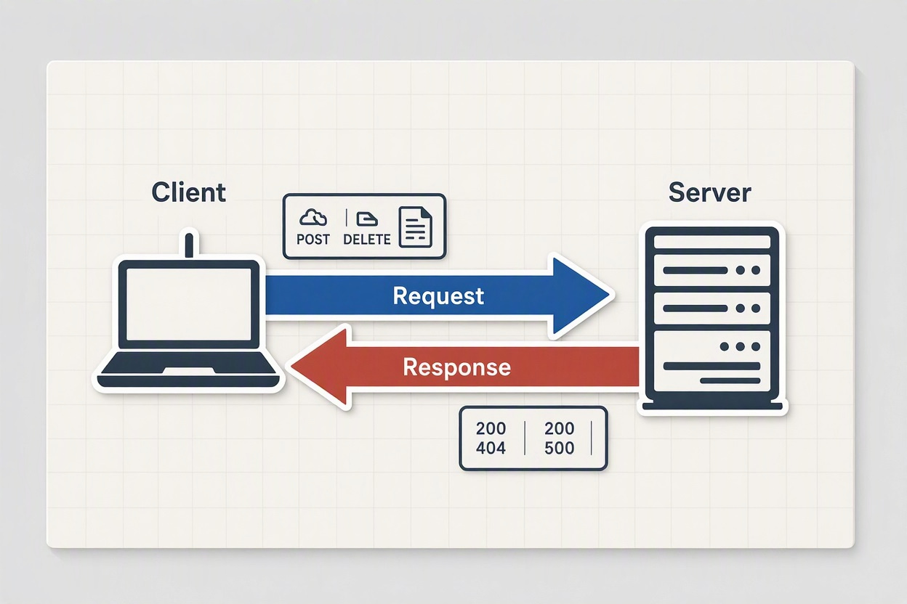

# REST API Fundamentals: Deep Dive with Star Wars & Weather APIs


## 1. What is an API and What Makes it RESTful?

An **API** (Application Programming Interface) is a messenger that allows two software applications to communicate with each other. 

A **REST API** (Representational State Transfer) is an architectural style for designing networked applications. It relies on a stateless, client-server communication protocol—almost always **HTTP**.

### The Core Principles of REST
1. **Statelessness**: Every request from a client to a server must contain all the information necessary to understand and complete the request. The server stores no session context about the client.
2. **Client-Server Architecture**: The client (requestor) and server (provider) are completely decoupled.
3. **Resource-Based URIs**: Data is exposed as **Resources** using unique Uniform Resource Identifiers (URIs).
4. **Standard HTTP Methods**: Operations on resources map directly to HTTP verbs (`GET`, `POST`, `PUT`, `DELETE`).

---

## 2. Anatomy of an HTTP Request & Response

Every REST interaction consists of a **Request** sent by the client and a **Response** returned by the server.



### The Request Structure
* **URI / Endpoint**: The target web address (e.g., `https://swapi.py4e.com/api/people/1/`).
* **HTTP Method**: The action to perform.
  * `GET`: Retrieve data (read-only, safe, idempotent).
  * `POST`: Create a new resource.
  * `PUT` / `PATCH`: Update an existing resource.
  * `DELETE`: Remove a resource.
* **Headers**: Key-value pairs carrying metadata (e.g., `Content-Type: application/json`, `Authorization: Bearer <token>`).
* **Query Parameters**: Key-value pairs in the URL to filter, sort, or paginate results (e.g., `?latitude=52.52&longitude=13.41`).
* **Body (Payload)**: Data sent with `POST` or `PUT` requests (usually JSON).

### The Response Structure
* **Status Code**: Indicates the result of the request.
  * `200 OK`: Request succeeded.
  * `201 Created`: Resource successfully created.
  * `400 Bad Request`: Client error (e.g., malformed syntax).
  * `404 Not Found`: The requested resource does not exist.
  * `500 Internal Server Error`: The server encountered an error.
* **Response Body**: The actual data returned (typically formatted in **JSON**).

---

## 3. Hands-On Exercise 1: The Star Wars API (SWAPI)

Let's explore a read-only, open REST API that requires no authentication keys: **SWAPI** (hosted via Py4e mirror).

### Goal: Fetch details about Luke Skywalker

* **Base URL**: `https://swapi.py4e.com/api/`
* **Endpoint**: `/people/1/`
* **Full Request URI**: `https://swapi.py4e.com/api/people/1/`
* **HTTP Method**: `GET`

### Testing with PowerShell

```powershell
# Send a GET request to SWAPI
$luke = Invoke-RestMethod -Uri "https://swapi.py4e.com/api/people/1/" -Method Get

# Inspect the returned JSON properties
$luke.name
$luke.height
$luke.hair_color
```

### Response JSON Data
```json
{
  "name": "Luke Skywalker",
  "height": "172",
  "mass": "77",
  "hair_color": "blond",
  "skin_color": "fair",
  "eye_color": "blue",
  "birth_year": "19BBY",
  "gender": "male",
  "homeworld": "https://swapi.py4e.com/api/planets/1/",
  "films": [
    "https://swapi.py4e.com/api/films/1/",
    "https://swapi.py4e.com/api/films/2/"
  ]
}
```

> **Zettelkasten Insight (HATEOAS)**: Notice how `homeworld` and `films` return URLs rather than raw IDs? This is a REST concept called **HATEOAS** (Hypermedia As The Engine Of Application State), guiding the client on how to discover related resources!

---

## 4. Hands-On Exercise 2: Open-Meteo Weather API

Now let's use a real-world API that relies heavily on **Query Parameters** to fetch current weather data without needing an API key: **Open-Meteo**.

### Goal: Fetch current weather for Berlin, Germany (Latitude: 52.52, Longitude: 13.41)

* **Base URL**: `https://api.open-meteo.com/v1/`
* **Endpoint**: `/forecast`
* **Query Parameters**:
  * `latitude`: `52.52`
  * `longitude`: `13.41`
  * `current_weather`: `true`

### Testing with PowerShell

```powershell
# Construct URI with Query Parameters
$url = "https://api.open-meteo.com/v1/forecast?latitude=52.52&longitude=13.41&current_weather=true"

# Fetch Weather Data
$weather = Invoke-RestMethod -Uri $url -Method Get

# Access nested JSON properties
Write-Host "Temperature in Berlin:" $weather.current_weather.temperature "°C"
Write-Host "Wind Speed:" $weather.current_weather.windspeed "km/h"
```

### Response JSON Data
```json
{
  "latitude": 52.52,
  "longitude": 13.419998,
  "generationtime_ms": 0.123,
  "utc_offset_seconds": 0,
  "timezone": "GMT",
  "timezone_abbreviation": "GMT",
  "elevation": 38.0,
  "current_weather": {
    "temperature": 14.2,
    "windspeed": 10.5,
    "winddirection": 210,
    "weathercode": 3,
    "is_day": 1,
    "time": "2026-10-16T17:00"
  }
}
```

---

## 5. Summary & Key Zettelkasten Concepts

To connect this note with the rest of your knowledge base:

* **[[HTTP Protocol]]**: REST APIs rely on HTTP methods (`GET`, `POST`, `PUT`, `DELETE`), status codes, and headers.
* **[[JSON Format]]**: JavaScript Object Notation is the primary lightweight data transfer standard used by modern APIs.
* **[[API Authentication]]**: While SWAPI and Open-Meteo are public/free, enterprise REST APIs usually require API Keys, Bearer Tokens, or OAuth2.
* **[[PowerShell API Testing]]**: `Invoke-RestMethod` parses JSON automatically into PowerShell objects; `Invoke-WebRequest` provides raw response data.

---
## Related Notes
* [[Testing Spring Boot Apache Camel REST APIs with PowerShell]]
* [[PowerShell Invoke-RestMethod Cheat Sheet]]