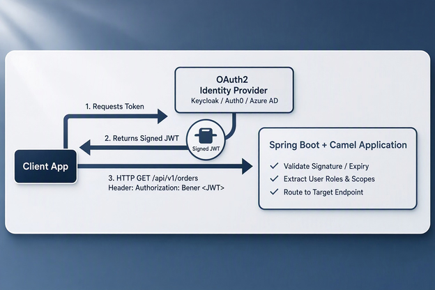

# OAuth2 and JWT Security in Apache Camel with Spring Boot 4.1 & Java 25

## 1. High-Level Concepts: OAuth2 vs. JWT

When securing enterprise integration endpoints, two standards are used together:

* **OAuth2**: An **authorization framework** that defines how a client application gets permission to access protected resources on behalf of a user or system.
* **JWT (JSON Web Token)**: An open standard (`RFC 7519`) defining a compact, self-contained method for securely transmitting information between parties as a JSON object.

### How They Work Together in Camel REST Routes

```
[Client App] ---> 1. Requests Token ---> [OAuth2 Identity Provider (Keycloak / Auth0 / Azure AD)]
[Client App] <--- 2. Returns Signed JWT -- [OAuth2 Identity Provider]
     |
     +-- 3. HTTP GET /api/v1/orders (Header: Authorization: Bearer <JWT>) --> [Spring Boot + Camel Application]
                                                                                |
                                                                                +-- Validate Signature / Expiry
                                                                                +-- Extract User Roles & Scopes
                                                                                +-- Route to Target Endpoint
```


1. **Client** authenticates with an **Identity Provider (IdP)** (e.g., Keycloak, Auth0, Okta).
2. **IdP** issues a cryptographically signed **JWT Access Token**.
3. **Client** calls the Camel REST endpoint, attaching the token in the `Authorization: Bearer <token>` header.
4. **Spring Security & Camel** intercept the request, validate the signature and expiration, and either grant or deny access.

---

## 2. Anatomy of a JSON Web Token (JWT)

A JWT is a string composed of three Base64URL-encoded parts separated by dots (`.`):

$$\text{JWT} = \text{Header} . \text{Payload} . \text{Signature}$$

```
eyJhbGciOiJSUzI1NiIsInR5cCI6IkpXVCJ9.
eyJzdWIiOiIxMjM0NTY3ODkwIiwibmFtZSI6IkFsaWNlIiwicm9sZXMiOlsiUkVBRF9PUkRFUlMiXSwiaWF0IjoxNTE2MjM5MDIyfQ.
SflKxwRJSMeKKF2QT4fwpMeJf36POk6yJV_adQssw5c
```

1. **Header**: Contains algorithm metadata (e.g., `RS256`).
2. **Payload (Claims)**: Holds user context, roles, issue date (`iat`), and expiration date (`exp`).
3. **Signature**: Validates that the sender is who it claims to be and ensures the message wasn't tampered with.

---

## 3. Project Configuration (`pom.xml`)

To secure Camel REST routes using OAuth2/JWT in **Spring Boot 4.1** on **Java 25**, include the Spring Security Resource Server dependencies alongside Camel:

```xml
<?xml version="1.0" encoding="UTF-8"?>
<project xmlns="http://maven.apache.org/POM/4.0.0"
         xmlns:xsi="http://www.w3.org/2001/XMLSchema-instance"
         xsi:schemaLocation="http://maven.apache.org/POM/4.0.0 
                             https://maven.apache.org/xsd/maven-4.0.0.xsd">
    <modelVersion>4.0.0</modelVersion>

    <parent>
        <groupId>org.springframework.boot</groupId>
        <artifactId>spring-boot-starter-parent</artifactId>
        <version>4.1.0</version>
        <relativePath/>
    </parent>

    <groupId>com.example</groupId>
    <artifactId>camel-jwt-security-demo</artifactId>
    <version>1.0.0-SNAPSHOT</version>

    <properties>
        <java.version>25</java.version>
        <camel.version>4.10.0</camel.version>
    </properties>

    <dependencies>
        <!-- Spring Boot Web & Security -->
        <dependency>
            <groupId>org.springframework.boot</groupId>
            <artifactId>spring-boot-starter-web</artifactId>
        </dependency>
        <dependency>
            <groupId>org.springframework.boot</groupId>
            <artifactId>spring-boot-starter-security</artifactId>
        </dependency>

        <!-- Spring OAuth2 Resource Server for JWT Validation -->
        <dependency>
            <groupId>org.springframework.boot</groupId>
            <artifactId>spring-boot-starter-oauth2-resource-server</artifactId>
        </dependency>

        <!-- Apache Camel Starters -->
        <dependency>
            <groupId>org.apache.camel.springboot</groupId>
            <artifactId>camel-spring-boot-starter</artifactId>
            <version>${camel.version}</version>
        </dependency>
        <dependency>
            <groupId>org.apache.camel.springboot</groupId>
            <artifactId>camel-rest-starter</artifactId>
            <version>${camel.version}</version>
        </dependency>
        <dependency>
            <groupId>org.apache.camel.springboot</groupId>
            <artifactId>camel-servlet-starter</artifactId>
            <version>${camel.version}</version>
        </dependency>
        <dependency>
            <groupId>org.apache.camel.springboot</groupId>
            <artifactId>camel-jackson-starter</artifactId>
            <version>${camel.version}</version>
        </dependency>
    </dependencies>

    <build>
        <plugins>
            <plugin>
                <groupId>org.apache.maven.plugins</groupId>
                <artifactId>maven-compiler-plugin</artifactId>
                <configuration>
                    <release>25</release>
                </configuration>
            </plugin>
        </plugins>
    </build>
</project>
```

---

## 4. Application Properties Setup

Configure Spring Security to act as an **OAuth2 Resource Server** by pointing it to your Identity Provider's JSON Web Key Set (JWKS) URL in `application.properties`:

```properties
server.port=8080

# Camel REST Configuration
camel.rest.component=servlet
camel.rest.context-path=/api/v1
camel.rest.binding-mode=json
camel.servlet.mapping.context-path=/api/v1/*

# OAuth2 / JWT Resource Server Configuration
# (Replace URI with your actual Keycloak, Auth0, or Azure AD Issuer URI)
spring.security.oauth2.resourceserver.jwt.issuer-uri=http://localhost:8081/realms/master
spring.security.oauth2.resourceserver.jwt.jwk-set-uri=http://localhost:8081/realms/master/protocol/openid-connect/certs
```

---

## 5. Security Configuration (Spring Security Filter Chain)

Configuring Spring Security ensures all incoming REST calls to `/api/v1/*` undergo JWT authentication before reaching the Camel engine.

```java
package com.example.cameljwt.config;

import org.springframework.context.annotation.Bean;
import org.springframework.context.annotation.Configuration;
import org.springframework.security.config.annotation.web.builders.HttpSecurity;
import org.springframework.security.config.annotation.web.configuration.EnableWebSecurity;
import org.springframework.security.web.SecurityFilterChain;

@Configuration
@EnableWebSecurity
public class SecurityConfig {

    @Bean
    public SecurityFilterChain securityFilterChain(HttpSecurity http) throws Exception {
        http
            .csrf(csrf -> csrf.disable()) // Stateless REST API
            .authorizeHttpRequests(auth -> auth
                .requestMatchers("/api/v1/public/**").permitAll() // Public endpoints
                .requestMatchers("/api/v1/orders/**").hasAuthority("SCOPE_read:orders") // Scope-protected
                .anyRequest().authenticated() // All other endpoints require valid JWT
            )
            .oauth2ResourceServer(oauth2 -> oauth2.jwt(jwt -> {})); // Enable JWT validation

        return http.build();
    }
}
```

---

## 6. Camel REST DSL Route with Java 25 Claims Processing

Now, let's inspect and leverage the authenticated user claims directly inside a Camel Route using Java 25 features.

### Record DTO (`OrderDto.java`)

```java
package com.example.cameljwt.model;

public record OrderDto(
    String orderId,
    String item,
    double price,
    String requestedBy
) {}
```

### Route Class (`SecuredOrderRoute.java`)

```java
package com.example.cameljwt.route;

import com.example.cameljwt.model.OrderDto;
import org.apache.camel.builder.RouteBuilder;
import org.springframework.security.core.Authentication;
import org.springframework.security.oauth2.jwt.Jwt;
import org.springframework.stereotype.Component;

@Component
public class SecuredOrderRoute extends RouteBuilder {

    @Override
    public void configure() throws Exception {

        restConfiguration()
            .component("servlet")
            .bindingMode("json")
            .dataFormatProperty("prettyPrint", "true");

        rest("/orders")
            .description("Secured Order Management API")
            
            // Protected GET endpoint
            .get("/{id}")
                .outType(OrderDto.class)
                .to("direct:fetchSecuredOrder");

        // Route logic accessing Spring Security Context from Exchange
        from("direct:fetchSecuredOrder")
            .routeId("fetchSecuredOrderRoute")
            .log("Processing secure request for Order ID: ${header.id}")
            .process(exchange -> {
                // Access security principal set by Spring Security Resource Server
                Authentication auth = exchange.getIn().getHeader("CamelAuthentication", Authentication.class);
                
                String username = "Anonymous";
                
                // Pattern matching for Security Context
                if (auth != null && auth.getPrincipal() instanceof Jwt jwt) {
                    // Extract claims directly from the validated JWT
                    username = jwt.getClaimAsString("preferred_username");
                    String email = jwt.getClaimAsString("email");
                    
                    exchange.getIn().setHeader("UserEmail", email);
                }

                String orderId = exchange.getIn().getHeader("id", String.class);
                
                // Create response record populated with token context
                OrderDto response = new OrderDto(orderId, "Enterprise License", 299.99, username);
                exchange.getMessage().setBody(response);
            })
            .log("Response created successfully for user: ${header.UserEmail}");
    }
}
```

---

## 7. Testing with PowerShell

To test this endpoint, you need an Access Token from your Identity Provider.

### Step 1: Request an OAuth2 Token (Client Credentials Flow)

```powershell
# Parameters for OAuth2 Token Request
$tokenUrl = "http://localhost:8081/realms/master/protocol/openid-connect/token"
$body = @{
    grant_type    = "client_credentials"
    client_id     = "my-camel-client"
    client_secret = "your-client-secret"
    scope         = "read:orders"
}

# Acquire Token
$tokenResponse = Invoke-RestMethod -Uri $tokenUrl -Method Post -Body $body
$accessToken = $tokenResponse.access_token

Write-Host "Acquired JWT Access Token:" $accessToken
```

### Step 2: Call the Secured Camel REST Endpoint

Pass the acquired token inside the `Authorization` header using the `Bearer` schema:

```powershell
# Request header containing JWT
$headers = @{
    "Authorization" = "Bearer $accessToken"
}

# Call Secured Endpoint
$response = Invoke-RestMethod -Uri "http://localhost:8080/api/v1/orders/ORD-9912" `
    -Method Get `
    -Headers $headers

# Inspect Response
$response
```

**Output**:
```json
{
  "orderId": "ORD-9912",
  "item": "Enterprise License",
  "price": 299.99,
  "requestedBy": "service-account-my-camel-client"
}
```

### Step 3: Test Access Denied (Without Token)

```powershell
# Request without Authorization Header
try {
    Invoke-RestMethod -Uri "http://localhost:8080/api/v1/orders/ORD-9912" -Method Get
} catch {
    Write-Host "HTTP Error Code:" $_.Exception.Response.StatusCode
}
```
**Output**: `HTTP Error Code: Unauthorized (401)`

---

## 8. Summary & Key Zettelkasten Concepts

* **[[OAuth2 Architecture]]**: Client Credentials, Authorization Code, and Resource Server roles.
* **[[JSON Web Tokens]]**: Structure ($\text{Header}.\text{Payload}.\text{Signature}$) and local validation using JWKS certificates.
* **[[Spring Security Resource Server]]**: Validates tokens automatically before passing execution to the Camel Servlet layer.
* **[[Apache Camel Security Context]]**: Reading security principals and JWT claims inside Processors or Expression languages (`${headers}`).

## Related Notes

* [[202610161947 - REST API Fundamentals: Deep Dive with Star Wars & Weather APIs]]
* [[camel_boot_rest_dsl_tutorial.md - Apache Camel REST DSL with Spring Boot 4.1 & Java 25]]
* [[202610161927 - Testing Spring Boot Apache Camel REST APIs with PowerShell]]