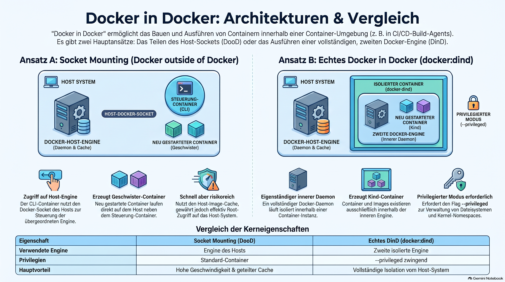

> [!NOTE]
> Diese **Dokumentation** bietet eine praxisnahe Anleitung für die Ausführung von **Docker in Docker** unter Windows 11 mit PowerShell und Docker Desktop. Der Leitfaden erklärt detailliert die beiden Hauptmethoden: das **Socket-Mounting** (Docker outside of Docker), bei dem ein Container die Engine des Hosts steuert, sowie die echte **DinD-Variante** mit einer eigenständigen Instanz innerhalb eines privilegierten Containers. Darüber hinaus werden wichtige Themen wie Netzwerke, **Datenspeicherung** durch Volumes, die Automatisierung mit **Docker Compose** und grundlegende **Sicherheitsaspekte** wie TLS-Verschlüsselung behandelt. Abschließend enthält der Text nützliche Tipps zur **Fehlerbehebung** und zur Übersetzung von Befehlen für die Nutzung auf Windows-Systemen.


# Docker in Docker (DinD) — Absolute Beginner Deep Dive

A step-by-step, hands-on guide to running Docker *inside* Docker, built for **Windows 11 + PowerShell + Docker Desktop (WSL 2 backend)**. You will learn the two main approaches, when to use each, how they differ internally, and how to avoid the common traps.

All commands in this tutorial are **PowerShell** commands. They were tested in PowerShell 7.6 with Docker Desktop (Docker 29.x). If you prefer a WSL/bash terminal, see [section 13](#13-powershell-and-windows-notes) for the differences.

---

## Table of Contents

1. [What Is Docker in Docker?](#1-what-is-docker-in-docker)
2. [Prerequisites and Environment Check](#2-prerequisites-and-environment-check)
3. [Concepts You Need First](#3-concepts-you-need-first)
4. [Approach A: Socket Mounting (Docker outside of Docker)](#4-approach-a-socket-mounting-docker-outside-of-docker)
5. [Approach B: True Docker in Docker (`docker:dind`)](#5-approach-b-true-docker-in-docker-dockerdind)
6. [Separate Client and Engine Containers](#6-separate-client-and-engine-containers)
7. [Building Images from Inside a Container](#7-building-images-from-inside-a-container)
8. [Persisting the Inner Engine's Data](#8-persisting-the-inner-engines-data)
9. [Docker Compose Version](#9-docker-compose-version)
10. [Enabling TLS (Safer DinD)](#10-enabling-tls-safer-dind)
11. [Comparing the Approaches](#11-comparing-the-approaches)
12. [Security Considerations](#12-security-considerations)
13. [PowerShell and Windows Notes](#13-powershell-and-windows-notes)
14. [Troubleshooting](#14-troubleshooting)
15. [Cleanup](#15-cleanup)
16. [Exercises](#16-exercises)
17. [Quick Reference](#17-quick-reference)

---

## 1. What Is Docker in Docker?

Normally you run the Docker CLI on your computer, and it talks to the Docker **engine** (the daemon, `dockerd`), which starts containers.

"Docker in Docker" means using Docker **from inside a container**. Typical reasons:

- A **CI/CD agent** (Jenkins, GitLab Runner, GitHub Actions runner) runs in a container but must build images.
- You want to **test Docker-related tooling** without touching your real engine.
- You want a **disposable, isolated** Docker environment.

There are two fundamentally different ways to do it:

| | Approach A: Socket mounting | Approach B: True DinD |
|---|---|---|
| Also called | DooD (Docker outside of Docker) | DinD |
| Engine used | The **host's** engine | A **second engine** inside a container |
| Needs `--privileged` | No | **Yes** |
| Inner containers are... | **Siblings** (live on the host engine) | **Children** (live in the inner engine) |
| Image cache | Shared with host | Separate |
| Isolation | Weak | Better (but not a security boundary by itself) |

You will try both.

---

## 2. Prerequisites and Environment Check

You need:

- Windows 11
- **Docker Desktop** running (WSL 2 backend)
- **PowerShell** (7.x recommended; start it with `pwsh`, or use Windows Terminal)

### 2.1 Verify

```powershell
docker version
docker run --rm hello-world
```

If both work, you're ready. `docker version` must show both a **Client** and a **Server** section; if Server is missing, Docker Desktop isn't running yet.

### 2.2 Create a working folder

```powershell
New-Item -ItemType Directory -Force -Path $HOME\dind-tutorial | Out-Null
Set-Location $HOME\dind-tutorial
```

### 2.3 PowerShell basics used in this tutorial

| You will see | Meaning |
|---|---|
| `` ` `` (backtick) at the end of a line | Continues the command on the next line (like `\` in bash). It must be the **last character** on the line, with no trailing spaces. |
| `${PWD}` | The current folder, e.g. `D:\Users\you\dind-tutorial`. |
| `'...'` (single quotes) | Literal text. PowerShell will not touch `$`, `"`, or `{{ }}` inside. |
| `"..."` (double quotes) | PowerShell expands `$variables` inside. Beware when the text is meant for a Linux shell. |
| `$LASTEXITCODE` | Exit code of the last native program (`docker`). `0` means success. |

> **Rule of thumb:** when you pass a script to `sh -c` inside a container, wrap it in **single quotes** so PowerShell leaves it alone.

---

## 3. Concepts You Need First

### 3.1 Client and daemon

`docker` (the CLI) is only a **client**. It sends API requests to the **daemon** (`dockerd`). The daemon owns images, containers, networks, and volumes.

### 3.2 How the client finds the daemon

- By default: Docker Desktop's local engine (inside a container, this is the Unix socket `/var/run/docker.sock`).
- Or via the `DOCKER_HOST` environment variable, e.g. `tcp://host:2375`.

This is the key to everything in this tutorial: **Docker in Docker is just choosing which daemon the CLI talks to.**

### 3.3 Image `docker:cli` vs `docker:dind`

| Image | Contains |
|---|---|
| `docker:cli` | Only the Docker client |
| `docker:dind` | The full engine (`dockerd`) plus client; designed to run privileged |

### 3.4 What `--privileged` does

It gives the container nearly all Linux capabilities and access to host devices. The inner engine needs this to create namespaces, cgroups, and mount filesystems.

### 3.5 A helper to wait for the inner engine

A DinD container is "running" a moment before the engine **inside** it is ready. Define this helper once in your PowerShell session; later sections use it:

```powershell
function Wait-DockerEngine {
    param([string]$Container)
    do {
        Start-Sleep -Seconds 1
        docker exec $Container docker info *> $null
    } while ($LASTEXITCODE -ne 0)
}
```

`docker exec <c> docker info` runs `docker info` **inside** the DinD container; it fails until the inner engine answers. `*> $null` hides all output.

> The function disappears when you close PowerShell. Paste it again in a new session.

---

## 4. Approach A: Socket Mounting (Docker outside of Docker)

Idea: give a container the **host's** Docker socket. Its CLI then controls the host engine.

### 4.1 Start a CLI container with the socket

```powershell
docker run -it --rm `
  -v /var/run/docker.sock:/var/run/docker.sock `
  docker:cli sh
```

- `-it` — interactive terminal.
- `-v /var/run/docker.sock:/var/run/docker.sock` — shares the host engine's socket. (Yes, this Linux path is correct on Windows; Docker Desktop provides it.)
- `docker:cli` — small image with just the client.
- `sh` — opens a shell inside.

### 4.2 Use Docker from inside

Inside the container's shell (the prompt changes to something like `/ #`):

```sh
docker ps
```

You see **your own container** listed. That proves you are talking to the host engine.

Start another container:

```sh
docker run -d --name inner-nginx -p 8081:80 nginx
docker ps
```

Open <http://localhost:8081> in your Windows browser — nginx responds. (If it does not, see [troubleshooting](#14-troubleshooting).)

### 4.3 Understand what happened

The new `inner-nginx` container is a **sibling**: it was created by the host engine, next to your CLI container, not inside it.

Leave the shell:

```sh
exit
```

Back in PowerShell:

```powershell
docker ps --filter name=inner-nginx
```

`inner-nginx` is **still running**, because it never lived inside the CLI container. Remove it:

```powershell
docker rm -f inner-nginx
```

### 4.4 Warning

Access to the Docker socket is effectively **root access to the host**. A container with it can start a privileged container that mounts the host filesystem. Only use it with images you trust.

---

## 5. Approach B: True Docker in Docker (`docker:dind`)

Idea: run a **complete second Docker engine** inside a container.

### 5.1 Start the inner engine

Make sure you defined `Wait-DockerEngine` ([section 3.5](#35-a-helper-to-wait-for-the-inner-engine)).

```powershell
docker run -d --name my-dind --privileged `
  -e DOCKER_TLS_CERTDIR= `
  docker:dind

Wait-DockerEngine my-dind
```

- `--privileged` — mandatory.
- `DOCKER_TLS_CERTDIR=` (empty) — disables TLS so the learning setup is simple. See [section 10](#10-enabling-tls-safer-dind) for the secure version.

Check the log:

```powershell
docker logs --tail 5 my-dind
```

You should see a line like `API listen on [::]:2375`.

> **Note:** Recent Docker versions print a `DEPRECATION NOTICE` when a client connects to an unencrypted API on port 2375, and warn that this will become a **hard failure** in future versions. It is fine for this local learning exercise, but real setups should use TLS (see [section 10](#10-enabling-tls-safer-dind)).

### 5.2 Use the inner engine

Open a shell inside the DinD container:

```powershell
docker exec -it my-dind sh
```

Inside:

```sh
docker ps          # empty - this is a brand-new engine
docker images      # empty as well
docker run --rm hello-world
docker images      # hello-world now cached in the INNER engine
exit
```

You can also run single commands from PowerShell without opening a shell:

```powershell
docker exec my-dind docker images
```

Then compare with the host:

```powershell
docker images
```

The inner `hello-world` image is not listed here (unless you pulled it yourself earlier). The inner engine has its **own** images, containers, networks, and volumes.

### 5.3 Prove the isolation

```powershell
docker exec my-dind docker run -d --name hidden alpine sleep 300

"host sees:";  docker ps --filter name=hidden --format '{{.Names}}'
"inner sees:"; docker exec my-dind docker ps --filter name=hidden --format '{{.Names}}'
```

The host prints nothing; the inner engine prints `hidden`.

### 5.4 Cleanup of this step

```powershell
docker rm -f my-dind
```

Removing the DinD container destroys everything inside it (unless you used a volume, see [section 8](#8-persisting-the-inner-engines-data)).

---

## 6. Separate Client and Engine Containers

CI systems usually run the **engine** and the **client** as two containers on a shared network. The client uses `DOCKER_HOST` to reach the engine.

### 6.1 Create the network and engine

```powershell
docker network create dind-net

docker run -d --name dind-engine --network dind-net --privileged `
  -e DOCKER_TLS_CERTDIR= `
  docker:dind

Wait-DockerEngine dind-engine
```

### 6.2 Start the client

```powershell
docker run -it --rm --network dind-net `
  -e DOCKER_HOST=tcp://dind-engine:2375 `
  docker:cli sh
```

### 6.3 Test

In the client shell:

```sh
docker info | grep -i "name:"
docker run --rm alpine echo "Hello from the inner engine"
docker ps -a
exit
```

`DOCKER_HOST` redirects the CLI to the inner engine. (`grep` works here because this is a Linux shell inside the container, not PowerShell.)

You can also run the whole test as one PowerShell command; note the **single quotes** around the script:

```powershell
docker run --rm --network dind-net `
  -e DOCKER_HOST=tcp://dind-engine:2375 `
  docker:cli sh -c 'docker run --rm alpine echo Hello from the inner engine'
```

### 6.4 Publishing ports from inner containers

Ports published by inner containers (`-p 8080:80`) are opened on the **DinD container**, not on your PC. To reach them from Windows, publish the port when creating the DinD container.

Keep `dind-engine` for section 7, and use a separate container for this experiment:

```powershell
docker run -d --name dind-web --privileged -p 8080:8080 `
  -e DOCKER_TLS_CERTDIR= `
  docker:dind

Wait-DockerEngine dind-web
docker exec dind-web docker run -d -p 8080:80 nginx
```

Then open <http://localhost:8080>.

You can also verify without a browser, which helps when `localhost` is blocked (for example by a firewall or VPN):

```powershell
docker port dind-web
docker exec dind-web wget -q -O /dev/null http://localhost:8080
if ($LASTEXITCODE -eq 0) { 'OK - inner nginx answers' }
```

```powershell
docker rm -f dind-web
```

---

## 7. Building Images from Inside a Container

Make sure `dind-engine` from section 6 is still running (or recreate it).

### 7.1 Create a Dockerfile

PowerShell has no `cat <<EOF`. Use a **here-string** instead. The closing `'@` must be at the very start of its line:

```powershell
Set-Location $HOME\dind-tutorial

@'
FROM alpine
RUN echo "built inside DinD" > /msg.txt
CMD ["cat", "/msg.txt"]
'@ | Set-Content -Path Dockerfile -Encoding ascii

Get-Content Dockerfile
```

(`-Encoding ascii` avoids a byte-order mark that some tools dislike.)

### 7.2 Build with the socket approach

```powershell
docker run --rm -it `
  -v /var/run/docker.sock:/var/run/docker.sock `
  -v "${PWD}:/work" -w /work `
  docker:cli sh -c 'docker build -t dind-demo . && docker run --rm dind-demo'
```

Expected output ends with: `built inside DinD`.

`"${PWD}:/work"` turns your Windows folder (even on another drive, such as `D:`) into `/work` inside the container. The curly braces are required so PowerShell doesn't read `$PWD:` as a drive-qualified variable name.

Note that `dind-demo` now exists in your **host** image list:

```powershell
docker images --filter 'reference=dind-demo*'
```

### 7.3 Build with the DinD engine

The build context is sent from the client to the engine automatically over `DOCKER_HOST`:

```powershell
docker run --rm -it --network dind-net `
  -e DOCKER_HOST=tcp://dind-engine:2375 `
  -v "${PWD}:/work" -w /work `
  docker:cli sh -c 'docker build -t dind-demo-inner . && docker run --rm dind-demo-inner'
```

Check where the images ended up:

```powershell
"host:";  docker images --filter 'reference=dind-demo*'
"inner:"; docker exec dind-engine docker images
```

Only `dind-demo` (from 7.2) is listed on the host. `dind-demo-inner` lives inside `dind-engine`.

> **Gotcha:** With socket mounting, `-v` paths in nested `docker run` commands refer to the **host's** filesystem, not the CLI container's. If you mount `/work` into a nested container, the engine looks for that path on the host. Use `docker build` with a context, or mount host paths.

When you are done, remove the engine and network:

```powershell
docker rm -f dind-engine
docker network rm dind-net
```

---

## 8. Persisting the Inner Engine's Data

By default, everything the inner engine downloads is lost when the container is removed. Re-pulling images each time is slow. Use a volume for `/var/lib/docker`:

```powershell
docker volume create dind-data

docker run -d --name dind-persist --privileged `
  -e DOCKER_TLS_CERTDIR= `
  -v dind-data:/var/lib/docker `
  docker:dind

Wait-DockerEngine dind-persist
```

Pull something inside and destroy the engine:

```powershell
docker exec dind-persist docker pull alpine
docker rm -f dind-persist
```

Start it again with the same volume:

```powershell
docker run -d --name dind-persist --privileged `
  -e DOCKER_TLS_CERTDIR= `
  -v dind-data:/var/lib/docker `
  docker:dind

Wait-DockerEngine dind-persist
docker exec dind-persist docker images
```

`alpine` is still there.

```powershell
docker rm -f dind-persist
```

> **Rule:** Never share one `/var/lib/docker` volume between **two running** DinD engines — it corrupts the data.

---

## 9. Docker Compose Version

Create `compose.yaml` in `$HOME\dind-tutorial` (again with a here-string):

```powershell
Set-Location $HOME\dind-tutorial

@'
services:
  dind:
    image: docker:dind
    privileged: true
    environment:
      DOCKER_TLS_CERTDIR: ""
    volumes:
      - dind-data-compose:/var/lib/docker

  client:
    image: docker:cli
    depends_on:
      - dind
    environment:
      DOCKER_HOST: tcp://dind:2375
    command: sh -c "until docker info >/dev/null 2>&1; do sleep 1; done; docker run --rm hello-world"

volumes:
  dind-data-compose:
'@ | Set-Content -Path compose.yaml -Encoding ascii
```

Run:

```powershell
docker compose up --abort-on-container-exit --exit-code-from client
```

You should see the hello-world message from the client. Then remove everything including the volume:

```powershell
docker compose down -v
```

> **Why the `until` loop?** `depends_on` only waits for the container to *start*, not for the engine inside to be *ready*. The loop keeps retrying `docker info` until the inner engine answers.

> **Why `--abort-on-container-exit`?** The `dind` service never ends by itself. This flag stops the whole project as soon as the client finishes.

---

## 10. Enabling TLS (Safer DinD)

The `docker:dind` image enables TLS by default (port **2376**) when `DOCKER_TLS_CERTDIR` is `/certs`. Certificates are generated into a shared volume.

```powershell
docker network create dind-tls-net
docker volume create dind-certs-ca
docker volume create dind-certs-client

docker run -d --name dind-tls --privileged `
  --network dind-tls-net --network-alias docker `
  -e DOCKER_TLS_CERTDIR=/certs `
  -v dind-certs-ca:/certs/ca `
  -v dind-certs-client:/certs/client `
  docker:dind

docker run -it --rm --network dind-tls-net `
  -e DOCKER_HOST=tcp://docker:2376 `
  -e DOCKER_TLS_VERIFY=1 `
  -e DOCKER_CERT_PATH=/certs/client `
  -v dind-certs-client:/certs/client:ro `
  docker:cli sh
```

Inside (if you get `Cannot connect`, wait a few seconds for the engine and certificates, then retry):

```sh
docker version
docker run --rm hello-world
exit
```

Cleanup:

```powershell
docker rm -f dind-tls
docker network rm dind-tls-net
docker volume rm dind-certs-ca dind-certs-client
```

TLS matters whenever the engine's port is reachable by anything other than a single trusted client.

---

## 11. Comparing the Approaches

| Question | Socket mounting (A) | True DinD (B) |
|---|---|---|
| Speed / overhead | Fast, no second engine | Slower start, extra memory |
| Layer cache | Shared with host (fast rebuilds) | Cold each time unless persisted |
| Cleanup | Containers leak onto the host | Delete the DinD container, all gone |
| Isolation | Almost none | Separate engine, but privileged |
| Port publishing | Directly on host | Via the DinD container |
| Volume mounts in nested runs | Host paths (confusing) | Paths inside the DinD container |
| Typical use | Local dev tools, simple CI | Isolated CI jobs, testing Docker tooling |

**Rule of thumb:** use A for convenience on trusted workloads; use B when you need a clean, disposable engine.

Alternatives worth knowing if you only need to **build images**: Docker Buildx with a remote builder, BuildKit rootless, Kaniko, Buildah, or Podman. For safer nested containers: Sysbox runtime.

---

## 12. Security Considerations

- **Socket mounting** = root on the host. Treat it as such.
- **`--privileged`** disables most container isolation. A compromised DinD container can affect the host kernel-level resources.
- **Unencrypted TCP 2375** lets anyone who reaches it control the engine. Use it only on private networks for learning, or enable TLS.
- Never expose port 2375 to your LAN or the internet (`-p 2375:2375`).
- Pin image tags (e.g. `docker:27-dind`) in real projects instead of floating tags.
- Use a throwaway environment for untrusted code.

---

## 13. PowerShell and Windows Notes

### 13.1 Bash to PowerShell cheat sheet

Most tutorials online are written for bash. Translate like this:

| bash | PowerShell |
|---|---|
| `\` line continuation | `` ` `` (backtick) |
| `$PWD` | `${PWD}` (use braces before a `:`) |
| `cmd 2>/dev/null` | `cmd 2>$null` |
| `cmd > /dev/null 2>&1` | `cmd *> $null` |
| `cmd \| grep text` | `cmd \| Select-String text` |
| `cmd \| tail -5` | `cmd \| Select-Object -Last 5` |
| `cmd \| head -2` | `cmd \| Select-Object -First 2` |
| `cat > file <<'EOF' ... EOF` | `@' ... '@ \| Set-Content file` |
| `until cmd; do sleep 1; done` | `do { Start-Sleep 1; cmd } while ($LASTEXITCODE -ne 0)` |
| `echo $?` | `$LASTEXITCODE` |
| `mkdir -p dir` | `New-Item -ItemType Directory -Force dir` |
| `rm -rf dir` | `Remove-Item -Recurse -Force dir` |
| `export VAR=value` | `$env:VAR = 'value'` |

### 13.2 Quoting: the number one source of errors

PowerShell reads your command **before** Docker does.

```powershell
# WRONG: PowerShell expands $HOME before Docker ever sees it
docker run --rm docker:cli sh -c "echo $HOME"        # prints a mangled Windows path, e.g. D:UsersBKUyou

# RIGHT: single quotes, the script reaches the container unchanged
docker run --rm docker:cli sh -c 'echo $HOME'        # prints /root
```

Inside a single-quoted string, write a literal single quote by doubling it: `'it''s'`.

### 13.3 Sections of the Docker command that run in a Linux shell

When you are inside a container (`sh`), you are in **Linux**, not PowerShell. There, bash-style syntax (`grep`, `\`, `$VAR`) is correct. The prompt tells you where you are: `PS D:\...>` is PowerShell, `/ #` is the container.

### 13.4 Paths and drives

- Your `$HOME` may not be on `C:` (for example `D:\Users\you`). Bind mounts such as `-v "${PWD}:/work"` were tested from a `D:` drive and work. If a mount ever comes up empty, check the file-sharing settings of Docker Desktop (Settings, Resources).
- Folders with spaces need the quotes: `-v "${PWD}:/work"`.
- `/var/run/docker.sock` is the same string in PowerShell. Do not try to use `\\.\pipe\docker_engine` for this tutorial.

### 13.5 Using WSL (bash) instead

Docker Desktop's WSL integration lets you run the same Docker commands from an Ubuntu terminal (Settings, Resources, WSL Integration). All concepts are identical; only the shell syntax changes, as in the table above. Keep projects inside the WSL filesystem (`~/...`) for speed. In Git Bash, prefix commands with `MSYS_NO_PATHCONV=1` so paths like `/var/run/docker.sock` aren't rewritten.

### 13.6 Memory

Docker Desktop runs the engine in a lightweight VM/WSL distro. With **true DinD**, you run an engine inside an engine inside that VM — fine, but it uses more RAM. Limit it in `%UserProfile%\.wslconfig` if needed:

```ini
[wsl2]
memory=8GB
processors=4
```

Apply with `wsl --shutdown` in PowerShell, then restart Docker Desktop.

### 13.7 Enhanced Container Isolation

Docker Desktop offers **Enhanced Container Isolation** (in supported plans), which can block the socket mount or privileged containers. If DinD fails with permission errors, check that setting.

---

## 14. Troubleshooting

| Symptom | Likely cause | Fix |
|---|---|---|
| `docker : The term 'docker' is not recognized` | Docker Desktop not installed, or terminal opened before install | Start Docker Desktop and open a **new** PowerShell window |
| `Cannot connect to the Docker daemon` / `error during connect` | Docker Desktop not running, or DinD engine still starting | Start Docker Desktop; use `Wait-DockerEngine` |
| `The term 'grep' is not recognized` | You used a Linux command in PowerShell | Use `Select-String`, or run it inside the container shell |
| `the input device is not a TTY` | `-it` used from a non-interactive host (script, CI, some editors) | Remove `-it`, or run from a real terminal |
| `docker: invalid reference format` followed by `The term 'docker:cli' is not recognized` | A bash `\` was used for line continuation instead of a backtick (or there is a space after the backtick) | Use `` ` `` as the very last character of the line |
| `Variable reference is not valid. ':' was not followed by a valid variable name character` | `$PWD:/work` typed without braces | Use `"${PWD}:/work"` |
| Variable inside the container is wrong | Double quotes let PowerShell expand `$VAR` first | Use single quotes around `sh -c` scripts |
| DinD container exits immediately | Missing `--privileged` | Add `--privileged`; check `docker logs <name>` |
| `failed to start daemon` / storage driver errors | Sharing `/var/lib/docker`, or unsupported filesystem | Use a named volume, one engine per volume |
| Nested `-v` mount is empty | Socket mode uses host paths | Use host paths or build contexts |
| Port not reachable from Windows | Port opened on the DinD container | Publish the port on the DinD container too |
| Port mapping exists but `localhost` still times out | Firewall/VPN/proxy or Docker Desktop port forwarding issue (also affects plain `docker run -p`) | Test with `docker exec <c> wget ...`; restart Docker Desktop; check firewall/VPN |
| `DEPRECATION NOTICE ... without encryption` | Unencrypted API on port 2375 | Fine for learning; use TLS (section 10) for anything real |
| TLS errors | Missing certs or wrong port | Use 2376 with certs; 2375 only with TLS disabled |
| Pulls are slow every run | Fresh inner engine each time | Persist `/var/lib/docker` or use a registry mirror |

Useful diagnostics:

```powershell
docker logs <dind-container>
docker exec <dind-container> docker info
docker exec <dind-container> docker ps -a
docker ps -a --filter name=dind
```

---

## 15. Cleanup

This removes only the objects created by this tutorial. Errors for objects that don't exist are hidden by `2>$null`.

```powershell
docker rm -f my-dind dind-engine dind-web dind-persist dind-tls inner-nginx 2>$null
docker network rm dind-net dind-tls-net 2>$null
docker volume rm dind-data dind-certs-ca dind-certs-client 2>$null
docker rmi dind-demo dind-demo-inner 2>$null

Set-Location ~
Remove-Item -Recurse -Force $HOME\dind-tutorial
```

> Avoid `docker system prune -a` unless you really want to delete **all** unused images on your machine.

---

## 16. Exercises

1. **Sibling proof:** Using socket mounting, start a container from inside the CLI container and show with `docker ps` in PowerShell that it runs next to, not inside, the CLI container.
2. **Isolation proof:** With true DinD, create three containers inside the engine. Confirm none appears on the host. Remove the DinD container and confirm they are gone.
3. **Persistence:** Pull `nginx` inside a DinD engine with a volume, destroy and recreate the engine, and verify the image is still cached.
4. **Port exposure:** Run a web server inside DinD and make it reachable from your Windows browser.
5. **Compose pipeline:** Extend the Compose file so the client builds an image from a Dockerfile and runs it (hint: mount `${PWD}` into the client with `volumes:`).
6. **TLS:** Repeat exercise 2 using the TLS setup from section 10.
7. **PowerShell script:** Write a `dind-demo.ps1` that starts a DinD engine, waits for it, runs `hello-world` inside, and always removes the engine (hint: `try { ... } finally { docker rm -f ... }`).

---

## 17. Quick Reference

```powershell
# Helper: wait until the inner engine is ready
function Wait-DockerEngine {
    param([string]$Container)
    do { Start-Sleep -Seconds 1; docker exec $Container docker info *> $null } while ($LASTEXITCODE -ne 0)
}

# A) Socket mounting - control the HOST engine from a container
docker run -it --rm -v /var/run/docker.sock:/var/run/docker.sock docker:cli sh

# B) True DinD - engine inside a container
docker run -d --name my-dind --privileged -e DOCKER_TLS_CERTDIR= docker:dind
Wait-DockerEngine my-dind
docker exec -it my-dind sh

# Separate client talking to the DinD engine
docker network create dind-net
docker run -d --name dind-engine --network dind-net --privileged -e DOCKER_TLS_CERTDIR= docker:dind
Wait-DockerEngine dind-engine
docker run -it --rm --network dind-net -e DOCKER_HOST=tcp://dind-engine:2375 docker:cli sh

# Persist inner engine data
docker run -d --name dind-persist --privileged -e DOCKER_TLS_CERTDIR= -v dind-data:/var/lib/docker docker:dind

# Mount the current folder (works across drives)
docker run --rm -v "${PWD}:/work" -w /work docker:cli sh -c 'ls -la'
```

| Concept | Remember |
|---|---|
| `DOCKER_HOST` | Chooses which engine the CLI talks to |
| Socket mount | Siblings on the host engine; root-equivalent access |
| `docker:dind` | Needs `--privileged`; own images/containers/networks |
| Port 2375 / 2376 | Plain / TLS |
| `/var/lib/docker` | Inner engine data; persist with a volume, one engine per volume |
| PowerShell line break | Backtick as last character |
| `sh -c` scripts | Always in **single quotes** |
| `${PWD}` | Braces needed before `:` |
