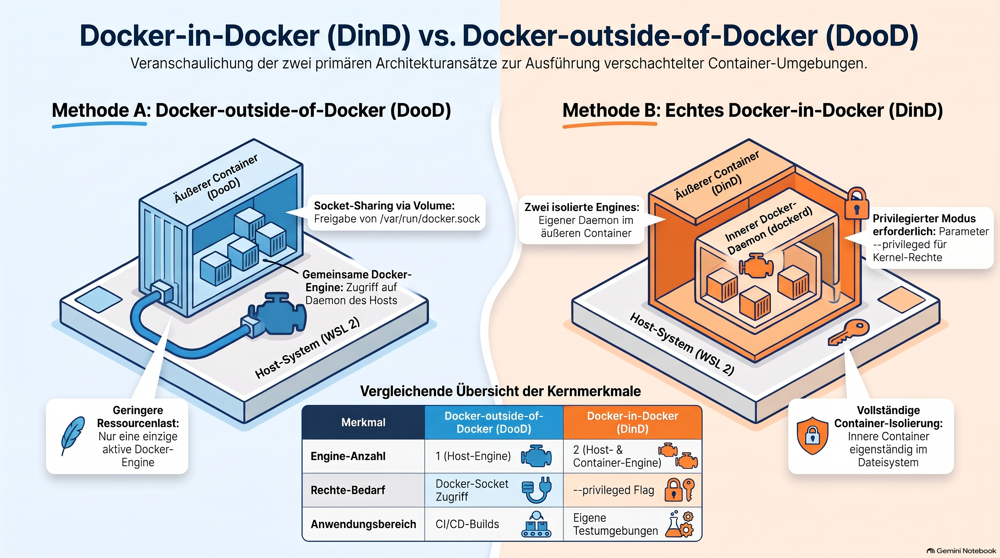
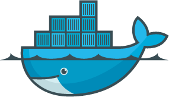
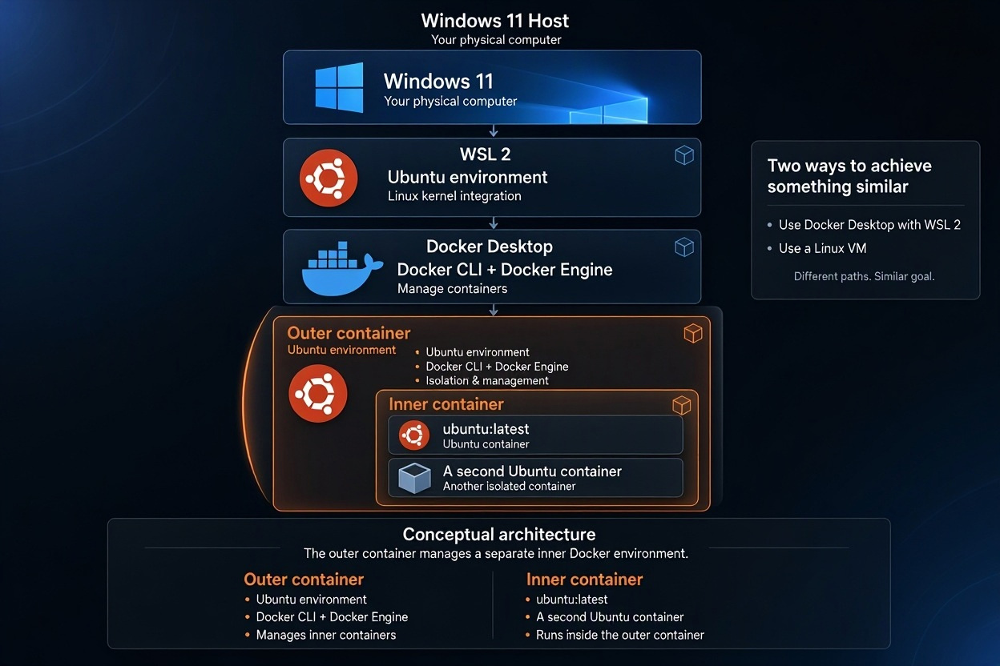
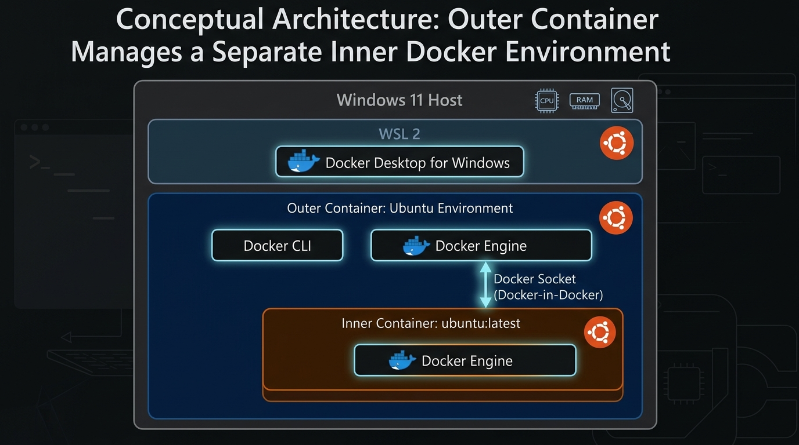

> [!NOTE]
> Der bereitgestellte Text erklärt ausführlich die Funktionsweise und Anwendung von **Docker-in-Docker** auf einem Windows-11-System mit WSL 2 und Docker Desktop. Dabei wird zwischen der einfacheren **Docker-outside-of-Docker-Methode**, bei welcher ein äußerer Container lediglich den Docker-Socket des Host-Systems nutzt, und dem echten **Docker-in-Docker-Verfahren** unterschieden. Bei letzterem betreibt der äußere Container über ein privilegiertes Image einen eigenständigen **Docker-Daemon**, der wiederum innere Container verwaltet. Solche verschachtelten Umgebungen eignen sich hervorragend für **CI/CD-Pipelines** sowie zu Lernzwecken, erfordern jedoch aufgrund erweiterter Systemrechte einen sorgsamen Umgang mit der **Sicherheit**.


Don't worry: **Docker-in-Docker (DinD) is a very useful technique**, 
especially when learning containerization, 
building CI/CD pipelines, 
testing Docker images, 
or running development environments.



Your setup is perfectly suitable for learning 👩‍🎓:

* Host operating system: Windows 11 🪟

* Linux environment: WSL 2 🐧

* Container 📦 engine: Docker Desktop 🐳

* Outer container: Ubuntu or another Linux distribution

* Inner container: `ubuntu:latest`

Let's build this step by step 🚶‍♀️‍➡️.


# **Docker-in-Docker (DinD) — Absolute Beginner Tutorial**

## **1. First, understand what we want to build**

Imagine the following architecture:



**Windows 11 Host**

Your physical computer

**WSL 2**

**Docker Desktop**

**Outer container**

Ubuntu environment

Docker CLI + Docker Engine

**Inner container**

ubuntu:latest

A second Ubuntu container

Conceptual architecture: the outer container manages a separate inner Docker environment.



There are actually two ways to achieve something similar:

| Approach                 | Description                                        |
| ------------------------ | -------------------------------------------------- |
| Docker-outside-of-Docker | The outer container uses the host's Docker Engine. |
| Docker-in-Docker         | The outer container runs its own Docker Engine.    |

**We will learn both**, starting with the simpler approach.

## **2. Check your Docker installation**

Open **PowerShell** on Windows 11.

Execute:

```
docker version
```

You should see two sections:

* Client: Docker CLI

* Server: Docker Engine

Now run:

```
docker run hello-world
```

If this works, Docker Desktop is ready.

You can also check your WSL installation:

```
wsl --list --verbose
```

Your Linux distribution should use WSL version 2.

Docker Desktop's WSL 2 integration is documented here: [Docker Desktop with WSL 2](https://docs.docker.com/desktop/features/wsl/?utm_source=chatgpt.com).

Docker Docs+1

## **3. Method A — Docker-outside-of-Docker**

Let's start with the easiest solution.

Here, we create an Ubuntu container and give it access to the Docker CLI on the host through the Docker socket.

The important distinction:

**The Docker Engine still runs on your host.** The Ubuntu container merely sends commands to it.

### **Step 1: Download Ubuntu**

```
docker pull ubuntu:latest
```

### **Step 2: Start an Ubuntu container**

```
docker run -it --name docker-client ubuntu:latest bash
```

You should now see something like:

```
root@xxxxxxxxxxxx:/#
```

Congratulations! You are inside Ubuntu.

### **Step 3: Install basic tools**

Inside the Ubuntu container:

```
apt-get update
apt-get install -y curl ca-certificates
```

However, this Ubuntu container does not automatically contain a Docker CLI.

We need to provide one.

### **Step 4: Exit Ubuntu**

```
exit
```

### **Step 5: Create a Docker client container**

For a more convenient demonstration, use the official Docker CLI image:

```
docker run -it --rm `
  -v /var/run/docker.sock:/var/run/docker.sock `
  docker:cli sh
```

Inside this container, execute:

```
docker version
```

If the socket is accessible, you should see the Docker client and server versions.

Now try:

```
docker run -it --rm ubuntu:latest bash
```

And there you have it!

You have started an Ubuntu container from inside another container.

**Important:** This is Docker-outside-of-Docker, not a separate Docker Engine. The inner command creates another container managed by Docker Desktop.

Also, mounting the Docker socket gives the outer container powerful control over your host's Docker environment. Only do this with trusted containers.

## **4. Method B — Real Docker-in-Docker**

Now comes the interesting part!

This time, the outer container runs its **own Docker daemon (**`dockerd`**)**.

We will use the official `docker:dind` image.

True Docker-in-Docker

### **Step 1: Download the Docker-in-Docker image**

Back in Windows PowerShell:

```
docker pull docker:dind
```

### **Step 2: Start the outer Docker container**

```
docker run -d `
  --privileged `
  --name my-dind `
  docker:dind
```

Let's understand the command:

| Parameter        | Meaning                           |
| ---------------- | --------------------------------- |
| `docker run`     | Create and start a container      |
| `-d`             | Run in background                 |
| `--privileged`   | Grant additional Linux privileges |
| `--name my-dind` | Name the outer container          |
| `docker:dind`    | Docker image with Docker Engine   |

**Why do we need&#x20;**`--privileged`**?**

Normally, a Docker container has restricted access to Linux kernel features. Running another Docker daemon requires additional privileges, including capabilities for managing mounts and devices.

Docker Docs+1

### **Step 3: Check whether the outer container is running**

```
docker ps
```

You should see:

```
CONTAINER ID   IMAGE         STATUS
xxxxxxxx       docker:dind   Up ...
```

### **Step 4: Enter the outer container**

```
docker exec -it my-dind sh
```

You are now inside the Docker-in-Docker environment.

Try:

```
docker version
```

And:

```
docker info
```

You should see information about the inner Docker Engine.

### **Step 5: Start your inner Ubuntu container**

This is the command you originally wanted:

```
docker run -it ubuntu:latest bash
```

Congratulations! You now have a genuine Docker-in-Docker environment.

Your terminal should look something like this:

```
/ # docker run -it ubuntu:latest bash

root@xxxxxxxxxxxx:/#
```

You are now inside the **inner Ubuntu container**.

### **Step 6: Experiment inside Ubuntu**

Execute:

```
cat /etc/os-release
```

Check the hostname:

```
hostname
```

Check the Linux kernel:

```
uname -a
```

Install some utilities:

```
apt-get update
apt-get install -y curl nano iputils-ping
```

Exit the inner Ubuntu container:

```
exit
```

You should return to:

```
/ #
```

You are back inside the outer Docker-in-Docker container!

### **Step 7: Inspect your inner containers**

From the outer container:

```
docker ps -a
```

You should see your Ubuntu container.

This is the really interesting part: the outer Docker Engine knows about the inner Ubuntu container, while Docker Desktop manages the outer `my-dind` container.

## **5. Understand the architecture**

Here is the difference between the two approaches:

**Method A: Docker-outside-of-Docker**

**Docker Desktop Engine**

**Outer container**

Docker CLI

**Inner container**

Ubuntu

One Docker Engine manages both containers.

**Method B: True Docker-in-Docker**

**Docker Desktop Engine**

**Outer container: docker:dind**

Own Docker daemon

**Inner container: ubuntu:latest**

Managed by the inner Docker daemon

Two Docker Engines: the host engine and the inner engine.

## **6. Useful Docker commands**

You can execute these commands from Windows PowerShell while the outer container is running.

| Command                      | Purpose                       |
| ---------------------------- | ----------------------------- |
| `docker ps`                  | List running outer containers |
| `docker ps -a`               | List all outer containers     |
| `docker logs my-dind`        | View outer container logs     |
| `docker exec -it my-dind sh` | Enter outer container         |
| `docker stop my-dind`        | Stop outer container          |
| `docker start my-dind`       | Start outer container again   |
| `docker rm my-dind`          | Remove outer container        |

Inside the outer container:

| Command                      | Purpose                              |
| ---------------------------- | ------------------------------------ |
| `docker version`             | Show inner Docker version            |
| `docker info`                | Show inner Docker Engine information |
| `docker images`              | List inner images                    |
| `docker ps -a`               | List inner containers                |
| `docker pull ubuntu`         | Download Ubuntu image                |
| `docker run -it ubuntu bash` | Start inner Ubuntu                   |

## **7. Troubleshooting**

**Problem 1: Docker daemon is not ready**

If you enter the outer container too quickly, the inner daemon might not have finished starting.

Check the logs from PowerShell:

```
docker logs my-dind
```

Look for a message indicating that the Docker daemon has finished initialization.

**Problem 2: Cannot connect to the Docker daemon**

Inside the outer container:

```
docker info
```

If this fails, check:

```
ps aux
```

Look for the `dockerd` process.

**Problem 3: Operation not permitted**

Check whether you started the outer container with:

```
--privileged
```

Also check whether Docker Desktop's Enhanced Container Isolation is enabled. Its security restrictions can affect privileged DinD workloads.

## **8. Clean up**

When you have finished experimenting, return to Windows PowerShell:

```
docker stop my-dind
```

Remove the outer container:

```
docker rm my-dind
```

Your inner containers and images are stored inside the outer container's writable filesystem and disappear when you remove it.

For persistent inner Docker data, you can later experiment with Docker volumes.

## **9. Your practical exercises**

Here are some exercises to reinforce what you have learned.

**Docker-in-Docker exercises**

0/8 completed

**1**__.&#x20;__**Start the Docker-in-Docker container**

docker run -d --privileged --name my-dind docker:dind

**2**__.&#x20;__**Enter the outer container**

docker exec -it my-dind sh

**3**__.&#x20;__**Check the inner Docker Engine**

docker info

**4**__.&#x20;__**Download an Ubuntu image inside DinD**

docker pull ubuntu:latest

**5**__.&#x20;__**Start an inner Ubuntu container**

docker run -it ubuntu:latest bash

**6**__.&#x20;__**Inspect the inner operating system**

cat /etc/os-release

**7**__.&#x20;__**Return to the outer container and list containers**

exit (then: docker ps -a)

**8**__.&#x20;__**Clean up**

docker stop my-dind; docker rm my-dind

Reset exercises

## **10. Official documentation**

These are excellent resources for your Zettelkasten:

1. [Docker — Continuous Integration and Docker-in-Docker](https://docs.docker.com/build/ci/?utm_source=chatgpt.com)

2. [Docker — Container Run Reference](https://docs.docker.com/reference/cli/docker/container/run/?utm_source=chatgpt.com)

3. [Docker Desktop — Windows Security](https://docs.docker.com/desktop/setup/install/windows-permission-requirements/?utm_source=chatgpt.com)

4. [Docker Desktop — WSL 2 Integration](https://docs.docker.com/desktop/features/wsl/?utm_source=chatgpt.com)

5. [Docker — Rootless Docker-in-Docker](https://docs.docker.com/engine/security/rootless/tips/?utm_source=chatgpt.com)

## **My recommendation**

I would actually make **true Docker-in-Docker (Method B)** your main learning project.

It teaches you several important concepts:

* Docker Engine versus Docker CLI

* Docker daemon (`dockerd`)

* Privileged containers

* Nested container environments

* Container isolation

* Docker networking

* Docker volumes

* Image management

One important security warning: `--privileged` gives the outer container extensive access to the Docker Desktop Linux environment. Do not use this setup with untrusted images or workloads.

Docker Docs+2

**A possible next step:** We could build a complete Docker-in-Docker bootcamp with a custom Ubuntu-based outer container, a Docker Engine inside it, and multiple nested Ubuntu containers, using Dockerfiles and Docker Compose. That would make an excellent practical Zettelkasten project! 😊
