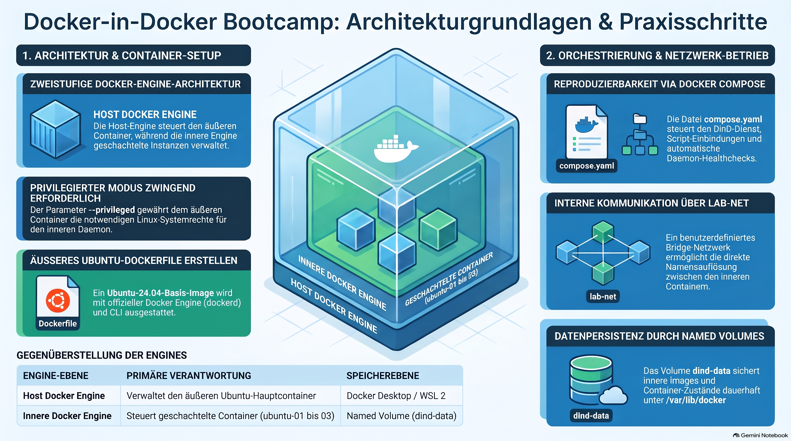
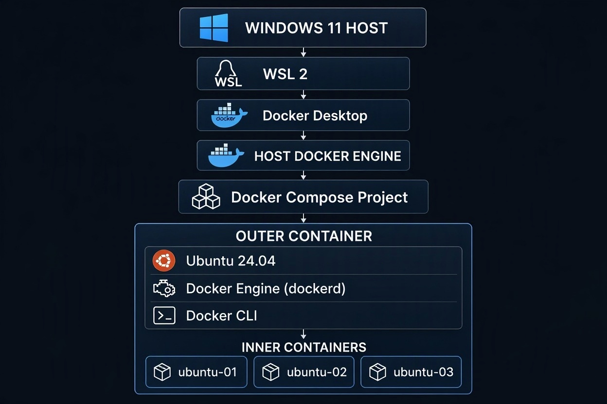
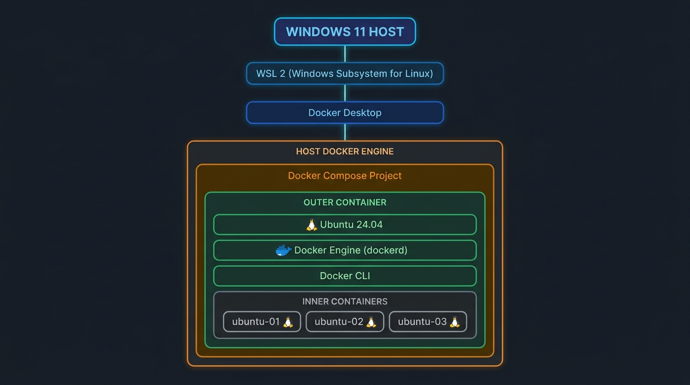

> [!NOTE]
> Diese **Dokumentation** beschreibt ein praktisches **Bootcamp** zum Erstellen einer **Docker-in-Docker-Umgebung** unter **Windows 11** mit **WSL 2** und **Docker Desktop**. Die Anleitung führt durch zehn praktische Lektionen, um einen eigenen **Ubuntu-basierten Außencontainer** mit einer funktionsfähigen **Docker-Engine** zu errichten. Mithilfe von **Docker Compose** und **Shell-Skripten** lernen Anwender, mehrere unabhängige **Innencontainer** zu starten, Netzwerke für die **Container-Kommunikation** einzurichten und **Daten** dauerhaft über Volumes zu speichern. Schließlich vermittelt das Projekt wertvolle Einblicke in **verschachtelte Image-Builds**, **Fehlerbehebung** und bewährte **Sicherheitsaspekte** für isolierte Testlabore.


# **Docker-in-Docker Bootcamp — Build Your Own Nested Docker Environment**


Absolute Beginner 👩‍🎓

Hands-on Project 🙌

Windows 11 + WSL 2


This is going to be a great practical project for your Zettelkasten! 😊

We are going to build a complete Docker-in-Docker laboratory from scratch. Instead of simply downloading the official `docker:dind` image, we will create our own Ubuntu-based outer container, install Docker Engine inside it, and use that engine to manage multiple Ubuntu containers.

The tutorial is designed around your development environment:

* Windows 11 host 🪟

* WSL 2 🐧

* Docker Desktop 🐳

* Visual Studio Code 🖊️

* PowerShell 🐚

* Ubuntu Linux containers 📦

* Dockerfiles 📁

* Docker Compose 🗃️

**Our final objective:** Start one Docker Compose project from Windows PowerShell, enter our custom Ubuntu container, and launch multiple independent Ubuntu containers from inside it.

## **1. What are we going to build?**

[Guide: Docker Inside Docker Containers (DIND) | by Prashanth M | Medium](https://images.openai.com/static-rsc-4/DyYHRdHIJneBVznkKGhUETJdODANc4SipEIblWD04LfrmPmMA_BgZ1memt6XHZ2iL61_bUvKecrYEEZIh9dEYqhrWxFe4c5wyGzkpgYjCrAw9DiUUAUhBRz72uVGP4htrPHYPyWk0xDx3WppWageeLZClooet33r-hvfy07vv_M?purpose=inline)

[medium.com](https://medium.com/%40prashanth31.2000/guide-docker-inside-docker-containers-dind-5fd999a1fabc?utm_source=chatgpt.com)

Our architecture will look like this:



```
WINDOWS 11 HOST
|
+-- WSL 2
    |
    +-- Docker Desktop
        |
        +-- HOST DOCKER ENGINE
            |
            +-- Docker Compose Project
                |
                +-- OUTER CONTAINER
                    |
                    +-- Ubuntu 24.04
                    |
                    +-- Docker Engine (dockerd)
                    |
                    +-- Docker CLI
                    |
                    +-- INNER CONTAINERS
                        |
                        +-- ubuntu-01
                        |
                        +-- ubuntu-02
                        |
                        +-- ubuntu-03
```



There are two independent Docker Engines:

| Docker Engine       | Responsibility                       |
| ------------------- | ------------------------------------ |
| Host Docker Engine  | Manages the outer container          |
| Inner Docker Engine | Manages the nested Ubuntu containers |

This is genuine Docker-in-Docker.

## **2. Bootcamp roadmap**

We will divide the project into 10 practical lessons.

| Day | Topic                           | Result                               |
| --- | ------------------------------- | ------------------------------------ |
| 1   | Docker environment verification | Working Docker Desktop               |
| 2   | Project structure               | Organized project directory          |
| 3   | Custom Ubuntu Dockerfile        | Ubuntu-based outer image             |
| 4   | Install Docker Engine           | Working inner daemon                 |
| 5   | Start the outer container       | Running nested Docker                |
| 6   | Docker Compose                  | Reproducible environment             |
| 7   | Multiple Ubuntu containers      | Three nested containers              |
| 8   | Networking                      | Communication between containers     |
| 9   | Volumes and persistence         | Persistent inner Docker data         |
| 10  | Final challenge                 | Complete Docker-in-Docker laboratory |

We will use a deliberately simple architecture first. Later, we can improve it with non-root users, health checks, networking, and security hardening.

## **3. Create the project directory**

Open Windows PowerShell.


I suggest using a dedicated project directory:

```powershell
mkdir D:\CodingDojo\DockerLabs
cd D:\CodingDojo\DockerLabs

mkdir docker-in-docker-bootcamp
cd docker-in-docker-bootcamp
```

Open the directory in Visual Studio Code:


⚠️ Notice the dot!

```powershell
code .
```

Our project structure will eventually look like this:

```
docker-in-docker-bootcamp/
|
+-- Dockerfile
|
+-- compose.yaml
|
+-- docker/
|   |
|   +-- daemon.json
|
+-- scripts/
    |
    +-- start-lab.sh
    |
    +-- create-containers.sh
```

We will create each file step by step.

## **4. Day 1 — Verify Docker Desktop**

Before building anything, let's check your environment.

Run these commands in PowerShell:

```
docker version
docker compose version
docker info
wsl --list --verbose
```

Expected results:

* Docker Client is available.

* Docker Server is available.

* Docker Compose v2 is available.

* Your WSL distribution uses version 2.

Check that Docker Desktop is using Linux containers. Our project requires a Linux Docker Engine.

Test Ubuntu:

```
docker run --rm -it ubuntu:24.04 bash
```

Inside Ubuntu:

```
cat /etc/os-release
exit
```

If everything works, continue.

## **5. Day 2 — Create our custom Ubuntu Dockerfile**

Now we create the most important part of the project.

Our outer container will use Ubuntu 24.04 as its base image.

Inside Ubuntu, we install:

1. Docker Engine (`dockerd`)

2. Docker CLI (`docker`)

3. containerd

4. Docker Buildx

5. Docker Compose plugin

6. curl and basic Linux utilities

We will install Docker using its official Ubuntu APT repository rather than an unofficial installation script.

Docker Docs+1

### **Step 1: Create Dockerfile**

In VS Code, create a file named:

`Dockerfile`

Put the following content into it:

```

# Custom Ubuntu-based Docker-in-Docker image

FROM ubuntu:24.04

# Avoid interactive package installation
ENV DEBIAN_FRONTEND=noninteractive

# Install basic dependencies
RUN apt-get update && apt-get install -y \
    ca-certificates \
    curl \
    gnupg \
    iproute2 \
    iptables \
    iputils-ping \
    procps \
    nano \
    && rm -rf /var/lib/apt/lists/*

# Create directory for Docker's signing key
RUN install -m 0755 -d /etc/apt/keyrings

# Add Docker's official GPG key
RUN curl -fsSL https://download.docker.com/linux/ubuntu/gpg \
    -o /etc/apt/keyrings/docker.asc \
    && chmod a+r /etc/apt/keyrings/docker.asc

# Add Docker's official Ubuntu repository
RUN echo "deb [arch=$(dpkg --print-architecture) signed-by=/etc/apt/keyrings/docker.asc] https://download.docker.com/linux/ubuntu \
    $(. /etc/os-release && echo "${UBUNTU_CODENAME:-$VERSION_CODENAME}") stable" \
    > /etc/apt/sources.list.d/docker.list

# Install Docker Engine, CLI and plugins
RUN apt-get update && apt-get install -y \
    docker-ce \
    docker-ce-cli \
    containerd.io \
    docker-buildx-plugin \
    docker-compose-plugin \
    && rm -rf /var/lib/apt/lists/*

# Docker daemon data directory
RUN mkdir -p /var/lib/docker

# Start Docker daemon when the container starts
ENTRYPOINT ["dockerd", "--host=unix:///var/run/docker.sock", "--data-root=/var/lib/docker"]
```

### **Step 2: Understand the Dockerfile**

Let's understand what we have just created.

| Instruction         | Explanation                             |
| ------------------- | --------------------------------------- |
| `FROM ubuntu:24.04` | Base image                              |
| `ENV`               | Defines an environment variable         |
| `RUN`               | Executes commands during image building |
| `apt-get install`   | Installs Linux packages                 |
| `ENTRYPOINT`        | Defines the main container process      |
| `dockerd`           | Starts the Docker daemon                |

One particularly important distinction:

```
docker
```

is the Docker command-line client.

```
dockerd
```

is the Docker daemon.

The client sends instructions to the daemon. The daemon creates and manages containers.

Our custom image contains both.

### **Step 3: Build our custom image**

In PowerShell, make sure you are in:

```
C:\DockerLabs\docker-in-docker-bootcamp
```

Execute:

```
docker build -t custom-ubuntu-dind:24.04 .
```

This may take a few minutes because Docker needs to download Ubuntu and install the Docker packages.

Check your image:

```
docker images
```

Expected result:

```
REPOSITORY          TAG       IMAGE ID
custom-ubuntu-dind  24.04     xxxxxxxxx
ubuntu              24.04     xxxxxxxxx
```

Milestone 1

You have built your own Ubuntu-based Docker-in-Docker image!

## **6. Day 3 — Configure the inner Docker daemon**

We will now create a configuration file for the Docker Engine running inside our outer container.

Create a directory:

```
mkdir docker
```

Inside this directory, create:

`docker/daemon.json`

Content:

```

{
  "log-driver": "local"
}
```

This configuration tells Docker to use the local logging driver, which provides log rotation and helps prevent container logs from growing indefinitely.

We are deliberately not exposing the Docker API over TCP. The inner Docker CLI will communicate with the daemon through its Unix socket:

```
/var/run/docker.sock
```

For now, the daemon will use the default storage driver selected by Docker Engine.

## **7. Day 4 — Start our first outer container**

Let's test the custom image before introducing Docker Compose.

Execute this command in PowerShell:

```
docker run -d --privileged --name ubuntu-dind -v dind-data:/var/lib/docker custom-ubuntu-dind:24.04
```

Let's break it down:

| Parameter                      | Explanation                     |
| ------------------------------ | ------------------------------- |
| `-d`                           | Run in background               |
| `--privileged`                 | Grant elevated Linux privileges |
| `--name ubuntu-dind`           | Name our outer container        |
| `-v dind-data:/var/lib/docker` | Persistent Docker data          |
| `custom-ubuntu-dind:24.04`     | Our custom image                |

The `--privileged` option is necessary for this conventional nested Docker Engine setup. It grants extensive additional permissions, so this is a disposable learning environment, not a production security boundary.

Docker Docs+1

### **Step 1: Check the container**

```
docker ps
```

You should see:

```
CONTAINER ID   IMAGE                    STATUS
xxxxxxxx       custom-ubuntu-dind:24.04 Up ...
```

### **Step 2: Check the logs**

```
docker logs ubuntu-dind
```

Look for a message indicating that the Docker daemon is ready.

### **Step 3: Enter the outer container**

```
docker exec -it ubuntu-dind bash
```

You are now inside your custom Ubuntu environment!

Check the operating system:

```
cat /etc/os-release
```

Check Docker:

```
docker version
```

Check the daemon:

```
ps aux | grep dockerd
```

Finally:

```
docker info
```

You should see information about your inner Docker Engine.

Milestone 2

Your custom Ubuntu container is now running its own Docker Engine!

## **8. Day 5 — Launch your first nested Ubuntu container**

Now we finally reach your original objective.

You are inside the outer Ubuntu container.

Execute:

```
docker pull ubuntu:24.04
```

Then:

```
docker run -it --name ubuntu-01 ubuntu:24.04 bash
```

You should see:

```
root@xxxxxxxxxxxx:/#
```

You are now inside the inner Ubuntu container!

Check:

```
cat /etc/os-release
```

Install a few utilities:

```
apt-get update
apt-get install -y curl nano iputils-ping
```

Check the hostname:

```
hostname
```

Exit:

```
exit
```

You should return to your outer Ubuntu environment.

Check the nested container:

```
docker ps -a
```

Expected result:

```
CONTAINER ID   IMAGE          NAMES
xxxxxxxx       ubuntu:24.04   ubuntu-01
```

Congratulations!

You have successfully created a nested Ubuntu container using your own Docker Engine.

## **9. Day 6 — Introduce Docker Compose**

So far, we have started the outer container manually.

But imagine having to remember all the parameters every time:

```
docker run -d --privileged ...
```

This is exactly where Docker Compose helps.

Docker Compose lets us define our container environment in a YAML file.

### **Step 1: Update our Dockerfile**

We created `docker/daemon.json` earlier. We now need to copy it into the image.

In your Dockerfile, replace:

```
RUN mkdir -p /var/lib/docker
```

with:

```
RUN mkdir -p /etc/docker /var/lib/docker

COPY docker/daemon.json /etc/docker/daemon.json
```

Keep the `ENTRYPOINT` instruction at the end.

### **Step 2: Create compose.yaml**

Create a file in the project root:

`compose.yaml`

```

name: docker-in-docker-lab

services:

  dind:

    build:
      context: .
      dockerfile: Dockerfile

    image: custom-ubuntu-dind:24.04

    container_name: ubuntu-dind

    # Required for our conventional nested Docker Engine
    privileged: true

    # Persistent inner Docker data
    volumes:
      - dind-data:/var/lib/docker

      # Make our scripts available inside the outer container
      - ./scripts:/scripts:ro

    # Check whether the inner Docker daemon is ready
    healthcheck:
      test: ["CMD", "docker", "info"]
      interval: 5s
      timeout: 3s
      retries: 20
      start_period: 20s

    stop_grace_period: 30s

volumes:

  dind-data:
```

Let's understand the important elements:

| Compose property | Explanation                                          |
| ---------------- | ---------------------------------------------------- |
| `services`       | Defines the containers                               |
| `build`          | Builds our custom image                              |
| `image`          | Names the resulting image                            |
| `container_name` | Sets the outer container name                        |
| `privileged`     | Grants the necessary additional permissions          |
| `volumes`        | Provides persistent storage and script access        |
| `healthcheck`    | Checks whether the inner Docker daemon is responding |

The named volume is particularly important. It keeps the inner Docker Engine's data outside the outer container's writable layer.

Docker Docs+1

### **Step 3: Create the scripts directory**

In PowerShell:

```
mkdir scripts
```

We will populate it in the next lesson.

### **Step 4: Validate the Compose file**

```
docker compose config
```

This checks whether Docker Compose can parse your configuration.

### **Step 5: Build and start the environment**

```
docker compose up -d --build
```

Check:

```
docker compose ps
```

Wait until the health status reports `healthy`.

You can inspect the logs:

```
docker compose logs -f dind
```

Press `Ctrl+C` to stop following the logs. This does not stop the container.

### **Step 6: Enter the environment**

```
docker compose exec dind bash
```

Test:

```
docker version
docker info
```

Milestone 3

You now have a reproducible Docker-in-Docker environment managed by Docker Compose!

## **10. Day 7 — Create multiple nested Ubuntu containers**

This is where our laboratory becomes interesting.

We want three independent Ubuntu containers:

```
Docker Desktop
    |
    +-- ubuntu-dind (outer)
          |
          +-- ubuntu-01
          |
          +-- ubuntu-02
          |
          +-- ubuntu-03
```

We will create a shell script to automate the process.

### **Step 1: Create create-containers.sh**

Open:

`scripts/create-containers.sh`

Insert:

```

#!/usr/bin/env bash

set -eu

echo "=================================="
echo " Docker-in-Docker Container Lab"
echo "=================================="

echo ""
echo "Creating Docker network..."

docker network inspect lab-net >/dev/null 2>&1 \
    || docker network create lab-net

echo ""
echo "Removing previous lab containers..."

for name in ubuntu-01 ubuntu-02 ubuntu-03
do
    docker rm -f "$name" >/dev/null 2>&1 || true
done

echo ""
echo "Starting nested Ubuntu containers..."

docker run -d \
    --name ubuntu-01 \
    --network lab-net \
    ubuntu:24.04 sleep infinity

docker run -d \
    --name ubuntu-02 \
    --network lab-net \
    ubuntu:24.04 sleep infinity

docker run -d \
    --name ubuntu-03 \
    --network lab-net \
    ubuntu:24.04 sleep infinity

echo ""
echo "All containers have been started!"

docker ps

echo ""
echo "Docker-in-Docker lab is ready!"
```

**What does&#x20;**`sleep infinity`**&#x20;do?**

Normally, a Docker container stops when its main process exits.

Our Ubuntu image does not automatically start a permanent service.

Therefore:

```
sleep infinity
```

keeps the container running until we stop it.

### **Step 2: Important Windows editor setting**

When editing shell scripts on Windows, use Unix line endings.

In VS Code:

1. Open `create-containers.sh`.

2. Look at the bottom-right corner.

3. Click the line-ending indicator.

4. Select `LF`, not `CRLF`.

5. Save the file.

This avoids common Linux shell errors caused by Windows line endings.

### **Step 3: Start the nested containers**

From Windows PowerShell:

```
docker compose exec dind bash /scripts/create-containers.sh
```

Expected output:

```
==================================
 Docker-in-Docker Container Lab
==================================

Creating Docker network...

Starting nested Ubuntu containers...

All containers have been started!

CONTAINER ID   IMAGE          NAMES
xxxxxxxx       ubuntu:24.04   ubuntu-01
xxxxxxxx       ubuntu:24.04   ubuntu-02
xxxxxxxx       ubuntu:24.04   ubuntu-03

Docker-in-Docker lab is ready!
```

### **Step 4: Inspect the nested containers**

Run:

```
docker compose exec dind docker ps
```

You should see all three Ubuntu containers.

Notice something important:

```
docker ps
```

shows the outer containers managed by Docker Desktop.

Whereas:

```
docker compose exec dind docker ps
```

shows the inner containers managed by the Docker Engine inside Ubuntu.

These are two different Docker environments!

### **Step 5: Enter each Ubuntu container**

Enter the first container:

```
docker compose exec dind docker exec -it ubuntu-01 bash
```

Check:

```
hostname
cat /etc/os-release
```

Exit:

```
exit
```

Try the second container:

```
docker compose exec dind docker exec -it ubuntu-02 bash
```

And finally:

```
docker compose exec dind docker exec -it ubuntu-03 bash
```

You now have three independently running Ubuntu containers.

## **11. Day 8 — Docker networking inside Docker-in-Docker**

Now we want our nested containers to communicate.

Remember that our shell script created a network:

```
docker network create lab-net
```

All three containers joined that network:

```
lab-net
  |
  +-- ubuntu-01
  |
  +-- ubuntu-02
  |
  +-- ubuntu-03
```

A user-defined Docker bridge network provides automatic DNS resolution between containers by their names.

### **Exercise 1: Inspect the network**

From PowerShell:

```
docker compose exec dind docker network inspect lab-net
```

Look for the container entries.

### **Exercise 2: Resolve another container**

Execute:

```
docker compose exec dind docker exec ubuntu-01 getent hosts ubuntu-02
```

You should see an IP address associated with `ubuntu-02`.

Try:

```
docker compose exec dind docker exec ubuntu-01 getent hosts ubuntu-03
```

And:

```
docker compose exec dind docker exec ubuntu-02 getent hosts ubuntu-01
```

This demonstrates container-to-container DNS resolution.

### **Exercise 3: Test network connectivity with ping**

First install ping in `ubuntu-01`:

```
docker compose exec dind docker exec ubuntu-01 bash -c "apt-get update && apt-get install -y iputils-ping"
```

Now:

```
docker compose exec dind docker exec ubuntu-01 ping -c 3 ubuntu-02
```

If everything works, you should see successful responses.

Milestone 4

Your nested Ubuntu containers can now discover and communicate with one another.

## **12. Day 9 — Docker volumes and persistence**

This is an important lesson.

What happens if we stop and restart our outer container?

Will our nested Docker images still exist?

Remember this section of `compose.yaml`:

```
volumes:
  - dind-data:/var/lib/docker
```

The named volume stores the inner Docker Engine's data.

This includes:

* Downloaded images

* Container writable layers

* Docker metadata

* Networks and other Docker-managed state

### **Exercise 1: Download another image**

```
docker compose exec dind docker pull alpine:latest
```

Check the inner images:

```
docker compose exec dind docker images
```

### **Exercise 2: Stop the outer container**

```
docker compose stop
```

### **Exercise 3: Start it again**

```
docker compose start
```

Wait for the health check.

Then:

```
docker compose exec dind docker images
```

You should still see Alpine and Ubuntu.

Check your nested containers:

```
docker compose exec dind docker ps -a
```

They should also still exist.

**Why?**

Because we persisted `/var/lib/docker` in a Docker named volume.

This is an important Docker concept: container lifecycle and data lifecycle are not necessarily the same thing.

## **13. Day 10 — Final Docker-in-Docker challenge**

Let's bring everything together.

Your challenge is to build a small nested container laboratory with three Ubuntu containers.

## **Final practical challenge**

Complete the following tasks independently before looking at the solution commands.

**Your progress**

0 / 12

Build the custom Ubuntu Docker image.

Start the outer container using Docker Compose.

Verify that dockerd is running inside Ubuntu.

Download ubuntu:24.04 using the inner Docker Engine.

Create the lab-net Docker network.

Start three nested Ubuntu containers.

Verify that all three containers are running.

Resolve ubuntu-02 from ubuntu-01.

Ping ubuntu-02 from ubuntu-01.

Download alpine:latest into the inner Docker Engine.

Restart the outer container.

Verify that the nested images and containers persist.

Reset challenge

### **Bonus challenge: Create your own nested Docker image**

Once everything works, try building another image inside the inner Docker Engine.

For example, create a Dockerfile inside `ubuntu-01`:

```
FROM ubuntu:24.04

RUN apt-get update && \
    apt-get install -y curl nano

CMD ["bash"]
```

Build it using the inner Docker Engine.

You will need to make a directory inside `ubuntu-01` and install the Docker CLI there, or build from the outer container using a directory accessible to it.

This is a particularly useful exercise because it introduces nested image builds.

### **Bonus solution: Build an image using the inner Docker Engine**

Create this additional project directory:

```
mkdir scripts\nested-image
```

Create:

`scripts/nested-image/Dockerfile`

```
FROM ubuntu:24.04

RUN apt-get update && \
    apt-get install -y curl nano iputils-ping && \
    rm -rf /var/lib/apt/lists/*

CMD ["bash"]
```

Now build it using the inner Docker Engine:

```
docker compose exec dind docker build -t nested-ubuntu:1.0 /scripts/nested-image
```

Check:

```
docker compose exec dind docker images
```

Run your own image:

```
docker compose exec dind docker run -it --rm nested-ubuntu:1.0
```

You have now built and executed your own Docker image inside a Docker-in-Docker environment!

## **14. Complete project structure**

Your finished Zettelkasten project should look like this:

```
docker-in-docker-bootcamp/
|
+-- Dockerfile
|
+-- compose.yaml
|
+-- docker/
|   |
|   +-- daemon.json
|
+-- scripts/
|   |
|   +-- create-containers.sh
|   |
|   +-- nested-image/
|       |
|       +-- Dockerfile
```

## **15. Important Docker commands cheat sheet**

Keep this table in your Zettelkasten.

**Windows PowerShell — Host Docker Engine**

| Command                         | Purpose                   |
| ------------------------------- | ------------------------- |
| `docker ps`                     | List outer containers     |
| `docker images`                 | List host images          |
| `docker compose up -d --build`  | Build and start lab       |
| `docker compose stop`           | Stop lab                  |
| `docker compose start`          | Restart lab               |
| `docker compose logs -f dind`   | View outer logs           |
| `docker compose exec dind bash` | Enter outer container     |
| `docker compose down`           | Remove Compose containers |

**Inside the outer container — Inner Docker Engine**

| Command                      | Purpose                 |
| ---------------------------- | ----------------------- |
| `docker version`             | Check inner Docker      |
| `docker info`                | Inspect inner Engine    |
| `docker ps -a`               | List nested containers  |
| `docker images`              | List nested images      |
| `docker network ls`          | List nested networks    |
| `docker volume ls`           | List nested volumes     |
| `docker run -it ubuntu bash` | Start nested Ubuntu     |
| `docker rm -f ubuntu-01`     | Remove nested container |

## **16. Troubleshooting**

Here are the problems you are most likely to encounter.

| Problem                             | Possible solution                  |
| ----------------------------------- | ---------------------------------- |
| `Cannot connect to Docker daemon`   | Check whether `dockerd` is running |
| `Operation not permitted`           | Verify `privileged: true`          |
| Docker daemon fails to start        | Inspect `docker compose logs dind` |
| Inner containers cannot communicate | Check `lab-net`                    |
| Shell script has strange errors     | Change line endings to LF          |
| Nested images disappear             | Verify `dind-data` volume          |
| Compose reports invalid YAML        | Run `docker compose config`        |

One particularly useful diagnostic command:

```
docker compose exec dind docker info
```

If this works, your inner Docker Engine is responding.

## **17. Clean up your laboratory**

When you finish experimenting, stop the project:

```
docker compose down
```

This removes the outer container and its Compose network, but keeps the named volume.

If you want to delete the entire laboratory, including the inner Docker data:

```
docker compose down -v
```

Attention

The second command deletes the named `dind-data` volume, including all nested images, containers and other persisted Docker data.

## **18. Learning resources**

These official resources are worth adding to your Zettelkasten:

**Docker Engine installation on Ubuntu**

[Official installation documentation](https://docs.docker.com/engine/install/ubuntu/?utm_source=chatgpt.com)

**Docker Compose specification**

[Compose file reference](https://docs.docker.com/reference/compose-file/?utm_source=chatgpt.com)

**Docker volumes**

[Volume documentation](https://docs.docker.com/reference/compose-file/volumes?utm_source=chatgpt.com)

**Docker security**

[Security documentation](https://docs.docker.com/engine/security/?utm_source=chatgpt.com)

## **19. Suggested Zettelkasten organization**

I suggest giving this project its own folder:

```
C:\DockerLabs\docker-in-docker-bootcamp
```

And using these Zettelkasten note titles:

| Note | Suggested headline                           |
| ---- | -------------------------------------------- |
| 01   | Docker-in-Docker — Architecture and Concepts |
| 02   | Building a Custom Ubuntu Docker Image        |
| 03   | Docker Engine — Installing dockerd           |
| 04   | Docker Daemon — Configuration                |
| 05   | Docker Compose — Managing DinD               |
| 06   | Nested Containers — Ubuntu                   |
| 07   | Docker Networking — Nested Environments      |
| 08   | Docker Volumes — Persistence                 |
| 09   | Docker Image Building — Nested Builds        |
| 10   | Docker-in-Docker — Troubleshooting           |

**One final security consideration:** This bootcamp intentionally uses a privileged outer container. That is appropriate for a disposable learning laboratory, but privileged DinD should not be treated as secure isolation for untrusted workloads. Keep the Docker API socket private, avoid publishing TCP port 2375, and never mount the host Docker socket into this project.

## **20. Where to go next?**

After completing this bootcamp, I would recommend a second practical project:

Next advanced project

# **Docker-in-Docker CI/CD Laboratory**

[Securing Docker CI/CD Pipelines with Jenkins and Docker Scout (DevSecOps Guide) | Medium](https://images.openai.com/static-rsc-4/91LD651u1zNepfTB0iRh1qgwoDHzgx_OF0JHQmTuigBt-MHPHB6dXm3dRwJJm16O4yUz7f0Fjz2lEaGJdK_bWrb9Lds95HvfDnkeXz76UhZN-J0caksfkuMdLgUmN-EIRAhFjFNyVqdASBDrBRqVr9wQZl-1HJd9y2RGOh9bTiE?purpose=inline)

[medium.com](https://medium.com/%40nightcode_x/from-insecure-docker-pipelines-to-devsecops-securing-ci-cd-with-jenkins-docker-scout-c179e8e754bf?utm_source=chatgpt.com)

Build a miniature CI/CD environment:

* Ubuntu-based Docker-in-Docker environment

* Jenkins running in a container

* Jenkins pipeline building Docker images

* Automated tests inside nested Ubuntu containers

* Image tagging and container deployment

* Git integration

This would introduce you to the relationship between Docker, CI/CD, automated testing and software deployment.

Have fun with your Docker laboratory! And remember: you don't have to understand everything immediately. Work through one milestone at a time. 😊

