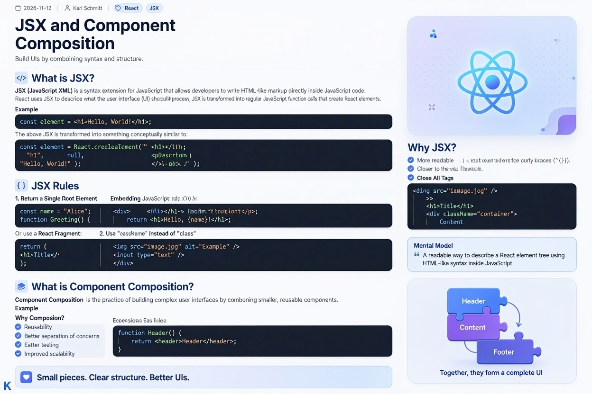

> [!NOTE]
Die bereitgestellten Quellen erklären grundlegende Konzepte der **React-Entwicklung** und beleuchten deren Funktionsweise. **JSX** fungiert dabei als JavaScript-Erweiterung, welche das Schreiben von HTML-ähnlichen Strukturen direkt im Code ermöglicht und für eine bessere Lesbarkeit sorgt. Bei der Erstellung von Benutzeroberflächen müssen bestimmte **Syntaxregeln** beachtet werden, wie etwa die Rückgabe eines einzelnen Wurzelelements sowie die korrekte Schließung aller Tags. Ergänzend dazu beschreibt die **Komponentenkomposition** einen architektonischen Ansatz, bei dem komplexe Oberflächen aus kleineren, wiederverwendbaren Bausteinen zusammengesetzt werden. Durch diese modulare Vorgehensweise wird die **Wartbarkeit** sowie die Skalierbarkeit von Anwendungen entscheidend verbessert.


# JSX and Component Composition



## What is JSX?

**JSX (JavaScript XML)** is a syntax extension for JavaScript that allows developers to write HTML-like markup directly inside JavaScript code.

React uses JSX to describe what the user interface (UI) should look like. During the build process, JSX is transformed into regular JavaScript function calls that create React elements.

### Example

```jsx
const element = <h1>Hello, World!</h1>;
```

The above JSX is transformed into something conceptually similar to:

```javascript
const element = React.createElement(
  "h1",
  null,
  "Hello, World!"
);
```

### Why JSX?

JSX makes UI code:

- More readable
- Easier to write and maintain
- More declarative
- Closer to the visual structure of the UI

### Embedding JavaScript in JSX

JavaScript expressions can be inserted inside curly braces (`{}`).

```jsx
const name = "Alice";

function Greeting() {
  return <h1>Hello, {name}!</h1>;
}
```

### JSX Rules

#### 1. Return a Single Root Element

```jsx
return (
  <div>
    <h1>Title</h1>
    <p>Description</p>
  </div>
);
```

Or use a React Fragment:

```jsx
return (
  <>
    <h1>Title</h1>
    <p>Description</p>
  </>
);
```

#### 2. Close All Tags

```jsx

<input type="text" />
```

#### 3. Use `className` Instead of `class`

```jsx
<div className="container">
  Content
</div>
```

### Mental Model

> A readable way to describe a React element tree using HTML-like syntax inside JavaScript.

---

## What is Component Composition?

**Component Composition** is the practice of building complex user interfaces by combining smaller, reusable components.

### Example

```jsx
function Header() {
  return <header>Header</header>;
}
```

### Why Composition?

- Reusability
- Better separation of concerns
- Easier maintenance
- Better testing
- Improved scalability

## Key Takeaways

### JSX

- JSX is a syntax extension for JavaScript.
- It allows writing HTML-like markup inside JavaScript.

### Component Composition

- Component composition means building larger UIs from smaller components.
- React favors composition over inheritance.

## Summary

> JSX is a declarative syntax for describing a user interface in React, while Component Composition is the architectural approach of assembling complex interfaces from small, reusable components.
