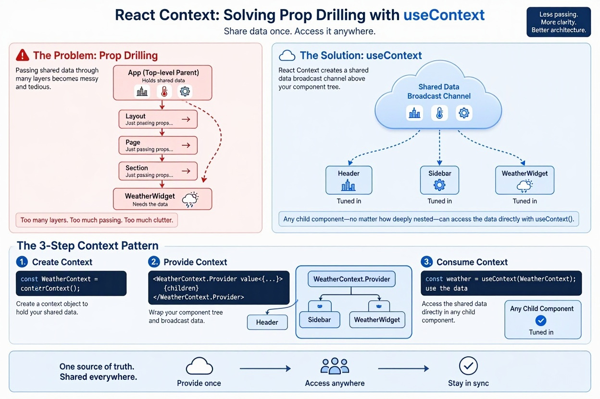

# Prop Dilling



_**Prop drilling in React is the process of passing data (props) from a parent component down through multiple layers of intermediate components just to reach a deeply nested child component that actually needs it**_**.**

Those middle components do not use the data themselves—they simply act as pass-through conduits. 

🚧 Quick Example:

Imagine a component tree where `App` holds user data, and only `ProfileBadge` needs it.

```javascript
function App() {
  const user = { name: "Alex" };
  return <Dashboard user={user} />;
}

// Dashboard doesn't use 'user', it just forwards it
function Dashboard({ user }) {
  return <Header user={user} />;
}

// Header doesn't use 'user' either
function Header({ user }) {
  return <ProfileBadge user={user} />;
}

// ProfileBadge finally uses 'user'
function ProfileBadge({ user }) {
  return <span>Welcome, {user.name}</span>;
}
```

⚠️ Use code with caution!

Why It Matters

* **When it's fine.** Passing props down 1 or 2 levels is normal React behavior and keeps data flow explicit and easy to trace. On [Reddit](https://www.reddit.com/r/reactjs/comments/182uz8g/when_is_prop_drilling_ok/), opinions are mixed on exact limits, though developers generally note that passing props within a single page is standard until it spans too many unrelated layers.
* * **When it becomes a problem.** Passing props through 3+ layers creates unnecessary boilerplate, tightly couples unrelated components, and makes refactoring tedious if you ever rename or change the data shape. (Note: It is a code maintainability issue, not a rendering performance issue.)

How to Avoid It:

When prop drilling gets messy, developers typically reach for one of these patterns, as outlined in the [React documentation](https://react.dev/learn/passing-data-deeply-with-context) and guides on [freeCodeCamp](https://www.freecodecamp.org/news/prop-drilling-in-react-explained-with-examples/) and [GeeksforGeeks](https://www.geeksforgeeks.org/reactjs/what-is-prop-drilling-and-how-to-avoid-it/):

* **Component Composition.** Pass the child component directly via the `children` prop so intermediate layout wrappers don't need to know about the data.
* **React Context API.** "Teleport" data directly from a top-level provider to any nested consumer without passing it through middle layers.
* **State Management Libraries.** Use tools like Zustand or Redux for complex, app-wide state. 

