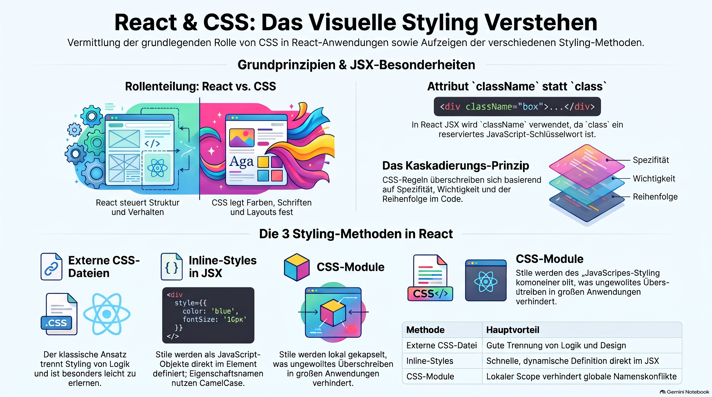
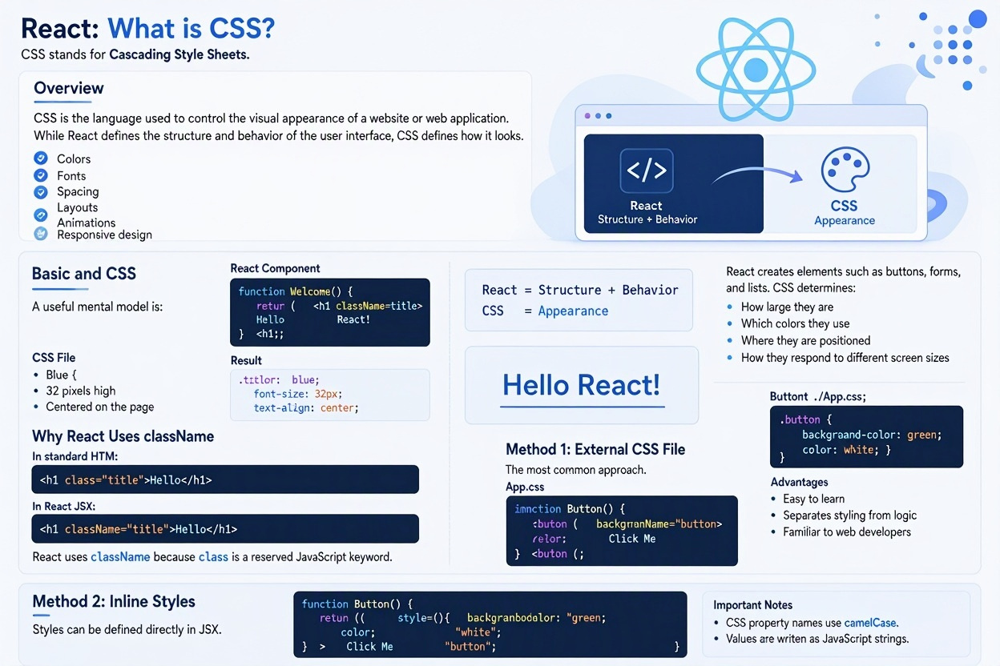

> [!NOTE]
> Diese Notizen erklären, wie **Cascading Style Sheets** das Aussehen und Design von **React-Anwendungen** steuern, während React selbst für die Struktur und das Verhalten zuständig ist. Es werden verschiedene Methoden zur Gestaltung vorgestellt, darunter **externe CSS-Dateien**, **Inline-Styles** mit camelCase-Schreibweise und **CSS-Modules** zur Vermeidung von Namenskonflikten. Zudem wird erläutert, warum React den Begriff **className** anstelle des üblichen HTML-Attributs verwendet, da es sich hierbei um ein reserviertes JavaScript-Wort handelt. Schließlich verdeutlicht das Prinzip des **Cascadings**, wie CSS bei konkurrierenden Regeln anhand von Spezifität und Reihenfolge entscheidet, welche Stilvorgabe letztendlich angewendet wird.


# React: What is CSS?



## Overview

CSS stands for **Cascading Style Sheets**.

CSS is the language used to control the visual appearance of a website or web application. While React defines the structure and behavior of the user interface, CSS defines how it looks.

Typical styling tasks include:

- Colors
- Fonts
- Spacing
- Layouts
- Animations
- Responsive design

---

## React and CSS

A useful mental model is:

```text
React = Structure + Behavior
CSS   = Appearance
```

React creates elements such as buttons, forms, and lists.

CSS determines:

- How large they are
- Which colors they use
- Where they are positioned
- How they respond to different screen sizes

---

## Basic Example

### React Component

```jsx
function Welcome() {
  return (
    <h1 className="title">
      Hello React!
    </h1>
  );
}
```

### CSS File

```css
.title {
  color: blue;
  font-size: 32px;
  text-align: center;
}
```

### Result

The text appears:

- Blue
- 32 pixels high
- Centered on the page

---

## Why React Uses `className`

In standard HTML:

```html
<h1 class="title">Hello</h1>
```

In React JSX:

```jsx
<h1 className="title">Hello</h1>
```

React uses `className` because `class` is a reserved JavaScript keyword.

---

## Method 1: External CSS File

The most common approach.

### App.css

```css
.button {
  background-color: green;
  color: white;
}
```

### Button.jsx

```jsx
import "./App.css";

function Button() {
  return (
    <button className="button">
      Click Me
    </button>
  );
}
```

### Advantages

- Easy to learn
- Separates styling from logic
- Familiar to web developers

---

## Method 2: Inline Styles

Styles can be defined directly in JSX.

```jsx
function Button() {
  return (
    <button
      style={{
        backgroundColor: "green",
        color: "white"
      }}
    >
      Click Me
    </button>
  );
}
```

### Important Notes

- CSS property names use camelCase.
- Values are written as JavaScript strings.

Examples:

```jsx
backgroundColor
fontSize
marginTop
```

---

## Method 3: CSS Modules

CSS Modules prevent style name collisions between components.

### Button.module.css

```css
.button {
  background-color: green;
}
```

### Button.jsx

```jsx
import styles from "./Button.module.css";

function Button() {
  return (
    <button className={styles.button}>
      Click Me
    </button>
  );
}
```

### Advantages

- Styles are scoped locally
- Prevents accidental overwrites
- Good for large applications

---

## What Does "Cascading" Mean?

Multiple CSS rules can apply to the same element.

CSS decides which rule wins based on:

1. Specificity
2. Importance (`!important`)
3. Order of appearance

Example:

```css
h1 {
  color: red;
}

.title {
  color: blue;
}
```

```html
<h1 class="title">Hello</h1>
```

Result:

```text
Blue
```

The `.title` selector is more specific than the `h1` selector.

---

## Key Takeaways

- CSS stands for Cascading Style Sheets.
- React controls structure and behavior.
- CSS controls appearance.
- React uses `className` instead of `class`.
- Common styling approaches:
  - External CSS files
  - Inline styles
  - CSS Modules
- CSS rules can cascade and override one another.

---

## Summary

React builds the user interface.

CSS makes the user interface attractive and usable.

Without CSS:

- Buttons work
- Forms work
- Components work

But everything looks plain.

CSS transforms a functional React application into a polished user experience.