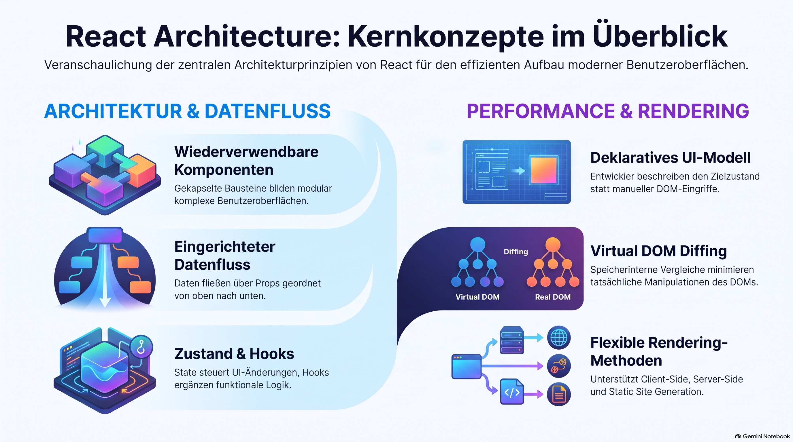
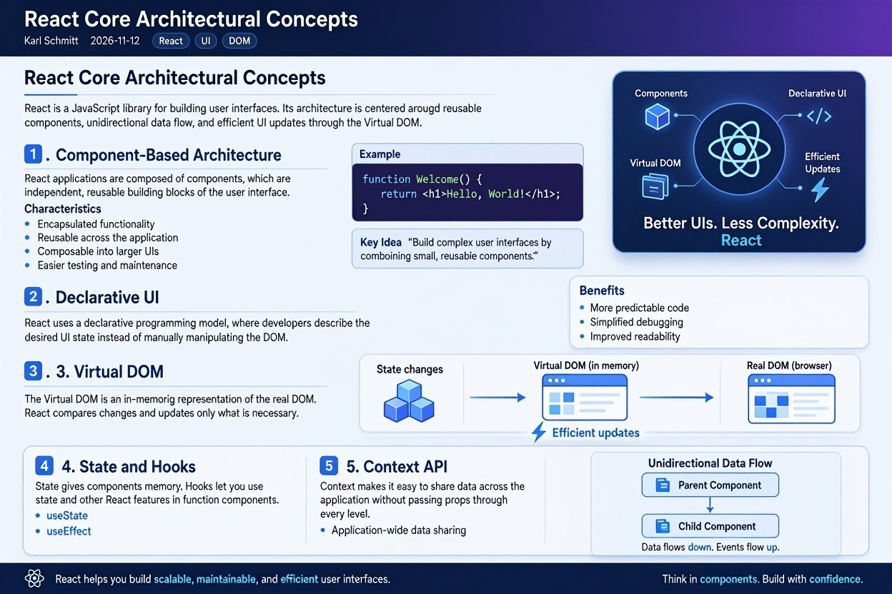

> [!NOTE]
> Der Text beschreibt die grundlegenden **architektonischen Konzepte** von React als JavaScript-Bibliothek zur Erstellung von Benutzeroberflächen. Im Mittelpunkt stehen **wiederverwendbare Komponenten**, die über einen **deklarativen Ansatz** und **einfache Datenflüsse** von Eltern- zu Kindelementen aufgebaut sind. Durch den Einsatz eines **virtuellen DOMs** und den **Abgleichungsprozess** werden Änderungen effizient im Browser dargestellt. Zudem steuern **Zustände** und **Hooks** die dynamischen Abläufe, während die **Context-API** den applikationsweiten Datenaustausch ohne unnötige Weitergabe erleichtert.


# React Core Architectural Concepts

## Overview

React is a JavaScript library for building user interfaces. Its architecture is centered around reusable components, unidirectional data flow, and efficient UI updates through the Virtual DOM.



---

## 1. Component-Based Architecture

React applications are composed of **components**, which are independent, reusable building blocks of the user interface.

### Characteristics
- Encapsulated functionality
- Reusable across the application
- Composable into larger UIs
- Easier testing and maintenance

### Example

```javascript
function Welcome() {
  return <h1>Hello, World!</h1>;
}
```

### Key Idea

> Build complex user interfaces by combining small, reusable components.

---

## 2. Declarative UI

React uses a **declarative programming model**, where developers describe the desired UI state instead of manually manipulating the DOM.

### Benefits
- More predictable code
- Simplified debugging
- Improved readability

---

## 3. Virtual DOM

The **Virtual DOM** is an in-memory representation of the actual DOM.

```text
State Change
      ↓
Virtual DOM Update
      ↓
Diffing Process
      ↓
Minimal DOM Update
```

### Advantages
- Faster rendering
- Reduced direct DOM manipulation
- Improved performance

---

## 4. One-Way Data Flow

React follows a **unidirectional data flow** model.

```text
Parent Component
       ↓ Props
Child Component
```

### Benefits
- Predictable application state
- Easier debugging
- Better maintainability

---

## 5. State Management

**State** represents data that changes over time and influences what is rendered.

### Common State Solutions
- React Context API
- Redux
- Zustand
- Recoil

---

## 6. Props

**Props (Properties)** are inputs passed from parent components to child components.

### Characteristics
- Read-only
- Passed from parent to child
- Promote component reusability

---

## 7. JSX (JavaScript XML)

JSX is a syntax extension that allows writing HTML-like markup within JavaScript.

### Benefits
- Familiar syntax
- Better readability
- Seamless integration of UI and logic

---

## 8. Reconciliation

Reconciliation is React's process of comparing old and new Virtual DOM trees to determine the minimal set of updates.

### Key Idea

> Efficiently update the UI with minimal DOM operations.

---

## 9. Hooks

Common Hooks:

```jsx
useState()
useEffect()
useContext()
useReducer()
useMemo()
useCallback()
useRef()
```

---

## 10. Component Lifecycle

```text
Mounting
    ↓
Updating
    ↓
Unmounting
```

---

## 11. Context API

The Context API enables data sharing across multiple components without prop drilling.

### Common Use Cases
- Authentication
- Theme management
- Localization
- User preferences

---

## 12. Rendering Strategies

- Client-Side Rendering (CSR)
- Server-Side Rendering (SSR)
- Static Site Generation (SSG)

---

# Architectural Relationship Diagram

```text
React Application
│
├── Components
├── Props
├── State
├── Hooks
├── Context
├── Virtual DOM
└── Reconciliation
        ↓
      Real DOM
```

---

# Key Takeaways

1. React is built around reusable components.
2. UI is defined using a declarative approach.
3. The Virtual DOM enables efficient rendering.
4. Data flows from parent to child through props.
5. State drives UI changes.
6. Hooks provide stateful and lifecycle functionality.
7. Reconciliation minimizes DOM updates.
8. The Context API supports shared application state.
9. React supports CSR, SSR, and SSG.

---

# Zettelkasten Note

> React organizes applications as a tree of reusable components that render declaratively from state. Through one-way data flow, the Virtual DOM, and reconciliation, React efficiently synchronizes UI state with the browser DOM while maintaining predictable application behavior.
