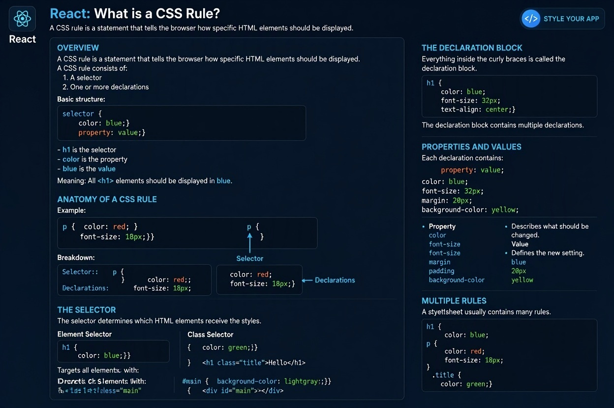
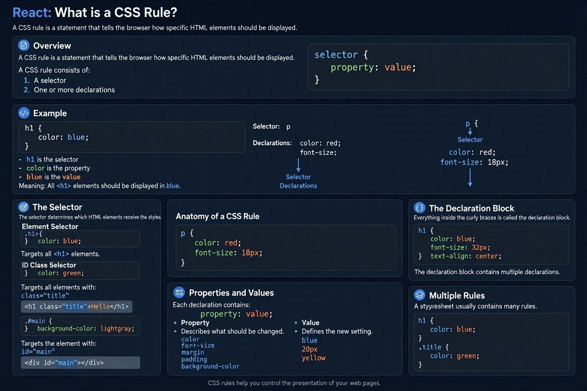

> [!NOTE]
> Eine **CSS-Regel** dient dazu, Webbrowsern anzuzeigen, wie bestimmte HTML-Elemente dargestellt werden sollen, und bildet somit das grundlegende Fundament für die Gestaltung von Webseiten. Jede einzelne Regel setzt sich aus einem **Selektor**, welcher die zu gestaltenden Elemente ansteuert, sowie einem dazugehörigen **Deklarationsblock** zusammen. Innerhalb dieses Blocks bestimmen spezifische **Eigenschaften und Werte** das exakte Aussehen, wie etwa Farben oder Schriftgrößen. Auch in modernen **React-Anwendungen** kommen diese klassischen Gestaltungsmuster zum Einsatz, wobei lediglich die Attributbezeichnung für Klassen leicht angepasst wird. Durch dieses klare Zusammenspiel lässt sich das visuelle Erscheinungsbild von Webinhalten präzise und strukturiert steuern.


# React: What is a CSS Rule?



## Overview

A CSS rule is a statement that tells the browser how specific HTML elements should be displayed.

A CSS rule consists of:

1\. A selector

2\. One or more declarations

Basic structure:

\`\`\`css

selector {

  property: value;

}

\`\`\`

\---

## Example

\`\`\`css

h1 {

  color: blue;

}

\`\`\`

In this rule:

\- \`h1\` is the selector

\- \`color\` is the property

\- \`blue\` is the value

Meaning:

All \`\<h1>\` elements should be displayed in blue.

\---

## Anatomy of a CSS Rule

Example:

\`\`\`css

p {

  color: red;

  font-size: 18px;

}

\`\`\`

Breakdown:

\`\`\`text

Selector:

p

Declarations:

color: red;

font-size: 18px;

\`\`\`

Visualization:

\`\`\`text

p {

  color: red;

  font-size: 18px;

}

↑

Selector

color: red;

font-size: 18px;

↑

Declarations

\`\`\`

\---

## The Selector

The selector determines which HTML elements receive the styles.

### Element Selector

\`\`\`css

h1 {

  color: blue;

}

\`\`\`

Targets all \`\<h1>\` elements.

\---

### Class Selector

\`\`\`css

.title {

  color: green;

}

\`\`\`

Targets all elements with:

\`\`\`html

class="title"

\`\`\`

Example:

\`\`\`html

\<h1 class="title">Hello\</h1>

\`\`\`

\---

### ID Selector

\`\`\`css

main {

  background-color: lightgray;

}

\`\`\`

Targets the element with:

\`\`\`html

id="main"

\`\`\`

Example:

\`\`\`html

\<div id="main">\</div>

\`\`\`

\---

\## The Declaration Block

Everything inside the curly braces is called the declaration block.

Example:

\`\`\`css

h1 {

  color: blue;

  font-size: 32px;

  text-align: center;

}

\`\`\`

The declaration block contains multiple declarations.

\---

## Properties and Values

Each declaration contains:

\`\`\`css

property: value;

\`\`\`

Examples:

\`\`\`css

color: blue;

font-size: 32px;

margin: 20px;

background-color: yellow;

\`\`\`

### Property

Describes what should be changed.

Examples:

\`\`\`text

color

font-size

margin

padding

background-color

\`\`\`
### Value

Defines the new setting.

Examples:

\`\`\`text

blue

32px

20px

yellow

\`\`\`

\---

## Multiple Rules

A stylesheet usually contains many rules.

\`\`\`css

h1 {

  color: blue;

}

p {

  font-size: 18px;

}

button {

  background-color: green;

}

\`\`\`

Each rule targets different elements.

\---

## CSS Rules in React

React uses the same CSS rules as regular HTML.

Example:

\### CSS

\`\`\`css

.title {

  color: blue;

  font-size: 32px;

}

\`\`\`

### React Component

\`\`\`jsx

function Welcome() {

  return (

    \<h1 className="title">

      Hello React

    \</h1>

  );

}

\`\`\`

React applies the CSS rule to the element because the class name matches the selector.

\---

## Mental Model

Think of a CSS rule as an instruction:

\`\`\`text

Selector

\+

Property

\+

Value

\=

Styling Instruction

\`\`\`

Example:

\`\`\`css

button {

  color: white;

}

\`\`\`

Translation:

"Make all button text white."

\---

## Key Takeaways

\- A CSS rule tells the browser how elements should look.

\- Every CSS rule contains a selector and one or more declarations.

\- A declaration consists of a property and a value.

\- Selectors determine which elements are affected.

\- React uses standard CSS rules.

\- React uses \`className\` instead of \`class\`.

\---

## Summary

A CSS rule is the basic building block of CSS.

Structure:
```css
selector {

  property: value;

}
```

The selector chooses the element, and the declarations define how that element should appear.


