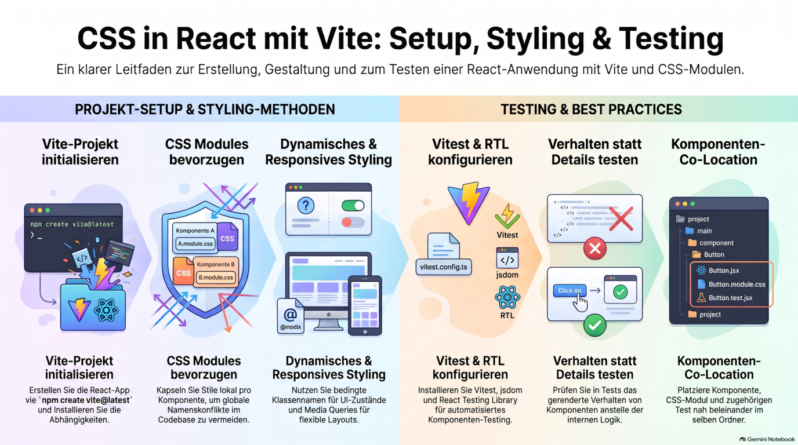
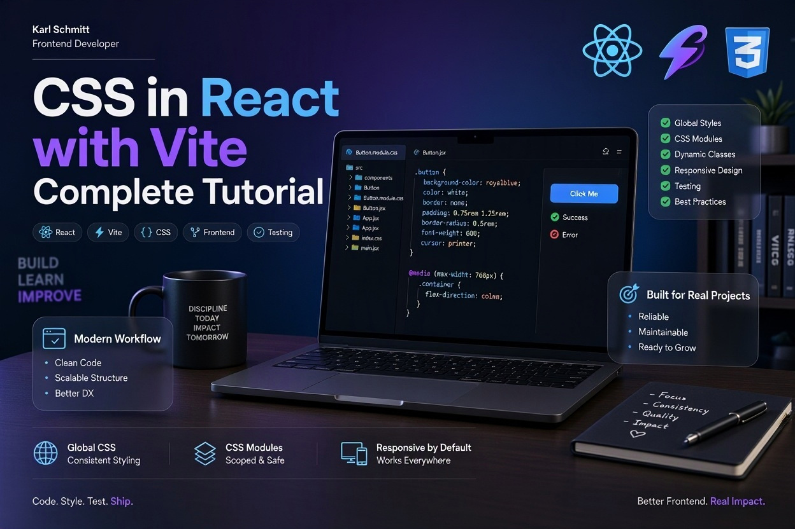

> [!NOTE]
> Karl Schmitt erklärt in seinem Tutorial, wie man **React-Anwendungen mit Vite** erstellt und mit verschiedenen **CSS-Techniken** gestaltet. Die Anleitung zeigt Schritt für Schritt, wie Entwickler globale Styles einbinden, **CSS-Module** zur Vermeidung von Namenskonflikten nutzen und dynamische Klassen sowie responsives Design implementieren können. Darüber hinaus werden die **Einrichtung von Tests** mit Vitest und React Testing Library sowie bewährte Methoden für skalierbaren Code erläutert. Das Dokument fasst somit wesentliche Werkzeuge und Best Practices für moderne, saubere Frontend-Projekte zusammen.

# CSS in React with Vite - Complete Tutorial



## Overview

This tutorial demonstrates:

1. Creating a React application using Vite
2. Working with CSS in React
3. CSS Modules
4. Dynamic CSS classes
5. Responsive design
6. Testing styled React components
7. Best practices

## Creating a New React Project

```bash
npm create vite@latest react-css-tutorial -- --template react
cd react-css-tutorial
npm install
npm run dev
```

## Global CSS

```css
body {
  font-family: Arial, sans-serif;
  background-color: #f4f4f4;
}
```

## CSS Modules

```css
/* Button.module.css */
.button {
  background-color: royalblue;
  color: white;
}
```

```jsx
import styles from './Button.module.css';

export default function Button() {
  return <button className={styles.button}>Click Me</button>;
}
```

## Dynamic Classes

```jsx
<div className={isError ? 'error' : 'success'}>
  Message
</div>
```

## Responsive Design

```css
@media (max-width: 768px) {
  .container {
    flex-direction: column;
  }
}
```

## Install Testing Dependencies

```bash
npm install -D vitest jsdom
npm install -D @testing-library/react
npm install -D @testing-library/jest-dom
```

## Vitest Configuration

```js
export default defineConfig({
  test: {
    environment: 'jsdom',
    setupFiles: './src/test/setup.js'
  }
});
```

## Example Test

```jsx
import { render, screen } from '@testing-library/react';
import { describe, it, expect } from 'vitest';

it('renders button text', () => {
  render(<Button />);
  expect(screen.getByRole('button')).toHaveTextContent('Save');
});
```

## Best Practices

- Prefer CSS Modules
- Use CSS Variables
- Keep components small
- Co-locate component, CSS, and tests
- Test behavior rather than implementation

## Summary

Modern React applications built with Vite commonly use:

- React
- CSS Modules
- Vitest
- React Testing Library

This structure scales from small projects to enterprise applications.
