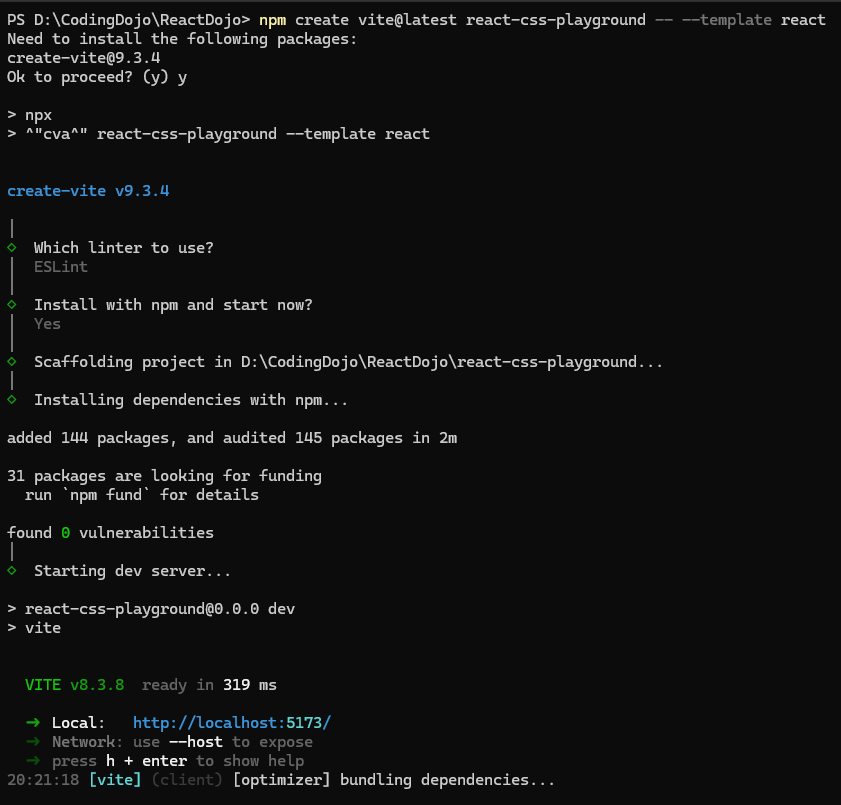
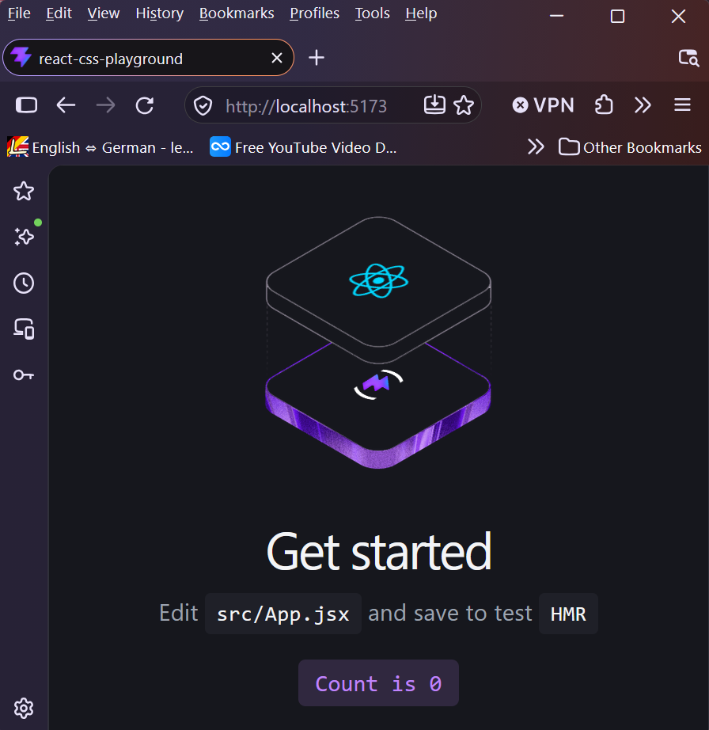
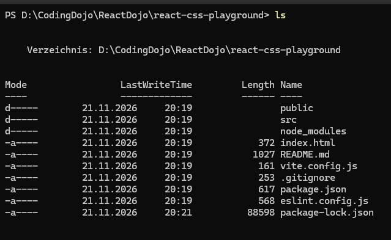
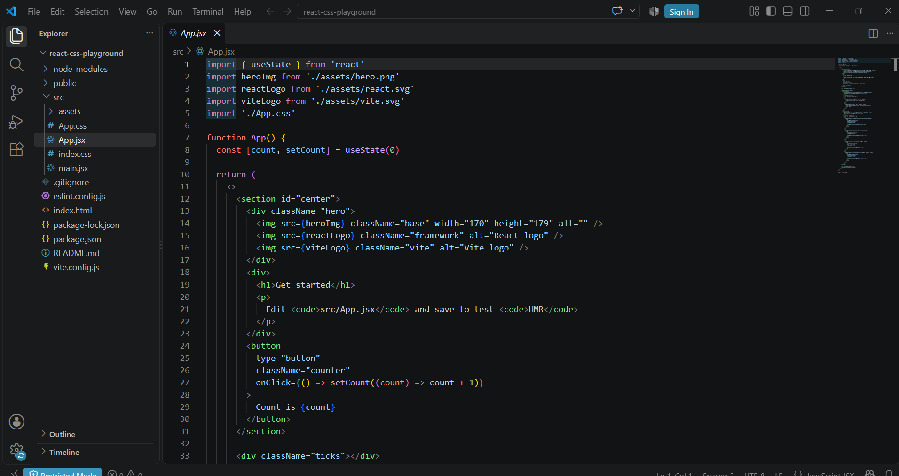
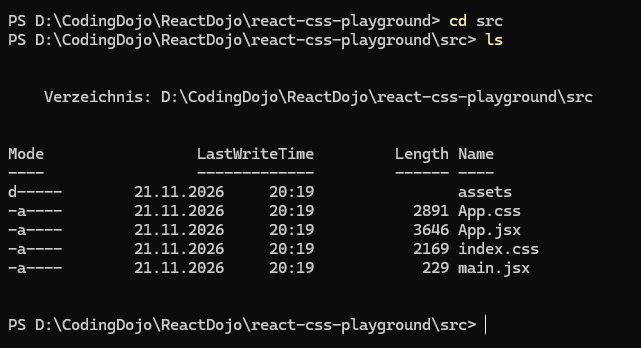
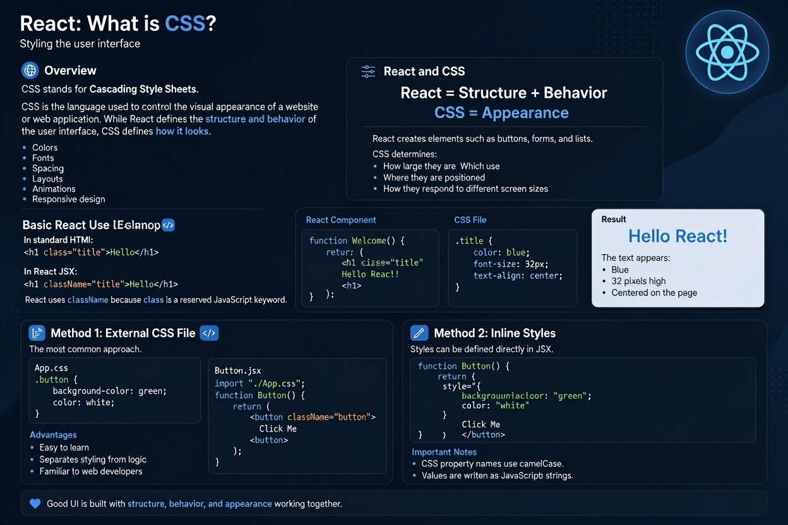
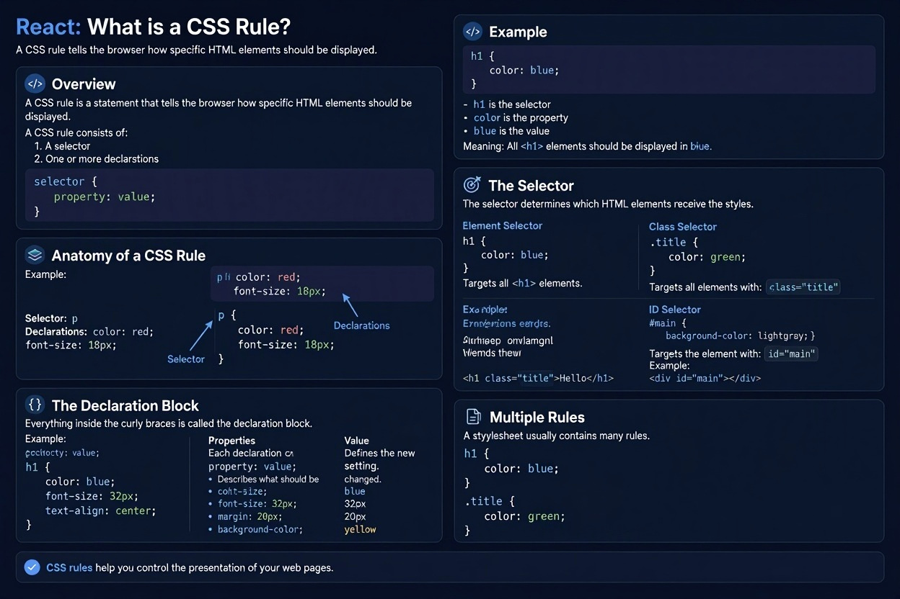

# **React and CSS3 an Absolute Beginner Tutorial**

A practical, step-by-step coding dojo with Vite, React, CSS3, and automated testing


## **1. Learning objectives**

By completing this tutorial, you will understand:

*  🏗️ How to create a React project using Vite.

* 🛠️ How HTML, JSX, React, and CSS work together.

* 🖌️How to style React components with CSS.

* 🪄 How to use CSS selectors, classes, IDs, and variables.

* 🌈 How to work with colors, fonts, spacing, and borders.

* 🥡How to use Flexbox and CSS Grid.

* 🍭 How to create responsive layouts.

* 🗄️ How to use CSS Modules.

* 🧪 How to test React components with Vitest.

* ⚗️ How to test user interactions with React Testing Library.

## **2. Required development environment**

We will use:

| Tool               | Purpose                           |
| ------------------ | --------------------------------- |
| Windows 11         | Operating system                  |
| Visual Studio Code | Code editor                       |
| PowerShell         | Terminal                          |
| Microsoft Edge     | Browser                           |
| Node.js            | JavaScript runtime                |
| npm                | Package manager                   |
| Vite               | Development server and build tool |
| React              | UI library                        |
| Vitest             | Testing framework                 |

**Important:** Vite requires Node.js. If your organization's restrictions on Node.js still apply, you will need an approved development environment where Node.js is permitted.

## **3. Our practical project**

We will create a small application called:

**🛝 React CSS Playground**

The application will contain:

* 🧭 A navigation bar.

* ⛩️A header section.

* 🃏Information cards.

* ▶️Styled buttons.

* 🖍️ A responsive layout.

* ⌚A small interactive counter.

* 👩‍🔬Automated component tests.


Our project structure will gradually become:


```
react-css-playground/
│
├── public/
│
├── src/
│   ├── components/
│   │   ├── Header.jsx
│   │   ├── Card.jsx
│   │   └── Counter.jsx
│   │
│   ├── styles/
│   │   └── global.css
│   │
│   ├── App.jsx
│   ├── App.css
│   ├── main.jsx
│   └── test/
│       └── setup.js
│
├── index.html
├── package.json
└── vite.config.js
```


## **4. Create the React project using Vite**


### **Step 1: Open PowerShell**


Navigate to your preferred development directory.

```
cd D:\CodingDojo\ReactDojo
```

Create the React project:

```
npm create vite@latest react-css-playground -- --template react
```



If you like you can chech the local URL with Browser



Navigate into the React project folder with a different PowerShell session::

```
cd D:\CodingDojo\ReactDojo\react-css-playground
```



⚠️ Install dependencies only if needed, in my case this was done with the npm invocation above!:
🍀 If the development server is already running this step can be omitted. 

```
npm install
```

### **Step 2: Open Visual Studio Code**


Open Visual Studio Code in a different PowerShell session:
```
cd D:\CodingDojo\ReactDojo\react-css-playground
code .
```
On the left side you see the file stucture and ```App.jsx``` is selected and on the right side you see the file content:



### **Step 3: ⭐ Start the development server**

⚠️Be careful, you only need to start the development server if it is not already running!
```
cd D:\CodingDojo\ReactDojo\react-css-playground
npm run dev
```

🌐 Open the following URL in a Web browser, the URI is displayed in the PowerShell, normally:

```
http://localhost:5173
```

🏋️ Exercise one completed ✅

You have created your first React application using Vite!

Vite provides a development server with Hot Module Replacement (HMR), so changes to your source files can appear in the browser without a complete page reload.

Vite+1

### **Step 4: Understand the initial project**

Important files:

| File             | Responsibility                |
| ---------------- | ----------------------------- |
| `index.html`     | HTML entry point              |
| `src/main.jsx`   | React application entry point |
| `src/App.jsx`    | Main React component          |
| `src/App.css`    | Application styles            |
| `src/index.css`  | Global CSS                    |
| `package.json`   | Dependencies and scripts      |
| `vite.config.js` | Vite configuration            |

The initial top level structure of you React project might looks like this:


The source folder of your React project migt look like this:



## **5. What is CSS?**

CSS stands for Cascading Style Sheets.

CSS describes how HTML elements should look.

For example, HTML defines the content:

```
<h1>Hello React!</h1>
```

CSS defines its appearance:

```
h1 {
    color: blue;
    font-size: 40px;
}
```

The result is a blue heading with a font size of 40 pixels.



> [!NOTE]
> If you want to find out more about CSS feel free to follow the white rabbit 🐇:

[What-is-CSS?](../Atoms/React-What-is-CSS.md)

### **5.1 CSS syntax**



A CSS rule consists of:

```
selector {
    property: value;
}
```

Example:

```
p {
    color: red;
    font-size: 18px;
}
```

Explanation:

| Element     | Meaning  |
| ----------- | -------- |
| `p`         | Selector |
| `color`     | Property |
| `red`       | Value    |
| `font-size` | Property |
| `18px`      | Value    |

### **5.2 CSS selectors**

There are several important CSS selectors.

**Element selector**

```
h1 {
    color: blue;
}
```

Selects all h1 elements.

**Class selector**

```
.card {
    background-color: lightgray;
}
```

Selects elements with the class `card`.

**ID selector**

```
#main-title {
    color: darkblue;
}
```

Selects the element with ID `main-title`.

**Universal selector**

```
* {
    box-sizing: border-box;
}
```

Selects all elements.

### **5.3 CSS classes in React**

In ordinary HTML, you write:

```
<div class="card">
    Hello World
</div>
```

In React JSX, you write:

```
<div className="card">
    Hello World
</div>
```

Important:

React uses `className` instead of `class`.

Why?

Because JSX uses JavaScript syntax, where `class` is a reserved keyword.

## **6. First CSS experiment**

Open:

`src/App.jsx`

Replace its contents:

```
function App() {
    return (
        <div>
            <h1>Hello React and CSS!</h1>

            <p>
                This is my first styled React application.
            </p>
        </div>
    );
}

export default App;
```

Open:

`src/App.css`

Replace its contents:

```
h1 {
    color: blue;
    font-size: 40px;
}

p {
    color: gray;
    font-size: 20px;
}
```

Make sure `App.jsx` imports the stylesheet:

```
import "./App.css";
```

Your browser should now display a blue heading and a gray paragraph.

Exercise 2 completed

## **7. Understanding the CSS Box Model**

The CSS Box Model is one of the most important CSS concepts.

Every HTML element can be understood as a rectangular box.

[Box Model Demystified: Margin, Border, Padding & Content - Euron Daily | Euron Community](https://images.openai.com/static-rsc-4/aNhJ5Hv9YEE0LLuFCrQxMEDQ_IPKsc85eHhW6jgkh1zwJmushl24aMsEIfzZ-IBueplaLN4JEmixTRp5c4x0W5xoEd_awQCsUM_soM1dg3XTeGKNvuWjldtPtK3xRPEZG3XYVu6RLJtWWmE16OvBHxsAIugXrPIUK_szeuHn_9k?purpose=inline)

[euron.one](https://euron.one/community/posts/d14457ca-5699-4307-bef0-889364028e4c?utm_source=chatgpt.com)

The four important parts are:

1. Content – the actual text or content.

2. Padding – space between content and border.

3. Border – the element's border.

4. Margin – space outside the border.

Example:

```
.card {
    width: 300px;

    padding: 20px;

    border: 2px solid black;

    margin: 30px;
}
```

### **7.1 box-sizing**

A useful global CSS rule:

```
* {
    box-sizing: border-box;
}
```

This makes width and height calculations easier because padding and borders are included in the declared dimensions.

**Exercise 3**

Create a card with:

* Width: 300px.

* Padding: 20px.

* Border: 2px solid blue.

* Margin: 30px.

* Background: lightgray.

Experiment with the values and observe the changes in Edge.

## **8. Colors, fonts and typography**

CSS provides many ways to define colors.

### **8.1 Color formats**

```
.example-one {
    color: red;
}

.example-two {
    color: #ff0000;
}

.example-three {
    color: rgb(255, 0, 0);
}

.example-four {
    color: hsl(0, 100%, 50%);
}
```

All four examples represent red.

### **8.2 Background colors**

```
body {
    background-color: #f4f6f9;
}
```

### **8.3 Font properties**

```
h1 {
    font-family: Arial, sans-serif;
    font-size: 36px;
    font-weight: bold;
    font-style: normal;
    text-align: center;
}
```

### **8.4 CSS text properties**

```
.description {
    color: #555555;
    line-height: 1.6;
    letter-spacing: 1px;
    text-align: left;
    text-decoration: none;
}
```

**Exercise 4**

Create a heading with:

* Dark blue text.

* 36px font size.

* Bold font weight.

* Center alignment.

Create a paragraph with:

* Gray text.

* 18px font size.

* Line height of 1.6.

## **9. Styling React components**

Now we will create reusable React components.

### **Step 1: Create a components directory**

In PowerShell:

```
New-Item -ItemType Directory src/components
```

### **Step 2: Create Header.jsx**

File:

`src/components/Header.jsx`

```
function Header() {
    return (
        <header className="header">
            <h1>React CSS Playground</h1>

            <p>
                Learning React and CSS step by step.
            </p>
        </header>
    );
}

export default Header;
```

### **Step 3: Create Card.jsx**

File:

`src/components/Card.jsx`

```
function Card({ title, description }) {
    return (
        <article className="card">
            <h2>{title}</h2>

            <p>{description}</p>
        </article>
    );
}

export default Card;
```

Notice:

```
function Card({ title, description })
```

This is JavaScript destructuring.

React passes information to components through props.

### **Step 4: Update App.jsx**

```
import Header from "./components/Header";
import Card from "./components/Card";

import "./App.css";

function App() {
    return (
        <div className="app">
            <Header />

            <main className="card-container">

                <Card
                    title="HTML"
                    description="Learn the structure of web pages."
                />

                <Card
                    title="CSS"
                    description="Learn how to style web pages."
                />

                <Card
                    title="React"
                    description="Learn how to build user interfaces."
                />

            </main>
        </div>
    );
}

export default App;
```

### **Step 5: Style the components**

File:

`src/App.css`

```
.app {
    max-width: 1200px;
    margin: 0 auto;
    padding: 30px;
}

.header {
    text-align: center;
    padding: 40px;
    background-color: #1e3a8a;
    color: white;
    border-radius: 12px;
    margin-bottom: 30px;
}

.header h1 {
    font-size: 36px;
}

.card-container {
    display: flex;
    gap: 20px;
}

.card {
    background-color: white;
    padding: 25px;
    border-radius: 10px;
    border: 1px solid #dddddd;
    flex: 1;
    box-shadow: 0 4px 8px rgba(0, 0, 0, 0.08);
}

.card h2 {
    color: #1e3a8a;
}

.card p {
    color: #555555;
}
```

Exercise 5 completed

You have created your first reusable React components with individual CSS classes.

## **10. Flexbox – arranging React components**

Flexbox is a CSS layout system.

It makes arranging elements horizontally or vertically much easier.

[What is a Flex Box?](https://images.openai.com/static-rsc-4/EE77KoF4hPeZ3LyxnFXBrsXnW4HGfG4BNt4SUWYkmSsMI5eOO5h0rn-DzhUpxtWegXk05xZh1IrzHM6nIOFsXomg8xD2D7J0zUAOH_cw8DnqkNDCvnnhu04WV9BO7RTSvXsyOQycNDk3N5DshEQ_TH_D2VQaVIg5LRGgJTLuqZI?purpose=inline)

[delasign.com](https://www.delasign.com/blog/what-is-a-flex-box/?utm_source=chatgpt.com)

Example:

```
.card-container {
    display: flex;
    justify-content: space-between;
    align-items: stretch;
    gap: 20px;
}
```

Important properties:

| Property          | Purpose                |
| ----------------- | ---------------------- |
| `display: flex`   | Activates Flexbox      |
| `flex-direction`  | Row or column          |
| `justify-content` | Main-axis alignment    |
| `align-items`     | Cross-axis alignment   |
| `flex-wrap`       | Allows wrapping        |
| `gap`             | Space between elements |

### **10.1 Horizontal layout**

```
.container {
    display: flex;
    flex-direction: row;
    gap: 20px;
}
```

### **10.2 Vertical layout**

```
.container {
    display: flex;
    flex-direction: column;
    gap: 20px;
}
```

### **10.3 Centering elements**

```
.container {
    display: flex;
    justify-content: center;
    align-items: center;
    min-height: 300px;
}
```

**Exercise 6**

Modify the card layout:

1. Display three cards horizontally.

2. Center the cards vertically.

3. Add 20px spacing.

4. Change the layout to a vertical column.

5. Observe the difference.

## **11. CSS Grid – another layout system**

CSS Grid is particularly useful for two-dimensional layouts.

[The Ultimate Guide For Designing A Professional Responsive Website - DEV Community](https://images.openai.com/static-rsc-4/DDGZn3w-13BxnGYlZhayPbF6TBbyvch-JGhDsm1ILtsDbARMiX4IwjGamaRsJRn8cu-DnuQ_t12hRJ_KataZMxugV7qM5pLaHUHqXE4F6t15MsEauPo_brWVFb9gT6k-G15Kd6tlYmtEOONg6j4OP7t5cPgWf_bzzFaytXV1vKI?purpose=inline)

[dev.to](https://dev.to/mroman7/the-ultimate-guide-for-designing-a-professional-responsive-website-46ig?utm_source=chatgpt.com)

Example:

```
.card-container {
    display: grid;
    grid-template-columns: repeat(3, 1fr);
    gap: 20px;
}
```

Explanation:

* `display: grid` activates Grid.

* `grid-template-columns` defines columns.

* `repeat(3, 1fr)` creates three equally sized columns.

* `gap` defines spacing.

### **11.1 Responsive Grid**

```
.card-container {
    display: grid;

    grid-template-columns:
        repeat(auto-fit, minmax(250px, 1fr));

    gap: 20px;
}
```

This is a very useful pattern.

The browser automatically adjusts the number of columns according to the available width.

**Exercise 7**

Create a grid with six cards.

Experiment with:

```
grid-template-columns: repeat(2, 1fr);
```

Then try:

```
grid-template-columns: repeat(3, 1fr);
```

Finally try the responsive version.

## **12. Responsive CSS and Media Queries**

Responsive design means that your application adapts to different screen sizes.

For example:

* Desktop: three columns.

* Tablet: two columns.

* Smartphone: one column.

[Responsive web design](https://images.openai.com/static-rsc-4/JgM9cuEQuvUUXSnUdopirtdrc6dr22qBcPtU4GP28uhR4g1a2E-3pWRXDssM2bzOvoltQav8T-7IzPPX0UYB0uTKp7iJK7gxryVD848PxiN-KHDwe1GwSEajDwFoDkft-GM9nQE1YyoEQ-c_UewiQ_GmDKF6qKyQT85owyq9kcw6FshkxmWF5BvE_4Bg47lY?purpose=inline)

Example:

```
.card-container {
    display: grid;
    grid-template-columns: repeat(3, 1fr);
    gap: 20px;
}

@media (max-width: 900px) {
    .card-container {
        grid-template-columns: repeat(2, 1fr);
    }
}

@media (max-width: 600px) {
    .card-container {
        grid-template-columns: 1fr;
    }
}
```

### **12.1 Understanding media queries**

```
@media (max-width: 600px) {
    /* CSS rules for smaller screens */
}
```

The rules inside the media query apply when the viewport is at most 600 pixels wide.

**Exercise 8**

Test your application in Microsoft Edge.

Use the browser's developer tools to simulate:

* Desktop.

* Tablet.

* Smartphone.

Check whether your cards adapt correctly.

## **13. CSS pseudo-classes and interactive buttons**

Pseudo-classes allow you to style elements in particular states.

For example, a button can look different when the mouse moves over it.

### **13.1 Hover**

```
.button {
    background-color: #2563eb;
    color: white;
    padding: 12px 24px;
    border: none;
    border-radius: 6px;
    cursor: pointer;
}

.button:hover {
    background-color: #1e40af;
}
```

### **13.2 Focus**

```
.button:focus {
    outline: 3px solid #93c5fd;
    outline-offset: 3px;
}
```

### **13.3 Active**

```
.button:active {
    transform: scale(0.97);
}
```

Other useful pseudo-classes:

| Pseudo-class   | Purpose                    |
| -------------- | -------------------------- |
| `:hover`       | Mouse over element         |
| `:focus`       | Element has keyboard focus |
| `:active`      | Element is being activated |
| `:first-child` | First child                |
| `:last-child`  | Last child                 |
| `:nth-child()` | Selects a particular child |
| `:disabled`    | Disabled element           |

### **13.4 Create a React button**

Create:

`src/components/Counter.jsx`

```
import { useState } from "react";

function Counter() {
    const [count, setCount] = useState(0);

    return (
        <section className="counter">

            <h2>React Counter</h2>

            <p>Current value: {count}</p>

            <button
                className="button"
                onClick={() => setCount(count + 1)}
            >
                Increase
            </button>

            <button
                className="button"
                onClick={() => setCount(0)}
            >
                Reset
            </button>

        </section>
    );
}

export default Counter;
```

Import the component in `App.jsx`:

```
import Counter from "./components/Counter";
```

Add it below your cards:

```
<Counter />
```

### **13.5 Style the counter**

```
.counter {
    margin-top: 40px;
    padding: 25px;
    background-color: #e5e7eb;
    border-radius: 10px;
    text-align: center;
}

.button {
    margin: 8px;
    padding: 12px 24px;
    background-color: #2563eb;
    color: white;
    border: none;
    border-radius: 6px;
    cursor: pointer;
}

.button:hover {
    background-color: #1e40af;
}
```

You have now combined React state management with CSS styling.

## **14. CSS variables (custom properties)**

CSS variables allow you to define reusable values.

This is particularly useful for larger applications.

Example:

```
:root {
    --primary-color: #1e3a8a;
    --secondary-color: #2563eb;
    --background-color: #f4f6f9;
    --text-color: #333333;
    --card-radius: 10px;
}
```

Use the variables:

```
body {
    background-color: var(--background-color);
    color: var(--text-color);
}

.header {
    background-color: var(--primary-color);
}

.card {
    border-radius: var(--card-radius);
}

.button {
    background-color: var(--secondary-color);
}
```

Advantages:

* Easier maintenance.

* Consistent colors.

* Less duplicated CSS.

* Easier theme customization.

**Exercise 9**

Create your own color scheme using five CSS variables.

Use those variables throughout your application.

## **15. CSS Modules in React**

Until now, we have used ordinary CSS files.

However, React projects can also use CSS Modules.

CSS Modules provide locally scoped class names.

This helps avoid CSS naming conflicts between components.

### **15.1 Create a CSS Module**

Create:

`src/components/Card.module.css`

```
.card {
    background-color: white;
    padding: 25px;
    border-radius: 10px;
    border: 1px solid #dddddd;
}

.title {
    color: #1e3a8a;
    font-size: 24px;
}

.description {
    color: #555555;
    line-height: 1.6;
}
```

### **15.2 Import the CSS Module**

Update `Card.jsx`:

```
import styles from "./Card.module.css";

function Card({ title, description }) {
    return (
        <article className={styles.card}>

            <h2 className={styles.title}>
                {title}
            </h2>

            <p className={styles.description}>
                {description}
            </p>

        </article>
    );
}

export default Card;
```

Notice:

```
className={styles.card}
```

Instead of:

```
className="card"
```

Vite supports CSS Modules without an additional plugin.

### **15.3 When should you use CSS Modules?**

| Styling approach | Typical use                          |
| ---------------- | ------------------------------------ |
| Global CSS       | Body, fonts, shared defaults         |
| Component CSS    | Small applications                   |
| CSS Modules      | Component-specific styling           |
| CSS-in-JS        | Styling through JavaScript libraries |

For this tutorial, I recommend learning ordinary CSS first and CSS Modules second.

## **16. Global CSS and project organization**

Let's clean up the CSS structure.

Create:

`src/styles/global.css`

```
* {
    box-sizing: border-box;
}

:root {
    --primary-color: #1e3a8a;
    --secondary-color: #2563eb;
    --background-color: #f4f6f9;
    --text-color: #333333;
}

body {
    margin: 0;
    font-family: Arial, sans-serif;
    background-color: var(--background-color);
    color: var(--text-color);
}

button {
    font-family: inherit;
}

img {
    max-width: 100%;
}
```

Import it in:

`src/main.jsx`

```
import { StrictMode } from "react";
import { createRoot } from "react-dom/client";

import App from "./App.jsx";
import "./styles/global.css";

createRoot(document.getElementById("root")).render(
    <StrictMode>
        <App />
    </StrictMode>
);
```

Now your global styles are separated from component-specific styles.

# **Part II – Automated Testing**

## **17. Why test React applications?**

Testing helps us verify that our application behaves as expected.

Imagine our counter component.

We want to verify:

1. The initial counter value is zero.

2. Clicking Increase increments the value.

3. Clicking Reset sets the value back to zero.

We will use three tools:

[Vitest Logo PNG, Vector (AI, EPS, CDR, PDF, SVG) - iconLogoVector](https://images.openai.com/static-rsc-4/9fODUnjZ7RBCzbxQyCCIM2GAKXQk3N2VIhfTFla03tODCHG6YASi_5_Rg9Sez4eb6w8boyBEItnwvC641Fwnlf7se_JajREveNF3aYnktq-cj385K4_7kGj4VDen8CNvPvDNm3iUbSWu85vRZgrIJWx-FXtqLrz1enU_8nKOhI4?purpose=inline)

**Vitest**

Runs our tests and provides assertions.

[Official documentation](https://vitest.dev/?utm_source=chatgpt.com)

[Migrating from enzyme to testing-library/react | geOps](https://images.openai.com/static-rsc-4/GCku5MREhao2874ZYlhArCCM7ObvYc28MqqETdBc_cDFh0DE1nkiRIWIminAqvwgHByWccg70jvD-76gwrkPC5hZMj-eag2riytMxuiLQ6W8RciGot-pAMDUe4DTjHdYnH1rH8UMW-NUt7za2ktldXSq52LbULu8KdDmmvyS4KE?purpose=inline)

**React Testing Library**

Helps us test React components through their rendered output.

[Official documentation](https://testing-library.com/docs/react-testing-library/intro/?utm_source=chatgpt.com)

[Exploring the Best Front-end Testing Solutions for Optimal Results | by Choco | Medium](https://images.openai.com/static-rsc-4/qbmrIyqt2DVd5oNQ5_qDBwK3wZdNAEx6rTcgKDhxPuEsHZwOVoPP3mfC35hSnKS2ZVZFFAfFAJqXDsWz6u5Az_tcHNN-HH0dp19bU_3bCdbgW88xIExzkMqsnEATj6vMXxEAYCR7YKn7wgGWMEBPKaMpkkmvJXWdbbj4r3rbWwQ?purpose=inline)

**user-event**

Simulates user interactions such as clicking buttons.

[Official documentation](https://testing-library.com/docs/user-event/intro/?utm_source=chatgpt.com)

## **18. Install the testing dependencies**

Stop your Vite development server if necessary.

In PowerShell, execute:

```
npm install -D vitest jsdom @testing-library/react @testing-library/jest-dom @testing-library/user-event
```

Explanation:

| Package                       | Purpose                     |
| ----------------------------- | --------------------------- |
| `vitest`                      | Test runner                 |
| `jsdom`                       | Simulated browser DOM       |
| `@testing-library/react`      | React component testing     |
| `@testing-library/jest-dom`   | Additional DOM assertions   |
| `@testing-library/user-event` | Simulated user interactions |

## **19. Configure Vitest**

Open:

`vite.config.js`

Replace its contents with:

```
import { defineConfig } from "vite";
import react from "@vitejs/plugin-react";

export default defineConfig({
    plugins: [react()],

    test: {
        environment: "jsdom",
        setupFiles: "./src/test/setup.js"
    }
});
```

We configure:

* `environment: "jsdom"` to provide a simulated browser environment.

* `setupFiles` to load our test configuration.

### **19.1 Create the test directory**

PowerShell:

```
New-Item -ItemType Directory src/test
```

Create:

`src/test/setup.js`

```
import "@testing-library/jest-dom/vitest";
```

This enables additional assertions such as:

```
expect(element).toBeInTheDocument();
```

## **20. Add test scripts to package.json**

Open `package.json`.

Find the `scripts` section and add the following:

```
"scripts": {
    "dev": "vite",
    "build": "vite build",
    "preview": "vite preview",
    "test": "vitest",
    "test:run": "vitest run"
}
```

Keep the existing dependencies and other package configuration.

We now have two test commands:

```
npm test
```

Starts Vitest in watch mode.

```
npm run test:run
```

Executes the tests once and exits.

## **21. Write your first React component test**

Create:

`src/components/Counter.test.jsx`

```
import { describe, it, expect } from "vitest";

import {
    render,
    screen
} from "@testing-library/react";

import userEvent from "@testing-library/user-event";

import Counter from "./Counter";

describe("Counter component", () => {

    it("should display an initial value of zero", () => {

        render(<Counter />);

        expect(
            screen.getByText("Current value: 0")
        ).toBeInTheDocument();

    });

    it("should increase the counter", async () => {

        const user = userEvent.setup();

        render(<Counter />);

        const button = screen.getByRole("button", {
            name: "Increase"
        });

        await user.click(button);

        expect(
            screen.getByText("Current value: 1")
        ).toBeInTheDocument();

    });

    it("should reset the counter", async () => {

        const user = userEvent.setup();

        render(<Counter />);

        await user.click(
            screen.getByRole("button", {
                name: "Increase"
            })
        );

        await user.click(
            screen.getByRole("button", {
                name: "Reset"
            })
        );

        expect(
            screen.getByText("Current value: 0")
        ).toBeInTheDocument();

    });

});
```

### **21.1 Understand the test structure**

```
describe("Counter component", () => {
```

Groups related tests.

```
it("should increase the counter", async () => {
```

Defines an individual test.

```
render(<Counter />);
```

Renders the React component in the simulated DOM.

```
screen.getByRole("button", {
    name: "Increase"
});
```

Finds the button by its accessible role and name.

```
await user.click(button);
```

Simulates a user clicking the button.

```
expect(...).toBeInTheDocument();
```

Checks whether the expected element exists.

### **21.2 Run your tests**

In PowerShell:

```
npm run test:run
```

Expected result:

3 tests passed

```
✓ Counter component
  ✓ should display an initial value of zero
  ✓ should increase the counter
  ✓ should reset the counter
```

Your exact terminal output and timing may differ.

## **22. Test the Card component**

Create:

`src/components/Card.test.jsx`

```
import { describe, it, expect } from "vitest";

import {
    render,
    screen
} from "@testing-library/react";

import Card from "./Card";

describe("Card component", () => {

    it("should display its title", () => {

        render(
            <Card
                title="React"
                description="Learning React."
            />
        );

        expect(
            screen.getByRole("heading", {
                name: "React"
            })
        ).toBeInTheDocument();

    });

    it("should display its description", () => {

        render(
            <Card
                title="React"
                description="Learning React."
            />
        );

        expect(
            screen.getByText("Learning React.")
        ).toBeInTheDocument();

    });

});
```

Run:

```
npm run test:run
```

You should now have five passing tests.

## **23. Test the complete application**

Create:

`src/App.test.jsx`

```
import { describe, it, expect } from "vitest";

import {
    render,
    screen
} from "@testing-library/react";

import App from "./App";

describe("App component", () => {

    it("should display the application heading", () => {

        render(<App />);

        expect(
            screen.getByRole("heading", {
                name: "React CSS Playground"
            })
        ).toBeInTheDocument();

    });

    it("should display the HTML card", () => {

        render(<App />);

        expect(
            screen.getByRole("heading", {
                name: "HTML"
            })
        ).toBeInTheDocument();

    });

    it("should display the CSS card", () => {

        render(<App />);

        expect(
            screen.getByRole("heading", {
                name: "CSS"
            })
        ).toBeInTheDocument();

    });

});
```

Run all tests:

```
npm run test:run
```

Expected total:

* Counter tests: 3

* Card tests: 2

* Application tests: 3

8 automated tests

**Important:** These tests verify React component behavior and rendered content. They do not verify that your CSS looks correct in a real browser. For visual and responsive testing, use Edge's developer tools or add a browser-testing framework such as Playwright later.

## **24. Build the React application**

Testing is important, but we also need to verify that Vite can produce a production build.

Execute:

```
npm run build
```

Vite creates a production-ready application in:

```
dist/
```

To preview the production build locally:

```
npm run preview
```

You can now test the production version in Microsoft Edge.

### **24.1 Important npm commands**

| Command            | Description              |
| ------------------ | ------------------------ |
| `npm install`      | Install dependencies     |
| `npm run dev`      | Start development server |
| `npm test`         | Run tests in watch mode  |
| `npm run test:run` | Run tests once           |
| `npm run build`    | Create production build  |
| `npm run preview`  | Preview production build |

## **25. Final project structure**

After completing the tutorial, your project should look similar to this:

```
react-css-playground/
│
├── public/
│
├── src/
│   │
│   ├── components/
│   │   ├── Header.jsx
│   │   ├── Card.jsx
│   │   ├── Card.module.css
│   │   ├── Card.test.jsx
│   │   ├── Counter.jsx
│   │   └── Counter.test.jsx
│   │
│   ├── styles/
│   │   └── global.css
│   │
│   ├── test/
│   │   └── setup.js
│   │
│   ├── App.jsx
│   ├── App.css
│   ├── App.test.jsx
│   └── main.jsx
│
├── index.html
├── package.json
├── package-lock.json
└── vite.config.js
```

## **26. CSS knowledge checklist**

Use this checklist to track your progress.

**Learning progress**

# **0**__%__

0 of 19 topics completed

CSS syntax and selectors

Element, class and ID selectors

CSS Box Model

Colors and typography

Padding, margin and borders

React className attribute

Styling React components

Flexbox

CSS Grid

Responsive design and media queries

Pseudo-classes and hover effects

CSS variables

CSS Modules

Global CSS

React component testing

Vitest configuration

React Testing Library

User interaction testing

Production builds

Reset checklist

## **27. Practical CSS coding dojo exercises**

These exercises are intended to help you learn by writing code rather than just reading about CSS.

### **Beginner exercises**

| Exercise | Task                               |
| -------- | ---------------------------------- |
| 1        | Create a React project with Vite   |
| 2        | Create a heading and paragraph     |
| 3        | Change font sizes and colors       |
| 4        | Create a styled card               |
| 5        | Experiment with padding and margin |
| 6        | Create a reusable Card component   |

### **Intermediate exercises**

| Exercise | Task                                |
| -------- | ----------------------------------- |
| 7        | Create a navigation bar             |
| 8        | Create a Flexbox layout             |
| 9        | Create a CSS Grid layout            |
| 10       | Add responsive media queries        |
| 11       | Create hover effects                |
| 12       | Introduce CSS variables             |
| 13       | Convert Card styling to CSS Modules |

### **Testing exercises**

| Exercise | Task                          |
| -------- | ----------------------------- |
| 14       | Install Vitest                |
| 15       | Test the Counter component    |
| 16       | Test button interactions      |
| 17       | Test the Card component       |
| 18       | Test the complete application |
| 19       | Run all tests from PowerShell |
| 20       | Create a production build     |

## **28. Additional learning resources**

These are excellent references for your Zettelkasten.

[File:CSS3 logo.svg - Wikimedia Commons](https://images.openai.com/static-rsc-4/5HK7RUAlNr1YKL6QJuVv1-CgprekutkzJwd00csqnENJWmtrVJ3n369b0Jq1DSqV6O8bRvo3rLYJWY5kOYdRd_yTew0rfIa1GkDC9iE5HUlWXbKzIac6LPhA0mEF8or3Nepj50ZKA2vLEhtoRteD5YrO5dRmRG2iww3Fn7WSKns?purpose=inline)

**MDN CSS**

CSS reference, tutorials and examples

[MDN CSS documentation](https://developer.mozilla.org/en-US/docs/Web/CSS?utm_source=chatgpt.com)

[React Logo, Interactive, JavaScript, Web Development, Library PNG](https://images.openai.com/static-rsc-4/Fl2k_M2MV9G60-G7WybCJohvSsz5vwqQsQppvr32F68EV081GHJtW9RJC9qzUmIyqYoKRib8QukYMDHeoi9S68vPmo6QWCkUSZ04wokMQon4iVyQtTjASZavNLZps_OHoxGIXYHG61QQxMlUTbtbDTcfPlPzUqtZndtSvw9CQCM?purpose=inline)

**React documentation**

React components, JSX, props and state

[Learn React](https://react.dev/learn?utm_source=chatgpt.com)

[Vite Logo PNG, Vector (AI, EPS, CDR, PDF, SVG) - iconLogoVector](https://images.openai.com/static-rsc-4/3z0Km4avLxM07hDPhEKDfS7e7PZ2lL2d3cwaKeEzgNJv9dyl98qGYk571u4SaDifiikdYK2hz1shWLZ9XF_Yxb2nSviCVF-CT-lxbC7LskalbJ4GtZ76GhzgB_MZk2WTQc3IigAMSX0g3wNU9KhgeUkOGefHiGbg1uJSTHBED1E?purpose=inline)

**Vite documentation**

Project creation and configuration

[Vite guide](https://vite.dev/guide/?utm_source=chatgpt.com)

[Vitest Guide: Next-Generation JavaScript Testing Framework for Modern Developers](https://images.openai.com/static-rsc-4/VgRnMICTxkaK14pmfNVWG0aH1jTs2LeFF5di_huK0nxm-a-Z_846J6h697sfOnrzJH7X1g3nHAhNjHwAHglTukC_oBkdryYmwFLndZBnCEVjuogPymdCNYGnux53vzSvefxL2NdoL-O0uHpHdQQsaZnJcrckdAzoFPg6tKcdLKQ?purpose=inline)

**Vitest documentation**

Test runners, assertions and configuration

[Vitest guide](https://vitest.dev/guide/?utm_source=chatgpt.com)

[React Testing Library Logo: SVG Guide For Developers](https://images.openai.com/static-rsc-4/7GZIU4Af9b-zANQuQsL5W4I_ofXLZx9AIsYlEtoq1Vkr3MgjQ639I0npfVQWy_GHNCz1lVMs3iO5_q-_nuiBQ-3k9nWMgTzf27Hg4Pm87iw1f3ji6byshQkjcXwBYm96D50BaOkVmLoVpE59UF9spHAyg6vVTpxyombLorK9L1I?purpose=inline)

**Testing Library**

Testing React components and user interactions

[Testing Library guide](https://testing-library.com/docs/react-testing-library/intro/?utm_source=chatgpt.com)

## **29. Suggested Zettlr Zettelkasten organization**

I would organize this tutorial into several interconnected notes:

```
React-CSS/
│
├── 00-React-CSS-Overview.md
├── 01-Create-React-Project-Vite.md
├── 02-CSS-Fundamentals.md
├── 03-CSS-Selectors.md
├── 04-CSS-Box-Model.md
├── 05-CSS-Typography.md
├── 06-CSS-Flexbox.md
├── 07-CSS-Grid.md
├── 08-CSS-Responsive-Design.md
├── 09-CSS-Variables.md
├── 10-CSS-Modules.md
├── 11-React-CSS-Components.md
├── 12-Vitest-Testing.md
├── 13-React-Testing-Library.md
└── 14-React-CSS-Coding-Dojo.md
```

**Suggested main Zettelkasten title:**

`React and CSS3 – Building Responsive User Interfaces with Vite`

**Suggested tags:**

```
#React
#CSS
#CSS3
#JavaScript
#Vite
#Frontend
#Flexbox
#CSSGrid
#ResponsiveDesign
#Vitest
#Testing
#Zettelkasten
```

## **30. My recommended next learning steps**

After finishing this tutorial, I recommend the following progression:

1. React + CSS – component-based styling.

2. React + CSS Modules – isolated component styling.

3. React + Sass/SCSS – advanced stylesheet organization.

4. React + Tailwind CSS – utility-first styling.

5. React + Vitest – component and unit testing.

6. React + Playwright – end-to-end browser testing.

One important distinction: Vitest and React Testing Library test component behavior, while Playwright can test the actual application in Microsoft Edge or another supported browser.

**A final recommendation:** Don't rush through the exercises. Experiment with CSS properties, deliberately break layouts, and try to fix them. That is one of the best ways to develop a solid understanding of CSS.

Happy coding and happy Zettelkasten learning! 😊
