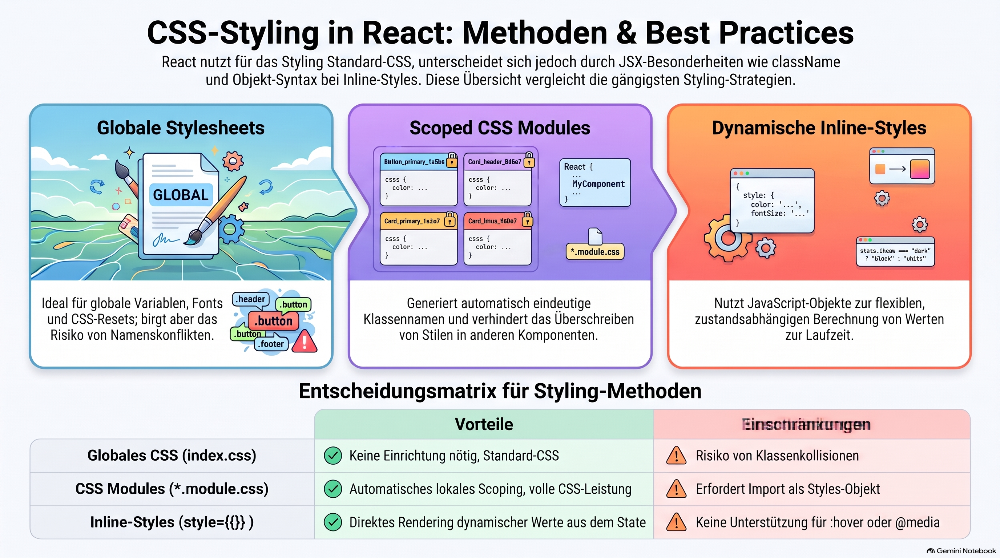

> [!NOTE]
> Dieser Leitfaden erklärt, wie React-Komponenten mithilfe von **globalen Stylesheets**, **CSS-Modulen** und **dynamischen Inline-Stilen** gestaltet werden können. Dabei wird ein Vite-Projekt aufgesetzt, um die automatische Kapselung von Klassennamen zu demonstrieren und Namenskonflikte zu vermeiden. Anhand einer interaktiven **StatusCard-Komponente** wird gezeigt, wie sich Zustandsänderungen und Varianteneigenschaften visuell umsetzen lassen. Zudem enthält das Tutorial eine Anleitung zur manuellen Überprüfung im Browser sowie zur automatisierten Testung mit **Vitest** und der **React Testing Library**. Abschließend bietet eine kompakte Übersicht Entscheidungshilfe bei der Wahl der passenden Styling-Methode.


# Styling React with CSS: An Absolute Beginner Tutorial

## 1. Core Concept (Zettelkasten Summary)

* **How CSS Works in React:** Because React compiles components down to standard HTML DOM elements, you use standard CSS—with two key JSX syntax differences:
  1. Use `className="..."` instead of HTML's `class="..."` (since `class` is a reserved keyword in JavaScript).
  2. Inline styles take a JavaScript **object** with camelCased properties (`style={{ backgroundColor: 'blue' }}`) rather than a semicolon-separated string.
* **The Three Main CSS Approaches in React:**
  1. **Global Stylesheets (`App.css` / `index.css`):** Standard `.css` files imported directly into JS. Great for base resets, fonts, and CSS variables, *but* class names are global and can collide across large apps.
  2. **CSS Modules (`Component.module.css`):** Built directly into Vite! Vite automatically generates unique, scoped class names (e.g., `_button_1x9a2_1`) so styles in one component **never** leak into or overwrite another component.
  3. **Dynamic / Conditional Classes:** Combining template literals or state toggles (`isActive ? styles.active : ''`) to change appearance interactively.

---

## 2. Step 1: Project Setup (Using Vite)

Ensure [Node.js](https://nodejs.org/) is installed on your machine.

1. Open your terminal and scaffold a new Vite + React project:
   ```bash
   npm create vite@latest react-css-demo -- --template react
   ```

2. Navigate into your project folder:
   ```bash
   cd react-css-demo
   ```

3. Install dependencies:
   ```bash
   npm install
   ```

4. Start the development server:
   ```bash
   npm run dev
   ```
   *(Open `http://localhost:5173` in your browser to verify it loads).*

---

## 3. Step 2: Global CSS & Design Variables (`src/index.css`)

Global CSS is ideal for setting up CSS Custom Properties (variables), typography, and dark/light theme foundations.

1. Open `src/index.css` and replace its contents with:

```css
/* src/index.css */
:root {
  --bg-page: #f1f5f9;
  --text-main: #0f172a;
  --primary: #2563eb;
  --primary-hover: #1d4ed8;
  --card-bg: #ffffff;
  --border-color: #cbd5e1;
}

* {
  box-sizing: border-box;
}

body {
  margin: 0;
  font-family: system-ui, -apple-system, sans-serif;
  background-color: var(--bg-page);
  color: var(--text-main);
  padding: 24px;
}
```

---

## 4. Step 3: Component-Scoped Styling with CSS Modules

Next, we will build an interactive **Alert / Status Card** component using a **CSS Module** (`StatusCard.module.css`). Notice the `.module.css` file extension—this tells Vite to scope every class locally to this component.

1. Inside `src/`, create a folder named `components`.
2. Create `src/components/StatusCard.module.css`:

```css
/* src/components/StatusCard.module.css */
.card {
  background-color: var(--card-bg);
  border: 2px solid var(--border-color);
  border-radius: 12px;
  padding: 20px;
  max-width: 420px;
  transition: transform 0.2s ease, border-color 0.2s ease;
}

.card:hover {
  transform: translateY(-2px);
}

/* Modifier classes for dynamic status variants */
.success {
  border-color: #16a34a;
  background-color: #f0fdf4;
}

.warning {
  border-color: #ea580c;
  background-color: #fff7ed;
}

.header {
  display: flex;
  justify-content: space-between;
  align-items: center;
  margin-bottom: 12px;
}

.title {
  margin: 0;
  font-size: 1.25rem;
}

.badge {
  padding: 4px 10px;
  border-radius: 999px;
  font-size: 0.75rem;
  font-weight: bold;
  text-transform: uppercase;
  background-color: #e2e8f0;
}

.button {
  margin-top: 12px;
  padding: 8px 16px;
  border: none;
  border-radius: 6px;
  background-color: var(--primary);
  color: white;
  font-weight: 600;
  cursor: pointer;
}

.button:hover {
  background-color: var(--primary-hover);
}
```

3. Now create `src/components/StatusCard.jsx` and import the CSS Module as a JavaScript object (`styles`):

```jsx
// src/components/StatusCard.jsx
import { useState } from 'react';
import styles from './StatusCard.module.css';

function StatusCard({ title, message, variant = 'default' }) {
  const [acknowledged, setAcknowledged] = useState(false);

  // Dynamically combine base `.card` class with variant modifier class
  const variantClass =
    variant === 'success'
      ? styles.success
      : variant === 'warning'
      ? styles.warning
      : '';

  return (
    <article
      className={`${styles.card} ${variantClass}`.trim()}
      data-testid="status-card"
    >
      <div className={styles.header}>
        <h2 className={styles.title}>{title}</h2>
        <span className={styles.badge}>
          {acknowledged ? 'Read' : variant}
        </span>
      </div>

      <p>{message}</p>

      {/* Dynamic inline style example for quick computed values */}
      <div
        style={{
          fontSize: '0.85rem',
          opacity: acknowledged ? 0.6 : 1,
          fontStyle: 'italic'
        }}
      >
        Status: {acknowledged ? 'Confirmed by operator' : 'Action pending'}
      </div>

      <button
        className={styles.button}
        onClick={() => setAcknowledged((prev) => !prev)}
      >
        {acknowledged ? 'Mark Unread' : 'Acknowledge'}
      </button>
    </article>
  );
}

export default StatusCard;
```

### Key Takeaways from Step 3:
* Importing `styles from './StatusCard.module.css'` gives you an object where keys match your CSS class names (`styles.card`, `styles.button`).
* Even if another component in your app also defines `.button` or `.header`, their generated hashes will differ, preventing accidental style overrides.

---

## 5. Step 4: Assembling the App (`src/App.jsx`)

1. Open `src/App.jsx` and replace its contents with:

```jsx
// src/App.jsx
import StatusCard from './components/StatusCard';

function App() {
  return (
    <main style={{ maxWidth: '460px', margin: '0 auto', display: 'grid', gap: '16px' }}>
      <h1>System Notifications</h1>

      <StatusCard
        title="Deployment Complete"
        message="Production build v2.4.0 is live across all regions."
        variant="success"
      />

      <StatusCard
        title="High Memory Usage"
        message="Worker node EU-Central-1 reached 88% RAM capacity."
        variant="warning"
      />
    </main>
  );
}

export default App;
```

---

## 6. Step 5: Testing CSS Classes & Dynamic Styles (Manual & Automated)

### A. Manual Browser Verification
1. Open `http://localhost:5173`.
2. Inspect the two cards using **Browser DevTools** (`F12` $\rightarrow$ **Elements** tab):
   * Notice how `class="_card_xxxxx _success_xxxxx"` has unique scoped hashes generated by Vite.
3. Click **Acknowledge** on either card and watch the badge change to `Read` and the status text opacity dim to `0.6`.

### B. Automated Style & Class Testing (Vitest + `@testing-library/jest-dom`)

With `@testing-library/jest-dom`, you can write automated assertions verifying that:
* Dynamic CSS classes are applied based on props (`variant="success"`).
* Dynamic inline styles update when user interactions change state (`toHaveStyle`).

1. Stop the dev server (`Ctrl + C`).
2. Install **Vitest**, **jsdom**, **React Testing Library**, **jest-dom**, and **User Event**:
   ```bash
   npm install -D vitest jsdom @testing-library/react @testing-library/jest-dom @testing-library/user-event
   ```

3. Create a test setup file `src/setupTests.js` to load `jest-dom` matchers (like `.toHaveStyle()` and `.toHaveClass()`):
   ```javascript
   // src/setupTests.js
   import '@testing-library/jest-dom';
   ```

4. Update `vite.config.js` to configure `jsdom`, `setupFiles`, and `css: true` (so Vitest parses CSS Module class names properly):
   ```javascript
   // vite.config.js
   import { defineConfig } from 'vite';
   import react from '@vitejs/plugin-react';

   export default defineConfig({
     plugins: [react()],
     test: {
       environment: 'jsdom',
       globals: true,
       setupFiles: './src/setupTests.js',
       css: true,
     },
   });
   ```

5. Create `src/components/StatusCard.test.jsx`:

```jsx
// src/components/StatusCard.test.jsx
import { render, screen } from '@testing-library/react';
import userEvent from '@testing-library/user-event';
import { describe, it, expect } from 'vitest';
import StatusCard from './StatusCard';

describe('StatusCard CSS & Dynamic Styling', () => {
  it('applies the scoped variant CSS Module class based on props', () => {
    render(
      <StatusCard
        title="Build Passed"
        message="All checks green."
        variant="success"
      />
    );

    const card = screen.getByTestId('status-card');

    // Verify CSS Module scoped classes are applied
    expect(card.className).toMatch(/card/);
    expect(card.className).toMatch(/success/);
  });

  it('updates inline opacity style dynamically when Acknowledge button is clicked', async () => {
    const user = userEvent.setup();
    render(
      <StatusCard
        title="Disk Alert"
        message="Volume at 85%."
        variant="warning"
      />
    );

    const statusLine = screen.getByText(/Status: Action pending/i);
    const ackButton = screen.getByRole('button', { name: /Acknowledge/i });

    // Initial inline style check
    expect(statusLine).toHaveStyle({ opacity: '1' });

    // Click Acknowledge button
    await user.click(ackButton);

    // Verify updated inline style and text
    const updatedStatusLine = screen.getByText(/Status: Confirmed by operator/i);
    expect(updatedStatusLine).toHaveStyle({ opacity: '0.6' });
  });
});
```

6. Run the test suite:
   ```bash
   npx vitest run
   ```
7. Confirm you see `2 passed` in green!

---

## 7. Quick Decision Guide: Which Styling Method to Choose?

| Method | Best For | Pros | Cons |
| :--- | :--- | :--- | :--- |
| **Global CSS (`index.css`)** | CSS variables, font defaults, body resets | Zero setup, standard CSS | Class names can collide across components |
| **CSS Modules (`*.module.css`)** | Component-specific layouts, hover states, media queries | Automatic local scoping, built into Vite, full CSS power | Requires importing `styles` object |
| **Inline Styles (`style={{}}`)** | Dynamic values calculated at runtime (e.g., progress bar `%`, dynamic coordinates) | Direct access to JS variables/state | Does not support `:hover` or `@media` queries |

---

## 8. Related Zettelkasten Links

* [[Building a Multi-Component Web GUI in React]]
* [[React Props Beginner Tutorial]]
* [[React State (useState) Beginner Tutorial]]