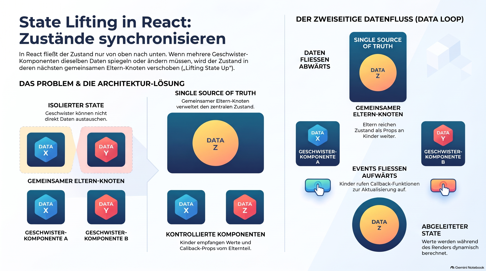
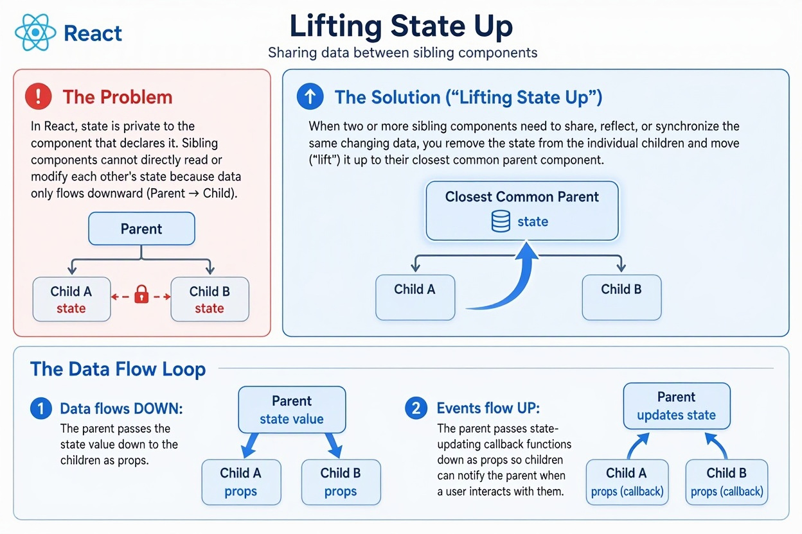
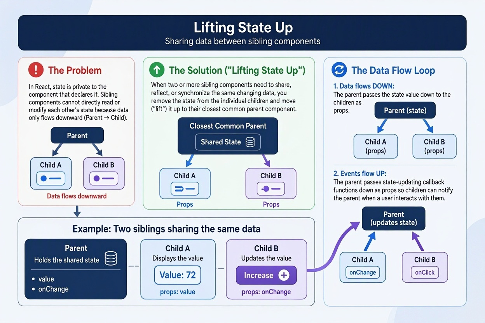

> [!NOTE]
> In React sind Zustände standardmäßig privat und Daten fließen ausschließlich von Eltern- zu Kindkomponenten nach unten. Wenn mehrere geschwisterliche Komponenten denselben Wert teilen und synchronisieren müssen, wird dieses Problem durch das **Hochziehen des Zustands** gelöst, indem der Zustand in die gemeinsame **Elternkomponente** verlagert wird. Die Elternkomponente fungiert dabei als **Single Source of Truth**, während die kindlichen Komponenten komplett **kontrolliert** und frei von eigenem internen Zustand sind. Daten werden den Kindern über **Props** übergeben, und Benutzerinteraktionen werden durch **Callback-Funktionen** nach oben gemeldet. Dadurch lassen sich abgeleitete Werte reibungslos berechnen, was durch automatisierte Integrationstests mit **Vitest** zuverlässig überprüft werden kann.


# Lifting State Up in React: An Absolute Beginner Deep Dive

## 1. Core Concept (Zettelkasten Summary)



* **The Problem:** In React, state is private to the component that declares it. Sibling components cannot directly read or modify each other's state because data only flows **downward** (Parent $\rightarrow$ Child).


* **The Solution ("Lifting State Up"):** When two or more sibling components need to share, reflect, or synchronize the same changing data, you **remove** the state from the individual children and move ("lift") it up to their **closest common parent** component.


* **The Data Flow Loop:**


  1. **Data flows DOWN:** The parent passes the state value down to the children as **props**.


  2. **Events flow UP:** The parent passes state-updating callback functions down as **props** so children can notify the parent when a user interacts with them.


## 2. Step 1: Project Setup (Using Vite)

Let's build a real-world **Temperature Converter** (Celsius and Fahrenheit inputs that stay synchronized in real time). Ensure [Node.js](https://nodejs.org/ "null") is installed first.


1. Open your terminal and create a new Vite + React project:


   ```
   npm create vite@latest react-lifting-state -- --template react
   ```

2. Navigate into the project directory:


   ```
   cd react-lifting-state
   ```

3. Install dependencies:


   ```
   npm install
   ```

4. Start the development server:


   ```
   npm run dev
   ```

   _(Open `http://localhost:5173` in your browser to verify it works)._


## 3. Step 2: Understanding the Problem (Isolated Sibling State)



Imagine we create a `TemperatureInput` component where each input manages its _own_ state:


```JavaScript
// ❌ ANTI-PATTERN FOR SYNCED SIBLINGS: Isolated State
function TemperatureInput({ scale }) {
  const [temperature, setTemperature] = useState(''); // Trapped inside each child!
  return (
    <fieldset>
      <legend>Enter temperature in {scale}:</legend>
      <input value={temperature} onChange={(e) => setTemperature(e.target.value)} />
    </fieldset>
  );
}
```

If we render two of these side-by-side (`<TemperatureInput scale="Celsius" />` and `<TemperatureInput scale="Fahrenheit" />`), typing `100` into Celsius will **not** update Fahrenheit to `212`. Each input lives in its own isolated memory bubble.


To synchronize them, **neither input should own the state**. Instead, their parent must become the **Single Source of Truth**.


## 4. Step 3: Building the Stateless ("Controlled") Child Component

First, we make `TemperatureInput` a pure, stateless child component. Instead of calling `useState`, it receives both its current `temperature` value and an `onTemperatureChange` function from its parent via **props**.


1. Inside `src/`, create a new file named `TemperatureInput.jsx`.


2. Add the following code:


```javascript
// src/TemperatureInput.jsx
const scaleNames = {
  c: 'Celsius',
  f: 'Fahrenheit'
};

function TemperatureInput({ scale, temperature, onTemperatureChange }) {
  function handleChange(e) {
    // Pass the new typed value UP to the parent via the callback prop
    onTemperatureChange(e.target.value);
  }

  return (
    <fieldset style={{
      border: '1px solid #cbd5e1',
      borderRadius: '8px',
      padding: '16px',
      marginBottom: '12px',
      backgroundColor: '#f8fafc'
    }}>
      <legend style={{ fontWeight: 'bold', padding: '0 6px' }}>
        Enter temperature in {scaleNames[scale]}:
      </legend>
      <input
        type="number"
        aria-label={`Temperature in ${scaleNames[scale]}`}
        value={temperature}
        onChange={handleChange}
        placeholder={`e.g. ${scale === 'c' ? '100' : '212'}`}
        style={{ padding: '8px', width: '100%', boxSizing: 'border-box', fontSize: '1rem' }}
      />
    </fieldset>
  );
}

export default TemperatureInput;
```

### Key Takeaways from Step 3:

* `TemperatureInput` has **zero internal state**. It is completely controlled by its parent.


* When the user types, it calls `onTemperatureChange(e.target.value)`—sending a message _upward_ to whoever rendered it.


## 5. Step 4: Lifting the State into the Common Parent (`App.jsx`)

Now, we lift the state into `App.jsx` (the common parent of both inputs). `App` will store the current `temperature` and which `scale` (`'c'` or `'f'`) was last edited, calculate the converted value for the other input, and pass both down.


1. Open `src/App.jsx` and replace its contents with:


```
// src/App.jsx
import { useState } from 'react';
import TemperatureInput from './TemperatureInput';

// Pure helper functions for math conversions
function toCelsius(fahrenheit) {
  return ((fahrenheit - 32) * 5) / 9;
}

function toFahrenheit(celsius) {
  return (celsius * 9) / 5 + 32;
}

function tryConvert(temperature, convertFn) {
  const input = parseFloat(temperature);
  if (Number.isNaN(input)) {
    return '';
  }
  const output = convertFn(input);
  const rounded = Math.round(output * 1000) / 1000;
  return rounded.toString();
}

function App() {
  // 1. LIFTED STATE: Single Source of Truth lives here in the parent
  const [temperature, setTemperature] = useState('');
  const [scale, setScale] = useState('c');

  // 2. Event handlers passed DOWN to children
  function handleCelsiusChange(newTemp) {
    setScale('c');
    setTemperature(newTemp);
  }

  function handleFahrenheitChange(newTemp) {
    setScale('f');
    setTemperature(newTemp);
  }

  // 3. Derived values calculated during render (no extra state needed!)
  const celsius = scale === 'f' ? tryConvert(temperature, toCelsius) : temperature;
  const fahrenheit = scale === 'c' ? tryConvert(temperature, toFahrenheit) : temperature;

  return (
    <div style={{
      maxWidth: '420px',
      margin: '40px auto',
      fontFamily: 'system-ui, sans-serif',
      padding: '20px'
    }}>
      <h1>Temperature Sync</h1>
      <p style={{ color: '#475569', fontSize: '0.95rem' }}>
        Type in either box below. Both siblings stay synchronized via lifted state in <code>App</code>.
      </p>

      {/* Sibling 1: Celsius */}
      <TemperatureInput
        scale="c"
        temperature={celsius}
        onTemperatureChange={handleCelsiusChange}
      />

      {/* Sibling 2: Fahrenheit */}
      <TemperatureInput
        scale="f"
        temperature={fahrenheit}
        onTemperatureChange={handleFahrenheitChange}
      />

      {/* Bonus: A third sibling reading the exact same lifted state! */}
      {celsius !== '' && (
        <p style={{
          marginTop: '16px',
          padding: '12px',
          borderRadius: '6px',
          backgroundColor: parseFloat(celsius) >= 100 ? '#fee2e2' : '#e0f2fe',
          color: parseFloat(celsius) >= 100 ? '#991b1b' : '#075985',
          fontWeight: 'bold'
        }}>
          {parseFloat(celsius) >= 100
            ? '🔥 The water would boil!'
            : '💧 The water would not boil.'}
        </p>
      )}
    </div>
  );
}

export default App;
```

### Tracing the Execution Flow (Step-by-Step):

1. User types `100` into the **Celsius** input.


2. `TemperatureInput` triggers `onChange` $\rightarrow$ calls `handleCelsiusChange('100')` in `App`.


3. `App` calls `setScale('c')` and `setTemperature('100')`.


4. `App` re-renders. It sees `scale === 'c'`, so `celsius` stays `'100'`, and `fahrenheit` is computed via `tryConvert('100', toFahrenheit)` $\rightarrow$ `'212'`.


5. `App` passes `temperature="100"` to the first child and `temperature="212"` to the second child. Both inputs update simultaneously!


## 6. Step 5: Testing Lifted State (Manual & Automated)

### A. Manual Browser Verification

1. Open `http://localhost:5173`.


2. Type `100` in **Celsius** $\rightarrow$ Verify **Fahrenheit** immediately displays `212` and the boiling banner turns red (`The water would boil!`).


3. Clear Fahrenheit and type `32` $\rightarrow$ Verify **Celsius** immediately updates to `0` and the banner turns blue (`The water would not boil.`).


### B. Automated Integration Testing (Vitest + User Event)

Because lifting state is an interaction _between_ a parent and multiple children, we test the composed `App` component to ensure siblings stay synchronized.


1. Stop the dev server (`Ctrl + C` in terminal).


2. Install **Vitest**, **jsdom**, **React Testing Library**, and **User Event**:


   ```
   npm install -D vitest jsdom @testing-library/react @testing-library/jest-dom @testing-library/user-event
   ```

3. Configure `vite.config.js` to use `jsdom`:


   ```
   import { defineConfig } from 'vite';
   import react from '@vitejs/plugin-react';

   export default defineConfig({
     plugins: [react()],
     test: {
       environment: 'jsdom',
       globals: true,
     },
   });
   ```

4. Create `src/App.test.jsx`:


```
// src/App.test.jsx
import { render, screen } from '@testing-library/react';
import userEvent from '@testing-library/user-event';
import { describe, it, expect } from 'vitest';
import App from './App';

describe('Lifting State Up: Temperature Converter', () => {
  it('synchronizes Fahrenheit when Celsius is typed', async () => {
    const user = userEvent.setup();
    render(<App />);

    const celsiusInput = screen.getByLabelText(/Temperature in Celsius/i);
    const fahrenheitInput = screen.getByLabelText(/Temperature in Fahrenheit/i);

    // Type 100 into Celsius
    await user.type(celsiusInput, '100');

    // Assert Fahrenheit sibling updated automatically
    expect(fahrenheitInput.value).toBe('212');
    expect(screen.getByText(/The water would boil!/i)).toBeDefined();
  });

  it('synchronizes Celsius when Fahrenheit is typed', async () => {
    const user = userEvent.setup();
    render(<App />);

    const celsiusInput = screen.getByLabelText(/Temperature in Celsius/i);
    const fahrenheitInput = screen.getByLabelText(/Temperature in Fahrenheit/i);

    // Type 32 into Fahrenheit
    await user.type(fahrenheitInput, '32');

    // Assert Celsius sibling updated automatically
    expect(celsiusInput.value).toBe('0');
    expect(screen.getByText(/The water would not boil./i)).toBeDefined();
  });
});
```

5. Run the test suite:


   ```
   npx vitest run
   ```

6. Confirm you see a green `PASS` with `2 passed`.


## 7. Key Architectural Principles Learned

* **Single Source of Truth:** Every piece of changing data should live in _one_ component only. Never duplicate state across two components and try to manually sync them.


* **Derived State vs. Stored State:** Notice we did **not** create two state variables (`celsiusState` and `fahrenheitState`). We stored only _one_ source temperature and _calculated_ the other during render. If a value can be computed from existing props or state, **do not put it in state**.


* **Controlled vs. Uncontrolled Components:** Moving state out of a child and passing `value` + `onChange` via props turns it into a **Controlled Component**.


## 8. Related Zettelkasten Links

* `[[How React Handles State (Under the Hood)]]` - Render-and-commit cycle, state snapshots, and derived values.


* `[[React Props vs. State]]` - How parent state becomes child props.


* `[[React State (useState) Beginner Tutorial]]` - Managing isolated component state and controlled inputs.


* `[[Prop Drilling in React]]` - What happens when lifted state has to pass through many intermediate layers (and how Context API solves it).

