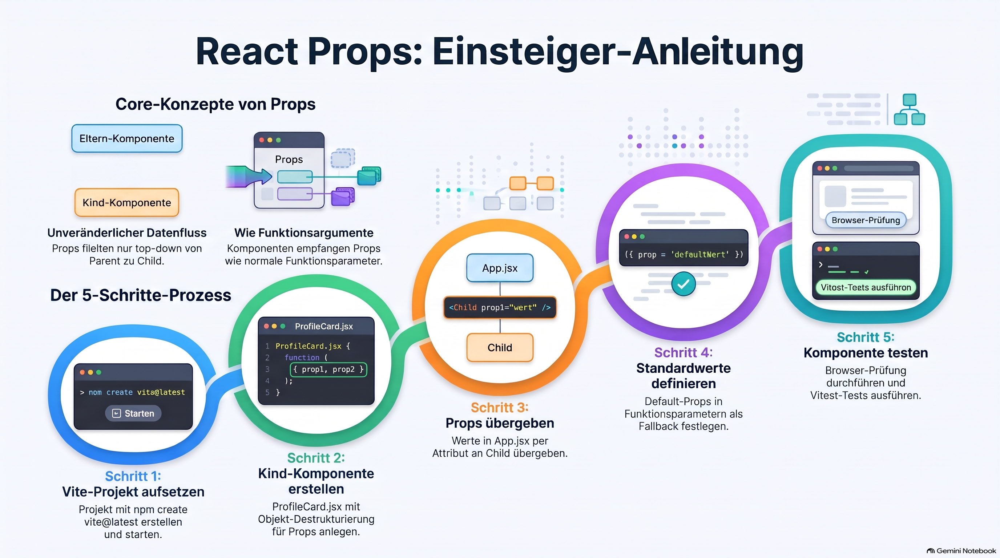

> [!NOTE]
> Der Text ist ein **Anfänger-Tutorial für React-Props**, das die Grundlagen der Datenübergabe von Eltern- zu Kindkomponenten erklärt. Es beginnt mit der **Einrichtung eines Projekts über Vite** und demonstriert die Erstellung einer **wiederverwendbaren Profilkarte** mittels JavaScript-Destrukturierung. Zudem wird gezeigt, wie verschiedene **Datentypen und Fallback-Werte** implementiert werden, um die Robustheit der Anwendung zu erhöhen. Abschließend enthält die Anleitung praktische Schritte zur **manuellen und automatisierten Überprüfung** der Komponenten im Browser sowie durch Tests.


# React Props: A Step-by-Step Beginner Tutorial

## 1. Core Concept (Zettelkasten Summary)

* **What are Props?** Short for _properties_, props are read-only inputs passed from a **Parent** component to a **Child** component.


* **Mental Model:** Think of a React component as a JavaScript function, and **props** as the arguments passed into that function.


* **Golden Rule:** Props are **immutable** (read-only). A child component can read its props, never modify them. Data flows strictly one way: **Top-Down**.


## 2. Step 1: Project Setup (Using Vite)

Modern React projects are best created using **Vite** (a fast build tool). Ensure you have [Node.js](https://nodejs.org/ "null") installed first.


1. Open your terminal or command prompt.


2. Run the following command to scaffold a new React project:


   ```
   npm create vite@latest react-props-demo -- --template react
   ```

3. Navigate into your new project folder:


   ```
   cd react-props-demo
   ```

4. Install the required dependencies:


   ```
   npm install
   ```

5. Start the development server:


   ```
   npm run dev
   ```

6. Open the local URL shown in your terminal (usually `http://localhost:5173`) in your browser. You should see the default Vite + React welcome screen.


## 3. Step 2: Creating a Child Component

We will build a reusable `ProfileCard` component that accepts dynamic data via props.


1. Inside your project folder, go to the `src/` directory.


2. Create a new file named `ProfileCard.jsx`.


3. Add the following code using **object destructuring** (the standard, cleanest way to read props):


```
// src/ProfileCard.jsx

function ProfileCard({ name, role, isAvailable }) {
  return (
    <div style={{ 
      border: '1px solid #ccc', 
      borderRadius: '8px', 
      padding: '16px', 
      margin: '12px 0',
      maxWidth: '300px'
    }}>
      <h2>{name}</h2>
      <p><strong>Role:</strong> {role}</p>
      <p>
        <strong>Status:</strong> {isAvailable ? '🟢 Available for work' : '🔴 Busy'}
      </p>
    </div>
  );
}

export default ProfileCard;
```

### Key Takeaways from Step 2:

* `{ name, role, isAvailable }` unpacks the properties directly from the `props` object.


* Curly braces `{}` inside JSX allow us to embed JavaScript expressions and variables.


## 4. Step 3: Passing Props from the Parent Component

Now we will import `ProfileCard` into our main `App` component (the Parent) and pass different data to each instance.


1. Open `src/App.jsx`.


2. Replace the existing code with the following:


```
// src/App.jsx
import ProfileCard from './ProfileCard';

function App() {
  return (
    <div style={{ fontFamily: 'sans-serif', padding: '20px' }}>
      <h1>Team Directory</h1>
      
      {/* Passing strings, and booleans (wrapped in curly braces) */}
      <ProfileCard 
        name="Elena Rostova" 
        role="Frontend Developer" 
        isAvailable={true} 
      />

      <ProfileCard 
        name="Marcus Vance" 
        role="UI/UX Designer" 
        isAvailable={false} 
      />

      <ProfileCard 
        name="Amina Patel" 
        role="Backend Engineer" 
        isAvailable={true} 
      />
    </div>
  );
}

export default App;
```

### Key Takeaways from Step 3:

* **Strings** are passed using quotes: `name="Elena Rostova"`.


* **Non-strings** (booleans, numbers, arrays, objects) must be wrapped in curly braces: `isAvailable={true}`.


* One component (`ProfileCard`) is reused three times to render completely different UI cards.


## 5. Step 4: Adding Default Props (Bonus Safety)

What happens if a parent forgets to pass a prop? You can assign default fallback values directly in the child component's parameters.


Update `src/ProfileCard.jsx`:


```
// src/ProfileCard.jsx

function ProfileCard({ name = "Anonymous User", role = "Team Member", isAvailable = false }) {
  return (
    <div style={{ 
      border: '1px solid #ccc', 
      borderRadius: '8px', 
      padding: '16px', 
      margin: '12px 0',
      maxWidth: '300px'
    }}>
      <h2>{name}</h2>
      <p><strong>Role:</strong> {role}</p>
      <p>
        <strong>Status:</strong> {isAvailable ? '🟢 Available for work' : '🔴 Busy'}
      </p>
    </div>
  );
}

export default ProfileCard;
```

Try adding `<ProfileCard />` with no attributes inside `App.jsx` to see the fallback values in action!


## 6. Step 5: Testing the App (Manual & Automated)

### A. Manual Browser Verification

1. Ensure `npm run dev` is still running in your terminal.


2. Refresh `http://localhost:5173`.


3. Verify that all three cards render with their respective names, roles, and availability statuses.


4. Open **Browser DevTools** (`F12` or `Right Click -> Inspect`) -> **Console** tab to ensure there are zero red error messages.


### B. Automated Component Testing (Using Vitest & React Testing Library)

To test that your component properly receives and renders props programmatically:


1. Stop the dev server (`Ctrl + C` in terminal).


2. Install **Vitest**, **jsdom**, and **React Testing Library**:


   ```
   npm install -D vitest jsdom @testing-library/react @testing-library/jest-dom
   ```

3. Open `vite.config.js` and configure the test environment:


   ```
   import { defineConfig } from 'vite';
   import react from '@vitejs/plugin-react';

   export default defineConfig({
     plugins: [react()],
     test: {
       environment: 'jsdom',
       globals: true,
     },
   });
   ```

4. Create a test file `src/ProfileCard.test.jsx`:


   ```
   // src/ProfileCard.test.jsx
   import { render, screen } from '@testing-library/react';
   import { describe, it, expect } from 'vitest';
   import ProfileCard from './ProfileCard';

   describe('ProfileCard Component', () => {
     it('renders the passed name, role, and availability status', () => {
       // 1. Arrange & Act: Render the component with mock props
       render(<ProfileCard name="Test User" role="QA Engineer" isAvailable={true} />);

       // 2. Assert: Check if the props appear in the rendered output
       expect(screen.getByText('Test User')).toBeDefined();
       expect(screen.getByText(/QA Engineer/i)).toBeDefined();
       expect(screen.getByText(/Available for work/i)).toBeDefined();
     });
   });
   ```

5. Run the test suite in your terminal:


   ```
   npx vitest run
   ```

6. You should see a green `PASS` confirmation showing `1 passed`.


## 7. Related Zettelkasten Links

* `[[React Components]]` - Building blocks of React UI.


* `[[React State (useState)]]` - How components manage internal, mutable data (contrast with immutable Props).


* `[[JavaScript Destructuring]]` - Syntax used to cleanly extract props.


Manuell oder mit Gemini bearbeiten

Klicke auf eine beliebige Stelle, um selbst Text einzugeben und zu bearbeiten, oder wähle Text aus, um Gemini Änderungen vornehmen zu lassen.

I have created the complete tutorial in Markdown format (`react_props_tutorial.md`), including YAML frontmatter, tags, and bidirectional link placeholders ready for your Zettelkasten vault. Let me know if you'd like to expand on any specific section, such as passing functions as props or the special `children` prop!
