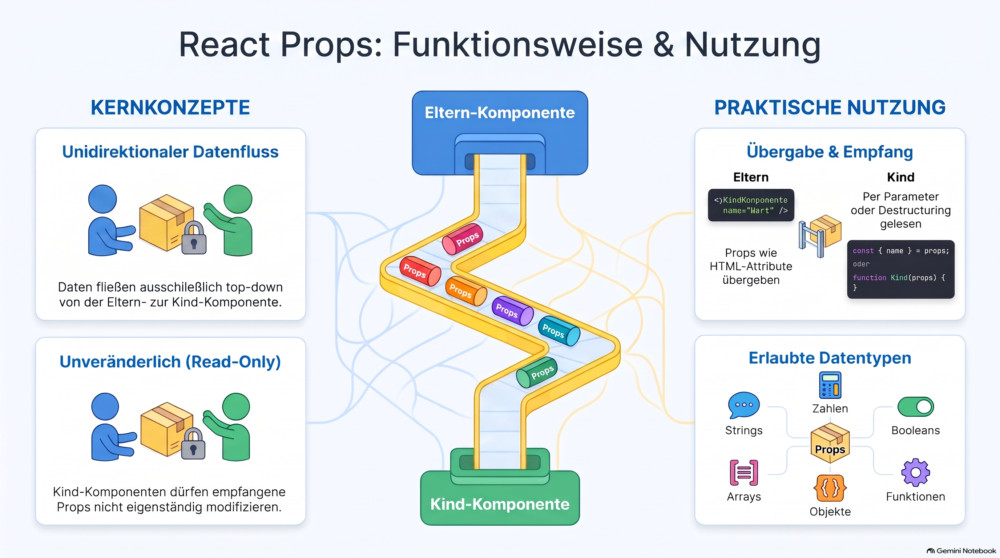

> [!NOTE]
> In React-Anwendungen dienen **Props** als grundlegendes Werkzeug, um Informationen von einer übergeordneten Komponente an eine untergeordnete weiterzuleiten. Sie ähneln funktionalen Argumenten oder HTML-Attributen, wodurch Entwickler flexible und wiederverwendbare UI-Elemente erstellen können. Ein zentrales Merkmal dieser Datenübertragung ist der **unidirektionale Datenfluss**, der sicherstellt, dass Informationen ausschließlich von oben nach unten wandern und für das empfangende Element unveränderlich bleiben. Durch diese **konstante Datenstruktur** lässt sich die Benutzeroberfläche dynamisch anpassen, ohne Werte fest im Code verankern zu müssen. Darüber hinaus beschränken sich diese Eigenschaften nicht nur auf einfache Textzeichenfolgen, sondern unterstützen diverse Formate wie Zahlen, Arrays oder Funktionen. Schließlich ermöglichen sie eine **saubere Code-Organisation**, indem Entwickler benötigte Werte direkt in den Funktionsparametern der jeweiligen Komponenten extrahieren können.

# React Props

In React, **props** (short for **properties**) are the mechanism used to pass data from one component down to another (typically from a parent component to a child component).

Think of props like function arguments in JavaScript or HTML attributes in markup: they allow you to make your components dynamic, reusable, and customizable.

### Key Characteristics of Props

* **Unidirectional (Top-Down) Data Flow:** Data in React flows in one direction—from parent to child. A child component cannot modify the props it receives; they are strictly **read-only** (immutable).


* **Dynamic Customization:** Instead of hardcoding text or values inside a component, you pass props so the component can display different data depending on where or how it is rendered.


### How Props Work: A Simple Example

Here is how you pass a prop from a parent component and receive/use it in a child component:


#### 1. The Parent Component Passes the Prop

```JavaScript
function App() {
  return (
    <div>
      {/* Passing a prop named "name" with the value "Sarah" */}
      <WelcomeMessage name="Sarah" />
    </div>
  );
}
```

#### 2. The Child Component Receives and Uses the Prop

```JavaScript
// The child component accepts "props" as an argument (or object destructuring)
function WelcomeMessage(props) {
  return <h1>Hello, {props.name}!</h1>;
}
```

You can also use **destructuring** directly in the function parameter for cleaner code:

```JavaScript
function WelcomeMessage({ name }) {
  return <h1>Hello, {name}!</h1>;
}
```

### Passing Different Data Types

Props aren't limited to strings. You can pass numbers, booleans, arrays, objects, and even functions down to child components:


```JavaScript
<UserProfile 
  username="dev_alex" 
  age={28} 
  isOnline={true} 
  skills={["React", "JavaScript", "CSS"]} 
/>
```
