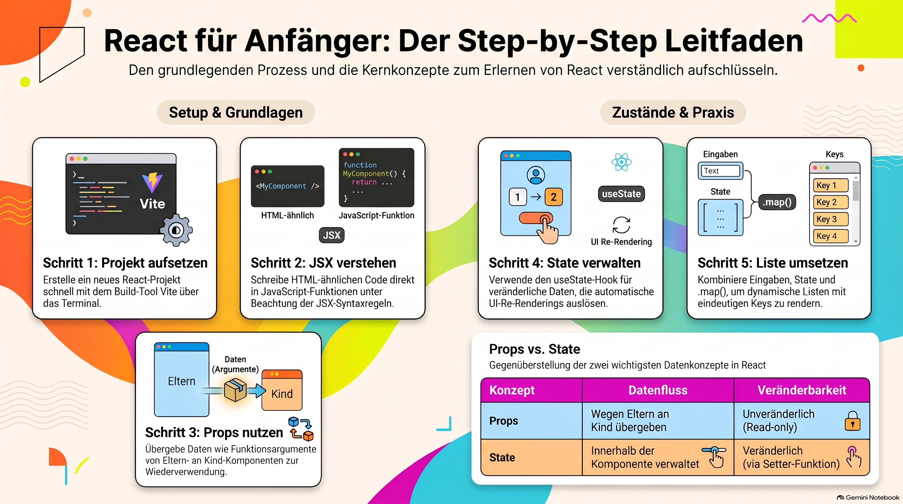

> [!NOTE]
> Karl Schmitt bietet in seiner Anleitung einen praxisnahen Leitfaden für den **Einstieg in React**, der sich speziell an Anfänger richtet. Zur Vorbereitung werden grundlegende Kenntnisse in **HTML, CSS und JavaScript** sowie die Installation von **Node.js und VS Code** vorausgesetzt. Mithilfe von **Vite** lässt sich eine moderne Entwicklungsumgebung einrichten, um die zentralen Konzepte wie **JSX, Komponenten und Props** kennenzulernen. Darüber hinaus erklärt das Tutorial die Funktionsweise des **useState-Hooks** zur Steuerung von dynamischen Inhalten und Interaktivität. Den Abschluss bildet ein praktisches **Mini-Projekt**, das die Erstellung von Aufgabenlisten mithilfe von **Formularen und Arrays** veranschaulicht.

# React Absolute Beginner Tutorial

> **Core Idea:** [[React]] is a [[JavaScript]] library for building user interfaces out of small, reusable pieces called [[React Components]]. Instead of manually updating the [[DOM]], you describe *what* the UI should look like based on your data, and React handles the updates.

---

## Prerequisites
Before starting, make sure you have:
1. Basic familiarity with [[HTML]], [[CSS]], and [[JavaScript]] (variables, functions, arrays).
2. [[Node.js]] installed on your computer (check by running `node -v` in your terminal).
3. A code editor like [[VS Code]].

---

## Step 1: Create a React Project (Using Vite)
Modern React uses build tools like [[Vite]] to set up a fast development environment.

1. Open your terminal.
2. Run the following command to create a new project:
   ```bash
   npm create vite@latest my-first-react-app -- --template react
   ```
3. Move into your new folder, install the dependencies, and start the app:
   ```bash
   cd my-first-react-app
   npm install
   npm run dev
   ```
4. Hold `Ctrl` (or `Cmd`) and click the `http://localhost:5173` link in your terminal to see your live app.

### Important Files to Know
- `index.html` — The single HTML page where your app lives.
- `src/main.jsx` — The entry point that injects React into `index.html`.
- `src/App.jsx` — Your main component where you will write most of your beginner code.

---

## Step 2: Understanding JSX & Your First Component
A **[[React Component]]** is just a JavaScript function that returns HTML-like code called **[[JSX]]** (JavaScript XML).

Open `src/App.jsx`, delete everything inside it, and paste this:

```jsx
function App() {
  const name = "Learner";

  return (
    <div className="container">
      <h1>Hello, {name}!</h1>
      <p>Welcome to your first React app.</p>
    </div>
  );
}

export default App;
```

### Key Rules of JSX
- **Return one parent element:** Wrap multiple elements in a single `<div>` or an empty fragment `<> ... </>`.
- **Use `className` instead of `class`:** Because `class` is a reserved keyword in JavaScript.
- **Curly braces `{ }`:** Put any JavaScript expression (like `{name}` or `{2 + 2}`) inside `{ }` to display it.

---

## Step 3: Reusing Code with Components & Props
Instead of putting everything in `App`, you can create smaller components and pass data to them using **[[React Props]]** (short for properties). Think of props like function arguments.

Update `src/App.jsx`:

```jsx
// 1. Create a child component that accepts "props"
function GreetingCard(props) {
  return (
    <div style={{ border: "1px solid #ccc", padding: "10px", margin: "10px 0" }}>
      <h2>Hello, {props.user}!</h2>
      <p>Role: {props.role}</p>
    </div>
  );
}

// 2. Use the component inside App and pass data to it
function App() {
  return (
    <div>
      <h1>Team Directory</h1>
      <GreetingCard user="Alice" role="Developer" />
      <GreetingCard user="Bob" role="Designer" />
    </div>
  );
}

export default App;
```

> **Note:** Component names **must** start with a Capital Letter (`GreetingCard`), otherwise React thinks it's a standard HTML tag.

---

## Step 4: Adding Interactivity with State (`useState`)
Props pass data *down*, and they shouldn't be changed by the child component. When a component needs to "remember" something that changes over time (like a button click count or text input), it uses **[[React State]]** via the `useState` hook.

Replace `src/App.jsx` with this counter example:

```jsx
import { useState } from "react";

function App() {
  // count = current value (starts at 0)
  // setCount = function to update the value
  const [count, setCount] = useState(0);

  function handleIncrease() {
    setCount(count + 1);
  }

  return (
    <div>
      <h1>Counter: {count}</h1>
      <button onClick={handleIncrease}>Click to +1</button>
      <button onClick={() => setCount(0)}>Reset</button>
    </div>
  );
}

export default App;
```

### How It Works
1. You import `{ useState }` from `"react"`.
2. `useState(0)` creates a state variable initialized to `0`.
3. Never modify `count` directly (`count = count + 1` won't update the screen). Always call `setCount(...)` so React knows to re-render the UI.
4. Events like `onClick` take a function, not a string.

---

## Step 5: Mini Project — Simple Task List
Let's combine **Components**, **State**, **Events**, and **Lists** (`.map()`) into a working mini app.

Replace `src/App.jsx` with:

```jsx
import { useState } from "react";

function App() {
  const [taskInput, setTaskInput] = useState("");
  const [tasks, setTasks] = useState(["Learn JSX", "Understand useState"]);

  function addTask(e) {
    e.preventDefault(); // Prevents page reload on form submit
    if (taskInput.trim() === "") return; // Ignore empty input

    // Create a new array with old tasks + the new task
    setTasks([...tasks, taskInput]);
    setTaskInput(""); // Clear the input box
  }

  return (
    <div style={{ padding: "20px", fontFamily: "sans-serif" }}>
      <h1>My Mini Task List</h1>

      <form onSubmit={addTask}>
        <input
          type="text"
          placeholder="Add a new task..."
          value={taskInput}
          onChange={(e) => setTaskInput(e.target.value)}
        />
        <button type="submit">Add</button>
      </form>

      <ul>
        {tasks.map((task, index) => (
          <li key={index}>{task}</li>
        ))}
      </ul>
    </div>
  );
}

export default App;
```

### New Concepts Introduced Here
- **Controlled Input:** `value={taskInput}` + `onChange` keeps the text box synced with React state.
- **Immutability (`[...tasks, taskInput]`):** In React, you don't `.push()` to an array in state; you create a fresh copy using the [[JavaScript Spread Operator]].
- **Rendering Lists (`.map()`):** Converts an array of strings into an array of `<li>` elements. Every list item needs a unique `key` prop so React can track it efficiently.

---

## Zettelkasten Breakdown (Atomic Note Ideas)
If you want to split this tutorial into atomic notes in your vault, create separate notes for these core concepts:
- `[[JSX Syntax Rules]]` — Why `className` and `{}` are used, and the single-parent rule.
- `[[Props vs State in React]]` — Props are passed in (immutable); State is managed inside (mutable via setter).
- `[[React useState Hook]]` — How state triggers re-renders and why direct mutation fails.
- `[[Rendering Lists in React]]` — Using `.map()` and the importance of the `key` prop.

## Next Steps
- [[React Conditional Rendering]] (showing/hiding elements with `&&` or ternary `? :`)
- [[React useEffect Hook]] (fetching data from an API)
~~~~