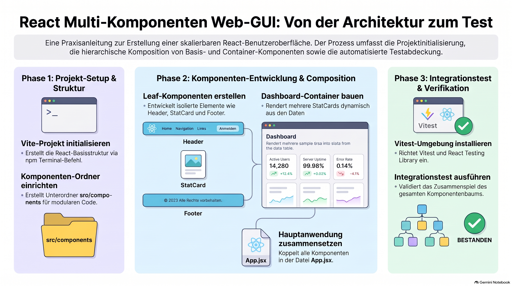
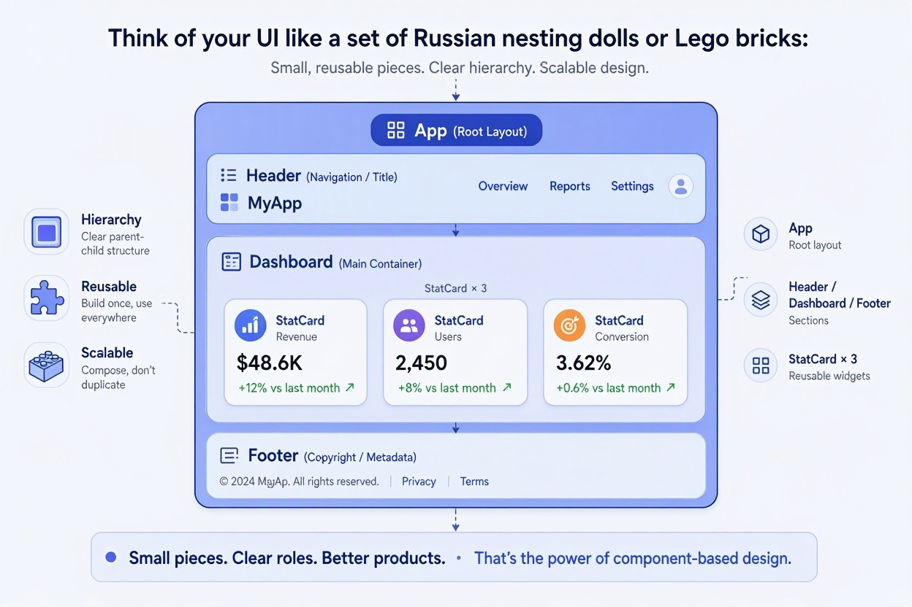
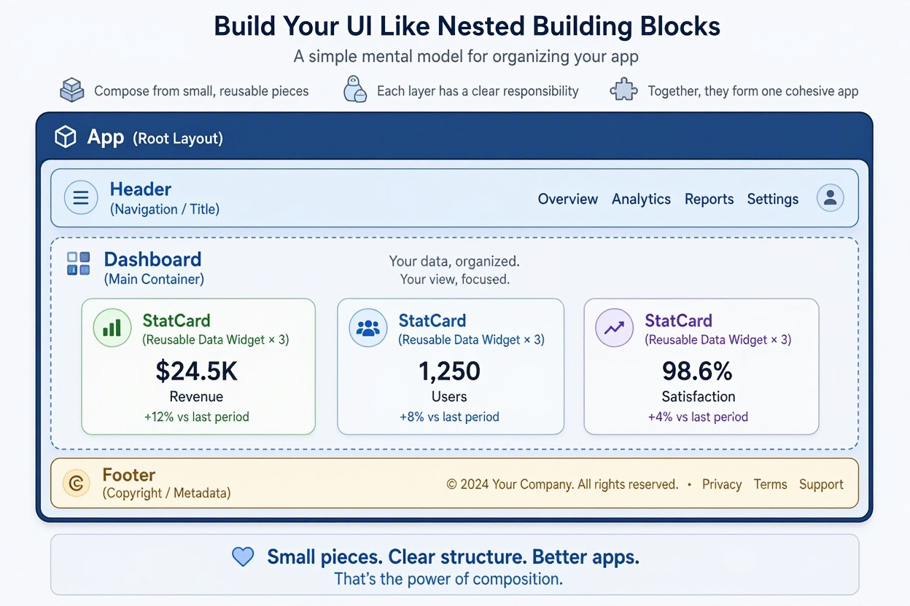

> [!NOTE]
> Dieser Leitfaden erklärt den schrittweisen Aufbau einer modernen **React-Benutzeroberfläche** mithilfe einer strukturierten **Komponenten-Architektur**. Zu Beginn wird ein neues Projekt über **Vite** eingerichtet und ein logischer **Ordner-Pfad** für die einzelnen UI-Elemente angelegt. Anschließend konstruieren Entwickler sowohl eigenständige **Blatt-Komponenten** wie Header und Fußzeile als auch **Container-Elemente** wie das Dashboard, welche mithilfe von **Props** Daten weiterleiten. Abschließend demonstriert das Tutorial die Integration von **Testwerkzeugen** wie Vitest und React Testing Library, um die fehlerfreie Darstellung des gesamten Anwendungsbaums zu überprüfen.


# Building a Multi-Component Web GUI in React


## 1. Core Concept (Zettelkasten Summary)

* **Component Architecture:** A React GUI is built as a **Component Tree**—a hierarchy of small, single-responsibility functions that return JSX.


* **Composition over Inheritance:** Complex interfaces are created by nesting smaller "leaf" components inside larger "layout" components, passing data down via **Props**.


* **Mental Model:** Think of your UI like a set of Russian nesting dolls or Lego bricks:



  * `App` (Root Layout)


    * `Header` (Navigation/Title)


    * `Dashboard` (Main Container)


      * `StatCard` (Reusable Data Widget $\times 3$)


    * `Footer` (Copyright/Metadata)


## 2. Step 1: Project Creation via Vite

Ensure [Node.js](https://nodejs.org/ "null") is installed on your system.


1. Open your terminal and create a new Vite + React project:


   ```
   npm create vite@latest react-gui-demo -- --template react
   ```

2. Navigate into the project directory:


   ```
   cd react-gui-demo
   ```

3. Install dependencies:


   ```
   npm install
   ```

4. Start the development server to verify the base setup:


   ```
   npm run dev
   ```

   _(Open `http://localhost:5173` in your browser to confirm it loads)._


## 3. Step 2: Organizing the Folder Structure

To keep multi-component GUIs maintainable, group reusable UI pieces inside a `src/components/` folder.


1. Inside your `src/` directory, create a new folder named `components`.


2. We will create four distinct components inside `src/components/`:



   * `Header.jsx`


   * `StatCard.jsx`


   * `Dashboard.jsx`


   * `Footer.jsx`


## 4. Step 3: Building the Leaf Components

Start from the bottom of the component tree (components that don't depend on other custom components).


### A. The Header Component (`src/components/Header.jsx`)

```JavaScript
function Header({ title, subtitle }) {
  return (
    <header style={{ 
      backgroundColor: '#1e293b', 
      color: '#ffffff', 
      padding: '20px', 
      borderRadius: '8px',
      marginBottom: '20px'
    }}>
      <h1 style={{ margin: 0 }}>{title}</h1>
      <p style={{ margin: '4px 0 0', color: '#94a3b8' }}>{subtitle}</p>
    </header>
  );
}

export default Header;
```

### B. The Reusable Widget Component (`src/components/StatCard.jsx`)

```JavaScript
function StatCard({ label, value, trend }) {
  return (
    <div style={{
      border: '1px solid #e2e8f0',
      borderRadius: '8px',
      padding: '16px',
      backgroundColor: '#f8fafc',
      flex: '1',
      minWidth: '180px'
    }}>
      <span style={{ fontSize: '0.85rem', color: '#64748b', textTransform: 'uppercase' }}>
        {label}
      </span>
      <h2 style={{ margin: '8px 0', fontSize: '1.75rem', color: '#0f172a' }}>
        {value}
      </h2>
      <span style={{ fontSize: '0.85rem', color: trend.startsWith('+') ? '#16a34a' : '#dc2626' }}>
        {trend} vs last month
      </span>
    </div>
  );
}

export default StatCard;
```

### C. The Footer Component (`src/components/Footer.jsx`)

```JavaScript
function Footer({ year, organization }) {
  return (
    <footer style={{ 
      marginTop: '32px', 
      paddingTop: '16px', 
      borderTop: '1px solid #e2e8f0', 
      textAlign: 'center', 
      color: '#64748b',
      fontSize: '0.9rem'
    }}>
      &copy; {year} {organization}. All rights reserved.
    </footer>
  );
}

export default Footer;
```

## 5. Step 4: Building a Container Component (`Dashboard.jsx`)

Now, create a mid-level container component that imports and arranges multiple `StatCard` components into a responsive flexbox grid.


Create `src/components/Dashboard.jsx`:


```JavaScript
import StatCard from './StatCard';

function Dashboard({ metrics }) {
  return (
    <section>
      <h2 style={{ marginBottom: '12px', color: '#334155' }}>System Overview</h2>
      <div style={{ display: 'flex', gap: '16px', flexWrap: 'wrap' }}>
        {metrics.map((item) => (
          <StatCard 
            key={item.id} 
            label={item.label} 
            value={item.value} 
            trend={item.trend} 
          />
        ))}
      </div>
    </section>
  );
}

export default Dashboard;
```

> **Note:** When rendering a list of components via `.map()`, React requires a unique `key` prop on each item to track DOM updates efficiently.
>
>

## 6. Step 5: Assembling the Full GUI (`src/App.jsx`)

Finally, compose the entire application inside `src/App.jsx` by connecting `Header`, `Dashboard`, and `Footer`.


Replace the contents of `src/App.jsx`:


```JavaScript
import Header from './components/Header';
import Dashboard from './components/Dashboard';
import Footer from './components/Footer';

function App() {
  const systemMetrics = [
    { id: 1, label: 'Active Users', value: '14,280', trend: '+12.4%' },
    { id: 2, label: 'Server Uptime', value: '99.98%', trend: '+0.02%' },
    { id: 3, label: 'Error Rate', value: '0.14%', trend: '-4.1%' }
  ];

  return (
    <div style={{ 
      maxWidth: '900px', 
      margin: '0 auto', 
      padding: '24px', 
      fontFamily: 'system-ui, sans-serif' 
    }}>
      <Header 
        title="Operations Control Center" 
        subtitle="Real-time infrastructure & user telemetry" 
      />
      
      <main>
        <Dashboard metrics={systemMetrics} />
      </main>

      <Footer year={2026} organization="Acme Cloud Systems" />
    </div>
  );
}

export default App;
```

## 7. Step 6: Testing the Multi-Component GUI

We will verify both individual components (Unit Testing) and the full composed tree (Integration Testing).


### A. Install Testing Tools

1. Stop the Vite dev server (`Ctrl + C`).


2. Install **Vitest**, **jsdom**, and **React Testing Library**:


   ```
   npm install -D vitest jsdom @testing-library/react @testing-library/jest-dom
   ```

3. Configure `vite.config.js` to support `jsdom`:


   ```JavaScript
   import { defineConfig } from 'vite';
   import react from '@vitejs/plugin-react';

   export default defineConfig({
     plugins: [react()],
     test: {
       environment: 'jsdom',
       globals: true,
     },
   });
   ```

### B. Write Integration & Unit Tests (`src/App.test.jsx`)

Create `src/App.test.jsx` to verify that `App` renders all child components (`Header`, `Dashboard`, `StatCard`, and `Footer`) properly together:


```JavaScript
import { render, screen } from '@testing-library/react';
import { describe, it, expect } from 'vitest';
import App from './App';

describe('Multi-Component GUI Integration', () => {
  it('renders the Header, Dashboard metrics, and Footer', () => {
    // 1. Render the full component tree
    render(<App />);

    // 2. Verify Header rendered
    expect(screen.getByText('Operations Control Center')).toBeDefined();

    // 3. Verify Dashboard & child StatCards rendered
    expect(screen.getByText('System Overview')).toBeDefined();
    expect(screen.getByText('Active Users')).toBeDefined();
    expect(screen.getByText('14,280')).toBeDefined();
    expect(screen.getByText('99.98%')).toBeDefined();

    // 4. Verify Footer rendered
    expect(screen.getByText(/Acme Cloud Systems/i)).toBeDefined();
  });
});
```

### C. Run the Test Suite

Execute the tests in your terminal:


```
npx vitest run
```

You should see a green `PASS` status confirming your entire component hierarchy renders as expected.


## 8. Related Zettelkasten Links

* `[[React Props Beginner Tutorial]]` - How data flows from parent to child components.


* `[[JSX Syntax Rules]]` - Writing HTML-like structures inside JavaScript functions.


* `[[React State (useState)]]` - Making multi-component GUIs interactive (e.g., filtering or updating metrics).


Manuell oder mit Gemini bearbeiten

Klicke auf eine beliebige Stelle, um selbst Text einzugeben und zu bearbeiten, oder wähle Text aus, um Gemini Änderungen vornehmen zu lassen.

I have created the multi-component React GUI tutorial (`react_multi_component_gui_tutorial.md`) in Zettelkasten Markdown format, walking through project scaffolding with Vite, component tree architecture, list rendering with `.map()`, and integration testing with Vitest. Let me know if you'd like to add interactive state (such as filtering cards or clicking buttons) in a follow-up note!
