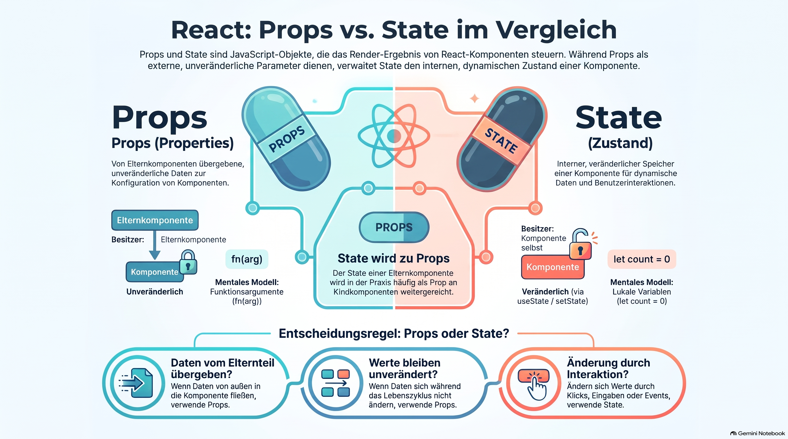
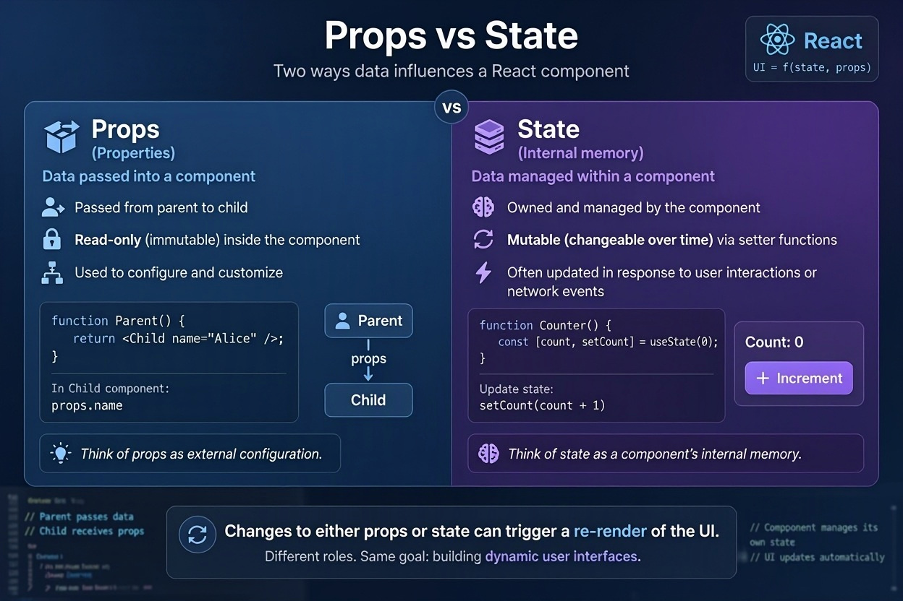
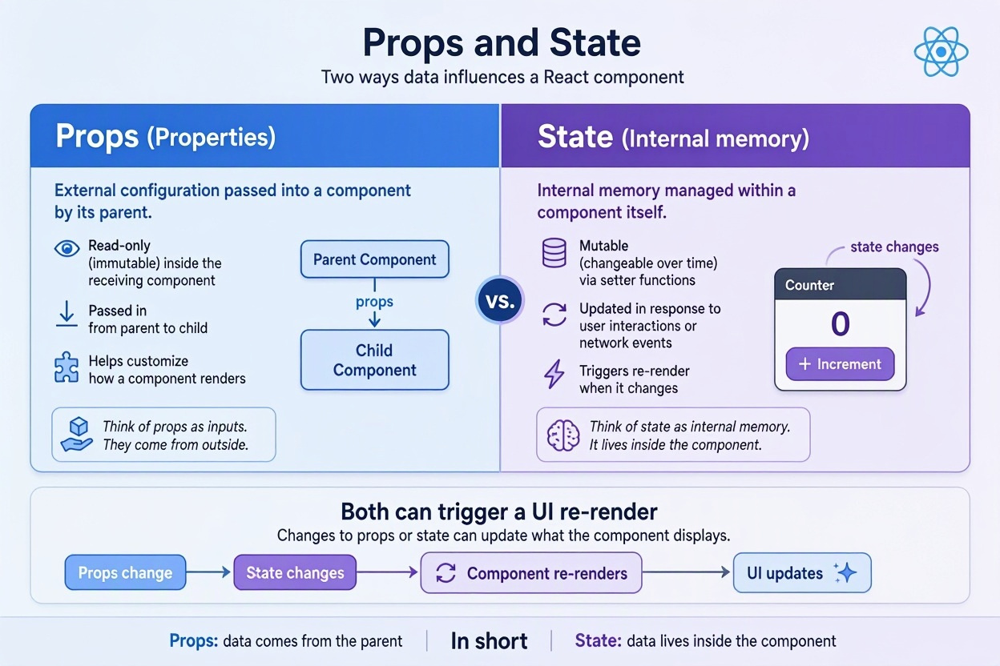

> [!NOTE]
> Die bereitgestellten Quellen erklären die grundlegenden Unterschiede und das Zusammenspiel von **Props** und **State** in der JavaScript-Bibliothek React. Während **Props** von außen an eine Komponente übergeben werden, unveränderlich sind und wie Funktionsargumente wirken, fungiert der **State** als internes, veränderliches Gedächtnis einer Komponente für dynamische Daten. Der Text veranschaulicht diese Konzepte anhand von übersichtlichen Tabellen, anschaulichen Code-Beispielen sowie praktischen Entscheidungsregeln für die Softwareentwicklung. Zudem wird demonstriert, wie der **State** einer Elternkomponente häufig als **Prop** an ein untergeordnetes Element weitergereicht wird.


# React: Props vs. State

## 1. Core Concept (Zettelkasten Summary)



Both **Props** and **State** are plain JavaScript objects that hold information influencing the render output of a React component, and changes to either will trigger a UI re-render. However, they serve opposite architectural roles:


* **Props (Properties):** External configuration passed **into** a component by its parent. They are **read-only** (immutable) inside the receiving component.


* **State:** Internal memory managed **within** a component itself. It is **mutable** (changeable over time) via setter functions (e.g., `useState`), usually in response to user interactions or network events.


## 2. Quick-Reference Comparison

|                      |                                              |                                                                      |
| -------------------- | -------------------------------------------- | -------------------------------------------------------------------- |
| **Feature**          | **Props**                                    | **State**                                                            |
| **Ownership**        | Owned by the **Parent** component            | Owned by the **Component itself**                                    |
| **Mutability**       | **Immutable** (Read-only by child)           | **Mutable** (Updated via `setState` / `useState`)                    |
| **Data Flow**        | Passed **down** from parent to child         | Stays **local** (unless passed down as props to children)            |
| **Mental Model**     | Function **arguments** (`fn(arg)`)           | Function **local variables** (`let count = 0`)                       |
| **Primary Purpose**  | Configure and customize reusable components  | Track dynamic data that changes over time (clicks, inputs, toggles)  |

## 3. Code Example 1: Props in Action (External & Read-Only)

In this example, `GreetingBanner` does not own its data; it simply displays whatever `username` the parent passes to it.


```JavaScript
// Child Component: Receives "username" as a read-only prop
function GreetingBanner({ username }) {
  // ❌ INVALID: username = "Bob"; (Never modify props directly!)
  
  return <h2>Welcome back, {username}!</h2>;
}

// Parent Component: Controls and passes the data
function App() {
  return <GreetingBanner username="Alice" />;
}
```

## 4. Code Example 2: State in Action (Internal & Mutable)

In this example, `LikeButton` manages its own private `likes` counter using the `useState` hook. When clicked, it updates its own state, causing React to re-render the button with the new number.


```JavaScript
import { useState } from 'react';

function LikeButton() {
  // Declare internal state: [currentValue, updaterFunction]
  const [likes, setLikes] = useState(0);

  function handleLike() {
    // ✅ VALID: Update state using the setter function
    setLikes(likes + 1);
  }

  return (
    <button onClick={handleLike}>
      ❤️ Likes: {likes}
    </button>
  );
}
```

## 5. How They Work Together (State Passed Down as Props)

In real applications, **a parent component's State often becomes a child component's Props**.


Here, `App` owns the `theme` state and passes it down to `StatusBox` as a prop:


```JavaScript
import { useState } from 'react';

// Child Component: Purely receives "theme" via Props
function StatusBox({ theme }) {
  const isDark = theme === 'dark';

  return (
    <div style={{
      padding: '16px',
      marginTop: '12px',
      backgroundColor: isDark ? '#1e293b' : '#f1f5f9',
      color: isDark ? '#f8fafc' : '#0f172a',
      borderRadius: '8px'
    }}>
      Current active theme: <strong>{theme.toUpperCase()}</strong>
    </div>
  );
}

// Parent Component: Owns "theme" in State and passes it down
function App() {
  const [theme, setTheme] = useState('light');

  function toggleTheme() {
    setTheme(theme === 'light' ? 'dark' : 'light');
  }

  return (
    <div style={{ padding: '20px', fontFamily: 'sans-serif' }}>
      <button onClick={toggleTheme}>
        Switch to {theme === 'light' ? 'Dark' : 'Light'} Mode
      </button>

      {/* Parent's STATE is passed as the Child's PROP */}
      <StatusBox theme={theme} />
    </div>
  );
}

export default App;
```

## 6. Decision Rule: Should I Use Props or State?



Ask yourself these three questions when designing a component:

1. **Is it passed in from a parent?** $\rightarrow$ Use **Props**.

2. **Does it remain unchanged throughout the component's lifecycle?** $\rightarrow$ Use **Props** (or a plain constant).

3. **Does it change because of user interaction (typing, clicking, toggling) inside this component?** $\rightarrow$ Use **State**.


## 7. Related Zettelkasten Links

* `[[React Props Beginner Tutorial]]` - Step-by-step setup and testing of component props.


* `[[Building a Multi-Component Web GUI in React]]` - Structuring parent-child component hierarchies.


* `[[React Hooks - useState]]` - Deep dive into state updates, batching, and functional state setters.


* `[[Lifting State Up in React]]` - How to share state between sibling components via a common parent.


Manuell oder mit Gemini bearbeiten

Klicke auf eine beliebige Stelle, um selbst Text einzugeben und zu bearbeiten, oder wähle Text aus, um Gemini Änderungen vornehmen zu lassen.

I have generated the Zettelkasten Markdown note (`react_props_vs_state.md`) contrasting **Props** and **State**, complete with a comparison table, isolated examples, a combined pattern showing state passed down as props, and a quick decision checklist. Let me know if you'd like to explore "Lifting State Up" or how to test stateful components with Vitest!
