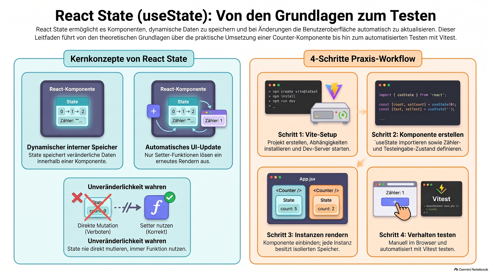
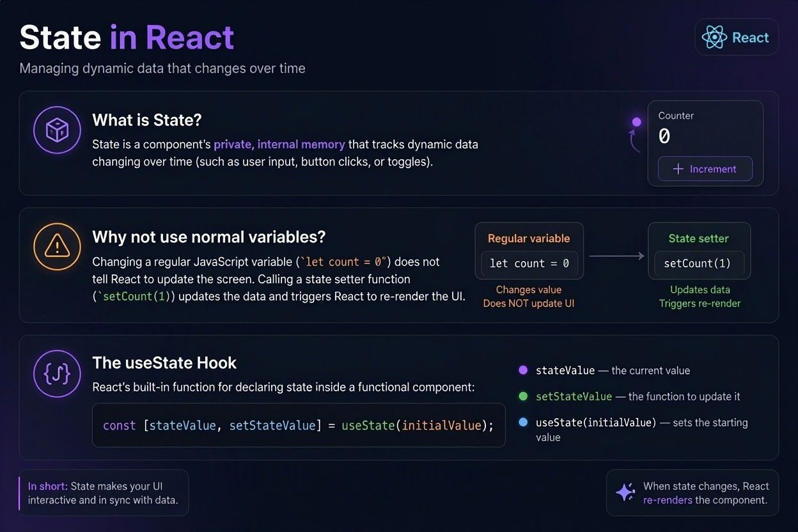

> [!NOTE]
> Dieser **Tutorial-Leitfaden** erklärt die Funktionsweise von **React State** anhand eines praktischen Zettelkasten-Eintrags. Nach der Einrichtung eines Projekts mit **Vite** wird die Erstellung einer **interaktiven Komponente** demonstriert, die sowohl numerische Werte als auch Texteingaben verwaltet. Dabei wird verdeutlicht, wie Komponenten **unabhängige Speicherbereiche** pflegen und wie direkte Datenmutationen vermieden werden. Abschließend zeigt die Anleitung, wie solche zustandsbasierten Benutzeroberflächen manuell im Browser sowie automatisiert mit **Vitest** getestet werden können.


# React State (`useState`): A Step-by-Step Beginner Tutorial

## 1. Core Concept (Zettelkasten Summary)



* **What is State?** State is a component's private, internal memory that tracks dynamic data changing over time (such as user input, button clicks, or toggles).


* **Why not use normal variables?** Changing a regular JavaScript variable (`let count = 0`) does **not** tell React to update the screen. Calling a state setter function (`setCount(1)`) updates the data **and** triggers React to re-render the UI.


* **The `useState` Hook:** React's built-in function for declaring state inside a functional component:


  ```
  const [stateValue, setStateValue] = useState(initialValue);
  ```

## 2. Step 1: Project Setup (Using Vite)

Ensure [Node.js](https://nodejs.org/ "null") is installed on your machine.


1. Open your terminal and scaffold a new React project using Vite:


   ```
   npm create vite@latest react-state-demo -- --template react
   ```

2. Navigate into the project directory:


   ```
   cd react-state-demo
   ```

3. Install dependencies:


   ```
   npm install
   ```

4. Start the development server:


   ```
   npm run dev
   ```

5. Open `http://localhost:5173` in your browser to verify the default Vite + React app runs cleanly.


## 3. Step 2: Building a Stateful Component (`CounterBox.jsx`)

We will build an interactive counter and text-input component demonstrating two different state variables working independently inside the same component.


1. Inside the `src/` folder, create a new file named `CounterBox.jsx`.


2. Add the following code:


```
// src/CounterBox.jsx
import { useState } from 'react';

function CounterBox() {
  // 1. Numeric state for tracking clicks
  const [count, setCount] = useState(0);

  // 2. String state for tracking live text input
  const [label, setLabel] = useState('Task Counter');

  function handleIncrement() {
    // Use functional updater (prev => prev + 1) when new state depends on old state
    setCount((prevCount) => prevCount + 1);
  }

  function handleDecrement() {
    setCount((prevCount) => Math.max(0, prevCount - 1)); // Prevents negative numbers
  }

  function handleReset() {
    setCount(0);
  }

  return (
    <div style={{
      border: '1px solid #cbd5e1',
      borderRadius: '8px',
      padding: '20px',
      maxWidth: '360px',
      backgroundColor: '#f8fafc'
    }}>
      {/* Controlled Input: Value is driven by React state */}
      <div style={{ marginBottom: '12px' }}>
        <label htmlFor="label-input" style={{ display: 'block', fontSize: '0.85rem', marginBottom: '4px' }}>
          Counter Title:
        </label>
        <input
          id="label-input"
          type="text"
          value={label}
          onChange={(e) => setLabel(e.target.value)}
          style={{ padding: '6px', width: '100%', boxSizing: 'border-box' }}
        />
      </div>

      <h2>{label}: {count}</h2>

      <div style={{ display: 'flex', gap: '8px' }}>
        <button onClick={handleIncrement}>+ Increment</button>
        <button onClick={handleDecrement}>- Decrement</button>
        <button onClick={handleReset}>Reset</button>
      </div>
    </div>
  );
}

export default CounterBox;
```

### Key Takeaways from Step 2:

* **Never mutate state directly:** Always call `setCount(...)` instead of `count = count + 1`.


* **Functional Updates:** Passing a callback (`prevCount => prevCount + 1`) guarantees you are reading the freshest state value even if multiple clicks happen rapidly.


* **Controlled Inputs:** Binding `value={label}` and `onChange={(e) => setLabel(e.target.value)}` keeps the input box and React state completely synchronized.


## 4. Step 3: Rendering the Component in `App.jsx`

Now mount `CounterBox` inside your main `App` component. Note that if you render `<CounterBox />` twice, **each instance gets its own isolated state**.


1. Open `src/App.jsx` and replace its contents with:


```
// src/App.jsx
import CounterBox from './CounterBox';

function App() {
  return (
    <div style={{ fontFamily: 'system-ui, sans-serif', padding: '24px' }}>
      <h1>React State Demo</h1>
      <p>Each component below maintains its own independent memory (state):</p>
      
      <div style={{ display: 'flex', gap: '20px', flexWrap: 'wrap' }}>
        <CounterBox />
        <CounterBox />
      </div>
    </div>
  );
}

export default App;
```

## 5. Step 4: Testing Stateful Interactions (Manual & Automated)

### A. Manual Browser Verification

1. Check `http://localhost:5173` while `npm run dev` is running.


2. Click **+ Increment** on the first card—verify only the first card's count increases while the second stays at `0`.


3. Type into the **Counter Title** input box and observe the heading update live on every keystroke.


### B. Automated Interaction Testing (Vitest + User Event)

To test stateful components automatically, we simulate real user clicks and typing using `@testing-library/user-event`.


1. Stop the dev server (`Ctrl + C` in terminal).


2. Install **Vitest**, **jsdom**, **React Testing Library**, and **User Event**:


   ```
   npm install -D vitest jsdom @testing-library/react @testing-library/jest-dom @testing-library/user-event
   ```

3. Configure `vite.config.js` to use `jsdom`:


   ```
   import { defineConfig } from 'vite';
   import react from '@vitejs/plugin-react';

   export default defineConfig({
     plugins: [react()],
     test: {
       environment: 'jsdom',
       globals: true,
     },
   });
   ```

4. Create a test file `src/CounterBox.test.jsx`:


```
// src/CounterBox.test.jsx
import { render, screen } from '@testing-library/react';
import userEvent from '@testing-library/user-event';
import { describe, it, expect } from 'vitest';
import CounterBox from './CounterBox';

describe('CounterBox State Behavior', () => {
  it('increments, decrements, and resets the counter on button clicks', async () => {
    const user = userEvent.setup();
    render(<CounterBox />);

    // Initial state check
    expect(screen.getByRole('heading', { name: /Task Counter: 0/i })).toBeDefined();

    // Simulate clicking "+ Increment" twice
    const incrementBtn = screen.getByRole('button', { name: /\+ Increment/i });
    await user.click(incrementBtn);
    await user.click(incrementBtn);
    expect(screen.getByRole('heading', { name: /Task Counter: 2/i })).toBeDefined();

    // Simulate clicking "- Decrement" once
    const decrementBtn = screen.getByRole('button', { name: /- Decrement/i });
    await user.click(decrementBtn);
    expect(screen.getByRole('heading', { name: /Task Counter: 1/i })).toBeDefined();

    // Simulate clicking "Reset"
    const resetBtn = screen.getByRole('button', { name: /Reset/i });
    await user.click(resetBtn);
    expect(screen.getByRole('heading', { name: /Task Counter: 0/i })).toBeDefined();
  });

  it('updates the heading dynamically when the user types in the input', async () => {
    const user = userEvent.setup();
    render(<CounterBox />);

    const input = screen.getByLabelText(/Counter Title:/i);

    // Clear default text and type a new title
    await user.clear(input);
    await user.type(input, 'Bugs Fixed');

    expect(screen.getByRole('heading', { name: /Bugs Fixed: 0/i })).toBeDefined();
  });
});
```

5. Run the test suite:


   ```
   npx vitest run
   ```

6. You should see `2 passed` in green, verifying both button click state transitions and controlled text input updates.


## 6. Related Zettelkasten Links

* `[[React Props vs. State]]` - Conceptual comparison of immutable external props vs. mutable internal state.


* `[[React Props Beginner Tutorial]]` - Passing data down from parent to child components.


* `[[Building a Multi-Component Web GUI in React]]` - Structuring larger applications with component trees.


* `[[Lifting State Up in React]]` - Sharing state between two sibling components by moving state to their common parent.


Manuell oder mit Gemini bearbeiten

Klicke auf eine beliebige Stelle, um selbst Text einzugeben und zu bearbeiten, oder wähle Text aus, um Gemini Änderungen vornehmen zu lassen.

I have created the complete React State (`useState`) tutorial (`react_state_tutorial.md`) in Zettelkasten Markdown format, covering project scaffolding with Vite, managing both numeric and text input state, isolated component state instances, and automated interaction testing with Vitest and `@testing-library/user-event`. Let me know if you'd like a follow-up note on **Lifting State Up** or `useEffect`!
