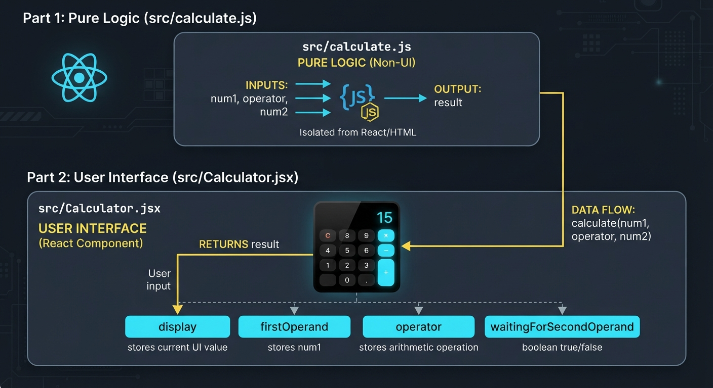

> [!NOTE]
> Der bereitgestellte Text beschreibt eine umfassende Anleitung zur Erstellung und zum Testen eines interaktiven **Web-Rechners mit React**. Dabei werden grundlegende Konzepte wie **Zustandsverwaltung**, **Ereignisverarbeitung** und die **Trennung von Geschäftslogik und Benutzeroberfläche** anhand isolierter Berechnungsfunktionen vermittelt. Das Projekt wird mithilfe von **Vite** initialisiert und das Layout durch moderne **CSS-Grid-Strukturen** übersichtlich gestaltet. Abschließend wird erläutert, wie mithilfe von **Vitest** und **React Testing Library** sowohl isolierte **Unit-Tests** für die Rechenoperationen als auch **Integrationstests** zur Simulation von Benutzereingaben eingerichtet und ausgeführt werden.
 

# React Web Calculator: Absolute Beginner Tutorial

> **Core Idea:** Building a calculator teaches the three pillars of [[React]]: **[[React State]]** (remembering numbers and operators), **[[Event Handling]]** (responding to button clicks), and **Separation of Concerns** (keeping pure math logic separate from the UI so it is easy to read and test).

---

## Step 1: Create the React Project

We will use [[Vite]] to generate a clean, modern React project.

1. Open your terminal and create the project:
   ```bash
   npm create vite@latest react-calculator -- --template react
   ```
2. Navigate into the folder, install dependencies, and start the development server:
   ```bash
   cd react-calculator
   npm install
   npm run dev
   ```
3. Click the `http://localhost:5173` link in your terminal to view the starter app in your browser.

---

## Step 2: Plan the Calculator Architecture



Before writing code, break the problem into two parts:
1. **Pure Logic (`src/calculate.js`):** A plain [[JavaScript]] function that takes two numbers and an operator (`+`, `-`, `*`, `/`) and returns the answer. It knows nothing about React or HTML.
2. **User Interface (`src/Calculator.jsx`):** A [[React Component]] that displays buttons, tracks what the user clicked using `useState`, and calls `calculate()` when needed.

### What State Does a Calculator Need?

To behave like a real calculator, our component needs to remember 4 things:
- `display`: What is currently shown on the screen (e.g., `"0"`, `"42"`, `"Error"`).
- `firstOperand`: The first number entered before pressing an operator (e.g., `5` in `5 + 3`).
- `operator`: The chosen math symbol (`"+"`, `"-"`, `"*"`, `"/"`, or `null`).
- `waitingForSecondOperand`: A `true`/`false` flag telling React whether the next digit pressed should *replace* the screen (starting the second number) or *append* to it.

---

## Step 3: Write the Pure Math Logic

Create a new file called `src/calculate.js`:

```javascript
export function calculate(a, b, operator) {
  if (operator === "+") return a + b;
  if (operator === "-") return a - b;
  if (operator === "*") return a * b;
  if (operator === "/") {
    if (b === 0) return "Error";
    return a / b;
  }
  return b;
}
```

> **Why separate this?** Because `calculate` is a [[Pure Function]], we can test all our math edge cases (like dividing by zero) in milliseconds without rendering any HTML.

---

## Step 4: Build the Calculator Component

Create a new file called `src/Calculator.jsx` and paste the following code:

```jsx
import { useState } from "react";
import { calculate } from "./calculate";
import "./Calculator.css";

function Calculator() {
  const [display, setDisplay] = useState("0");
  const [firstOperand, setFirstOperand] = useState(null);
  const [operator, setOperator] = useState(null);
  const [waitingForSecondOperand, setWaitingForSecondOperand] = useState(false);

  function inputDigit(digit) {
    // If recovering from an Error, start fresh
    if (display === "Error") {
      setDisplay(digit);
      setFirstOperand(null);
      setOperator(null);
      setWaitingForSecondOperand(false);
      return;
    }

    if (waitingForSecondOperand) {
      setDisplay(digit);
      setWaitingForSecondOperand(false);
    } else {
      setDisplay(display === "0" ? digit : display + digit);
    }
  }

  function inputDecimal() {
    if (display === "Error") return;

    if (waitingForSecondOperand) {
      setDisplay("0.");
      setWaitingForSecondOperand(false);
      return;
    }

    if (!display.includes(".")) {
      setDisplay(display + ".");
    }
  }

  function handleOperator(nextOperator) {
    if (display === "Error") return;

    const inputValue = parseFloat(display);

    if (firstOperand === null) {
      setFirstOperand(inputValue);
    } else if (operator && !waitingForSecondOperand) {
      const result = calculate(firstOperand, inputValue, operator);
      if (result === "Error") {
        setDisplay("Error");
        setFirstOperand(null);
        setOperator(null);
        setWaitingForSecondOperand(false);
        return;
      }
      setDisplay(String(result));
      setFirstOperand(result);
    }

    setWaitingForSecondOperand(true);
    setOperator(nextOperator);
  }

  function handleEquals() {
    if (display === "Error" || operator === null || waitingForSecondOperand) {
      return;
    }

    const inputValue = parseFloat(display);
    const result = calculate(firstOperand, inputValue, operator);

    setDisplay(String(result));
    setFirstOperand(null);
    setOperator(null);
    setWaitingForSecondOperand(true);
  }

  function clearAll() {
    setDisplay("0");
    setFirstOperand(null);
    setOperator(null);
    setWaitingForSecondOperand(false);
  }

  return (
    <div className="calculator">
      <div className="calculator-display" data-testid="display">
        {display}
      </div>

      <div className="calculator-keypad">
        <button className="btn-clear" onClick={clearAll}>C</button>
        <button className="btn-operator" onClick={() => handleOperator("/")}>/</button>
        <button className="btn-operator" onClick={() => handleOperator("*")}>*</button>
        <button className="btn-operator" onClick={() => handleOperator("-")}>-</button>

        <button onClick={() => inputDigit("7")}>7</button>
        <button onClick={() => inputDigit("8")}>8</button>
        <button onClick={() => inputDigit("9")}>9</button>
        <button className="btn-operator" onClick={() => handleOperator("+")}>+</button>

        <button onClick={() => inputDigit("4")}>4</button>
        <button onClick={() => inputDigit("5")}>5</button>
        <button onClick={() => inputDigit("6")}>6</button>
        <button className="btn-equals" onClick={handleEquals}>=</button>

        <button onClick={() => inputDigit("1")}>1</button>
        <button onClick={() => inputDigit("2")}>2</button>
        <button onClick={() => inputDigit("3")}>3</button>
        <button onClick={() => inputDigit("0")}>0</button>

        <button onClick={inputDecimal}>.</button>
      </div>
    </div>
  );
}

export default Calculator;
```

---

## Step 5: Style the Calculator with CSS Grid

Create `src/Calculator.css` to arrange the buttons into a clean 4-column grid:

```css
.calculator {
  width: 280px;
  margin: 50px auto;
  padding: 20px;
  border-radius: 12px;
  background-color: #1e293b;
  box-shadow: 0 10px 25px rgba(0, 0, 0, 0.3);
  font-family: system-ui, sans-serif;
}

.calculator-display {
  background-color: #0f172a;
  color: #f8fafc;
  font-size: 2rem;
  text-align: right;
  padding: 15px;
  border-radius: 8px;
  margin-bottom: 16px;
  overflow-x: auto;
}

.calculator-keypad {
  display: grid;
  grid-template-columns: repeat(4, 1fr);
  gap: 10px;
}

.calculator-keypad button {
  padding: 16px;
  font-size: 1.2rem;
  border: none;
  border-radius: 8px;
  background-color: #334155;
  color: #ffffff;
  cursor: pointer;
}

.calculator-keypad button:hover {
  background-color: #475569;
}

.calculator-keypad .btn-operator {
  background-color: #f59e0b;
  color: #0f172a;
  font-weight: bold;
}

.calculator-keypad .btn-clear {
  background-color: #ef4444;
  font-weight: bold;
}

.calculator-keypad .btn-equals {
  background-color: #10b981;
  color: #0f172a;
  font-weight: bold;
}
```

### Connect Calculator to `src/App.jsx`

Replace everything inside `src/App.jsx` with:

```jsx
import Calculator from "./Calculator";

function App() {
  return (
    <main>
      <Calculator />
    </main>
  );
}

export default App;
```

Check your browser (`http://localhost:5173`)—you now have a working React web calculator!

---

## Step 6: Set Up Testing (Vitest + React Testing Library)

To make sure our calculator never breaks when we edit it later, we will write two kinds of tests:
1. **[[Unit Tests]]:** Testing `calculate.js` directly.
2. **[[Integration Tests]]:** Rendering `<Calculator />`, simulating real button clicks, and checking the screen output.

### 1. Install Testing Tools

In your terminal (inside `react-calculator`), run:

```bash
npm install -D vitest jsdom @testing-library/react @testing-library/jest-dom @testing-library/user-event
```

### 2. Configure `vite.config.js` and `package.json`

Open `vite.config.js` and add the `test` configuration:

```javascript
import { defineConfig } from "vite";
import react from "@vitejs/plugin-react";

export default defineConfig({
  plugins: [react()],
  test: {
    environment: "jsdom",
    globals: true,
  },
});
```

Open `package.json` and add `"test": "vitest"` to `"scripts"`:

```json
"scripts": {
  "dev": "vite",
  "build": "vite build",
  "lint": "eslint .",
  "preview": "vite preview",
  "test": "vitest"
}
```

---

## Step 7: Write Unit & Component Tests

### 1. Unit Tests for Math Logic (`src/calculate.test.js`)

Create `src/calculate.test.js`:

```javascript
import { calculate } from "./calculate";

describe("calculate helper function", () => {
  test("adds two numbers", () => {
    expect(calculate(4, 5, "+")).toBe(9);
  });

  test("subtracts two numbers", () => {
    expect(calculate(10, 3, "-")).toBe(7);
  });

  test("multiplies two numbers", () => {
    expect(calculate(6, 7, "*")).toBe(42);
  });

  test("divides two numbers", () => {
    expect(calculate(20, 4, "/")).toBe(5);
  });

  test("returns 'Error' when dividing by zero", () => {
    expect(calculate(10, 0, "/")).toBe("Error");
  });
});
```

### 2. Component Tests for the UI (`src/Calculator.test.jsx`)

Create `src/Calculator.test.jsx` to simulate a user clicking buttons:

```jsx
import { render, screen } from "@testing-library/react";
import userEvent from "@testing-library/user-event";
import "@testing-library/jest-dom";
import Calculator from "./Calculator";

describe("Calculator Component", () => {
  test("displays 0 initially", () => {
    render(<Calculator />);
    expect(screen.getByTestId("display")).toHaveTextContent("0");
  });

  test("performs addition when user clicks 2 + 3 =", async () => {
    const user = userEvent.setup();
    render(<Calculator />);

    await user.click(screen.getByRole("button", { name: "2" }));
    await user.click(screen.getByRole("button", { name: "+" }));
    await user.click(screen.getByRole("button", { name: "3" }));
    await user.click(screen.getByRole("button", { name: "=" }));

    expect(screen.getByTestId("display")).toHaveTextContent("5");
  });

  test("supports multi-digit numbers and decimals (1.5 * 2 = 3)", async () => {
    const user = userEvent.setup();
    render(<Calculator />);

    await user.click(screen.getByRole("button", { name: "1" }));
    await user.click(screen.getByRole("button", { name: "." }));
    await user.click(screen.getByRole("button", { name: "5" }));
    await user.click(screen.getByRole("button", { name: "*" }));
    await user.click(screen.getByRole("button", { name: "2" }));
    await user.click(screen.getByRole("button", { name: "=" }));

    expect(screen.getByTestId("display")).toHaveTextContent("3");
  });

  test("shows Error when dividing by 0", async () => {
    const user = userEvent.setup();
    render(<Calculator />);

    await user.click(screen.getByRole("button", { name: "8" }));
    await user.click(screen.getByRole("button", { name: "/" }));
    await user.click(screen.getByRole("button", { name: "0" }));
    await user.click(screen.getByRole("button", { name: "=" }));

    expect(screen.getByTestId("display")).toHaveTextContent("Error");
  });

  test("clears the display back to 0 when clicking C", async () => {
    const user = userEvent.setup();
    render(<Calculator />);

    await user.click(screen.getByRole("button", { name: "9" }));
    expect(screen.getByTestId("display")).toHaveTextContent("9");

    await user.click(screen.getByRole("button", { name: "C" }));
    expect(screen.getByTestId("display")).toHaveTextContent("0");
  });
});
```

### 3. Run Your Tests

Run the test suite in your terminal:

```bash
npm test
```

All 10 tests (5 unit tests + 5 UI interaction tests) should pass! Press `q` to quit the test runner.

---

## Zettelkasten Breakdown (Atomic Note Ideas)

To turn this project into reusable knowledge inside your vault, extract these atomic notes:
- `[[Separating Business Logic from React Components]]` — Why extracting pure functions like `calculate.js` simplifies testing and maintenance.
- `[[React State Machines for Multi-Step UI]]` — How `firstOperand`, `operator`, and `waitingForSecondOperand` work together.
- `[[Testing User Interactions with userEvent]]` — Why `userEvent.setup()` + `async/await` mimics real browser clicks better than simple DOM events.
- `[[CSS Grid for Uniform Layouts]]` — Using `grid-template-columns: repeat(4, 1fr)` for button grids.
