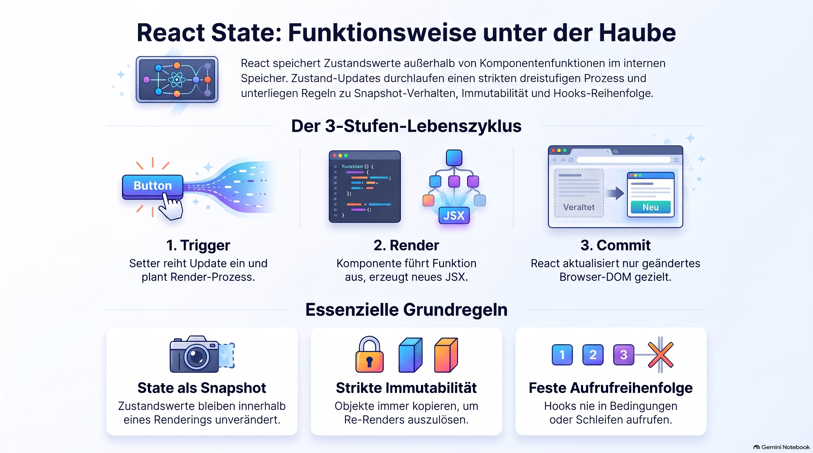
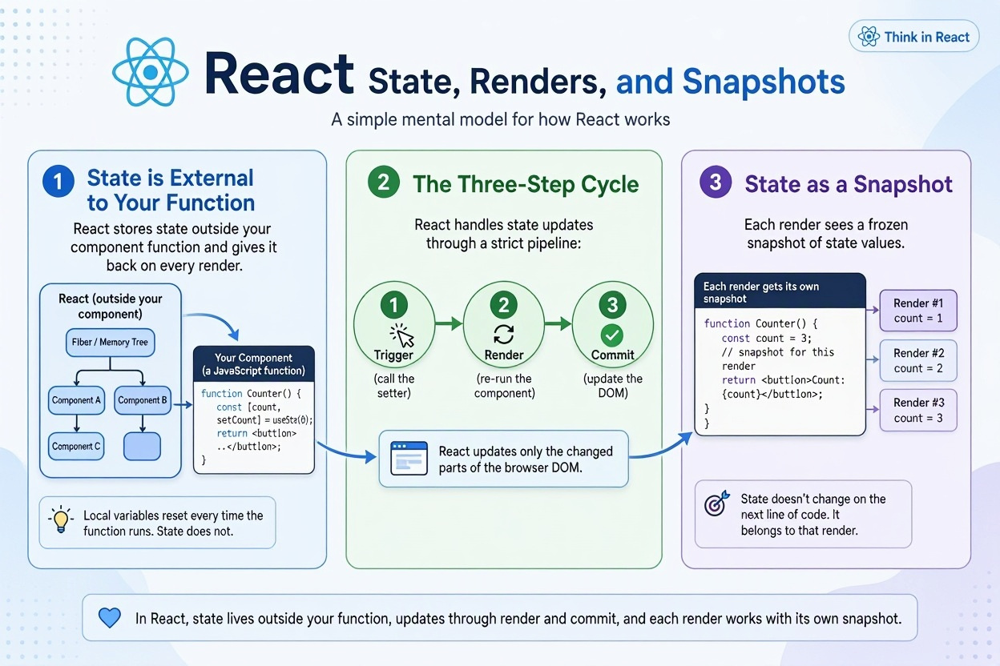
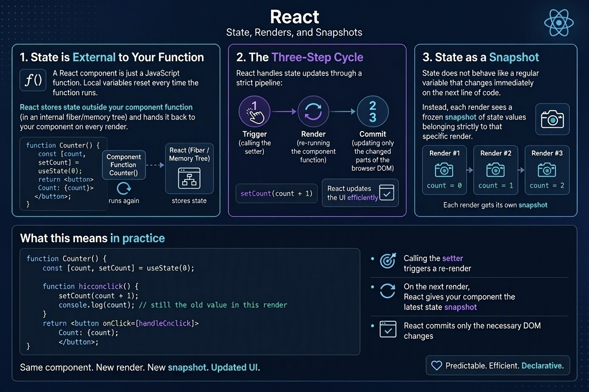

> [!NOTE]
> React speichert den **Zustand** extern in einem internen Speichersystem, da lokale Variablen in Funktionskomponenten bei jedem Durchlauf zurückgesetzt werden. Die Aktualisierung erfolgt über einen strikten Dreischritt aus **Trigger**, **Render** und **Commit**, wobei React lediglich die tatsächlich veränderten DOM-Bereiche anpasst. Ein einzelner Zustand funktioniert stets als **momentane Momentaufnahme**, weshalb Setter-Funktionen den aktuellen Wert nicht sofort im laufenden Code verändern. Zudem bündelt React mehrere Aktualisierungen und verlangt, dass komplexe Datenstrukturen wie Objekte oder Arrays zwingend **unveränderlich** behandelt werden. Schließlich behält das Framework den Überblick über verschiedene Hook-Aufrufe, indem es sich strikt an die **exakte Aufrufreihenfolge** hält.


# How React Handles State (Under the Hood)



## 1. Core Concept (Zettelkasten Summary)

* **State is External to Your Function:** Because a React component is just a JavaScript function, local variables reset every time the function runs. React stores state **outside** your component function (in an internal fiber/memory tree) and hands it back to your component on every render.


* **The Three-Step Cycle:** React handles state updates through a strict pipeline: **1. Trigger** (calling the setter) $\rightarrow$ **2. Render** (re-running the component function) $\rightarrow$ **3. Commit** (updating only the changed parts of the browser DOM).


* **State as a Snapshot:** State does not behave like a regular variable that changes immediately on the next line of code. Instead, each render sees a frozen **snapshot** of state values belonging strictly to that specific render.


## 2. Why Normal Variables Fail

To understand how React handles state, look at why a standard JavaScript variable fails to update the UI:


``` JavaScript
function BrokenCounter() {
  let count = 0; // Resets to 0 on every render

  function handleClick() {
    count = count + 1; // 1. Updates the local variable in memory...
    // 2. ...but React has NO idea anything changed, so it never re-renders!
  }

  return <button onClick={handleClick}>Count: {count}</button>;
}
```

When you replace `let count = 0` with `const [count, setCount] = useState(0)`, the `setCount` function does two critical things:


1. It queues a new value in React's internal memory store.


2. It notifies React that this component is "dirty" and schedules a **re-render**.


## 3. The State Update Lifecycle (Trigger $\rightarrow$ Render $\rightarrow$ Commit)




Whenever a user interacts with your GUI and triggers a state change, React executes three distinct phases:

1. **Trigger Phase:** An event handler calls `setCount(1)`. React records this update in a queue.


2. **Render Phase:** React calls your component function (`Counter()`) again from top to bottom. During this execution, `useState(0)` ignores the initial `0` and returns the newest value (`1`) from React's internal memory. Your function returns a new virtual description (JSX) of what the UI _should_ look like.


3. **Commit Phase:** React compares the newly returned JSX with the previous render's JSX (a process called **Reconciliation** / diffing). It then modifies **only** the specific DOM text or attributes that actually changed, leaving the rest of the webpage untouched.


## 4. Crucial Rule 1: State Behaves Like a Snapshot

Calling a state setter **does not** change the state variable inside the currently running code. It only requests a _future_ render with the new value.

```JavaScript
function SnapshotExample() {
  const [count, setCount] = useState(0);

  function handleClick() {
    setCount(count + 1); // Requests next render to have count = 1
    console.log(count);  // Still logs 0! (The snapshot for THIS render is 0)
  }

  return <button onClick={handleClick}>Count: {count}</button>;
}
```

### State Batching & Functional Updaters

Because state is a snapshot, calling `setCount(count + 1)` three times in a row will only increment `count` by `1` (because `count` is `0` in all three lines: `0 + 1`, `0 + 1`, `0 + 1`). React also **batches** multiple state updates inside an event handler into a single re-render for performance.

To calculate new state based on the _previous_ queued state, pass an **updater function**:

```JavaScript
function handleTripleIncrement() {
  setCount((prev) => prev + 1); // Queues: 0 => 1
  setCount((prev) => prev + 1); // Queues: 1 => 2
  setCount((prev) => prev + 1); // Queues: 2 => 3
  // Result after one re-render: 3
}
```

## 5. Crucial Rule 2: Treat State as Immutable

When storing **Objects** or **Arrays** in state, never mutate them directly (e.g., `user.name = 'Bob'` or `items.push('new')`).

React checks whether state changed by comparing object references (`Object.is(oldState, newState)`). If you mutate an existing object, its memory reference stays identical, so **React assumes nothing changed and skips re-rendering**.

Always create a **brand-new copy** using the spread operator (`...`) or non-mutating array methods (`.map()`, `.filter()`):

```JavaScript
// ✅ Updating an Object in State
const [user, setUser] = useState({ name: 'Alice', role: 'Dev' });
setUser({ ...user, role: 'Lead Dev' }); // Creates a new object reference

// ✅ Updating an Array in State
const [tags, setTags] = useState(['react', 'vite']);
setTags([...tags, 'zettelkasten']); // Creates a new array reference
```

## 6. How React Tracks Multiple `useState` Calls

Notice that `useState(0)` doesn't take a variable name as an argument—so how does React know which state belongs to which variable?

**By call order.** Internally, React maintains an array of state cells for each component instance. On every render, it relies on `useState` being called in the **exact same order**:

* First `useState` call $\rightarrow$ Index `0`

* Second `useState` call $\rightarrow$ Index `1`

(This is the exact reason why React forbids calling Hooks inside `if` statements, loops, or nested functions—doing so would shift the index order and corrupt the mapping)._

## 7. Related Zettelkasten Links

* `[[React State (useState) Beginner Tutorial]]` - Hands-on Vite project setup, code implementation, and Vitest testing.


* `[[React Props vs. State]]` - Contrasting external read-only props with internal mutable state.


* `[[Rules of Hooks in React]]` - Why hooks must only be called at the top level of components.


* `[[Lifting State Up in React]]` - Moving state to a common ancestor when sibling components need to share data.

