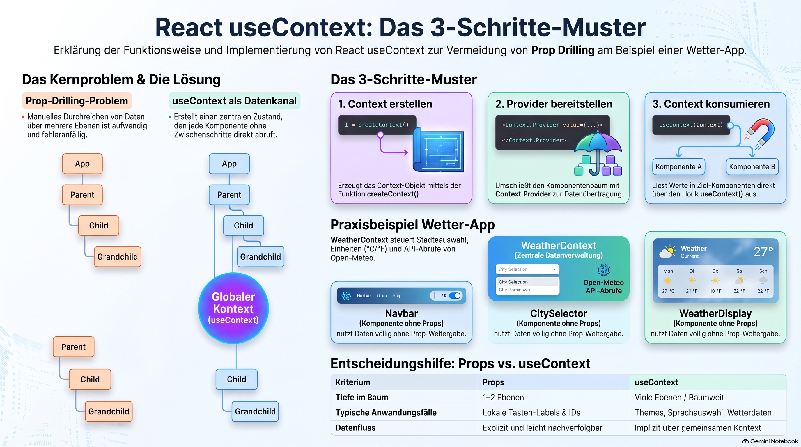
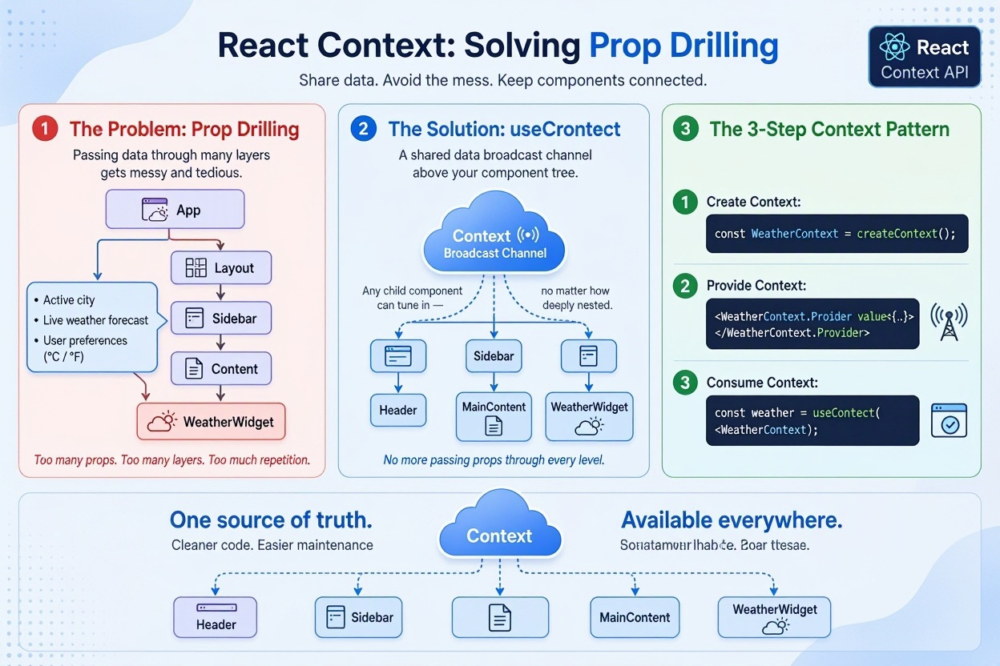
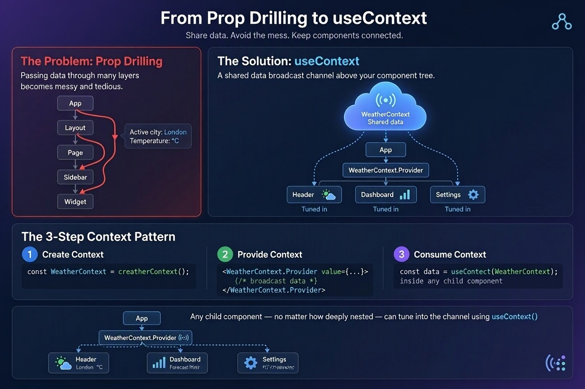

> [!NOTE]
>  Die bereitgestellten Quellen präsentieren einsteigerfreundliches Tutorial zur Erstellung einer **Wetter-Web-App mit React**, das die **Context API** und den Hook **useContext** nutzt, um das umständliche Durchreichen von Eigenschaften zu verhindern. Zu Beginn werden die Grundlagen erläutert und die Projektumgebung mithilfe von **Vite** eingerichtet, bevor eine modulare Architektur aus mehreren Komponenten wie **Navbar**, **CitySelector** und **WeatherDisplay** entwickelt wird. Im nächsten Schritt wird ein zentraler **WeatherProvider** erstellt, der globale Zustände verwaltet und Live-Wetterdaten von der **Open-Meteo-API** abruft. Anschließend zeigt die Anleitung, wie diese Komponenten komplett ohne Props auf die gemeinsamen Daten zugreifen und diese nahtlos aktualisieren können. Abschließend wird die Funktionalität durch manuelle Browser-Überprüfungen sowie automatisierte Integrationstests mit **Vitest** verifiziert, während ein kurzer Leitfaden bei der Entscheidung zwischen traditionellen Props und der Context-Nutzung unterstützt.


# React `useContext` and Weather Web App: An Absolute Beginner Tutorial

## 1. Core Concept (Zettelkasten Summary)



* **The Problem ("Prop Drilling"):** In a multi-component GUI, passing shared data (like the active city, live weather forecast, or user preferences like `°C` vs `°F`) from a top-level parent down through 3 or 4 layers of intermediate components becomes messy and tedious.

* **The Solution (`useContext`):** React's Context API lets you create a **shared data broadcast channel** (a "cloud" above your component tree). Any child component—no matter how deeply nested—can tune directly into that channel using `useContext()` without passing props through intermediate components.

* **The 3-Step Context Pattern:**

  1. **Create Context:** `const WeatherContext = createContext();`

  2. **Provide Context:** Wrap your component tree in `<WeatherContext.Provider value={...}>` to broadcast data.

  3. **Consume Context:** Call `useContext(WeatherContext)` inside any child component that needs the data.



## 2. Step 1: Project Setup (Using Vite)

Ensure [Node.js](https://nodejs.org/ "null") is installed on your machine.


1. Open your terminal and scaffold a new Vite + React project:

   ```
   npm create vite@latest react-context-weather -- --template react
   ```

2. Navigate into your project folder:

   ```
   cd react-context-weather
   ```

3. Install dependencies:

   ```
   npm install
   ```

4. Start the development server:

   ```
   npm run dev
   ```

   _(Open `http://localhost:5173` in your browser to verify it loads)._

## 3. Step 2: Designing the Multi-Component Architecture

Instead of putting everything in one giant `App.jsx` file, we will split our Weather Web App into separate, focused components that all consume shared state via `useContext`:

* `src/context/WeatherContext.jsx`: Holds the Context, fetches live weather from **Open-Meteo** via `useEffect`, and manages the selected city and temperature unit (`C` or `F`).

* `src/components/Navbar.jsx`: Displays the app title and a **Unit Toggle Button** (`°C` / `°F`).

* `src/components/CitySelector.jsx`: Renders buttons to switch between cities.

* `src/components/WeatherDisplay.jsx`: Displays the live temperature, wind speed, and weather icon, automatically converting units based on Context.

## 4. Step 3: Creating the Weather Context (`src/context/WeatherContext.jsx`)

1. Inside `src/`, create a new folder named `context`.

2. Create `src/context/WeatherContext.jsx` and add the following code:

```
// src/context/WeatherContext.jsx
import { createContext, useState, useEffect, useContext } from 'react';

export const CITIES = [
  { name: 'Frankfurt', lat: 50.11, lon: 8.68 },
  { name: 'Tokyo', lat: 35.68, lon: 139.69 },
  { name: 'New York', lat: 40.71, lon: -74.01 },
  { name: 'Reykjavik', lat: 64.15, lon: -21.94 }
];

// 1. Create the Context object
const WeatherContext = createContext();

// 2. Create a Provider component that holds state & fetches API data
export function WeatherProvider({ children }) {
  const [selectedCity, setSelectedCity] = useState(CITIES[0]);
  const [unit, setUnit] = useState('C'); // 'C' for Celsius, 'F' for Fahrenheit
  const [weather, setWeather] = useState(null);
  const [loading, setLoading] = useState(true);
  const [error, setError] = useState(null);

  useEffect(() => {
    let ignore = false;

    async function fetchWeather() {
      setLoading(true);
      setError(null);

      try {
        const url = `https://api.open-meteo.com/v1/forecast?latitude=${selectedCity.lat}&longitude=${selectedCity.lon}&current_weather=true`;
        const response = await fetch(url);

        if (!response.ok) {
          throw new Error(`Weather API error (Status: ${response.status})`);
        }

        const data = await response.json();
        if (!ignore) {
          setWeather(data.current_weather);
        }
      } catch (err) {
        if (!ignore) {
          setError(err.message);
        }
      } finally {
        if (!ignore) {
          setLoading(false);
        }
      }
    }

    fetchWeather();

    return () => {
      ignore = true;
    };
  }, [selectedCity]);

  function toggleUnit() {
    setUnit((prev) => (prev === 'C' ? 'F' : 'C'));
  }

  // Bundle all shared values & updater functions into one object
  const contextValue = {
    selectedCity,
    setSelectedCity,
    unit,
    toggleUnit,
    weather,
    loading,
    error
  };

  return (
    <WeatherContext.Provider value={contextValue}>
      {children}
    </WeatherContext.Provider>
  );
}

// 3. Optional convenience hook so child components don't need to import both useContext & WeatherContext
export function useWeather() {
  return useContext(WeatherContext);
}
```

## 5. Step 4: Building the Child Components (Zero Props Needed!)

Notice that **none** of the components below accept props—they pull everything they need directly from `useWeather()` (which wraps `useContext(WeatherContext)`).


1. Inside `src/`, create a new folder named `components`.

### A. Navbar with Unit Toggle (`src/components/Navbar.jsx`)

```
// src/components/Navbar.jsx
import { useWeather } from '../context/WeatherContext';

function Navbar() {
  // Consume only `unit` and `toggleUnit` from Context
  const { unit, toggleUnit } = useWeather();

  return (
    <header style={{
      display: 'flex',
      justifyContent: 'space-between',
      alignItems: 'center',
      marginBottom: '20px',
      borderBottom: '1px solid rgba(255,255,255,0.2)',
      paddingBottom: '12px'
    }}>
      <h1 style={{ margin: 0, fontSize: '1.35rem' }}>🌍 Context Weather</h1>
      <button
        onClick={toggleUnit}
        style={{
          padding: '6px 12px',
          borderRadius: '8px',
          border: '1px solid #facc15',
          backgroundColor: 'transparent',
          color: '#facc15',
          fontWeight: 'bold',
          cursor: 'pointer'
        }}
      >
        Switch to °{unit === 'C' ? 'F' : 'C'}
      </button>
    </header>
  );
}

export default Navbar;
```

### B. City Selector (`src/components/CitySelector.jsx`)

```
// src/components/CitySelector.jsx
import { CITIES, useWeather } from '../context/WeatherContext';

function CitySelector() {
  // Consume `selectedCity` and `setSelectedCity` from Context
  const { selectedCity, setSelectedCity } = useWeather();

  return (
    <div style={{ display: 'flex', gap: '8px', flexWrap: 'wrap', marginBottom: '20px' }}>
      {CITIES.map((city) => {
        const isActive = city.name === selectedCity.name;
        return (
          <button
            key={city.name}
            onClick={() => setSelectedCity(city)}
            style={{
              padding: '8px 14px',
              borderRadius: '20px',
              border: 'none',
              cursor: 'pointer',
              fontWeight: 'bold',
              backgroundColor: isActive ? '#facc15' : 'rgba(255, 255, 255, 0.2)',
              color: isActive ? '#0f172a' : '#ffffff'
            }}
          >
            {city.name}
          </button>
        );
      })}
    </div>
  );
}

export default CitySelector;
```

### C. Weather Display Card (`src/components/WeatherDisplay.jsx`)

```
// src/components/WeatherDisplay.jsx
import { useWeather } from '../context/WeatherContext';

function getWeatherDescription(code) {
  if (code === 0) return { label: 'Clear Sky', icon: '☀️' };
  if (code >= 1 && code <= 3) return { label: 'Partly Cloudy', icon: '⛅' };
  if (code >= 45 && code <= 48) return { label: 'Foggy', icon: '🌫️' };
  if (code >= 51 && code <= 67) return { label: 'Rainy', icon: '🌧️' };
  if (code >= 71 && code <= 77) return { label: 'Snowfall', icon: '❄️' };
  if (code >= 80 && code <= 99) return { label: 'Thunderstorms', icon: '⛈️' };
  return { label: 'Variable Weather', icon: '🌤️' };
}

function WeatherDisplay() {
  // Consume live weather data, loading/error states, city name, and unit from Context
  const { selectedCity, weather, loading, error, unit } = useWeather();

  if (loading) {
    return (
      <div style={{ textAlign: 'center', padding: '30px' }}>
        Fetching live forecast for {selectedCity.name}...
      </div>
    );
  }

  if (error) {
    return (
      <div style={{ color: '#fecaca', textAlign: 'center', padding: '30px' }}>
        ⚠️ {error}
      </div>
    );
  }

  if (!weather) return null;

  const condition = getWeatherDescription(weather.weathercode);
  const displayTemp =
    unit === 'C'
      ? weather.temperature
      : Math.round(((weather.temperature * 9) / 5 + 32) * 10) / 10;

  return (
    <div style={{
      backgroundColor: 'rgba(255, 255, 255, 0.12)',
      borderRadius: '12px',
      padding: '20px',
      textAlign: 'center'
    }}>
      <div style={{ fontSize: '3.5rem', lineHeight: 1 }}>{condition.icon}</div>
      <h2 style={{ margin: '10px 0 4px', fontSize: '1.6rem' }}>{selectedCity.name}</h2>
      <p style={{ margin: '0 0 16px', opacity: 0.9 }}>{condition.label}</p>

      <div style={{
        display: 'flex',
        justifyContent: 'space-around',
        borderTop: '1px solid rgba(255,255,255,0.2)',
        paddingTop: '14px'
      }}>
        <div>
          <span style={{ display: 'block', fontSize: '0.8rem', opacity: 0.8 }}>TEMPERATURE</span>
          <strong style={{ fontSize: '1.4rem' }}>{displayTemp}°{unit}</strong>
        </div>

        <div>
          <span style={{ display: 'block', fontSize: '0.8rem', opacity: 0.8 }}>WIND SPEED</span>
          <strong style={{ fontSize: '1.4rem' }}>{weather.windspeed} km/h</strong>
        </div>
      </div>
    </div>
  );
}

export default WeatherDisplay;
```

## 6. Step 5: Assembling the App (`src/App.jsx`)

Now open `src/App.jsx`. Notice how clean it is—`App` simply wraps the layout inside `<WeatherProvider>` with **zero props** passed to `Navbar`, `CitySelector`, or `WeatherDisplay`.


```
// src/App.jsx
import { WeatherProvider } from './context/WeatherContext';
import Navbar from './components/Navbar';
import CitySelector from './components/CitySelector';
import WeatherDisplay from './components/WeatherDisplay';

function App() {
  return (
    <WeatherProvider>
      <div style={{
        maxWidth: '460px',
        margin: '40px auto',
        padding: '24px',
        fontFamily: 'system-ui, sans-serif',
        borderRadius: '16px',
        background: 'linear-gradient(135deg, #0f766e 0%, #1e3a8a 100%)',
        color: '#ffffff',
        boxShadow: '0 10px 25px rgba(0, 0, 0, 0.15)'
      }}>
        <Navbar />
        <CitySelector />
        <WeatherDisplay />
      </div>
    </WeatherProvider>
  );
}

export default App;
```

## 7. Step 6: Testing the Context Weather App (Manual & Automated)

### A. Manual Browser Verification

1. Open `http://localhost:5173`.

2. Confirm **Frankfurt** loads automatically in `°C`.

3. Click **Switch to °F** in the `Navbar`—verify `WeatherDisplay` immediately updates the temperature to Fahrenheit without making a new API call!

4. Click **Tokyo** in `CitySelector`—verify `WeatherDisplay` fetches Tokyo's forecast and displays it in `°F`.

### B. Automated Integration Testing (Vitest)

When testing components that rely on `useContext`, rendering `<App />` automatically includes `<WeatherProvider>`, allowing us to test how all sibling components communicate through Context.


1. Stop the dev server (`Ctrl + C`).

2. Install **Vitest**, **jsdom**, **React Testing Library**, and **User Event**:

   ```
   npm install -D vitest jsdom @testing-library/react @testing-library/jest-dom @testing-library/user-event
   ```

3. Configure `vite.config.js` to use `jsdom`:

   ```
   import { defineConfig } from 'vite';
   import react from '@vitejs/plugin-react';

   export default defineConfig({
     plugins: [react()],
     test: {
       environment: 'jsdom',
       globals: true,
     },
   });
   ```

4. Create `src/App.test.jsx`:

```
// src/App.test.jsx
import { render, screen } from '@testing-library/react';
import userEvent from '@testing-library/user-event';
import { describe, it, expect, vi, beforeEach, afterEach } from 'vitest';
import App from './App';

describe('Weather Web App with useContext', () => {
  beforeEach(() => {
    global.fetch = vi.fn();
  });

  afterEach(() => {
    vi.restoreAllMocks();
  });

  it('shares weather data and toggles temperature units across sibling components via Context', async () => {
    const user = userEvent.setup();

    // Mock Frankfurt weather (20°C = 68°F)
    global.fetch.mockResolvedValueOnce({
      ok: true,
      json: async () => ({
        current_weather: {
          temperature: 20.0,
          windspeed: 10.5,
          weathercode: 0,
        },
      }),
    });

    render(<App />);

    // 1. Wait for WeatherDisplay to render initial Celsius value from Context
    expect(await screen.findByText('20°C')).toBeDefined();

    // 2. Click the Navbar toggle button ("Switch to °F")
    const toggleBtn = screen.getByRole('button', { name: /Switch to °F/i });
    await user.click(toggleBtn);

    // 3. Verify WeatherDisplay updated to Fahrenheit via Context without refetching
    expect(screen.getByText('68°F')).toBeDefined();
    expect(global.fetch).toHaveBeenCalledTimes(1);

    // 4. Mock Tokyo weather (10°C = 50°F) and click Tokyo in CitySelector
    global.fetch.mockResolvedValueOnce({
      ok: true,
      json: async () => ({
        current_weather: {
          temperature: 10.0,
          windspeed: 5.0,
          weathercode: 61,
        },
      }),
    });

    const tokyoBtn = screen.getByRole('button', { name: 'Tokyo' });
    await user.click(tokyoBtn);

    // 5. Verify Tokyo renders immediately in the currently selected °F Context unit
    expect(await screen.findByText('50°F')).toBeDefined();
    expect(screen.getByText('Rainy')).toBeDefined();
  });
});
```

5. Run the test suite:

   ```
   npx vitest run
   ```

6. Confirm you see `1 passed` in green.

## 8. When to Use `useContext` vs. Props

* **Use Props** when passing data 1 or 2 levels down (explicit data flow is easier to trace).

* **Use `useContext`** for global or tree-wide state needed by many components at different nesting levels (e.g., current logged-in user, light/dark theme, language/unit preferences, or shared API data).

## 9. Related Zettelkasten Links

* `[[React useEffect & Weather Web App: An Absolute Beginner Tutorial]]` - Single-component version using `useEffect` and Open-Meteo.

* `[[Lifting State Up in React: An Absolute Beginner Deep Dive]]` - The step before Context: sharing state between close siblings via a common parent.

* `[[React Props vs. State]]` - Understanding local state vs. passed properties.

* `[[Custom Hooks in React]]` - Notice how `useWeather()` in Step 3 is actually a clean Custom Hook wrapping `useContext`!

Manuell oder mit Gemini bearbeiten

Klicke auf eine beliebige Stelle, um selbst Text einzugeben und zu bearbeiten, oder wähle Text aus, um Gemini Änderungen vornehmen zu lassen.

I have created the complete Zettelkasten tutorial (`react_usecontext_weather_app_tutorial.md`) showing how to build a multi-component Weather Web App using `useContext` and the free Open-Meteo API, eliminating prop drilling across `Navbar`, `CitySelector`, and `WeatherDisplay`, and ending with an automated Vitest integration test. Let me know if you'd like to explore **Custom Hooks** or `useReducer` next!
