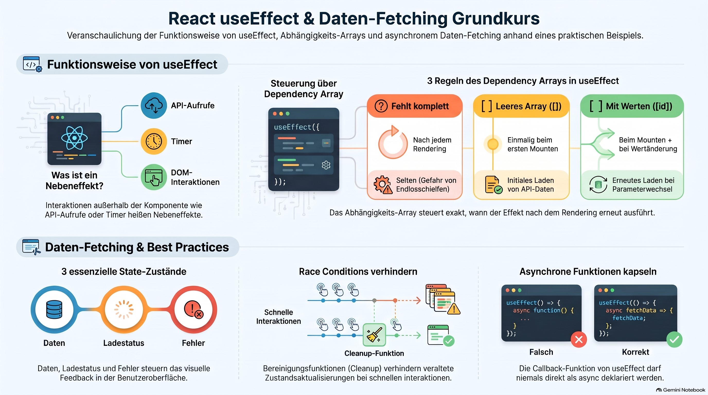
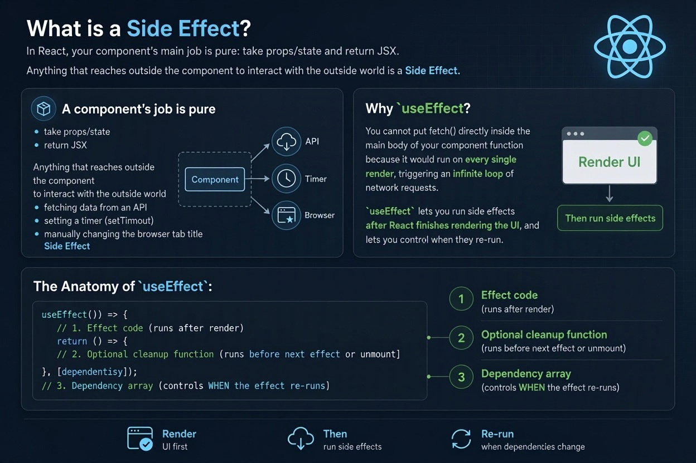

> [!NOTE]
> Diese Quellen bieten einsteigerfreundliche Anleitungen und Code-Beispiele zur Verwendung des **useEffect-Hooks** in React, demonstriert am praktischen Beispiel des **Star Wars API (SWAPI)**-Datenabrufs. Es wird detailliert erläutert, wie **Side Effects** funktionieren, warum die korrekte Verwendung von **Dependency Arrays** Endlosschleifen verhindert und wie man das Laden, Fehlerausgaben sowie Daten erfolgreich verwaltet. Zudem beinhaltet der Text wichtige Schritte zur **Projekteinrichtung** mittels Vite, manuelle Verifizierungsschritte im Browser sowie automatisierte Tests mit **Vitest**. Abschließend werden typische Fallstricke wie direkt asynchrone Effect-Callbacks oder vergessene Abhängigkeiten aufgezeigt, um sauberen und performanten React-Code zu schreiben.


# React `useEffect` and Star Wars API (SWAPI): An Absolute Beginner Tutorial

## 1. Core Concept (Zettelkasten Summary)



* **What is a "Side Effect"?** A React component's primary job is pure: take props/state and return JSX. Anything that reaches _outside_ the component to interact with the outside world—such as fetching data from an API, setting a timer (`setTimeout`), or manually changing the browser tab title—is called a **Side Effect**.

* **Why `useEffect`?** You cannot put `fetch()` directly inside the main body of your component function because it would run on **every single render**, triggering an infinite loop of network requests. `useEffect` lets you run side effects _after_ React finishes rendering the UI, and lets you control _when_ they re-run.

* **The Anatomy of `useEffect`:**

  ```
  useEffect(() => {
    // 1. Effect code (runs after render)
    return () => {
      // 2. Optional cleanup function (runs before next effect or unmount)
    };
  }, [dependencies]); // 3. Dependency array (controls WHEN the effect re-runs)
  ```

### The 3 Dependency Array Rules

1. **No array (`useEffect(() => {})`):** Runs after **every** render (rarely used; can cause infinite loops).

2. **Empty array (`useEffect(() => {}, [])`):** Runs **only once** when the component first mounts on the screen (ideal for initial API data fetching).

3. **With values (`useEffect(() => {}, [id])`):** Runs on mount **and** whenever `id` changes between renders.

## 2. Step 1: Project Setup (Using Vite)

Ensure [Node.js](https://nodejs.org/ "null") is installed on your machine.


1. Open your terminal and scaffold a new Vite + React project:

   ```
   npm create vite@latest react-swapi-effect -- --template react
   ```

2. Navigate into your project directory:

   ```
   cd react-swapi-effect
   ```

3. Install dependencies:

   ```
   npm install
   ```

4. Start the development server:

   ```
   npm run dev
   ```

   _(Open `http://localhost:5173` in your browser to verify it loads)._

## 3. Step 2: Understanding the Star Wars API (SWAPI)

We will use the free, public **Star Wars API** (`https://swapi.py4e.com/api/people/1/` or `https://swapi.dev/api/people/1/`), which requires no API key and returns JSON data about Star Wars characters:


```
{
  "name": "Luke Skywalker",
  "height": "172",
  "mass": "77",
  "birth_year": "19BBY"
}
```

_(Note: We will use `https://swapi.py4e.com/api/people/` in this tutorial as it is a reliable, fast mirror of SWAPI with proper CORS support)._


## 4. Step 3: Fetching Data on Mount (`useEffect` with `[]`)

When fetching data from an API, you always need **three pieces of state** to give the user proper feedback:


1. `character`: Holds the fetched JSON object (initially `null`).

2. `loading`: Boolean indicating whether the request is still in flight (initially `true`).

3. `error`: Holds an error message if the network fails (initially `null`).

4. Open `src/App.jsx` and replace its contents with the following:

```
// src/App.jsx
import { useState, useEffect } from 'react';

function App() {
  // 1. State for API data, loading status, and errors
  const [characterId, setCharacterId] = useState(1);
  const [character, setCharacter] = useState(null);
  const [loading, setLoading] = useState(true);
  const [error, setError] = useState(null);

  // 2. useEffect runs AFTER render, and re-runs whenever `characterId` changes
  useEffect(() => {
    // Flag to prevent race conditions if the user clicks rapidly
    let ignore = false;

    async function fetchStarWarsCharacter() {
      setLoading(true);
      setError(null);

      try {
        const response = await fetch(`https://swapi.py4e.com/api/people/${characterId}/`);
        
        if (!response.ok) {
          throw new Error(`HTTP error! Status: ${response.status}`);
        }

        const data = await response.json();

        // Only update state if this effect hasn't been superseded by a newer click
        if (!ignore) {
          setCharacter(data);
        }
      } catch (err) {
        if (!ignore) {
          setError(err.message);
        }
      } finally {
        if (!ignore) {
          setLoading(false);
        }
      }
    }

    fetchStarWarsCharacter();

    // 3. Cleanup function: marks stale requests as ignored
    return () => {
      ignore = true;
    };
  }, [characterId]); // <-- Dependency array: re-runs whenever characterId changes!

  return (
    <div style={{
      maxWidth: '450px',
      margin: '40px auto',
      padding: '24px',
      fontFamily: 'system-ui, sans-serif',
      border: '1px solid #cbd5e1',
      borderRadius: '12px',
      backgroundColor: '#0f172a',
      color: '#f8fafc'
    }}>
      <h1 style={{ color: '#facc15', marginTop: 0 }}>Star Wars Databank</h1>

      {/* Navigation buttons to change `characterId` state */}
      <div style={{ display: 'flex', gap: '10px', marginBottom: '20px' }}>
        <button
          onClick={() => setCharacterId((prev) => Math.max(1, prev - 1))}
          disabled={characterId === 1 || loading}
          style={{ padding: '8px 12px', cursor: 'pointer' }}
        >
          &larr; Previous
        </button>

        <span style={{ alignSelf: 'center', fontWeight: 'bold' }}>
          Character #{characterId}
        </span>

        <button
          onClick={() => setCharacterId((prev) => prev + 1)}
          disabled={loading}
          style={{ padding: '8px 12px', cursor: 'pointer' }}
        >
          Next &rarr;
        </button>
      </div>

      {/* Conditional Rendering based on Loading / Error / Success */}
      {loading && <p style={{ color: '#38bdf8' }}>Loading transmission from Coruscant...</p>}

      {error && <p style={{ color: '#f87171' }}>Error: {error}</p>}

      {!loading && !error && character && (
        <div style={{
          backgroundColor: '#1e293b',
          padding: '16px',
          borderRadius: '8px'
        }}>
          <h2 style={{ marginTop: 0, color: '#facc15' }}>{character.name}</h2>
          <p><strong>Height:</strong> {character.height} cm</p>
          <p><strong>Mass:</strong> {character.mass} kg</p>
          <p><strong>Birth Year:</strong> {character.birth_year}</p>
          <p><strong>Eye Color:</strong> {character.eye_color}</p>
        </div>
      )}
    </div>
  );
}

export default App;
```

### Tracing What Happens Step-by-Step:

1. **Initial Render:** `App` renders with `characterId = 1` and `loading = true`. The user immediately sees `"Loading transmission from Coruscant..."`.

2. **Effect Execution:** Right after painting the screen, React runs the `useEffect` callback because `[characterId]` was initialized.

3. **API Resolution:** `fetch` resolves with Luke Skywalker's JSON. `setCharacter(data)` and `setLoading(false)` trigger a re-render displaying Luke's stats.

4. **User Interaction:** The user clicks **Next&#x20;**$\rightarrow$. `characterId` becomes `2`. React re-renders, sees that `characterId` changed from `1` to `2` in the `[characterId]` dependency array, and automatically runs `useEffect` again to fetch C-3PO!

## 5. Step 4: Testing `useEffect` & API Calls (Manual & Automated)

### A. Manual Browser Verification

1. Open `http://localhost:5173`.

2. Confirm **Luke Skywalker** loads first (`Character #1`).

3. Click **Next&#x20;**$\rightarrow$ and verify it briefly shows the loading message before displaying **C-3PO** (`Character #2`), then **R2-D2** (`Character #3`).

### B. Automated Testing with Mocked `fetch` (Vitest)

In automated unit tests, you should **never** hit the real internet/API (it makes tests slow and fragile if the server is offline). Instead, we **mock** `global.fetch` so we can test how our `useEffect` handles loading states, successful JSON responses, and re-fetching when buttons are clicked.


1. Stop the dev server (`Ctrl + C`).

2. Install **Vitest**, **jsdom**, **React Testing Library**, and **User Event**:

   ```
   npm install -D vitest jsdom @testing-library/react @testing-library/jest-dom @testing-library/user-event
   ```

3. Configure `vite.config.js` to support `jsdom`:

   ```
   import { defineConfig } from 'vite';
   import react from '@vitejs/plugin-react';

   export default defineConfig({
     plugins: [react()],
     test: {
       environment: 'jsdom',
       globals: true,
     },
   });
   ```

4. Create `src/App.test.jsx`:

```
// src/App.test.jsx
import { render, screen } from '@testing-library/react';
import userEvent from '@testing-library/user-event';
import { describe, it, expect, vi, beforeEach, afterEach } from 'vitest';
import App from './App';

describe('Star Wars API useEffect Integration', () => {
  beforeEach(() => {
    // Replace global fetch with a Vitest spy function before each test
    global.fetch = vi.fn();
  });

  afterEach(() => {
    vi.restoreAllMocks();
  });

  it('fetches and displays the initial character on mount, then fetches the next on click', async () => {
    const user = userEvent.setup();

    // 1. Mock the first API response (Luke Skywalker)
    global.fetch.mockResolvedValueOnce({
      ok: true,
      json: async () => ({
        name: 'Luke Skywalker',
        height: '172',
        mass: '77',
        birth_year: '19BBY',
        eye_color: 'blue',
      }),
    });

    render(<App />);

    // Verify loading text appears immediately on initial render
    expect(screen.getByText(/Loading transmission/i)).toBeDefined();

    // Wait for `useEffect` fetch to resolve and render Luke Skywalker
    const lukeHeading = await screen.findByRole('heading', { name: /Luke Skywalker/i });
    expect(lukeHeading).toBeDefined();
    expect(screen.getByText(/19BBY/i)).toBeDefined();
    expect(global.fetch).toHaveBeenCalledWith('https://swapi.py4e.com/api/people/1/');

    // 2. Mock the second API response (C-3PO) for when Next is clicked
    global.fetch.mockResolvedValueOnce({
      ok: true,
      json: async () => ({
        name: 'C-3PO',
        height: '167',
        mass: '75',
        birth_year: '112BBY',
        eye_color: 'yellow',
      }),
    });

    // Click "Next" button to change `characterId` state and re-trigger `useEffect`
    const nextBtn = screen.getByRole('button', { name: /Next/i });
    await user.click(nextBtn);

    // Wait for C-3PO to appear
    const c3poHeading = await screen.findByRole('heading', { name: /C-3PO/i });
    expect(c3poHeading).toBeDefined();
    expect(global.fetch).toHaveBeenCalledWith('https://swapi.py4e.com/api/people/2/');
  });
});
```

5. Run the test suite:

   ```
   npx vitest run
   ```

6. You should see `1 passed` in green—confirming that your `useEffect` fetches on mount, handles async state updates, and re-runs when its dependency (`characterId`) changes!

## 6. Common `useEffect` Pitfalls to Avoid

* **Forgetting the Dependency Array:** Calling `setState` inside a `useEffect` that has _no_ dependency array (`useEffect(() => { setCount(1); })`) will trigger a render $\rightarrow$ run the effect $\rightarrow$ trigger a render $\rightarrow$ **infinite loop**.

* **Making the `useEffect` callback `async` directly:** Never write `useEffect(async () => { ... })`. An `async` function implicitly returns a Promise, whereas `useEffect` expects either `undefined` or a synchronous cleanup function. Always define the `async` function _inside_ the effect and call it, just as we did with `fetchStarWarsCharacter()`.

## 7. Related Zettelkasten Links

* `[[How React Handles State (Under the Hood)]]` - Understanding the render-and-commit cycle that triggers `useEffect`.

* `[[React State (useState) Beginner Tutorial]]` - Managing the `loading`, `error`, and `data` states used alongside `useEffect`.

* `[[Lifting State Up in React - Deep Dive Tutorial]]` - Combining lifted state with `useEffect` when child components trigger API reloads.

* `[[Custom Hooks in React]]` - How to extract reusable `useEffect` + `fetch` logic into a clean `useFetch` hook.

