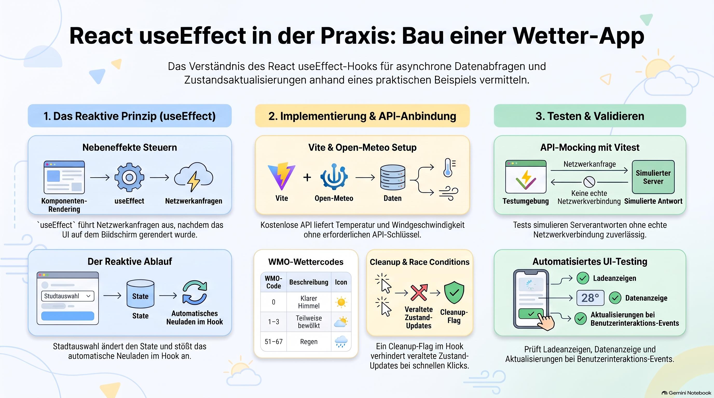
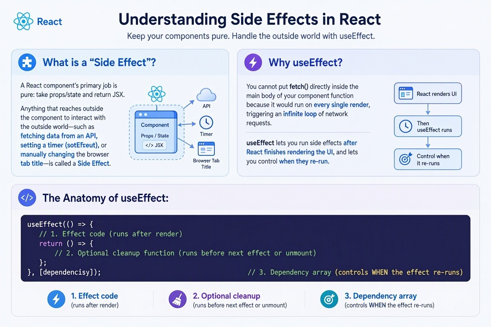
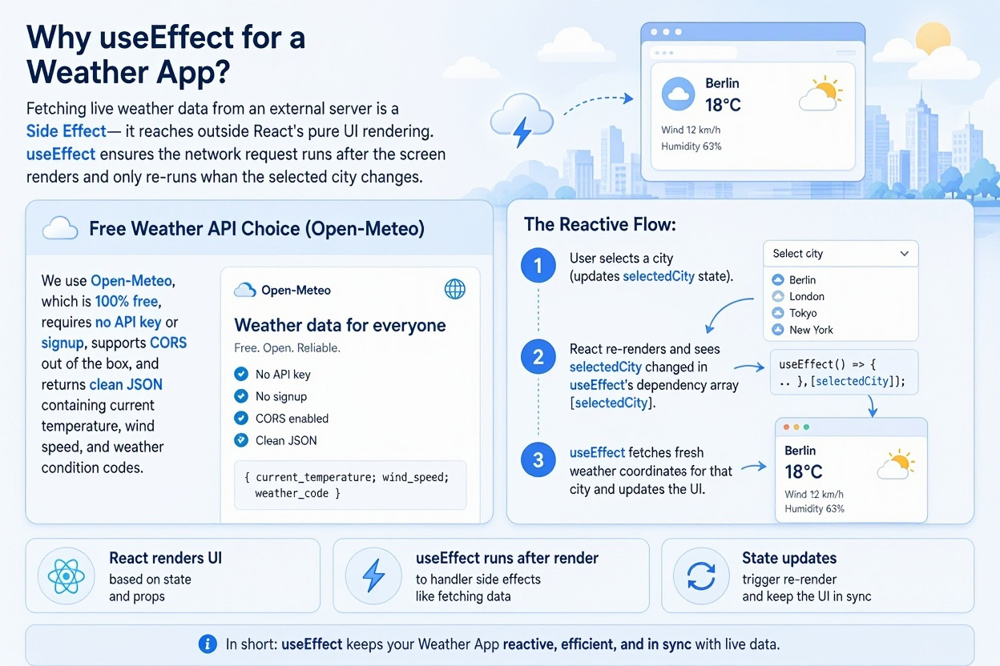

> [!NOTE]
> Der vorliegende Leitfaden erklärt Anfängern Schritt für Schritt, wie man mit **React** und dem **useEffect-Hook** eine interaktive **Wetter-Web-App** entwickelt. Als Datenquelle dient die kostenlose **Open-Meteo-API**, welche aktuelle Temperatur- und Windwerte ohne Registrierung bereitstellt. Die Anwendung nutzt einen **Zustands-Hook (useState)** zur Verwaltung von Städten, Ladeanzeigen sowie Fehlern und aktualisiert die Wetterdaten dynamisch beim Wechsel des Standorts. Zudem werden geeignete **Bereinigungsmethoden** und **Race-Condition-Schutz** implementiert, um veraltete Netzwerkanfragen zu verhindern. Abschließend demonstriert das Tutorial die manuelle Überprüfung im Browser sowie die automatisierte **Testumgebung mit Vitest**, um das korrekte Verhalten der Komponente sicherzustellen.


# React `useEffect` and Weather Web App: An Absolute Beginner Tutorial



## 1. Core Concept (Zettelkasten Summary)



* **Why `useEffect` for a Weather App?** Fetching live weather data from an external server is a **Side Effect**—it reaches outside React's pure UI rendering. `useEffect` ensures the network request runs _after_ the screen renders and only re-runs when the selected city changes.

* **Free Weather API Choice (Open-Meteo):** We use [Open-Meteo](https://open-meteo.com/ "null"), which is 100% free, requires **no API key or signup**, supports CORS out of the box, and returns clean JSON containing current temperature, wind speed, and weather condition codes.

* **The Reactive Flow:**

  1. User selects a city (updates `selectedCity` state).

  2. React re-renders and sees `selectedCity` changed in `useEffect`'s dependency array `[selectedCity]`.

  3. `useEffect` fetches fresh weather coordinates for that city and updates the UI.

## 2. Step 1: Project Setup (Using Vite)

Ensure [Node.js](https://nodejs.org/ "null") is installed on your machine.


1. Open your terminal and scaffold a new Vite + React project:

   ```
   npm create vite@latest react-weather-app -- --template react
   ```

2. Navigate into your project folder:

   ```
   cd react-weather-app
   ```

3. Install dependencies:

   ```
   npm install
   ```

4. Start the development server:

   ```
   npm run dev
   ```

   _(Open `http://localhost:5173` in your browser to verify the base app runs)._

## 3. Step 2: Understanding the Free Weather API (Open-Meteo)

Open-Meteo accepts latitude and longitude query parameters and returns current weather conditions:


```
https://api.open-meteo.com/v1/forecast?latitude=50.18&longitude=8.46&current_weather=true
```

Sample JSON response:


```
{
  "current_weather": {
    "temperature": 14.2,
    "windspeed": 11.5,
    "weathercode": 2,
    "is_day": 1
  }
}
```

## 4. Step 3: Building the Weather Web App (`src/App.jsx`)

We will build a complete, interactive Weather Web App with:


* Quick-select buttons for major cities (with pre-configured coordinates).

* A `useEffect` hook watching `[selectedCity]` to fetch live weather automatically.

* Helper logic translating numeric WMO weather codes (`0`, `1-3`, `61`, etc.) into readable conditions and weather icons.

* Proper `loading`, `error`, and race-condition cleanup handling.

1. Open `src/App.jsx` and replace its contents with:

```
// src/App.jsx
import { useState, useEffect } from 'react';

// Preset cities with latitude & longitude for Open-Meteo
const CITIES = [
  { name: 'Frankfurt', lat: 50.11, lon: 8.68 },
  { name: 'Tokyo', lat: 35.68, lon: 139.69 },
  { name: 'New York', lat: 40.71, lon: -74.01 },
  { name: 'Reykjavik', lat: 64.15, lon: -21.94 }
];

// Helper function to convert Open-Meteo WMO weather codes into text & emoji
function getWeatherDescription(code) {
  if (code === 0) return { label: 'Clear Sky', icon: '☀️' };
  if (code >= 1 && code <= 3) return { label: 'Partly Cloudy', icon: '⛅' };
  if (code >= 45 && code <= 48) return { label: 'Foggy', icon: '🌫️' };
  if (code >= 51 && code <= 67) return { label: 'Rainy', icon: '🌧️' };
  if (code >= 71 && code <= 77) return { label: 'Snowfall', icon: '❄️' };
  if (code >= 80 && code <= 99) return { label: 'Thunderstorms', icon: '⛈️' };
  return { label: 'Variable Weather', icon: '🌤️' };
}

function App() {
  // 1. State for currently selected city object
  const [selectedCity, setSelectedCity] = useState(CITIES[0]);

  // 2. States for API response, loading status, and errors
  const [weather, setWeather] = useState(null);
  const [loading, setLoading] = useState(true);
  const [error, setError] = useState(null);

  // 3. useEffect runs on mount AND whenever `selectedCity` changes
  useEffect(() => {
    let ignore = false; // Cleanup flag to prevent stale state updates

    async function fetchWeather() {
      setLoading(true);
      setError(null);

      try {
        const url = `https://api.open-meteo.com/v1/forecast?latitude=${selectedCity.lat}&longitude=${selectedCity.lon}&current_weather=true`;
        const response = await fetch(url);

        if (!response.ok) {
          throw new Error(`Weather service error (Status: ${response.status})`);
        }

        const data = await response.json();

        if (!ignore) {
          setWeather(data.current_weather);
        }
      } catch (err) {
        if (!ignore) {
          setError(err.message);
        }
      } finally {
        if (!ignore) {
          setLoading(false);
        }
      }
    }

    fetchWeather();

    // Cleanup function runs if user clicks another city before fetch finishes
    return () => {
      ignore = true;
    };
  }, [selectedCity]); // <-- Re-runs whenever user selects a new city!

  const condition = weather ? getWeatherDescription(weather.weathercode) : null;

  return (
    <div style={{
      maxWidth: '460px',
      margin: '40px auto',
      padding: '24px',
      fontFamily: 'system-ui, sans-serif',
      borderRadius: '16px',
      background: 'linear-gradient(135deg, #0284c7 0%, #1e3a8a 100%)',
      color: '#ffffff',
      boxShadow: '0 10px 25px rgba(0, 0, 0, 0.15)'
    }}>
      <h1 style={{ margin: '0 0 16px 0', fontSize: '1.5rem' }}>
        🌍 Live Weather Station
      </h1>

      {/* City Selector Buttons */}
      <div style={{ display: 'flex', gap: '8px', flexWrap: 'wrap', marginBottom: '24px' }}>
        {CITIES.map((city) => {
          const isActive = city.name === selectedCity.name;
          return (
            <button
              key={city.name}
              onClick={() => setSelectedCity(city)}
              style={{
                padding: '8px 14px',
                borderRadius: '20px',
                border: 'none',
                cursor: 'pointer',
                fontWeight: 'bold',
                backgroundColor: isActive ? '#facc15' : 'rgba(255, 255, 255, 0.2)',
                color: isActive ? '#0f172a' : '#ffffff'
              }}
            >
              {city.name}
            </button>
          );
        })}
      </div>

      {/* Weather Display Card */}
      <div style={{
        backgroundColor: 'rgba(255, 255, 255, 0.12)',
        borderRadius: '12px',
        padding: '20px',
        minHeight: '150px',
        display: 'flex',
        flexDirection: 'column',
        justifyContent: 'center'
      }}>
        {loading && (
          <p style={{ textAlign: 'center', fontSize: '1.1rem', margin: 0 }}>
            Fetching live forecast for {selectedCity.name}...
          </p>
        )}

        {error && (
          <p style={{ color: '#fecaca', textAlign: 'center', margin: 0 }}>
            ⚠️ {error}
          </p>
        )}

        {!loading && !error && weather && condition && (
          <div style={{ textAlign: 'center' }}>
            <div style={{ fontSize: '3.5rem', lineHeight: 1 }}>
              {condition.icon}
            </div>
            <h2 style={{ margin: '10px 0 4px', fontSize: '1.6rem' }}>
              {selectedCity.name}
            </h2>
            <p style={{ margin: '0 0 16px', opacity: 0.9 }}>
              {condition.label}
            </p>

            <div style={{
              display: 'flex',
              justifyContent: 'space-around',
              borderTop: '1px solid rgba(255,255,255,0.2)',
              paddingTop: '14px'
            }}>
              <div>
                <span style={{ display: 'block', fontSize: '0.8rem', opacity: 0.8 }}>
                  TEMPERATURE
                </span>
                <strong style={{ fontSize: '1.4rem' }}>
                  {weather.temperature}°C
                </strong>
              </div>

              <div>
                <span style={{ display: 'block', fontSize: '0.8rem', opacity: 0.8 }}>
                  WIND SPEED
                </span>
                <strong style={{ fontSize: '1.4rem' }}>
                  {weather.windspeed} km/h
                </strong>
              </div>
            </div>
          </div>
        )}
      </div>
    </div>
  );
}

export default App;
```

### How `useEffect` Drives This App:

1. When the app first opens, `selectedCity` defaults to **Frankfurt**.

2. After rendering the initial UI, `useEffect` sees `[selectedCity]` and fetches Frankfurt's weather from Open-Meteo.

3. When you click **Tokyo**, `setSelectedCity` updates the state. React re-renders, compares the old `selectedCity` (Frankfurt) to the new `selectedCity` (Tokyo), sees they differ, and triggers `useEffect` again with Tokyo's coordinates.

## 5. Step 4: Testing the Weather App (Manual & Automated)

### A. Manual Browser Verification

1. Ensure `npm run dev` is running and visit `http://localhost:5173`.

2. Confirm **Frankfurt** loads automatically with a temperature, wind speed, and weather icon.

3. Click **Tokyo**, **New York**, and **Reykjavik**—verify the loading indicator briefly flashes and fresh data appears for each city.

### B. Automated Unit & Integration Testing (Vitest)

We mock `global.fetch` so our tests verify the `useEffect` lifecycle (loading state $\rightarrow$ rendered weather data $\rightarrow$ re-fetching on city button click) without relying on an active internet connection.


1. Stop the dev server (`Ctrl + C`).

2. Install **Vitest**, **jsdom**, **React Testing Library**, and **User Event**:

   ```
   npm install -D vitest jsdom @testing-library/react @testing-library/jest-dom @testing-library/user-event
   ```

3. Configure `vite.config.js` to use `jsdom`:

   ```
   import { defineConfig } from 'vite';
   import react from '@vitejs/plugin-react';

   export default defineConfig({
     plugins: [react()],
     test: {
       environment: 'jsdom',
       globals: true,
     },
   });
   ```

4. Create `src/App.test.jsx`:

```
// src/App.test.jsx
import { render, screen } from '@testing-library/react';
import userEvent from '@testing-library/user-event';
import { describe, it, expect, vi, beforeEach, afterEach } from 'vitest';
import App from './App';

describe('Weather Web App (useEffect + Open-Meteo)', () => {
  beforeEach(() => {
    global.fetch = vi.fn();
  });

  afterEach(() => {
    vi.restoreAllMocks();
  });

  it('loads default city weather on mount and fetches new weather when another city is clicked', async () => {
    const user = userEvent.setup();

    // 1. Mock initial Frankfurt weather response
    global.fetch.mockResolvedValueOnce({
      ok: true,
      json: async () => ({
        current_weather: {
          temperature: 18.5,
          windspeed: 12.0,
          weathercode: 0, // Clear Sky
        },
      }),
    });

    render(<App />);

    // Confirm loading message displays immediately
    expect(screen.getByText(/Fetching live forecast for Frankfurt/i)).toBeDefined();

    // Wait for Frankfurt data to render
    expect(await screen.findByText('18.5°C')).toBeDefined();
    expect(screen.getByText('12 km/h')).toBeDefined();
    expect(screen.getByText('Clear Sky')).toBeDefined();

    // 2. Mock Tokyo weather response for button click
    global.fetch.mockResolvedValueOnce({
      ok: true,
      json: async () => ({
        current_weather: {
          temperature: 22.0,
          windspeed: 8.4,
          weathercode: 61, // Rainy
        },
      }),
    });

    // Click the "Tokyo" city button
    const tokyoButton = screen.getByRole('button', { name: 'Tokyo' });
    await user.click(tokyoButton);

    // Confirm Tokyo weather updates on screen
    expect(await screen.findByText('22°C')).toBeDefined();
    expect(screen.getByText('8.4 km/h')).toBeDefined();
    expect(screen.getByText('Rainy')).toBeDefined();
    expect(global.fetch).toHaveBeenCalledTimes(2);
  });
});
```

5. Run the test suite:

   ```
   npx vitest run
   ```

6. Confirm you see `1 passed` in green.

## 6. Related Zettelkasten Links

* `[[React useEffect & Star Wars API (SWAPI): An Absolute Beginner Tutorial]]` - Fetching sequential character records with `useEffect`.

* `[[How React Handles State (Under the Hood)]]` - How `setWeather` and `setLoading` trigger the render-and-commit cycle.

* `[[React State (useState) Beginner Tutorial]]` - Managing multiple independent state variables inside a component.

* `[[Custom Hooks in React]]` - Refactoring the `useEffect` fetch logic inside `App.jsx` into a reusable `useWeather(city)` hook.

