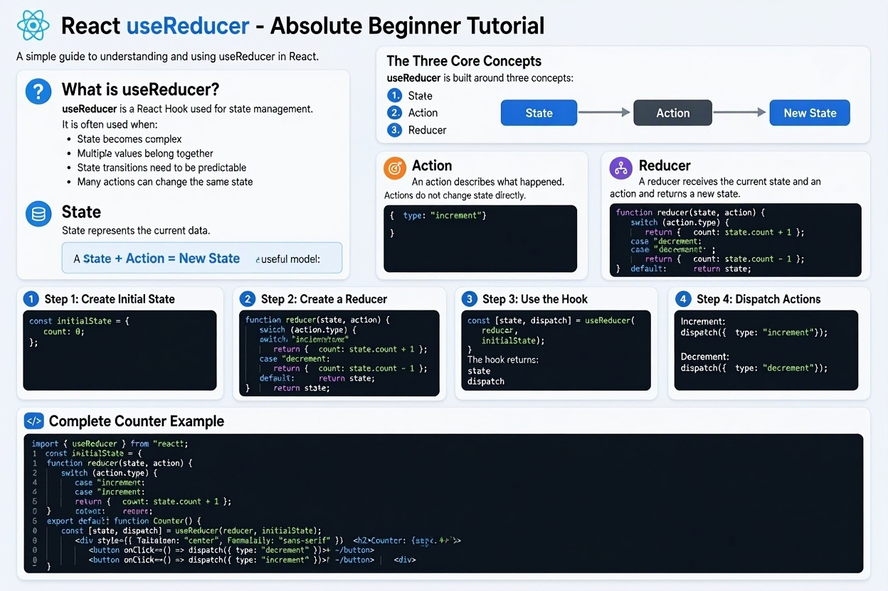
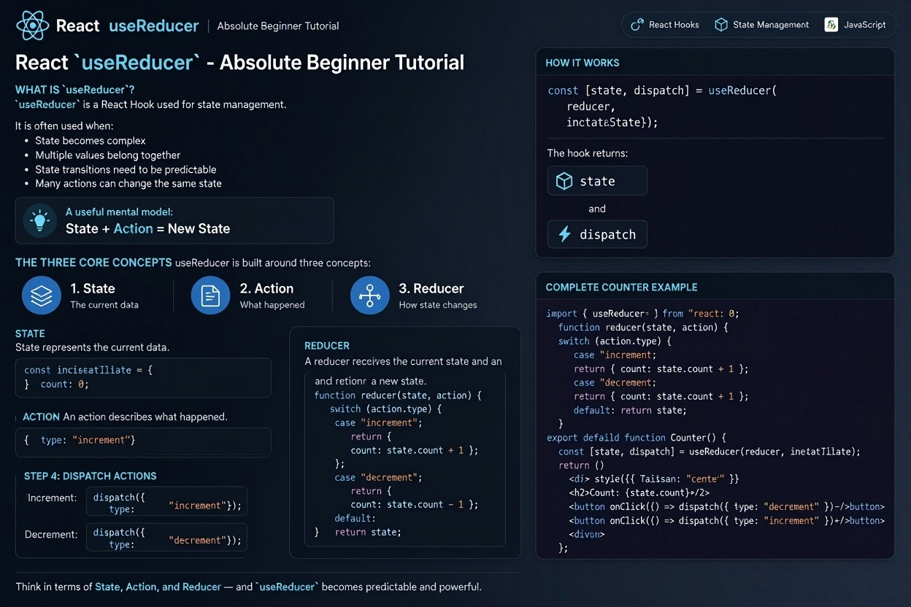

> [!NOTE]
> Der **useReducer-Hook** in React ist ein mächtiges Werkzeug zur **Zustandsverwaltung**, das sich besonders bei komplexen und miteinander verknüpften Daten anbietet. Das System stützt sich auf drei zentrale Säulen: das aktuelle **State**, das eingetretene **Action** sowie die **Reducer-Funktion**, die als Steuerzentrale fungiert. Mithilfe der **dispatch()-Methode** werden Aktionen an den Reducer gesendet, welcher daraufhin einen neuen, veränderten Zustand berechnet. Im Gegensatz zu einfachen **useState-Variablen** verhindert dieser strukturierte Ansatz direkte Datenmanipulationen und zentralisiert jegliche Logik. Dadurch eignet sich das Konzept hervorragend, um vorhersehbare Zustandsänderungen in React-Anwendungen übersichtlich und sauber zu organisieren.

***

# React `useReducer` - Absolute Beginner Tutorial



## What is `useReducer`?

`useReducer` is a React Hook used for state management.

It is often used when:

* State becomes complex
* Multiple values belong together
* State transitions need to be predictable
* Many actions can change the same state

A useful mental model:

> State + Action = New State

## The Three Core Concepts

`useReducer` is built around three concepts:

1. State
2. Action
3. Reducer

## State

State represents the current data.

```javascript
const initialState = {
  count: 0
};
```

## Action

An action describes what happened.

```javascript
{
  type: "increment"
}
```

Actions do not change state directly.

## Reducer

A reducer receives the current state and an action and returns a new state.

```javascript
function reducer(state, action) {
  switch (action.type) {
    case "increment":
      return {
        count: state.count + 1
      };

    case "decrement":
      return {
        count: state.count - 1
      };

    default:
      return state;
  }
}
```

## Step 1: Create Initial State

```javascript
const initialState = {
  count: 0
};
```

## Step 2: Create a Reducer

```javascript
function reducer(state, action) {
  switch (action.type) {
    case "increment":
      return {
        count: state.count + 1
      };

    case "decrement":
      return {
        count: state.count - 1
      };

    default:
      return state;
  }
}
```

## Step 3: Use the Hook

```javascript
const [state, dispatch] = useReducer(
  reducer,
  initialState
);
```

The hook returns:

```javascript
state
```

and

```javascript
dispatch
```

## Step 4: Dispatch Actions

Increment:

```javascript
dispatch({
  type: "increment"
});
```

Decrement:

```javascript
dispatch({
  type: "decrement"
});
```

## Complete Counter Example

```javascript
import { useReducer } from "react";

const initialState = {
  count: 0
};

function reducer(state, action) {
  switch (action.type) {
    case "increment":
      return {
        count: state.count + 1
      };

    case "decrement":
      return {
        count: state.count - 1
      };

    default:
      return state;
  }
}

export default function Counter() {
  const [state, dispatch] = useReducer(
    reducer,
    initialState
  );

  return (
    <div>
      <h1>{state.count}</h1>

      <button
        onClick={() =>
          dispatch({ type: "increment" })
        }
      >
        +
      </button>

      <button
        onClick={() =>
          dispatch({ type: "decrement" })
        }
      >
        -
      </button>
    </div>
  );
}
```

## Understanding Dispatch

`dispatch()` sends an action to the reducer.

Example:

```javascript
dispatch({
  type: "increment"
});
```

The reducer receives the action, calculates the new state, and React re-renders the component.

## Payload Example

Actions can contain additional data.

```javascript
dispatch({
  type: "add",
  payload: 5
});
```

Reducer:

```javascript
case "add":
  return {
    count: state.count + action.payload
  };
```

## Managing Multiple State Values

Instead of:

```javascript
const [name, setName] = useState("");
const [age, setAge] = useState(0);
const [email, setEmail] = useState("");
const [isLoggedIn, setIsLoggedIn] = useState(false);
```

You can use:

```javascript
const initialState = {
  name: "",
  age: 0,
  email: "",
  isLoggedIn: false
};
```

## Login Example

```javascript
const initialState = {
  isLoggedIn: false
};

function reducer(state, action) {
  switch (action.type) {
    case "login":
      return {
        isLoggedIn: true
      };

    case "logout":
      return {
        isLoggedIn: false
      };

    default:
      return state;
  }
}
```

Dispatch actions:

```javascript
dispatch({
  type: "login"
});
```

```javascript
dispatch({
  type: "logout"
});
```

## When Should You Use `useReducer`?

Use `useReducer` when:

* State contains multiple related values
* State updates become complicated
* Several actions modify the same state
* Business logic should be centralized

## When Should You Use `useState`?

Use `useState` for simple state:

```javascript
const [count, setCount] = useState(0);
```

## Common Beginner Mistakes

Incorrect:

```javascript
state.count++;
return state;
```

Correct:

```javascript
return {
  count: state.count + 1
};
```

Always include:

```javascript
default:
  return state;
```

## Cheat Sheet

Create reducer:

```javascript
function reducer(state, action) {
  switch (action.type) {
    case "actionName":
      return newState;

    default:
      return state;
  }
}
```

Connect reducer:

```javascript
const [state, dispatch] =
  useReducer(reducer, initialState);
```

Dispatch action:

```javascript
dispatch({
  type: "actionName"
});
```

## Key Takeaways




* `useReducer` is an alternative to `useState`.
* State updates are driven by actions.
* Reducers determine how state changes.
* `dispatch()` sends actions.
* Reducers should return new state objects.
* State should never be mutated directly.
* `useReducer` is ideal for complex state management.

## Related Notes

* \[\[React-Hooks-Overview]]
* \[\[React-useState]]
* \[\[React-Context-API]]
* \[\[React-State-Management]]
* \[\[Redux-Core-Concepts]]
* \[\[React-Component-Lifecycle]]

## Source

https\://react.dev/reference/react/useReducer
