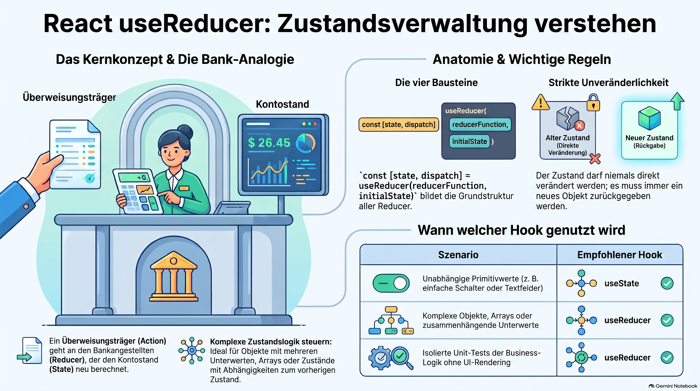
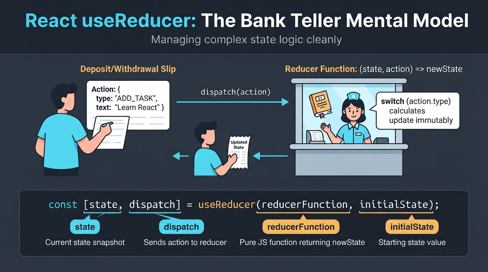
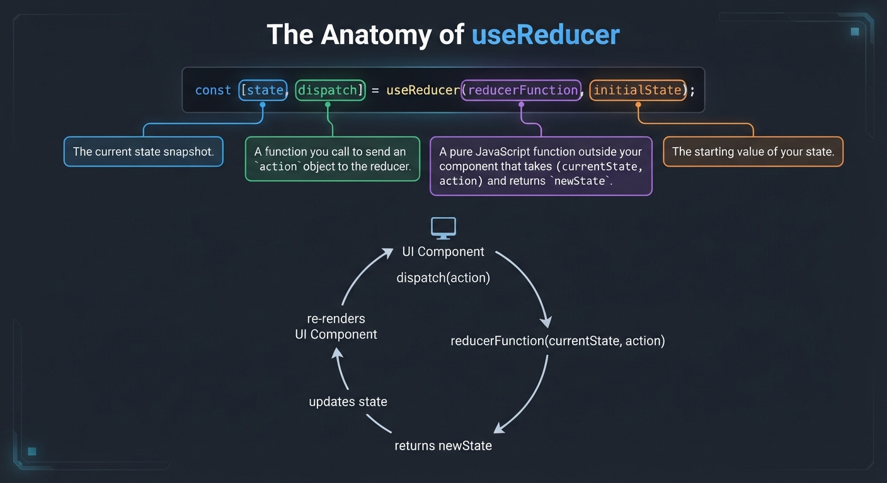

> [!NOTE]
> Der **React useReducer Hook** bietet eine strukturierte Alternative zu **useState** für die Verwaltung komplexer Zustandslogiken, indem er Zustandsänderungen mithilfe reiner Funktionen und **Action-Objekte** trennt. In diesem Tutorial wird Schritt für Schritt demonstriert, wie eine moderne **Vite-Anwendung** aufgesetzt und ein vollständiger **Task-Manager** mit Funktionen wie Hinzufügen, Umschalten und Löschen implementiert wird. Dabei wird besonderer Wert darauf gelegt, dass Reducer-Funktionen stets **unveränderliche (immutable) Kopien** zurückgeben, um vorhersehbare Abläufe zu garantieren. Durch die Auslagerung dieser Geschäftslogik lassen sich sowohl reine **Unit-Tests** als auch **Integrationstests** mit Tools wie Vitest und React Testing Library mühelos durchführen. Letztendlich stellt die Kombination aus useReducer und **Zustands-Dispatches** eine wartungsfreundliche Lösung dar, besonders wenn mehrere abhängige Werte oder komplexe Datenstrukturen in React-Anwendungen verwaltet werden müssen.

# React `useReducer`: An Absolute Beginner Step-by-Step Tutorial

## 1. Core Concept (Zettelkasten Summary)



* **What is `useReducer`?** An alternative to `useState` designed for managing **complex state logic**—such as objects with multiple sub-values, arrays of items, or states where the next state depends on the previous one.

* **Mental Model (The Bank Teller):**

  * Instead of changing your account balance directly (`useState`), you fill out a **Deposit/Withdrawal Slip** (an **Action** object like `{ type: 'ADD_TASK', text: 'Learn React' }`).

  * You hand that slip (`dispatch(action)`) to the **Bank Teller** (the **Reducer** function).

  * The Teller checks the rules (`switch (action.type)`), calculates the new balance without mutating the old receipt, and hands back the updated state.

* **The Anatomy of `useReducer`:**


  
  ```javascript
  const [state, dispatch] = useReducer(reducerFunction, initialState);
  ```

  1. **`state`:** The current state snapshot.

  2. **`dispatch`:** A function you call to send an `action` object to the reducer.

  3. **`reducerFunction(state, action)`:** A **pure JavaScript function** outside your component that takes `(currentState, action)` and returns `newState`.

  4. **`initialState`:** The starting value of your state.

## 2. Step 1: Project Setup (Using Vite)

Ensure [Node.js](https://nodejs.org/ "null") is installed on your machine.


1. Open your terminal and scaffold a new Vite + React project:

   ```
   npm create vite@latest react-reducer-demo -- --template react
   ```

2. Navigate into your project directory:

   ```
   cd react-reducer-demo
   ```

3. Install dependencies:

   ```
   npm install
   ```

4. Start the development server:

   ```
   npm run dev
   ```

   _(Open `http://localhost:5173` in your browser to verify the base app runs)._

## 3. Step 2: Designing the Pure Reducer Function (`src/taskReducer.js`)

Because a reducer is just a pure JavaScript function (it doesn't use any React hooks inside it), we can put it in its own clean `.js` file. This makes our business logic easy to read and super easy to unit test!


We will build a **Task Manager** supporting 4 distinct actions:


1. `ADD_TASK`: Appends a new task object to the list.

2. `TOGGLE_TASK`: Flips a task's `completed` boolean (`true` $\leftrightarrow$ `false`).

3. `DELETE_TASK`: Removes a task by its `id`.

4. `CLEAR_COMPLETED`: Filters out all completed tasks at once.

5. Inside `src/`, create a new file named `taskReducer.js`.

6. Add the following code:

```
// src/taskReducer.js

export const initialTasks = [
  { id: 1, text: 'Learn useState basics', completed: true },
  { id: 2, text: 'Master useReducer actions', completed: false }
];

// Pure function: takes (currentState, action) -> returns brand-new state
export function taskReducer(state, action) {
  switch (action.type) {
    case 'ADD_TASK': {
      // Prevent adding empty tasks
      if (!action.text || action.text.trim() === '') {
        return state;
      }
      const newTask = {
        id: Date.now(),
        text: action.text.trim(),
        completed: false
      };
      // Return a NEW array (never mutate `state` with .push!)
      return [...state, newTask];
    }

    case 'TOGGLE_TASK': {
      return state.map((task) =>
        task.id === action.id
          ? { ...task, completed: !task.completed }
          : task
      );
    }

    case 'DELETE_TASK': {
      return state.filter((task) => task.id !== action.id);
    }

    case 'CLEAR_COMPLETED': {
      return state.filter((task) => !task.completed);
    }

    default: {
      throw new Error(`Unknown action type: ${action.type}`);
    }
  }
}
```

### Key Rules for Writing Reducers:

* **Never mutate `state`:** Always return a new array or object (`[...state, newTask]`, `.map()`, `.filter()`).

* **Keep it pure:** Never run `fetch()`, `setTimeout()`, or `Math.random()` inside a reducer. Given the exact same `(state, action)`, it must always return the exact same output.

## 4. Step 3: Connecting `useReducer` to the UI (`src/App.jsx`)

Now we connect `taskReducer` to our React component using `useReducer`. Notice how clean `App.jsx` stays—it doesn't contain any `.map()` or `.filter()` array manipulation logic; it simply **dispatches intentions**.


1. Open `src/App.jsx` and replace its contents with:

```
// src/App.jsx
import { useState, useReducer } from 'react';
import { taskReducer, initialTasks } from './taskReducer';

function App() {
  // 1. Initialize useReducer with our pure reducer function and starting array
  const [tasks, dispatch] = useReducer(taskReducer, initialTasks);

  // 2. Simple local useState is still great for form input text!
  const [inputText, setInputText] = useState('');

  function handleAddSubmit(e) {
    e.preventDefault();
    if (!inputText.trim()) return;

    // Dispatch an action object describing WHAT happened
    dispatch({ type: 'ADD_TASK', text: inputText });
    setInputText('');
  }

  const completedCount = tasks.filter((t) => t.completed).length;

  return (
    <div style={{
      maxWidth: '480px',
      margin: '40px auto',
      padding: '24px',
      fontFamily: 'system-ui, sans-serif',
      border: '1px solid #cbd5e1',
      borderRadius: '12px',
      backgroundColor: '#f8fafc'
    }}>
      <h1 style={{ marginTop: 0, color: '#0f172a' }}>📋 Task Reducer</h1>

      {/* Form to dispatch ADD_TASK */}
      <form onSubmit={handleAddSubmit} style={{ display: 'flex', gap: '8px', marginBottom: '20px' }}>
        <input
          type="text"
          aria-label="New task name"
          placeholder="What needs to be done?"
          value={inputText}
          onChange={(e) => setInputText(e.target.value)}
          style={{
            flex: 1,
            padding: '10px',
            borderRadius: '6px',
            border: '1px solid #94a3b8',
            fontSize: '1rem'
          }}
        />
        <button
          type="submit"
          style={{
            padding: '10px 16px',
            borderRadius: '6px',
            border: 'none',
            backgroundColor: '#2563eb',
            color: '#ffffff',
            fontWeight: 'bold',
            cursor: 'pointer'
          }}
        >
          Add
        </button>
      </form>

      {/* Task List */}
      <ul style={{ listStyle: 'none', padding: 0, margin: '0 0 20px 0' }}>
        {tasks.map((task) => (
          <li
            key={task.id}
            style={{
              display: 'flex',
              justifyContent: 'space-between',
              alignItems: 'center',
              padding: '10px 12px',
              marginBottom: '8px',
              backgroundColor: '#ffffff',
              borderRadius: '6px',
              border: '1px solid #e2e8f0'
            }}
          >
            <label style={{ display: 'flex', alignItems: 'center', gap: '10px', cursor: 'pointer' }}>
              <input
                type="checkbox"
                checked={task.completed}
                onChange={() => dispatch({ type: 'TOGGLE_TASK', id: task.id })}
              />
              <span style={{
                textDecoration: task.completed ? 'line-through' : 'none',
                color: task.completed ? '#94a3b8' : '#1e293b'
              }}>
                {task.text}
              </span>
            </label>

            <button
              onClick={() => dispatch({ type: 'DELETE_TASK', id: task.id })}
              aria-label={`Delete ${task.text}`}
              style={{
                background: 'none',
                border: 'none',
                color: '#dc2626',
                cursor: 'pointer',
                fontWeight: 'bold'
              }}
            >
              ✕
            </button>
          </li>
        ))}
      </ul>

      {/* Footer Summary & Clear Completed Button */}
      <div style={{
        display: 'flex',
        justifyContent: 'space-between',
        alignItems: 'center',
        fontSize: '0.9rem',
        color: '#475569',
        borderTop: '1px solid #e2e8f0',
        paddingTop: '12px'
      }}>
        <span>
          {completedCount} of {tasks.length} completed
        </span>

        {completedCount > 0 && (
          <button
            onClick={() => dispatch({ type: 'CLEAR_COMPLETED' })}
            style={{
              padding: '6px 10px',
              borderRadius: '6px',
              border: '1px solid #cbd5e1',
              backgroundColor: '#ffffff',
              cursor: 'pointer'
            }}
          >
            Clear Completed
          </button>
        )}
      </div>
    </div>
  );
}

export default App;
```

## 5. Step 4: Testing `useReducer` (Manual & Automated)

One of the biggest superpowers of `useReducer` is that you can test your reducer logic **twice**:


1. **Pure Unit Tests:** Test `taskReducer` directly as a plain JavaScript function without even rendering React!

2. **Component Integration Tests:** Render `<App />` and verify that clicking buttons dispatches the right actions and updates the DOM.

### A. Install Testing Tools

1. Stop the dev server (`Ctrl + C`).

2. Install **Vitest**, **jsdom**, **React Testing Library**, and **User Event**:

   ```
   npm install -D vitest jsdom @testing-library/react @testing-library/jest-dom @testing-library/user-event
   ```

3. Configure `vite.config.js` to use `jsdom`:

   ```
   import { defineConfig } from 'vite';
   import react from '@vitejs/plugin-react';

   export default defineConfig({
     plugins: [react()],
     test: {
       environment: 'jsdom',
       globals: true,
     },
   });
   ```

### B. Write Pure Reducer Unit Tests (`src/taskReducer.test.js`)

Create `src/taskReducer.test.js`:


```
// src/taskReducer.test.js
import { describe, it, expect } from 'vitest';
import { taskReducer } from './taskReducer';

describe('taskReducer Pure Logic', () => {
  it('adds a new task when ADD_TASK is dispatched', () => {
    const startState = [{ id: 1, text: 'Initial task', completed: false }];
    const action = { type: 'ADD_TASK', text: 'Write tests' };

    const nextState = taskReducer(startState, action);

    expect(nextState).toHaveLength(2);
    expect(nextState[1].text).toBe('Write tests');
    expect(nextState[1].completed).toBe(false);
  });

  it('toggles completion status when TOGGLE_TASK is dispatched', () => {
    const startState = [{ id: 10, text: 'Learn reducers', completed: false }];
    const nextState = taskReducer(startState, { type: 'TOGGLE_TASK', id: 10 });

    expect(nextState[0].completed).toBe(true);
  });

  it('removes completed tasks when CLEAR_COMPLETED is dispatched', () => {
    const startState = [
      { id: 1, text: 'Done', completed: true },
      { id: 2, text: 'Pending', completed: false }
    ];
    const nextState = taskReducer(startState, { type: 'CLEAR_COMPLETED' });

    expect(nextState).toHaveLength(1);
    expect(nextState[0].text).toBe('Pending');
  });
});
```

### C. Write Component Integration Tests (`src/App.test.jsx`)

Create `src/App.test.jsx`:


```
// src/App.test.jsx
import { render, screen } from '@testing-library/react';
import userEvent from '@testing-library/user-event';
import { describe, it, expect } from 'vitest';
import App from './App';

describe('Task Manager App with useReducer', () => {
  it('allows adding, toggling, and clearing completed tasks via UI interactions', async () => {
    const user = userEvent.setup();
    render(<App />);

    // 1. Add a new task
    const input = screen.getByLabelText(/New task name/i);
    const addButton = screen.getByRole('button', { name: /Add/i });

    await user.type(input, 'Build Zettelkasten vault');
    await user.click(addButton);

    expect(screen.getByText('Build Zettelkasten vault')).toBeDefined();
    expect(screen.getByText('1 of 3 completed')).toBeDefined();

    // 2. Toggle the new task's checkbox
    const checkbox = screen.getByRole('checkbox', { name: /Build Zettelkasten vault/i });
    await user.click(checkbox);
    expect(screen.getByText('2 of 3 completed')).toBeDefined();

    // 3. Click "Clear Completed"
    const clearBtn = screen.getByRole('button', { name: /Clear Completed/i });
    await user.click(clearBtn);

    expect(screen.queryByText('Build Zettelkasten vault')).toBeNull();
    expect(screen.getByText('0 of 1 completed')).toBeDefined();
  });
});
```

### D. Run the Test Suite

Execute the tests in your terminal:


```
npx vitest run
```

You should see **2 test files passed** (`4 passed` total tests) in green!


## 6. When to Choose `useState` vs. `useReducer`

| Scenario                                                                                                          | Recommended Hook            |
| ----------------------------------------------------------------------------------------------------------------- | --------------------------- |
| Independent primitive values (a boolean toggle, a text input string, a simple counter)                            | `useState`                  |
| Multiple related sub-values that update together (arrays of objects, complex forms, multi-step state machines)    | `useReducer`                |
| You want to separate business logic from UI components so it can be unit-tested in isolation                      | `useReducer`                |
| You want to pass a single stable `dispatch` function down via `useContext` instead of 5 separate setter callbacks | `useReducer` + `useContext` |

## 7. Related Zettelkasten Links

* `[[How React Handles State (Under the Hood)]]` - Why reducers must return immutable copies rather than mutating existing state.

* `[[React State (useState) Beginner Tutorial]]` - Simpler state management for isolated primitives.

* `[[React useContext & Weather Web App: An Absolute Beginner Tutorial]]` - Combining `useReducer` + `useContext` is the standard pattern for lightweight global app state (similar to Redux).

