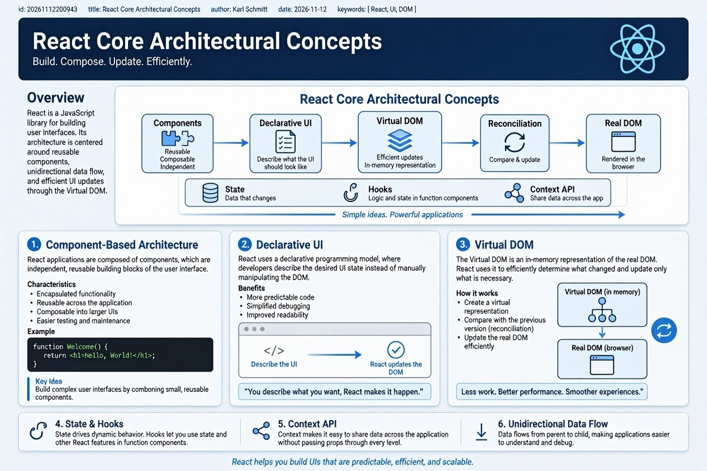

# What is the React boot camp?

1. 🚀 [What is React?](./Atoms/React.md)
2. 🧑‍🎓 [How to learn React?](./How_to_learn_React_JS.md)
3. 🌍 [React «Hello World» using Vite](./Atoms/React_Hello_World_using_Vite.md)
4. 📦 [Simple React Component Example](./Atoms/Simple_React_Component_Example.md)
5. ⚠️ [How does React handle side effects?](./Atoms/React_handling_side_effects.md)
6. 📰 [Multi Page Applications](./Atoms/React_Router_multi_page_applications.md)
7. 🔄[Dynamic Route Parameters](./Atoms/React_Router_Dynamic_Route_Parameters.md)
   


> **Core Mental Model:** React is a declarative JavaScript library for building user interfaces where the UI is a pure function of state: $UI = f(state)$.

---

## 🗺️ Curriculum Overview (Atomic Note Links)

* [01-react-architecture-and-virtual-dom](./Atoms/React_Core_Architectural_Concepts_Zettelkasten.md)
* [[02-jsx-and-component-composition]]
* [[03-props-and-unidirectional-data-flow]]
* [[04-state-management-with-usestate]]
* [[05-side-effects-and-useeffect]]
* [[06-client-side-routing-with-react-router]]
* [[07-modern-react-ecosystem-and-next-steps]]

---

## Phase 1: Foundations & Setup

### 1. Environment Setup with Vite
Modern React apps are bootstrapped using **Vite** rather than legacy tools like Create React App.
* **Initialize Project:** `npm create vite@latest my-app -- --template react`
* **Install & Run:** `cd my-app && npm install && npm run dev`
* **Key Concept:** Vite uses native ES Modules in the browser for instant server startup and Hot Module Replacement (HMR).




### 2. Core Architectural Concepts
* **Component-Based Architecture:** Break UIs into isolated, reusable building blocks (e.g., `<Navbar />`, `<Card />`, `<Button />`).
* **The Virtual DOM:** An in-memory lightweight copy of the real browser DOM. When state changes, React runs a *diffing algorithm* (Reconciliation) to calculate the minimal set of changes required and updates only those specific nodes in the real DOM.
* **JSX (JavaScript XML):** Syntax sugar allowing HTML-like structure inside JavaScript. Under the hood, compilers (like Babel or SWC) transpile JSX into `React.createElement()` calls.
  * *Rule 1:* Must return a single root element (use `<>...</>` Fragments to avoid extra `<div>` wrappers).
  * *Rule 2:* Use `className` instead of `class`, and `htmlFor` instead of `for`.
  * *Rule 3:* Embed JavaScript expressions inside single curly braces `{expression}`.

---

## Phase 2: Data Flow & Interactivity

### 3. Props (Properties)
* **Definition:** Read-only inputs passed from a parent component down to a child component.
* **Unidirectional Data Flow:** Data always flows downward. A child component cannot directly mutate the props it receives.
* **Pattern (Destructuring):**

```javascript
  
  function UserBadge({ username, isOnline }) {
    return (
      <span>
        {username} {isOnline ? '🟢' : '⚪'}
      </span>
    );
  }
```

### 4. Local State (`useState`)

* **Definition:** Component memory that persists across renders. Updating state triggers a component re-render.

* **Syntax:** `const [state, setState] = useState(initialValue);`

* **Golden Rules of State:**

  1. **Never mutate state directly** (e.g., never do `items.push(newItem)`). Always create a new reference using spread syntax `[...items, newItem]` or `.map()` / `.filter()`.

  2. **Functional Updates:** When new state depends on previous state, pass an updater function: `setCount(prev => prev + 1)`.


## Phase 3: Side Effects & Lifecycle

### 5. Synchronizing with External Systems (`useEffect`)

* **Definition:** Used to step outside pure rendering to interact with external APIs, browser timers, DOM subscriptions, or `localStorage`.

* **Syntax & Dependency Array:**
  
```javascript
  useEffect(() => {
    // 1. Setup / Side Effect code
    const controller = new AbortController();

    fetch('/api/data', { signal: controller.signal })
      .then(res => res.json())
      .then(data => setData(data));

    // 2. Cleanup function (runs on unmount or before re-running effect)
    return () => controller.abort();
  }, [dependency]); // 3. Dependency Array
  ```

* **Dependency Array Cheat Sheet:**

  * `[]` (Empty): Runs **once** on component mount.

  * `[id]` (Populated): Runs on mount + whenever `id` changes.

  * _Omitted_: Runs after **every** render (avoid unless intentional).

## Phase 4: Multi-Page Navigation (SPAs)

### 6. Client-Side Routing (`react-router-dom`)

React builds Single-Page Applications (SPAs) where URL changes swap components in memory without full browser page reloads.

* **Core Components:**

  * `<BrowserRouter>`: Syncs UI with browser URL history.

  * `<Routes>` & `<Route>`: Maps URL paths to components.

  * `<Link to="/path">`: Declarative navigation without page refreshes.

* **Dynamic URL Parameters (`useParams`):**

  * Define route with colon: `<Route path="/users/:userId" element={<Profile />} />`

  * Extract inside component: `const { userId } = useParams();`


## Phase 5: Capstone Practice Projects (Learn by Building)

To solidify these atomic notes into practical muscle memory, build these three projects in order:

1. **Project 1 — Interactive Task Tracker (CRUD):**

   * _Skills tested:_ `useState`, array immutability (`.filter()`, `.map()`), controlled form inputs, conditional rendering.

2. **Project 2 — Weather or Movie Search Dashboard:**

   * _Skills tested:_ `useEffect`, `fetch` / `async-await`, loading & error UI states, debouncing user search input.

3. **Project 3 — Multi-Page E-Commerce Storefront:**

   * _Skills tested:_ `react-router-dom`, dynamic routes (`/product/:id`), lifting state up (shopping cart shared across pages).


## 🔗 Next Atomic Notes to Create

* \[ ] `[[custom-hooks-pattern]]` — Extracting reusable stateful logic (`useFetch`, `useLocalStorage`).


* \[ ] `[[usecontext-and-prop-drilling]]` — Solving deep prop passing across component trees.


* \[ ] `[[controlled-vs-uncontrolled-forms]]` — Managing complex form inputs and validation.


* \[ ] `[[react-performance-memoization]]` — Understanding `useMemo`, `useCallback`, and `React.memo`.

```

<FollowUp label="Would you like me to generate separate, standalone atomic Zettelkasten notes for each of the modules listed in the Map of Content?" query="Generate individual atomic Zettelkasten notes with YAML frontmatter and code examples for each module in the React bootcamp."/>
```
