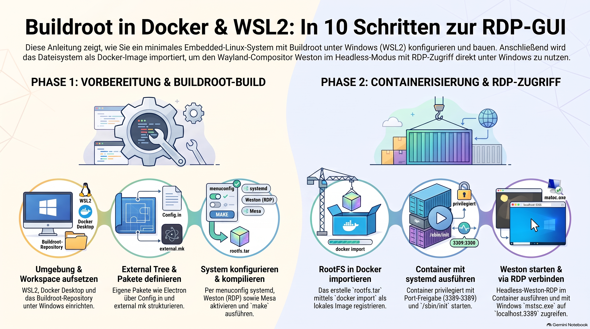
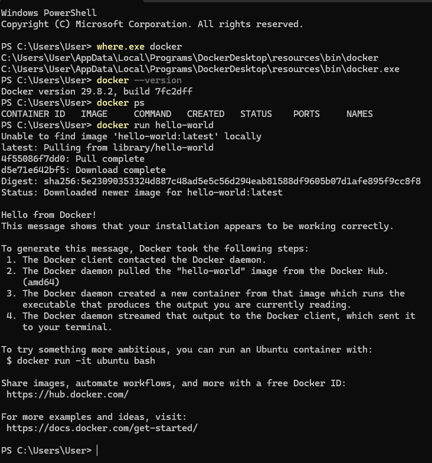
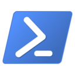
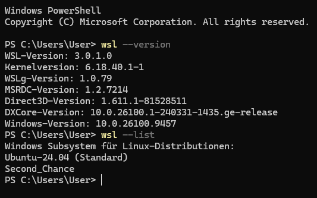

> [NOTE!]
> Diese Anleitung beschreibt Schritt für Schritt, wie man ein maßgeschneidertes und minimales **Linux-System** mithilfe von **Buildroot** erstellt. Als Grundlage dient eine Windows-Umgebung, in der **WSL2** und **Docker** als Basis für die Entwicklung und Ausführung eingerichtet werden. Anschließend wird ein externer Ordner konfiguriert, um eigene Softwarepakete wie **Electron** in das Betriebssystem zu integrieren. Nach dem erfolgreichen Kompilieren des Systemabbilds wird das resultierende Dateisystem in einen **Docker-Container** importiert. Schließlich lässt sich die grafische Benutzeroberfläche über einen **Wayland-Compositor** starten und mithilfe des Remotedesktop-Protokolls direkt auf **Windows** anzeigen.

# Step‑by‑Step 👟 Tutorial

## 1. Prepare the environment

Set up the basic tools 🛠️ needed to build and run the target system.

On Windows: install **WSL2**, a Linux distribution (e.g. Ubuntu or Debian), and **Docker Desktop** with WSL2 backend enabled.

* **Enable WSL** and the Virtual Machine Platform for Windows

* **Install a Linux Distro** (e.g. Ubuntu or Debian) from Microsoft Store

* Install **Docker Desktop** and ensure it uses the WSL2 backend

* Inside WSL, **verify Docker works**: `docker ps` and `docker run hello-world`
`

### Check Virtualization 

Open **Task Manager** -> **Performance** tab -> **CPU**. Confirm that **Virtualization** is listed as **Enabled**. 

### Enable WSL

In the **PowerShell** admin console type: `wsl --install`

After the installation restart your PC 💻.

### Install a Linux Distro

In a PowerShell console type: `wsl -d Ubuntu`

In a PowerShell console type: `wsl -d Debian`

### Verify Docker Works

In a PowerShell console type: `docker ps`  and `docker run hello-world`

## 2. Create the Buildroot workspace

Organize a working directory 📂 for Buildroot and the external tree 🌳.

In your WSL terminal:

* First install the tools to **build** a Buildroot linux oerating system on your WSL linux

* Next create a GitHub repository to store your learnings: [Second Chance](https://github.com/karlschmitt/Second_Chance)

* Clone your GitHub repository locally: `git clone git@github.com:karlschmitt/Second_Chance.git`

* Create your project folder: `mkdir -p ~/Second_Chance/External_Tree`

* Create a workspace: `mkdir -p ~/Second_Chance/External_Tree/buildroot-work && cd ~/Second_Chance/External_Tree/buildroot-work`

* Download or clone Buildroot into `buildroot/` (e.g. `git clone https://git.busybox.net/buildroot buildroot`)

* Verify: `cd buildroot && ls` shows standard Buildroot directories

## 3 Create the Buildroot external tree

Set up an external tree to hold custom packages and configuration.

In your WSL terminal:

* Go to home: `cd ~`

* Create external tree: `mkdir -p ~/Second_Chance/External_Tree/buildroot-external/package/electron` and `mkdir -p ~/Second_Chance/External_Tree/buildroot-external/package/hello-electron`

* Ensure structure: `ls ~/Second_Chance/External_Tree/buildroot-external` should show `Config.in`, `external.mk`, `package/` after next steps

## 4 Define external tree integration files

Connect the external tree to Buildroot via Config.in and external.mk.

Edit files under `~/Second_Chance/External_Tree/buildroot-external`:

* Create `Config.in` with:

  * `menu "Custom external packages"`

  * `source "$BR2_EXTERNAL/package/electron/Config.in"`

  * `source "$BR2_EXTERNAL/package/hello-electron/Config.in"`

  * `endmenu`

* Create `external.mk` with:

  * `include $(BR2_EXTERNAL)/Config.in`

  * `include $(BR2_EXTERNAL)/package/electron/electron.mk`

  * `include $(BR2_EXTERNAL)/package/hello-electron/hello-electron.mk`

* Ensure files are saved without BOM and with Unix line endings (LF).

## 5 Define custom packages (Electron example)

Add minimal package definitions for custom applications.

Under `~/Second_Chance/External_Tree/buildroot-external/package`:

* For `electron`:

  * `Config.in`: `config BR2_PACKAGE_ELECTRON` + `bool "electron"`

  * `electron.mk`: define version/site/install commands and end with `$(eval $(generic-package))`

* For `hello-electron`:

  * `Config.in`: `config BR2_PACKAGE_HELLO_ELECTRON` + `bool "hello-electron"`

  * `hello-electron.mk`: similar minimal package definition

* Keep these simple; they can be extended later with real sources and install logic.

## 6 Configure Buildroot to use the external tree

Tell Buildroot to include the external tree and select required components.

From `~/Second_Chance/External_Tree/buildroot-work/buildroot`:

* Run: `make BR2_EXTERNAL=~/buildroot-external menuconfig`

* In menuconfig, enable:

  * `systemd` as init system

  * `Weston` (Wayland compositor) with headless backend and RDP support

  * `Mesa` (software rendering)

  * Your custom packages: `electron`, `hello-electron`

* Save the configuration and exit menuconfig.

## 7 Build the system with Buildroot

Compile the full root filesystem and images.

From `~/Second_Chance/External_Tree/buildroot-work/buildroot`:

* Run: `make`

* Wait for Buildroot to download, compile, and assemble all components

* When finished, check `output/images/` for generated artifacts

* Confirm `rootfs.tar` exists (this will be used for Docker).

## 8 Create a Docker image from the Buildroot rootfs

Import the Buildroot root filesystem into Docker as an image.

From `~/buildroot-work/buildroot`:

* In WSL, run: `cd output/images`

* Import the rootfs: `docker import rootfs.tar buildroot-image`

* Verify: `docker images` shows `buildroot-image`

## 9 Run the Buildroot system in a Docker container

Start the container with systemd and expose RDP to Windows.

In WSL terminal:

* Run: `docker run -it --privileged -p 3389:3389 buildroot-image /sbin/init`

* This starts systemd inside the container

* Keep this terminal open; it is the running Buildroot system.

## 10 Start Weston headless with RDP and connect from Windows

Launch the Wayland compositor and access the GUI via RDP.

Inside the running container and on Windows:

* In the container shell, start Weston:

  * `weston --backend=headless-backend.so --rdp --socket=wayland-0`

* On Windows, open the RDP client:

  * Run `mstsc.exe`

  * Connect to `localhost:3389`

* You now see the Buildroot Wayland desktop; Electron or other apps can be started as Wayland clients.

## Summary

Following these steps, you:

* Build a custom, minimal Linux system with Buildroot (including systemd, Weston, Mesa, and custom packages).

* Package it as a Docker image using `rootfs.tar`.

* Run it inside Docker on WSL2 with systemd.

* Start Weston in headless mode with RDP output.

* Connect from Windows via the native RDP client to interact with the GUI and any Wayland/Electron applications.

This sequence is reproducible on any machine with WSL2 and Docker available.
