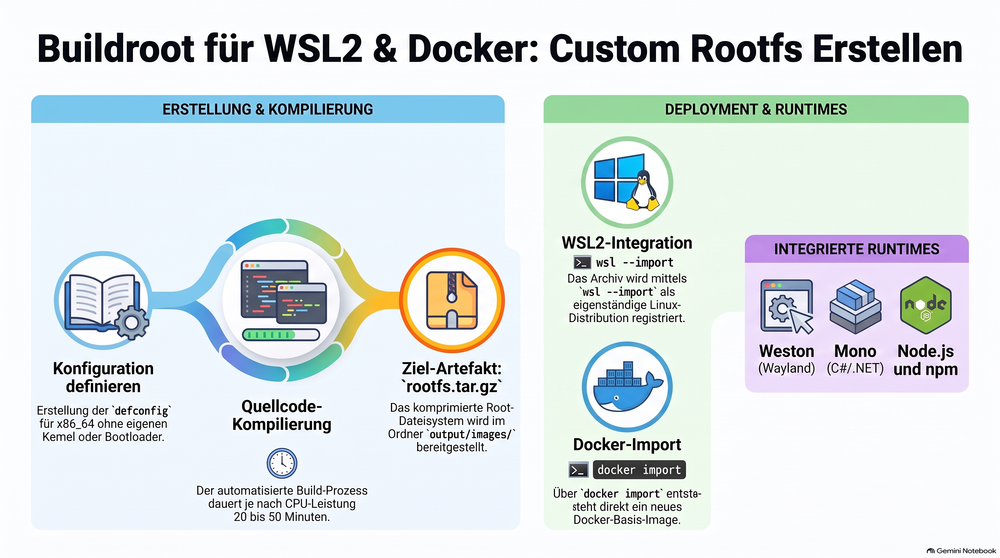

> [NOTE!]
> Der Text beschreibt eine umfassende Anleitung zur Erstellung eines maßgeschneiderten und ressourcensonenschonenden **Embedded Linux Root-Dateisystems** mithilfe von **Buildroot**. Dabei werden sämtliche Softwarekomponenten, einschließlich des C-Bibliotheks-Toolchains, direkt aus dem Quellcode für die **x86\_64**-Architektur cross-kompiliert. Für den Einsatz in containerisierten Umgebungen wie **Docker** oder Virtualisierungsschichten wie **WSL2** wird bewusst auf die Erstellung eines eigenen Kernels verzichtet, um stattdessen ein optimiertes **rootfs.tar**-Archiv zu generieren. Die Konfiguration erfolgt über eine reproduzierbare **defconfig**-Datei, die neben grundlegenden Systemwerkzeugen auch moderne Display-Server-Technologien wie **Weston** sowie Laufzeitumgebungen wie **Node.js** und **Mono** einbindet. Abschließend erläutert die Dokumentation den erfolgreichen Import des erstellten Tarballs in Windows-Subsystem-für-Linux- sowie Docker-Umgebungen und zeigt konkrete Validierungsschritte zur Funktionsprüfung auf.


# Buildroot Deep Dive

Custom x86_64 Rootfs for WSL2 and  Docker providing Weston, Mono, and Node.js

## 1. What is Buildroot and How Does It Work?

**Buildroot** is an open-source tool designed to generate custom, lightweight embedded Linux systems using cross-compilation. Unlike traditional desktop Linux distributions (e.g., Ubuntu, Debian) that install pre-compiled binary packages, Buildroot compiles everything—from the C library and cross-compiler to system utilities and custom applications—directly from source code.

### The Three Core Outputs of Buildroot

1. **Toolchain**: The cross-compiler (e.g., `x86_64-buildroot-linux-gnu-gcc`) and standard C library (`glibc`, `musl`, or `uClibc-ng`) required to compile software for the target architecture.
2. **Root File System (`rootfs`)**: A clean tree containing binaries (`/bin`, `/sbin`), libraries (`/lib`), configuration files (`/etc`), and user directories (`/home`).
3. **Kernel & Bootloader Images** *(Optional)*: `bzImage` (Linux kernel) and `GRUB`/`syslinux` bootloaders. 

> **WSL2 & Docker Context**: When targeting **WSL2** or **Docker**, we do **not** need Buildroot to generate a Linux kernel or bootloader! Both runtime environments use host-managed kernels. We only require Buildroot to produce a root filesystem tarball (`rootfs.tar`).

---

## 2. Environment Setup & Prerequisites

Buildroot must be executed on a POSIX-compliant host system (Linux or WSL2 Ubuntu/Debian).

### Host System Dependencies

Install the core build dependencies on your Linux build machine or WSL Ubuntu distribution:

```bash
sudo apt update && sudo apt install -y \
    build-essential \
    bash \
    bc \
    binutils \
    bzip2 \
    cpio \
    diffutils \
    file \
    findutils \
    g++ \
    gawk \
    gcc \
    git \
    grep \
    gzip \
    libncurses-dev \
    make \
    patch \
    perl \
    python3 \
    rsync \
    sed \
    tar \
    unzip \
    wget
```

### Fetching Buildroot Source Code

Clone the official LTS (Long Term Support) repository:

```bash
git clone https://github.com/buildroot/buildroot.git
cd buildroot
```

---

## 3. Blueprint Configuration (`defconfig`)

Instead of navigating thousands of options in `make menuconfig`, Buildroot allows you to define a minimal reproducible config file called a `defconfig`.

Create a file named `wsl_docker_x86_64_defconfig` inside the `configs/` directory:

```bash
cat << 'EOF' > configs/wsl_docker_x86_64_defconfig
# --- Architecture Configuration ---
BR2_x86_64=y
BR2_x86_x86_64=y

# --- Toolchain Options ---
BR2_TOOLCHAIN_BUILDROOT_GLIBC=y
BR2_PACKAGE_HOST_LINUX_HEADERS_CUSTOM_6_6=y
BR2_TOOLCHAIN_BUILDROOT_CXX=y
BR2_GCC_ENABLE_OPENMP=y
BR2_ENABLE_LOCALE=y
BR2_USE_WCHAR=y

# --- System Configuration ---
BR2_TARGET_GENERIC_HOSTNAME="embedded-wsl"
BR2_TARGET_GENERIC_ISSUE="Welcome to Custom Buildroot WSL2/Docker Rootfs"
BR2_TARGET_GENERIC_ROOT_PASSWD="root"
BR2_ROOTFS_DEVICE_CREATION_DYNAMIC_DEVTMPFS=y
BR2_INIT_BUSYBOX=y

# --- Filesystem Targets ---
# Produce only the tarball needed for Docker import and WSL2
BR2_TARGET_ROOTFS_TAR=y
BR2_TARGET_ROOTFS_TAR_GZ=y
# disable kernel/bootloader builds for container/WSL target
# BR2_LINUX_KERNEL is not set

# --- Wayland & Weston Display Server ---
BR2_PACKAGE_WAYLAND=y
BR2_PACKAGE_WESTON=y
BR2_PACKAGE_WESTON_HAS_COMPOSITOR=y
BR2_PACKAGE_WESTON_DRM=y
BR2_PACKAGE_WESTON_XWAYLAND=y
BR2_PACKAGE_XORG7=y

# --- Application Runtimes ---
# 1. Node.js Engine & Package Manager
BR2_PACKAGE_NODEJS=y
BR2_PACKAGE_NODEJS_NPM=y

# 2. Mono C# Runtime (.NET Execution Framework)
BR2_PACKAGE_MONO=y

# --- System Utilities & Libraries ---
BR2_PACKAGE_MESA3D=y
BR2_PACKAGE_MESA3D_GALLIUM_DRIVER_VIRGL=y
BR2_PACKAGE_LIBDRM=y
BR2_PACKAGE_CAIRO=y
BR2_PACKAGE_LIBPNG=y
BR2_PACKAGE_JPEG=y
BR2_PACKAGE_OPENSSL=y
BR2_PACKAGE_CURL=y
BR2_PACKAGE_BASH=y
EOF
```

---

## 4. Building the Root Filesystem

Apply your blueprint configuration and start the compilation:

```bash
# 1. Load the defconfig
make wsl_docker_x86_64_defconfig

# 2. (Optional) Inspect or modify using the Ncurses TUI
# make menuconfig

# 3. Compile the system (Use -j to enable multi-threaded compilation)
make -j$(nproc)
```

> **Note**: Buildroot builds the cross-compiler host tools and libraries from source. The initial compilation can take anywhere from **20 to 50 minutes** depending on your CPU power.

### Compilation Artifacts

When compilation finishes, your complete system image will reside in:

```bash
output/images/rootfs.tar.gz
```

---

## 5. Deployment Guide

### A. Importing to WSL2 (Windows Subsystem for Linux)

1. Copy `output/images/rootfs.tar.gz` to a location accessible by Windows (e.g., `C:\buildroot\rootfs.tar.gz`).
2. Open Windows PowerShell and create a target directory:
   ```powershell
   New-Item -ItemType Directory -Path "C:\WSL\Buildrootx86"
   ```
3. Import the tarball into WSL2:
   ```powershell
   wsl --import Buildroot-x86 C:\WSL\Buildrootx86 C:\buildroot\rootfs.tar.gz --version 2
   ```
4. Launch your custom Buildroot distribution:
   ```powershell
   wsl -d Buildroot-x86
   ```

---

### B. Importing to Docker

1. Load the generated tarball directly as a Docker base image:
   ```bash
   docker import output/images/rootfs.tar.gz buildroot-x86_64:latest
   ```
2. Verify the imported image:
   ```bash
   docker images | grep buildroot
   ```
3. Run an interactive shell container:
   ```bash
   docker run -it --rm buildroot-x86_64:latest /bin/bash
   ```

---

## 6. Validating Installed Runtimes

Once inside your running WSL distribution or Docker container, run the following verification commands:

### 1. Verify Node.js Environment
```bash
node -v
npm -v
node -e 'console.log("Hello from Node.js on Buildroot x86_64!");'
```

### 2. Verify Mono C# Runtime
Create a simple test program:

```bash
cat << 'EOF' > Hello.cs
using System;

public class Program {
    public static void Main() {
        Console.WriteLine("Hello from Mono C# running on custom Buildroot Linux!");
    }
}
EOF

# Compile and Execute
mcs Hello.cs
mono Hello.exe
```

### 3. Verify Weston Display Server (Wayland)
Check if Weston compositing binaries and Wayland protocols are present:

```bash
weston --version
wayland-scanner --version
```

---

## 7. Summary & Key Zettelkasten Concepts

To connect this note across your knowledge base:

* **[[Embedded Linux Toolchains]]**: The mechanics of building cross-compilers (`glibc` vs `musl`).
* **[[WSL2 Integration]]**: Importing raw OCI-compliant container root filesystems via `wsl --import`.
* **[[Docker Image Construction]]**: Building Docker base layers using `docker import` rather than standard Dockerfiles.
* **[[Wayland vs X11 Compositors]]**: Running Weston as an efficient display server protocol in containerized or virtualized environments.

## Related Notes

* [[202610162043-keycloak-fundamentals-deep-dive]]
* [[202610162019-camel-oauth2-jwt-security]]
* [[202610161947 - REST API Fundamentals: Deep Dive with Star Wars & Weather APIs]]