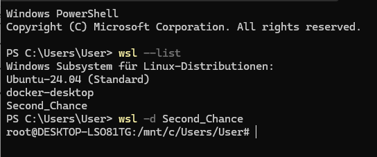
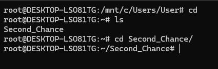
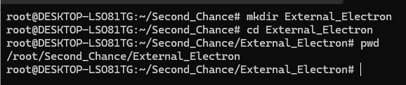

# External Electron.js Example

---

## 1. Conceptual Overview: What is Buildroot?

**Buildroot** is a simple, efficient, and easy-to-use tool to generate a embedded Linux system through cross-compilation. Unlike heavy distributions (Ubuntu, Fedora), Buildroot builds everything from scratch:
1. **Toolchain:** The cross-compiler (GCC, Binutils) running on your host machine (x86_64).
2. **Bootloader:** GRUB or syslinux (for x86_64 PC/WSL/Docker targets).
3. **Linux Kernel:** A customized, lean kernel configuration.
4. **Root Filesystem (Rootfs):** A minimal directory tree containing BusyBox, libraries, Weston compositor, Mono runtime, Node.js, and your custom Electron application.

### Why Target WSL and Docker?
* **WSL2 (Windows Subsystem for Linux):** Can boot custom kernels and ext4 root disks via `.vhdx` images or run via Docker integration.
* **Docker:** You can import a Buildroot-generated rootfs tarball as a Docker base image (`docker import`) or run a custom container with GUI forwarding (via X11/Wayland sockets).

---

## 2. Blueprint Target Specifications
- **Architecture:** `x86_64` (64-bit Intel/AMD)
- **C Library:** `glibc` (Required for heavy runtimes like Node.js, Mono, and Electron/Chromium).
- **Init System:** `systemd` or `SysVinit` (SysVinit/BusyBox init is used here for maximum simplicity and fast boot).
- **Display Server:** Wayland via **Weston** (The reference Wayland compositor).
- **Runtimes & Frameworks:**
  - **Mono C# (.NET Framework runtime)**
  - **Node.js (JavaScript runtime)**
  - **Electron.js (Chromium + Node.js desktop framework running externally via a custom Buildroot package)**

---

## 3. Step-by-Step Implementation Guide

### Step 1: Clone Buildroot and Initialize Configuration

Open your Linux development environment (or WSL Ubuntu host) and clone the stable Buildroot repository:



Feel free to clone a GitHub repository where you store your learnings in my case this is 
```bash
git clone git@github.com:karlschmitt/Second_Chance.git
```
I already cloned my GitHub repository for other projects so I can move into it:



Let“s create a new folder for our new project and move into it:
```bash
mkdir External_Electron
cd External_Electron
```


`/root/Second_Chance/External_Electron` is now our project home.
And inside our new poject folder `External_Electron` we can clone the Buildroot repostory:
```bash
git clone https://github.com/buildroot/buildroot.git
cd /root/Second_Chance/External_Electron/buildroot
# The next step is optional, the master branch is good as well
git checkout 2026.02.x  # Or latest stable LTS release
```

### Step 2: Create the x86_64 Blueprint defconfig

Create a configuration file named `configs/x86_64_blueprint_defconfig` with the following baseline settings:
```bash
touch /root/Second_Chance/External_Electron/buildroot/configs/x86_64_blueprint_defconfig
nvim /root/Second_Chance/External_Electron/buildroot/configs/x86_64_blueprint_defconfig
```
#### Content of `configs/x86_64_blueprint_defconfig`
```
BR2_x86_64=y
BR2_x86_cowsay=n
BR2_TOOLCHAIN_BUILDROOT_GLIBC=y
BR2_PACKAGE_HOST_LINUX_HEADERS_CUSTOM_6_6=y
BR2_ROOTFS_DEVICE_CREATION_DYNAMIC_EUDEV=y

# System Configuration
BR2_TARGET_GENERIC_HOSTNAME="buildroot-x86"
BR2_TARGET_GENERIC_ISSUE="Welcome to Buildroot x86_64 Blueprint"
BR2_ROOTFS_OVERLAY="board/blueprint/overlay"

# Kernel
BR2_TARGET_ROOTFS_TAR=y
BR2_TARGET_ROOTFS_EXT2=y
BR2_TARGET_ROOTFS_EXT2_4=y

# Graphics & Wayland / Weston
BR2_PACKAGE_WESTON=y
BR2_PACKAGE_WESTON_DEFAULT_COMPOSITOR="desktop"
BR2_PACKAGE_WAYLAND=y

# Runtimes: Mono & Node.js
BR2_PACKAGE_MONO=y
BR2_PACKAGE_NODEJS=y
BR2_PACKAGE_NODEJS_NPM=y

# External Custom Packages
BR2_PACKAGE_EXTERNAL_ELECTRON_APP=y
```

### Step 3: Create the External Electron Package (external-electron-app)

Buildroot allows you to cleanly separate custom software via an external tree or local package definition. Create a `package` directory inside `/root/Second_Chance/External_Electron/external-electron-app`:

#### Top level folder structure:
```bash
mkdir -p /root/Second_Chance/External_Electron/external-electron-app/package
touch /root/Second_Chance/External_Electron/external-electron-app/external.desc
touch /root/Second_Chance/External_Electron/external-electron-app/external.mk
```
```bash
mkdir -p /root/Second_Chance/External_Electron/external-electron-app/package/external-electron-app
touch /root/Second_Chance/External_Electron/external-electron-app/package/external-electron-app/Config.in
nvim /root/Second_Chance/External_Electron/external-electron-app/package/external-electron-app/Config.in
```
#### Content of the config file
```
config BR2_PACKAGE_EXTERNAL_ELECTRON_APP
    bool "external-electron-app"
    depends on BR2_PACKAGE_NODEJS
    select BR2_PACKAGE_WESTON
    help
        Custom Hello World Electron.js GUI application running on Weston.
```
```bash
touch /root/Second_Chance/External_Electron/external-electron-app/package/external-electron-app/external-electron-app.mk
nvim /root/Second_Chance/External_Electron/external-electron-app/external-electron-app.mk
````

#### Content of the makefile

```makefile
################################################################################
#
# external-electron-app
#
################################################################################

EXTERNAL_ELECTRON_APP_VERSION = 1.0.0
EXTERNAL_ELECTRON_APP_SITE = $(TOPDIR)/../app-source
EXTERNAL_ELECTRON_APP_SITE_METHOD = local
EXTERNAL_ELECTRON_APP_DEPENDENCIES = nodejs weston

define EXTERNAL_ELECTRON_APP_INSTALL_TARGET_CMDS
    $(INSTALL) -d -m 0755 $(TARGET_DIR)/opt/electron-app
    cp -dpft $(TARGET_DIR)/opt/electron-app $(@D)/*
    cd $(TARGET_DIR)/opt/electron-app && npm install --production
    $(INSTALL) -D -m 0755 package/external-electron-app/S99electron \
        $(TARGET_DIR)/etc/init.d/S99electron
endef

$(eval $(generic-package))
```

#### Create the Init Startup Script:

```bash
touch /root/Second_Chance/External_Electron/external-electron-app/package/external-electron-app/S99electron
nvim /root/Second_Chance/External_Electron/external-electron-app/package/external-electron-app/S99electron
```

#### Content of Init Startup Script:

```bash
#!/bin/sh
case "\$1" in
    start)
        echo "Starting Weston & Electron Hello World GUI..."
        export XDG_RUNTIME_DIR=/run/user/0
        mkdir -p \$XDG_RUNTIME_DIR
        weston --backend=drm-backend.so --tty=1 &
        sleep 2
        cd /opt/electron-app
        electron . --no-sandbox &
        ;;
    stop)
        killall electron
        killall weston
        ;;
    *)
        echo "Usage: \$0 {start|stop}"
        exit 1
        ;;
esac
exit 0
```

#### Step 4: Write the External Electron "Hello World" App Source

Create a folder named `app-source` next to your buildroot directory containing your external Node/Electron project:

```bash
mkdir -p /root/Second_Chance/External_Electron/external-electron-app/package/external-electron-app/app-source
touch /root/Second_Chance/External_Electron/external-electron-app/package/external-electron-app/app-source/package.json
nvim /root/Second_Chance/External_Electron/external-electron-app/package/external-electron-app/app-source/package.json
```

#### Content of the JSON file:
```
{
  "name": "electron-hello-world",
  "version": "1.0.0",
  "main": "main.js",
  "dependencies": {
    "electron": "^28.0.0"
  }
}
```
```bash
touch /root/Second_Chance/External_Electron/external-electron-app/package/external-electron-app/app-source/main.js
nvim /root/Second_Chance/External_Electron/external-electron-app/package/external-electron-app/app-source/main.js
```

#### Content of the JavaScript file:

```javascript

const { app, BrowserWindow } = require('electron');

function createWindow () {
  const win = new BrowserWindow({
    width: 800,
    height: 600,
    webPreferences: {
      nodeIntegration: true,
      contextIsolation: false
    }
  });

  win.loadFile('index.html');
}

app.whenReady().then(() => {
  createWindow();

  app.on('activate', () => {
    if (BrowserWindow.getAllWindows().length === 0) {
      createWindow();
    }
  });
});

app.on('window-all-closed', () => {
  if (process.platform !== 'darwin') {
    app.on('quit', () => app.quit());
  }
});
```
```bash
touch /root/Second_Chance/External_Electron/external-electron-app/package/external-electron-app/app-source/index.html
nvim /root/Second_Chance/External_Electron/external-electron-app/package/external-electron-app/app-source/index.html
```

#### Content of HTML file:
```html
<!DOCTYPE html>
<html>
<head>
    <meta charset="UTF-8">
    <title>Buildroot Electron Hello World</title>
    <style>
        body { font-family: sans-serif; background: #1e1e1e; color: #fff; text-align: center; padding-top: 100px; }
        h1 { color: #61afef; }
    </style>
</head>
<body>
    <h1>Hello World from Buildroot + Electron!</h1>
    <p>Running on x86_64 Linux with Weston Wayland Compositor, Node.js, and Mono C# support.</p>
</body>
</html>
```

### Step 5: Build the Image

Load your blueprint configuration and start the build process:

```bash
cd /root/Second_Chance/External_Electron/buildroot
make x86_64_blueprint_defconfig
make
```

Once compilation completes (which downloads and builds toolchains, glibc, node, weston, and bundles your external Electron app), you will find your output images in output/images/:

```bash
ls -lh /root/Second_Chance/External_Electron/buldroot/output/images/
```

rootfs.ext2 / rootfs.tar: The complete root filesystem ready for Docker or WSL.

bzImage: The Linux kernel image.

### 4. Deploying to Docker and WSL2

Deploying to Docker
You can import the generated rootfs tarball directly into Docker:

```bash
docker import output/images/rootfs.tar buildroot-electron:latest
docker run -it buildroot-electron:latest /bin/sh
```

Deploying to WSL2
To boot or mount the custom rootfs as a WSL distribution:

Convert rootfs.ext2 to a virtual disk (ext4.vhdx).

Register the tarball using wsl --import <DistroName> <InstallFolder> output/images/rootfs.tar.

---
