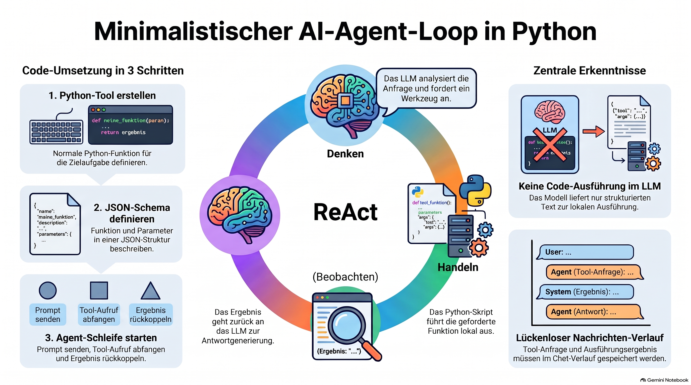
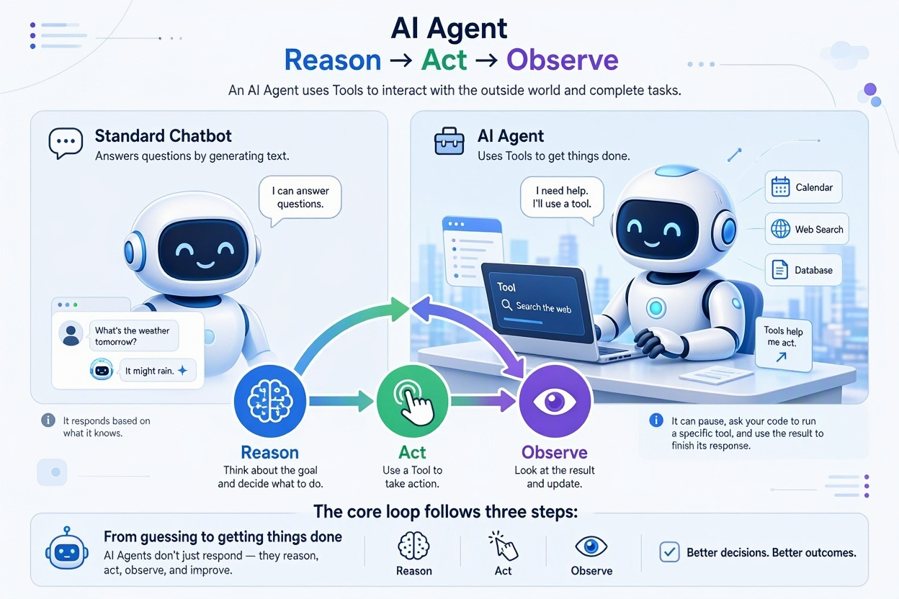
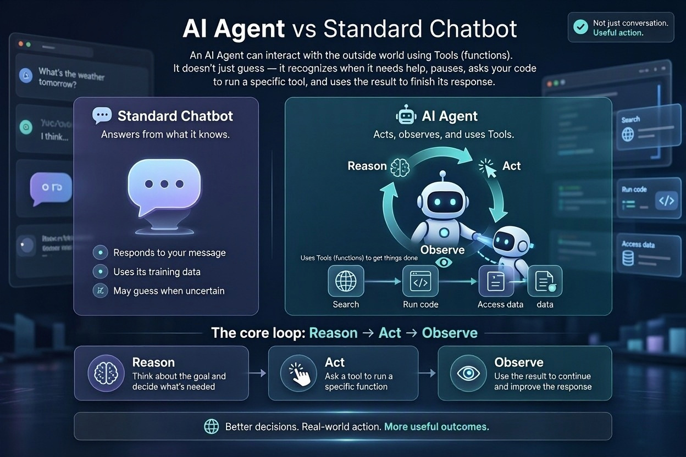

> [!NOTE]
> Der Text beschreibt, wie ein **KI-Agent** mithilfe von Python und der OpenAI-API so programmiert werden kann, dass er über einfache Chatbots hinausgeht und externe **Werkzeuge** nutzt. Das grundlegende Prinzip folgt dabei einer wiederkehrenden Schleife aus **Überlegen, Handeln und Beobachten**, bei der das Sprachmodell strukturierte **JSON-Anweisungen** anstelle von direktem ausführbarem Code generiert. Zunächst wird eine gewöhnliche Programmierfunktion erstellt und dem System über ein **Schchema** verständlich gemacht, damit die KI weiß, welche Parameter benötigt werden. Schließlich wertet das Skript die Anfrage der KI aus, führt die lokale **Berechnung** aus und sendet das Ergebnis zurück in den **Kontextverlauf**, damit das Modell eine präzise Endantwort formulieren kann.

# Minimalist AI Agent Loop in Python

## Core Concept



An **AI Agent** differs from a standard chatbot because it can interact with the outside world using **Tools** (functions). Instead of guessing an answer, the LLM recognizes when it needs help, pauses, asks your code to run a specific tool, and uses the result to finish its response.

The core loop follows three steps: **Reason → Act → Observe**.



---

## Prerequisites

1. 🚧 Install the OpenAI Python library: `pip install openai`
2. ⚠️ Set your API key in your terminal: `export OPENAI_API_KEY="your-key-here"`

---

## Step-by-Step Code Breakdown

### Step 1: 👷 Create the Tool
Write a normal Python function. The AI cannot run this directly; it only tells *your script* when to run it.
```python
def multiply(a: int, b: int) -> int:
    return a * b
```

### Step 2: 🪶 Write the "Instruction Manual" (Schema)
LLMs only understand text/JSON. You must describe your Python function in a dictionary so the AI knows what the tool does and what inputs it needs.
```python
tools = [{
    "type": "function",
    "function": {
        "name": "multiply",
        "description": "Multiplies two numbers together.",
        "parameters": {
            "type": "object",
            "properties": {
                "a": {"type": "integer"},
                "b": {"type": "integer"}
            },
            "required": ["a", "b"]
        }
    }
}]
```

### Step 3: 🚀 Run the Agent Loop
Send a prompt along with the tool manual. Check if the AI asks to use the tool, run it locally, and feed the answer back.

```python
import json
from openai import OpenAI

client = OpenAI()
messages = [{"role": "user", "content": "What is 342 multiplied by 891?"}]

# 1. REASON: Ask the AI what to do
response = client.chat.completions.create(
    model="gpt-4o-mini",
    messages=messages,
    tools=tools
)
ai_message = response.choices.message
messages.append(ai_message) # Save AI's thought process to chat history

# 2. ACT: Did the AI ask to use a tool?
if ai_message.tool_calls:
    for tool_call in ai_message.tool_calls:
        # Unpack the numbers the AI extracted from the user's prompt
        args = json.loads(tool_call.function.arguments)
        
        # Run the actual Python function on your computer
        result = multiply(args["a"], args["b"])
        
        # 3. OBSERVE: Send the tool's output back to the AI
        messages.append({
            "role": "tool",
            "tool_call_id": tool_call.id,
            "content": str(result)
        })

    # 4. FINISH: Let the AI write the final answer using the tool's result
    final_response = client.chat.completions.create(
        model="gpt-4o-mini",
        messages=messages
    )
    print(final_response.choices.message.content)
```

---

## 🔑 Key Takeaways for Future 📋Notes

* **The LLM never executes code:** It only outputs structured text (JSON) requesting that *your script* execute a function.
* **Conversation Memory (`messages`):** You must append both the AI's tool request and the tool's output to the `messages` list so the AI has full context for its final answer.
* **Scaling Up:** Wrapping Step 3 in a `while` loop turns this single-action script into an autonomous multi-step agent.

## Related Links
* [[What is Function Calling in LLMs]]
* [[ReAct Pattern (Reason and Act)]]
* [[Turning a Single-Step Agent into a While Loop]]
````

Use code with caution.

_(Note: I caught a tiny typo in my previous code snippet where `.choices` was missing `[0]`—I fixed that here to `response.choices.message` so the code runs cleanly if you copy-paste it!)_

Would you like me to adjust anything for your Zettelkasten setup, such as:

* **Splitting this into smaller atomic notes** (e.g., separating the concept from the code)
* **Matching a specific template format** (like Obsidian Templater or Logseq properties)
* **Creating the follow-up note** for the `[[Turning a Single-Step Agent into a While Loop]]` link
