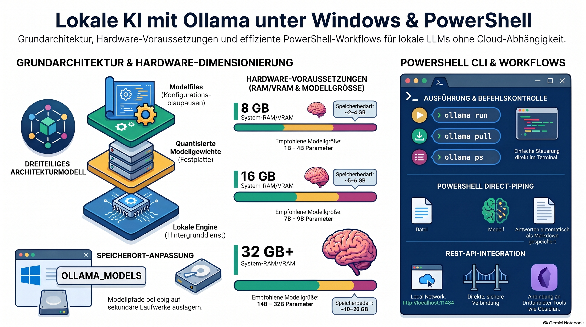

> [!NOTE]
> Diese Anleitung beschreibt umfassend die Nutzung von **Ollama** unter **Windows 11** mithilfe der **PowerShell**, um lokale Sprachmodelle auf consumer-freundlicher Hardware auszuführen. Die Architektur unterteilt sich in die **Ollama Engine** als Hintergrundserver, die heruntergeladenen **Model Weights** sowie individuelle **Modelfiles** zur Konfiguration von Parametern und Systemanweisungen. Nutzer erfahren Schritt für Schritt, wie die Installation gelingt, welche **Hardware-Voraussetzungen** bezüglich des Arbeitsspeichers oder VRAMs nötig sind und wie die Steuerung über grundlegende **CLI-Befehle** erfolgt. Darüber hinaus zeigt das Tutorial fortgeschrittene Automatisierungen wie das **Piping** von Textdateien direkt in Modelle sowie die Anpassung von **Speicherpfaden** und Umgebungsvariablen. Mit diesen Werkzeugen können Anwender künstliche Intelligenz komplett offline betreiben, lokale Markdown-Dateien verarbeiten und maßgeschneiderte Wissensassistenten erstellen.

# Ollama Beginner Deep Dive using Windows and PowerShell

## 1. Core Concepts (Mental Model)

Before touching the terminal, anchor these three foundational concepts in your Zettelkasten:

* **Ollama Engine (The Server):** A lightweight background runtime that manages hardware acceleration (GPU/CPU), memory allocation, and exposes a local REST API at `http://localhost:11434`.
* **Model Weights (The Brain):** Pre-trained neural network files (quantized to fit consumer hardware) downloaded from Ollama's library and stored locally on your drive.
* **Modelfile (The Blueprint):** A plain-text configuration file (similar to a `Dockerfile`) used to customize a model's system prompt, temperature, and context window.

---

## 2. System Prerequisites & Hardware Sizing

Ollama runs natively on Windows 11 (x64 or ARM64) and automatically detects NVIDIA (CUDA) or AMD (ROCm/Vulkan) GPUs. Your **VRAM (GPU memory)** or **System RAM** dictates which model sizes you can run smoothly:

| System RAM / VRAM | Recommended Parameter Size | Example Models | Storage Needed |
| :--- | :--- | :--- | :--- |
| **8 GB** | 1B – 4B parameters | `gemma3:4b`, `llama3.2:3b`, `qwen3.5:0.8b` | ~2–4 GB per model |
| **16 GB** | 7B – 9B parameters | `llama3.1:8b`, `qwen2.5:7b`, `mistral` | ~5–6 GB per model |
| **32 GB+** | 14B – 32B parameters | `qwen2.5:14b`, `gemma3:27b` | ~10–20 GB per model |

---

## 3. Step-by-Step Installation

1. **Download the Installer:** Go to [ollama.com/download/windows](https://ollama.com/download/windows) and download `OllamaSetup.exe`.
2. **Run Setup:** Double-click `OllamaSetup.exe` and click **Install**. No Administrator privileges are required; it installs to `%LOCALAPPDATA%\Programs\Ollama` and automatically adds `ollama` to your Windows `PATH`.
3. **Verify Background Service:** Check your Windows System Tray (bottom-right near the clock) for the small llama icon, indicating the local server is active.
4. **Verify in PowerShell:** Open **Windows Terminal** or **PowerShell** and check the installed version:

```powershell
   ollama --version
```

> **Optional — Custom Install Directory:** If your `C:` drive is low on space, launch the installer from PowerShell with the `/DIR` flag before installing:

```PowerShell
 .\OllamaSetup.exe /DIR="D:\AI\Ollama"
```

## 4. Essential PowerShell CLI Reference

### Model Lifecycle Commands

* **Download a model without running it:**
  ```PowerShell
  ollama pull llama3.2
  ```

* **Download and immediately start an interactive chat:**

  ```PowerShell
  ollama run gemma3:4b
  ```

* **List all locally stored models and their disk footprint:**

  ```PowerShell
  ollama list
  ```

* **Inspect active models currently loaded in RAM/VRAM:**

  ```PowerShell
  ollama ps
  ```

* **Unload a model from memory immediately:**
  ```PowerShell
  ollama stop gemma3:4b
  ```

* **Delete a model from your hard drive:**
  ```PowerShell
  ollama rm gemma3:4b
  ```

* **Inspect model architecture, parameters, and license:**
  ```PowerShell
  ollama show gemma3:4b
  ```

### In-Chat Slash Commands

While inside an active `ollama run` session, type these commands directly into the prompt:

* `/bye` — Exit the chat session and return to PowerShell.

* `/clear` — Wipe the current conversation context.

* `/set verbose` — Display token generation speed (`tokens/sec`) after each response.

* `/show info` — Print the active model's parameter count and quantization level.

* `"""` — Start and end multi-line prompts (useful for pasting long notes or code blocks).

## 5. PowerShell Piping & Automation (Zettelkasten Workflows)

Because Ollama accepts standard input (`stdin`) in PowerShell, you can pipe local Markdown files directly into an LLM without opening a chat window.

### Summarize a Note via Pipeline
```PowerShell
Get-Content ".\raw-notes.md" | ollama run gemma3:4b "Extract 5 atomic Zettelkasten concepts from this text in Markdown bullet points:"
```
### Save Output Directly to a New Markdown Note
```PowerShell
$Prompt = "Create a concise literature note with YAML frontmatter for the following text:`n" + (Get-Content ".\article.txt" -Raw)
$Prompt | ollama run llama3.2 | Out-File -FilePath ".\literature-note.md" -Encoding utf8
```

### Query the Local REST API via PowerShell

When integrating Ollama with tools like Obsidian (e.g., Smart Connections, Copilot, or Text Generator plugins), apps communicate with `http://localhost:11434`. You can test the API directly in PowerShell:
```PowerShell
$Body = @{
    model  = "gemma3:4b"
    prompt = "Define evergreen notes in two sentences."
    stream = $false
} | ConvertTo-Json

$Response = Invoke-RestMethod -Method Post -Uri "http://localhost:11434/api/generate" -Body \$Body -ContentType "application/json"
$Response.response
```

## 6. Customizing Models with a `Modelfile`

You can build specialized Zettelkasten assistants (e.g., a note-linker or Markdown formatter) by wrapping an existing model in custom instructions.

1. **Create a file named `Modelfile` (no file extension) in PowerShell:**
   ```PowerShell
   @"
   FROM gemma3:4b

   # Lower temperature (0.0 - 1.0) makes output more deterministic and factual
   PARAMETER temperature 0.2

   # Expand context window (default is often 2048 or 4096 tokens)
   PARAMETER num_ctx 8192

   SYSTEM """
   You are a Zettelkasten knowledge assistant. Format all responses in clean Markdown. 
   Focus on atomic concepts, clear definitions, and suggest [[WikiLinks]] for related ideas.
   """
   "@ | Out-File -FilePath ".\Modelfile" -Encoding utf8
   ```

2. **Compile your custom model:**
   ```PowerShell
   ollama create zettel-assistant -f .\Modelfile
   ```

3. **Run your new custom model:**
   ```PowerShell
   ollama run zettel-assistant
   ```

## 7. Windows 11 Storage & Environment Configuration

By default, Ollama stores downloaded models in `C:\Users\<YourUsername>\.ollama\models`. To move model storage to a secondary drive (e.g., `D:\OllamaModels`):

1. **Set a persistent User Environment Variable in PowerShell:**
   ```PowerShell
   [System.Environment]::SetEnvironmentVariable("OLLAMA_MODELS", "D:\OllamaModels", "User")
   ```

2. **Enable CORS (Required if browser extensions or Obsidian web views connect to Ollama):**
   ```PowerShell
   [System.Environment]::SetEnvironmentVariable("OLLAMA_ORIGINS", "*", "User")
   ```

3. **Restart Ollama:** Right-click the Ollama icon in the Windows System Tray, select **Quit Ollama**, and relaunch it from the Start Menu for the new variables to take effect.

## 8. Quick Troubleshooting & Windows Paths

* **Check if the server is responding:** Open `http://localhost:11434` in any browser; it should display `Ollama is running`.

* **Port Conflict (`bind: Only one usage of each socket address`):** You tried running `ollama serve` while the background tray app was already running. Close the tray app first if you want to run the server manually in a terminal.

* **Important Windows Directories** (press `Win + R` and paste to inspect):

  * `%LOCALAPPDATA%\Ollama` — Server and application logs (`server.log`, `app.log`).

  * `%LOCALAPPDATA%\Programs\Ollama` — Ollama binaries and CUDA/ROCm libraries.

  * `%USERPROFILE%\.ollama` — Default models and SSH keys.

---

```
