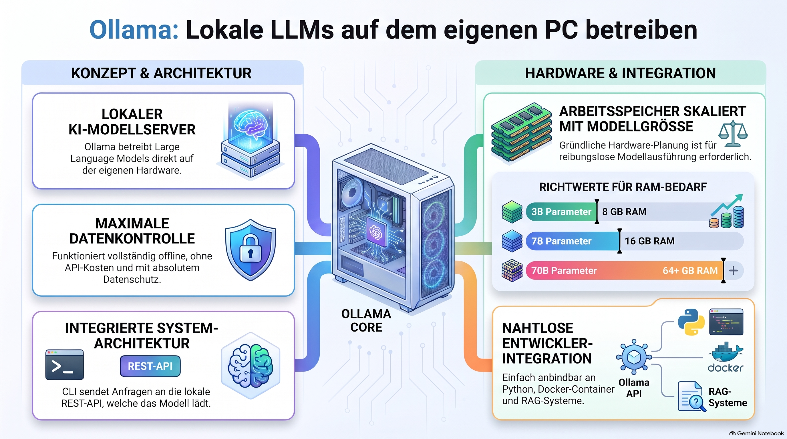
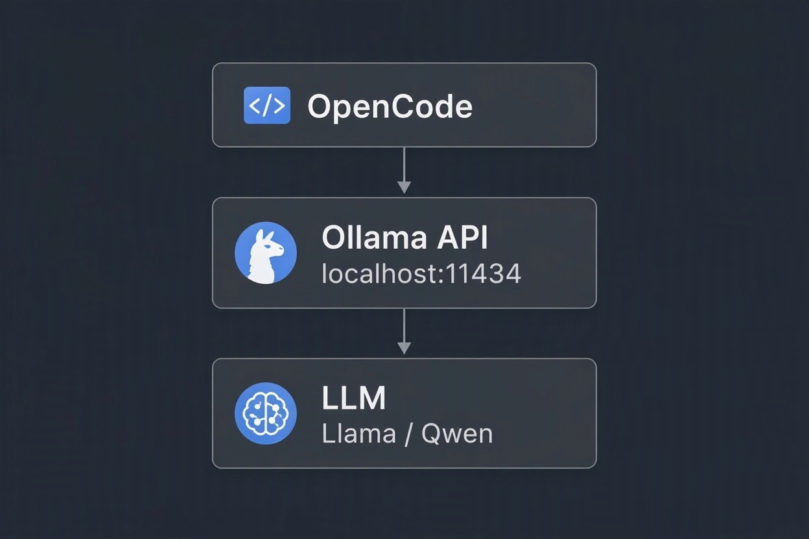
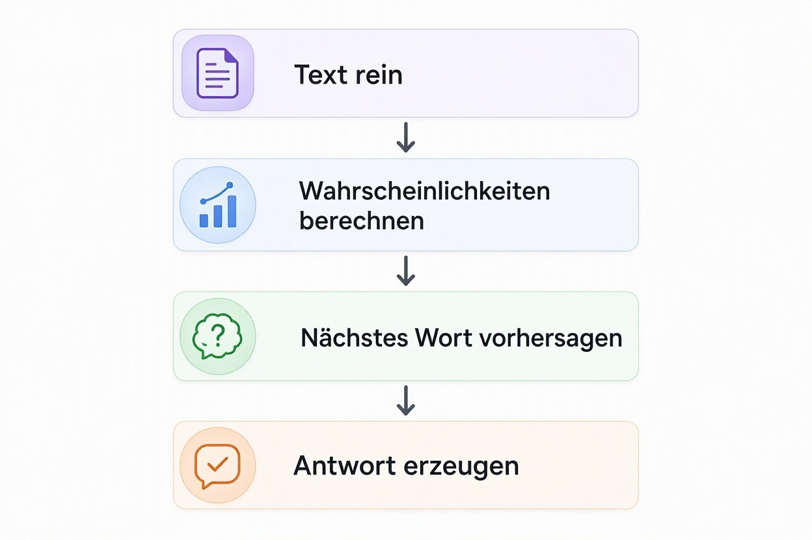
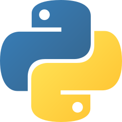

> [!NOTE]
> Der **Ollama Deep Dive für absolute Anfänger** bietet eine umfassende Einführung in die Ausführung von **Large Language Models** direkt auf dem eigenen Computer, wodurch Datenschutz und Unabhängigkeit von der Cloud gewährleistet werden. Das Tutorial erklärt Schritt für Schritt die grundlegende **Architektur**, die Installation verschiedener **Modelle** sowie die Verwaltung über die Befehlszeile. Darüber hinaus wird gezeigt, wie sich der lokale **API-Server** mithilfe von Python ansprechen lässt, um eigene Anwendungen, Chatbots oder Streaming-Antworten zu realisieren. Ein weiterer Schwerpunkt liegt auf fortgeschrittenen Themen wie **Docker**, **RAG-Systemen** und der Erstellung maßgeschneiderter **Modelfiles**. Letztlich dient der Leitfaden als strukturierter Lernpfad, um eine vollständige und datenschutzfreundliche **KI-Entwicklungsumgebung** aufzubauen.


# Ollama Deep Dive für absolute Anfänger 👩‍🎓 

> **Zettelkasten Tutorial**
>
> Ziel: Nach diesem Tutorial verstehst du nicht nur, wie man Ollama verwendet, sondern auch **was lokal laufende LLMs sind**, wie Ollama intern funktioniert, wie man Modelle verwaltet, APIs nutzt, Python integriert, Docker einsetzt und eine lokale KI-Entwicklungsumgebung aufbaut.

***

## 1. Was ist Ollama?


### Kurzdefinition

**Ollama** ist eine Plattform, mit der man Large Language Models (LLMs) lokal auf dem eigenen Computer ausführen kann.

Anstatt ChatGPT über das Internet zu verwenden, läuft das Modell direkt auf deinem Rechner.

Beispiele:

* Llama 3
* Gemma
* Qwen
* DeepSeek
* Mistral
* Phi

***

### Warum Ollama?

Vorteile:

✅ Datenschutz

✅ Keine Cloud notwendig

✅ Keine API-Kosten

✅ Offline nutzbar

✅ Perfekt für Entwickler

✅ Lokale AI-Agenten möglich

✅ Vollständig unter eigener Kontrolle

***

## Das große Bild



Ollama ist also:

> Ein lokaler Modellserver plus eine API.

***

# 2. Wie funktioniert ein LLM?

Ein Large Language Model ist letztlich:



Beispiel:

Prompt:

The capital of France is

Das Modell berechnet:

Paris → 98%

London → 0.5%

Berlin → 0.3%

und gibt aus:

Paris

Millionen solcher Vorhersagen erzeugen ganze Texte.

***

# 3. Ollama Architektur

## Komponenten

### Modelldateien

Beispiel:

llama3

Die Gewichte des Modells.

***

### Runtime

Lädt das Modell in den RAM.

***

### API Server

Startet automatisch:

[http://localhost:11434](http://localhost:11434/)

***

### CLI

PowerShell-Befehle:

ollama run llama3

***

# 4. Erstes Modell herunterladen

## Modelle anzeigen

Besuche:

<https://ollama.com/library>

Beliebte Modelle:

| Modell      | Größe     |
| ----------- | --------- |
| llama3      | Mittel    |
| qwen3       | Sehr gut  |
| deepseek-r1 | Reasoning |
| gemma3      | Effizient |
| phi4        | Klein     |

***

## Modell installieren

Beispiel:

ollama pull llama3

***

Download überprüfen:

ollama list

Ausgabe:

NAME       SIZE

llama3     4.7 GB

***

# 5. Erstes Gespräch

ollama run llama3

Dann:

\>>> Explain React Hooks

Antwort erscheint direkt im Terminal.

***

Verlassen:

/bye

***

# 6. Modelle verwalten

## Installierte Modelle

ollama list

***

## Modell löschen

ollama rm llama3

***

## Modellinformationen

ollama show llama3

***

# 7. Mehrere Modelle

Du kannst mehrere Modelle gleichzeitig installiert haben.

ollama pull qwen3

ollama pull phi4

ollama pull mistral

Verwendung:

ollama run qwen3

oder

ollama run phi4

***

# 8. Wie viel RAM brauche ich?

Faustregel:

| Modellgröße | RAM    |
| ----------- | ------ |
| 3B          | 8 GB   |
| 7B          | 16 GB  |
| 13B         | 24 GB  |
| 70B         | 64+ GB |

***

## VRAM

Falls NVIDIA GPU vorhanden:

GPU = schneller

CPU = langsamer

Ollama erkennt die Hardware automatisch.

***

# 9. Ollama REST API

Der wichtigste Schritt.

Ollama ist ein lokaler API-Server.

***

## Test im Browser

[http://localhost:11434](http://localhost:11434/)

Antwort:

Ollama is running

***

## API Request

PowerShell:

curl <http://localhost:11434/api/generate> \`
```yson
{

"model":"llama3",

"prompt":"What is React?"

}
```

***

# 10. JSON verstehen

Request:
```yson
{

  "model": "llama3",

  "prompt": "What is React?"

}
```
Antwort:
```yson
{

  "response": "React is..."

}
```
***

# 11. Python Integration



Jetzt wird es spannend.

***

## Python installieren

Prüfen:

python --version

***

## Requests Library

pip install requests

***

## Erstes Python Script

import requests

response = requests.post(

    "<http://localhost:11434/api/generate>",

    json={

        "model": "llama3",

        "prompt": "Explain React"

    }

)

print(response.json())

***

Speichern:

chat.py

Starten:

python chat.py

***

# 12. Streaming Responses

ChatGPT-artige Ausgabe.

import requests

r = requests.post(

    "<http://localhost:11434/api/generate>",

    json={

        "model": "llama3",

        "prompt": "Tell me a story"

    },

    stream=True

)

for line in r.iter_lines():

    if line:

        print(line.decode())

***

# 13. Chat API

OpenAI-ähnlich.

import requests

response = requests.post(

    "<http://localhost:11434/api/chat>",

    json={

        "model":"llama3",

        "messages":\[

            {

                "role":"user",

                "content":"Hello"

            }

        ]

    }

)

print(response.json())

***

# 14. System Prompts

System-Prompts steuern das Verhalten.

{

  "role":"system",

  "content":"You are a React expert."

}

***

Beispiel:

messages = \[

    {

        "role":"system",

        "content":"You are a React teacher."

    },

    {

        "role":"user",

        "content":"Explain useReducer"

    }

]

***

# 15. OpenCode + Ollama

Deine aktuelle Konfiguration:

OpenCode

↓

Ollama

↓

Lokale Modelle

***

Typischer Workflow:

OpenCode

    ↓

Prompt

    ↓

Ollama

    ↓

Llama/Qwen

    ↓

Codevorschläge

***

# 16. Warum viele Entwickler Qwen bevorzugen

Aktuelle Stärken:

* sehr stark für Coding
* gute Reasoning-Fähigkeiten
* schnell
* effizient

Beliebte Modelle:

qwen3

qwen3-coder

***

# 17. Docker + Ollama

Oft wird Ollama lokal installiert.

Du kannst aber auch Docker nutzen.

***

Container starten:

docker run -d `</span></div><div><span attribution="{&quot;id&quot;:&quot;E64C3D4F-5E12-4514-AD9B-893A6FAFD00C&quot;,&quot;name&quot;:&quot;Copilot&quot;,&quot;oid&quot;:&quot;E64C3D4F-5E12-4514-AD9B-893A6FAFD00C&quot;,&quot;timestamp&quot;:1795637700000,&quot;dataSource&quot;:0}">-p 11434:11434`

-v ollama:/root/.ollama \`

ollama/ollama

***

Prüfen:

docker ps

***

# 18. Eigene Modelle erstellen

Ollama nutzt sogenannte:

Modelfiles

Ähnlich wie Dockerfiles.

***

Beispiel:

FROM llama3

SYSTEM You are a React mentor.

Datei:

Modelfile

***

Build:

ollama create react-teacher -f Modelfile

***

Nutzen:

ollama run react-teacher

***

# 19. Embeddings

Embeddings erzeugen Vektoren aus Text.

Text

 ↓

Embedding

 ↓

Vektor

Diese werden benötigt für:

* RAG
* lokale Wissensdatenbanken
* Semantische Suche

***

# 20. Was ist RAG?

Retrieval Augmented Generation.

Statt nur das Modellwissen zu nutzen:

Dokumente

 ↓

Suche

 ↓

Passende Abschnitte

 ↓

LLM

 ↓

Antwort

***

Beispiel:

Meine Notizen

↓

RAG

↓

Ollama

↓

Antworten auf Basis meiner Notizen

***

# 21. Zukünftiger Lernpfad

## Stufe 1

Lernen:

ollama run

ollama list

ollama pull

ollama rm

***

## Stufe 2

API lernen:

/api/generate

/api/chat

***

## Stufe 3

Python

requests

json

streaming

***

## Stufe 4

RAG

Embeddings

ChromaDB

FAISS

LangChain

LlamaIndex

***

## Stufe 5

Agenten

OpenCode

Ollama

Tools

RAG

Agents

***

# 22. Empfohlenes Setup für deinen Rechner

Da du hast:

* Windows 11
* PowerShell
* Ollama
* OpenCode
* Docker Desktop
* Python
* keine organisatorischen Einschränkungen

würde ich heute folgendes Setup empfehlen:

Ollama

├── qwen3

├── qwen3-coder

├── deepseek-r1

└── gemma3

Python

├── requests

├── uv

├── langchain

├── chromadb

└── jupyter

OpenCode

Docker Desktop

Damit kannst du später problemlos:

* lokale Chatbots bauen
* Coding-Assistenten entwickeln
* RAG-Systeme erstellen
* Dokumentensuche realisieren
* Multi-Agent-Systeme aufsetzen
* eigene KI-Workflows entwickeln

***

# Zusammenfassung

Ollama ist kein Chatbot, sondern ein **lokaler LLM-Server**.

Modell

    ↓

Ollama

    ↓

REST API

    ↓

Python / OpenCode / Apps

Der wichtigste mentale Wechsel für Anfänger:

> Denke nicht "Ich benutze einen Chatbot", sondern:
>
> **"Ich betreibe einen lokalen KI-Service auf meinem eigenen Computer."**

Sobald dieses Konzept verstanden ist, werden Themen wie Python-Integration, RAG, Agenten, Docker und lokale KI-Anwendungen wesentlich leichter verständlich.
