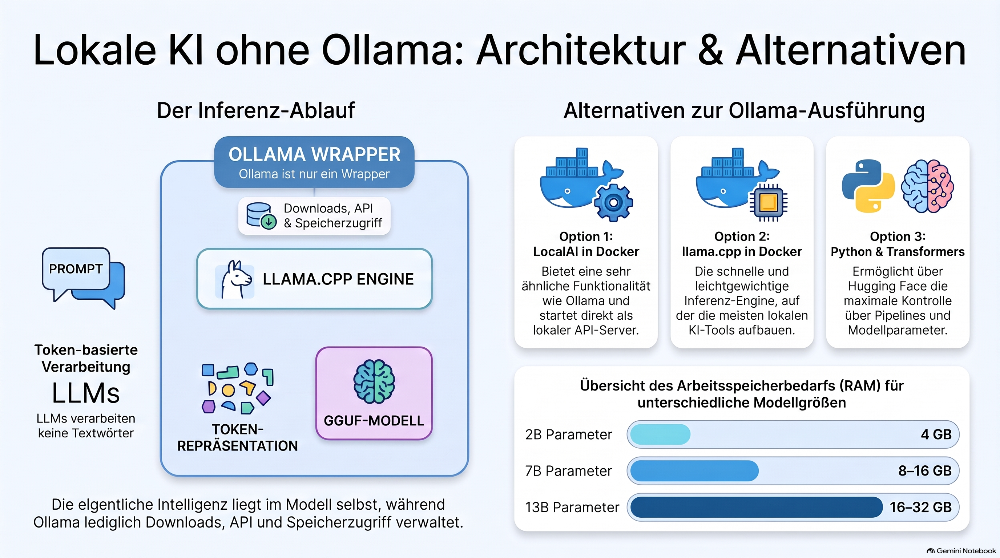
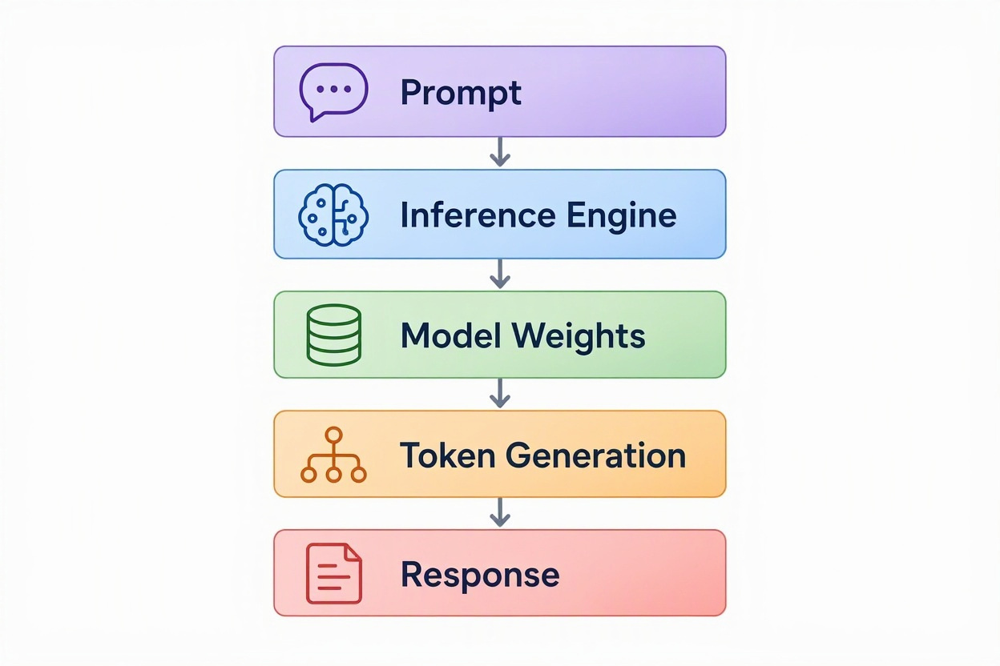
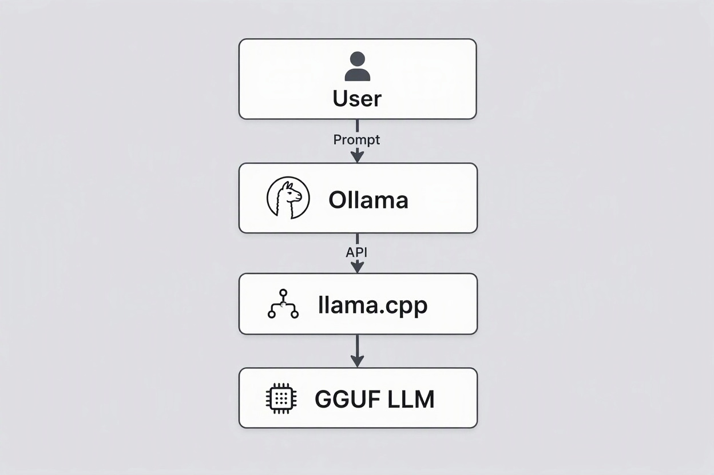

> [!NOTE]
> Der Text erklärt, wie man **lokale KI-Modelle** auch ohne die Software Ollama betreiben kann, indem man stattdessen **Docker** und **Python** verwendet. Da Ollama lediglich eine bequeme Benutzeroberfläche darstellt, lässt sich die zugrundeliegende Funktionalität durch Tools wie **LocalAI**, **llama.cpp** oder die **Hugging Face Transformers** manuell nachbilden. Zudem vermittelt die Anleitung grundlegende Konzepte wie **Tokenisierung**, **Modellquantisierung** und die Funktionsweise von **Inferenz-Engines**. Durch dieses praxisnahe Verständnis der Systemarchitektur lernen Anwender, wie man eigene **KI-Server** und webbasierte Chat-Anwendungen komplett eigenständig aufsetzt.


# Ollama Without Ollama


## The Problem

My organization does not allow installing Ollama.

Available tools:

* Windows 11
* PowerShell
* Docker Desktop
* Python

Question:

Can I still run local AI models?

Answer:

**Yes.**

Ollama is essentially a tool that makes running Large Language Models (LLMs) easy.

Under the hood it:

1. Downloads a model
2. Loads the model into memory
3. Exposes an API
4. Generates text

We can reproduce these steps ourselves using Docker and Python.

***

# What Ollama Actually Does

Most beginners think:

```text
Prompt → Ollama → Response
```

Internally:



```text
Prompt
   ↓
Inference Engine
   ↓
Model Weights
   ↓
Token Generation
   ↓
Response
```

The magic is not Ollama.

The magic is the model itself.

Examples:

* Llama
* Mistral
* Gemma
* Phi
* Qwen

Ollama is only a convenient wrapper.

***

# Ollama Architecture





Understanding this architecture is important.

If you understand this diagram, you understand the core idea behind Ollama.

***

# Replacing Ollama

Instead of:

```powershell
ollama run llama3
```

We use:

```text
Docker
+
Python
+
Open Source Model
```

Architecture:

```text
Windows
   ↓
Docker
   ↓
Inference Server
   ↓
Model
```

***

# Option 1 - Use LocalAI in Docker

LocalAI behaves very similarly to Ollama.

Pull image:

```powershell
docker pull localai/localai
```

Run container:

```powershell
docker run -ti -p 8080:8080 localai/localai
```

Now you have:

```text
http://localhost:8080
```

running an AI server.

***

# Option 2 - Use llama.cpp in Docker

llama.cpp is one of the most important projects in local AI.

Many tools including Ollama are built on ideas from llama.cpp.

Architecture:

```text
User
 ↓
API
 ↓
llama.cpp
 ↓
GGUF Model
```

Advantages:

* Fast
* Lightweight
* Open Source
* Industry standard

***

# Option 3 - Use Hugging Face Transformers

This is the most educational option.

Install:

```powershell
python -m venv venv

.\venv\Scripts\activate

pip install transformers

pip install torch
```

***

# Your First Local AI Script

Create:

```python
from transformers import pipeline

pipe = pipeline(
    "text-generation",
    model="microsoft/phi-2"
)

result = pipe(
    "Explain Docker to a beginner:",
    max_new_tokens=100
)

print(result[0]["generated_text"])
```

Run:

```powershell
python app.py
```

***

# Understanding What Happens

Step 1:

```python
pipeline(...)
```

Loads a model.

Step 2:

```python
"Explain Docker..."
```

Creates tokens.

Step 3:

Model predicts:

```text
next token
next token
next token
...
```

until stopping criteria are reached.

***

# What Are Tokens?

Humans see:

```text
Hello world
```

Models see:

```text
[15496, 995]
```

Tokens are numerical representations of text.

Example:

```text
"The cat sat"
```

becomes:

```text
[464, 3797, 3332]
```

LLMs process tokens, not words.

***

# The Fundamental Prediction Loop

Every LLM does:

```text
Given previous tokens
predict next token
```

Example:

```text
The sky is ...
```

Prediction:

```text
blue
```

Then:

```text
The sky is blue ...
```

Prediction:

```text
today
```

Then:

```text
The sky is blue today ...
```

Prediction:

```text
because
```

And so on.

***

# Model Files

Ollama downloads models automatically.

Without Ollama you download them manually.

Common formats:

| Format      | Description        |
| ----------- | ------------------ |
| GGUF        | llama.cpp models   |
| Safetensors | HuggingFace models |
| PyTorch     | Original weights   |

Most local setups today use:

```text
GGUF
```

because it is memory efficient.

***

# Quantization

Raw model:

```text
70 GB
```

Quantized:

```text
4 GB
```

or

```text
8 GB
```

Quantization reduces memory requirements.

Examples:

```text
Q4
Q5
Q6
Q8
```

Smaller:

* Faster
* Less RAM

Larger:

* More accurate
* More RAM

***

# RAM Requirements

Rule of thumb:

| Model | Recommended RAM |
| ----- | --------------- |
| 2B    | 4 GB            |
| 7B    | 8-16 GB         |
| 13B   | 16-32 GB        |
| 70B   | 64 GB+          |

For most home systems:

```text
Phi
Gemma
Mistral 7B
Llama 3 8B
```

are practical.

***

# Building a ChatGPT Clone with Python

Install:

```powershell
pip install streamlit
```

Create:

```python
import streamlit as st

st.title("My Local AI")

prompt = st.text_area("Ask something")

if st.button("Send"):
    st.write("Response appears here")
```

Run:

```powershell
streamlit run app.py
```

Local browser UI appears.

***

# Adding an AI Backend

Architecture:

```text
Browser
   ↓
Streamlit
   ↓
Local Model
   ↓
Response
```

This is basically:

```text
Mini ChatGPT
```

running entirely on your machine.

***

# Understanding APIs

Ollama exposes:

```text
localhost:11434
```

We can build the same concept.

Example:

```python
from flask import Flask

app = Flask(__name__)

@app.route("/")
def hello():
    return "AI Server Running"

app.run()
```

You now have a local API.

***

# Complete Mental Model

```text
User
 ↓
Prompt
 ↓
Client
 ↓
API
 ↓
Inference Engine
 ↓
Model
 ↓
Generated Tokens
 ↓
Response
```

Everything in local AI follows this pattern.

Not just Ollama.

Not just ChatGPT.

Not just Claude.

Every modern LLM system is some variation of this architecture.

***

# Why Learning Without Ollama Is Valuable

Many users learn:

```text
Ollama Commands
```

but never understand what is happening.

Using:

* Docker
* Python
* Hugging Face
* llama.cpp

teaches:

* Models
* Tokens
* Inference
* Quantization
* APIs
* AI system architecture

These concepts transfer to every future AI platform.

***

# Key Takeaways

1. Ollama is a convenience layer.
2. The real intelligence is inside the model.
3. Docker can replace much of Ollama's deployment role.
4. Python can replace much of Ollama's API interaction.
5. Understanding tokens and inference is more important than learning commands.
6. Once you understand the architecture, all local-LLM tools become variations of the same underlying system.

***

# Next Learning Path

1. Docker basics
2. Python basics
3. Hugging Face transformers
4. Tokens and tokenization
5. GGUF models
6. llama.cpp
7. LocalAI
8. RAG (Retrieval Augmented Generation)
9. AI agents
10. Fine-tuning
