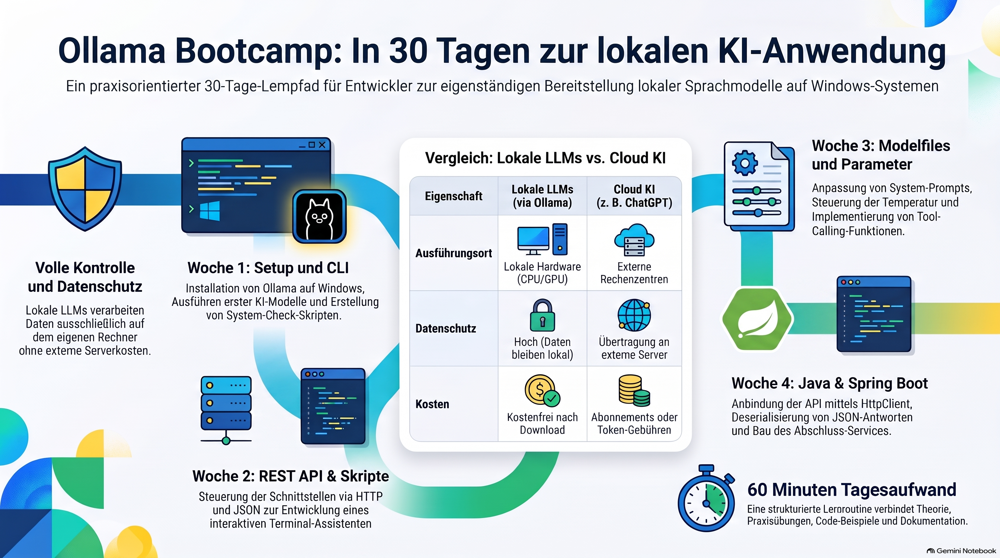
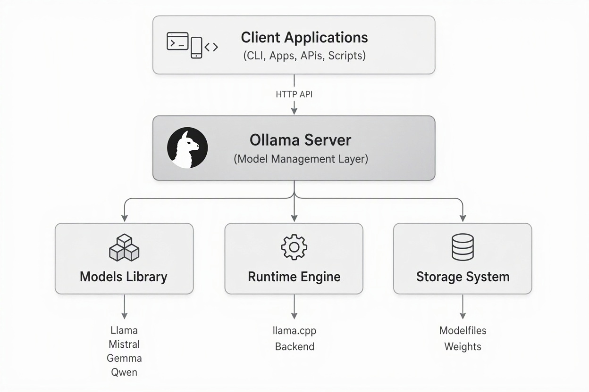

> [!NOTE]
> Der Text beschreibt ein **30-tägiges Lernprogramm** für Einsteiger, um die Ausführung lokaler Künstlicher Intelligenz mit **Ollama** unter Windows und PowerShell zu meistern. Die Teilnehmenden erlernen im ersten Teil die grundlegende Handhabung von **lokalen Sprachmodellen** und erkunden im Anschluss die Kommunikation über **REST-APIs** sowie die Anpassung durch individuelle Modelfiles. In der finalen Phase wird das erworbenen Wissen praktisch angewendet, indem eine lokale KI-Schnittstelle in eine **Java- und Spring-Boot-Anwendung** integriert wird.


Let's make this a practical coding dojo for your Windows and PowerShell environment, with one lesson, one exercise, and a tangible result every day.

We'll progress from installing Ollama to building a local AI assistant and eventually integrating it with Java and Spring Boot.

# **Ollama 🦙 a 30-Day Absolute Beginner Bootcamp**🏕️

[Ollama AI Integration in Unreal Engine - Local Chat Tutorial | Community tutorial](https://images.openai.com/static-rsc-4/8qPFd12ip3agsA9qy3mUalT4c9YwH8vAbENt59NQ6lNR0xbegiZ6AyUFe6ylpSQ0QlXd18p4MKo-Mt7_bqtr9Zu7kDxm74ffdIWrX3IloNwWvUJkQc6nXV8rKLBkzyh-kMNnHh1IAqgOKiR27c5_UZ1RDj2ZVjUnO18TeLt8PDM?purpose=inline)

[A Local AI Assistant for Coding — Key Insights | by Maurizio Farina | Medium](https://images.openai.com/static-rsc-4/7DlbVTtwo82LrGZ0jLGQ8FySxK2zFy8k9sOTh4x1HXa0qMFgN8AWxlB4Ab0-ufHUb0iiHwLWEyM8Lg5CSDXYa083o5shAOaEBA78pAV69Uyh3ouSLO1_G5CUFJ_484hP2F0wUuu5npxC0eFrJIFrCyYQZp0QzWKHJ1nDfTiKswo?purpose=inline)

[Must Know Ollama Commands for Managing LLMs locally](https://images.openai.com/static-rsc-4/z82bvyYyZTpUCyM8RLWdpra-B_Z_Yp6QvKW176yVWI_NuyH-9K4bU5bk8AN1z6ijh61ubZQEcluQUrZNvXidCmstFy_ysjL4R0Nov5o7DmjJMSG-9NWs1o_w-bBOu_Asw6q0z52NAWZeGrHbsXZGg6rcgI2jaMPmrH9lBDodvdA?purpose=inline)


## **⛺Bootcamp roadmap**

**Your learning journey** 🚂

30 days 🗓️

**Week 1 **🎯**Ollama fundamentals**

01–07

Installation, models, commands and local AI

**Week 2** 🎯**PowerShell and REST API**

08–14

HTTP, JSON, prompts and chat applications

**Week 3**__🎯__**Advanced Ollama**

15–21

Modelfiles, parameters, streaming and tool calling

**Week 4**__🎯__**Java and AI applications**

22–30

Java clients, Spring Boot and final project

## **Week 1 – Ollama 🦙 fundamentals**

Days 1–7 · Beginner 👩‍🎓

Goal: Install Ollama, understand local LLMs and become comfortable with the command line 💻.

### Local LLM 🎪

_**Local LLMs (Large Language Models) are AI models that run directly on your own computer’s hardware—using your CPU, GPU, and RAM—rather than on remote cloud servers**_. **Ollama** is an open-source tool that acts like a package manager for these models, making it easy to download, manage, and run them with simple terminal commands or a desktop interface. \[[1](https://www.youtube.com/watch?v=5RIOQuHOihY), [2](https://www.promptquorum.com/local-llms/what-are-local-llms), [3](https://www.freecodecamp.org/news/run-and-customize-llms-locally-with-ollama/)]

Why Run LLMs Locally?

* **Complete privacy.** Your prompts, documents, and data never leave your device, making local models ideal for confidential or sensitive work.
* 💰**Zero API costs.** Once you download a model, you can generate unlimited text without paying subscription fees or per-token cloud charges.
* **Offline access.** Local models work without an internet connection, which is useful when traveling or working in restricted environments. 
* **Full customization.** Tools like Ollama let you tweak system prompts, adjust parameters via a `Modelfile`, or connect models to local apps via a built-in REST API (`localhost:11434`).

How Local LLMs Compare to Cloud AI ☁️

| Feature           | Local LLMs (via Ollama)                                                      | Cloud AI (e.g., ChatGPT, Claude)                     |
| ----------------- | ---------------------------------------------------------------------------- | ---------------------------------------------------- |
| **Where it runs** | Your local CPU, GPU, or Apple Silicon                                        | Remote data centers                                  |
| **Data privacy**  | High; data stays on your machine                                             | Prompts are sent to external servers                 |
| **Cost**          | Free after initial download                                                  | Subscription or pay-per-token fees                   |
| **Capability**    | Strong for summarizing, writing, and coding, though limited by your hardware | Frontier-level reasoning and massive context windows |

Normally, running an open-weight model (like Llama, Gemma, Qwen, or Mistral) requires configuring runtimes and managing compressed model files (such as GGUF formats). [Ollama](https://ollama.com/) bundles the inference engine and model library together. After installing it, typing a single command like `ollama run llama3` downloads the optimized model and starts a local chat session. 

**Day 1 – What is Ollama?**

* Understand [LLMs](../Atomics/Large_language_models.md) and local AI.

* Understand Ollama versus an AI model.

* Explore the Ollama architecture.

_Exercise:_ Draw the architecture from PowerShell to Ollama to the model.



**Deliverable:** `01-What-is-Ollama.md`

**Day 2 – Install Ollama on Windows 11**

* Download and install Ollama.

* Understand the Windows application.

* Check the installation with `ollama --version`.

* Test `http://localhost:11434`.

_Exercise:_ Verify that the local Ollama server is running.

**Deliverable:** Installation checklist.

**Day 3 – Understanding AI models**

* Understand model families.

* Explore Gemma, Qwen and Llama.

* Understand model sizes and memory requirements.

* Explore quantization at a beginner level.

_Exercise:_ Investigate three models in the Ollama library.

**Deliverable:** `03-AI-Models.md`

**Day 4 – Download your first model**

```
ollama pull gemma3:1b
```

* Understand model downloads.

* Explore model storage.

* Use `ollama list`.

_Exercise:_ Download and inspect your first model.

**Deliverable:** Model installation notes.

**Day 5 – Your first AI conversation**

```
ollama run gemma3:1b
```

* Ask questions.

* Generate Java code.

* Ask follow-up questions.

* Exit using `/bye`.

_Exercise:_ Ask the model to explain Java classes and interfaces.

**Deliverable:** First local AI conversation.

**Day 6 – Ollama CLI deep dive**

Learn:

```
ollama --version
ollama list
ollama show gemma3:1b
ollama ps
ollama stop gemma3:1b
```

_Exercise:_ Create a PowerShell script that lists your downloaded models.

**Deliverable:** `06-Ollama-CLI.md`

**Day 7 – Weekly review and mini-project**

Build a small PowerShell script that:

1. Checks Ollama availability.

2. Lists downloaded models.

3. Displays the Ollama version.

**Deliverable:** `Ollama-SystemCheck.ps1`

## **Week 2 – PowerShell and REST API**

Days 8–14 · Beginner to intermediate

Goal: Understand how applications communicate with local AI models.

**Day 8 – Introduction to HTTP**

* Understand HTTP requests and responses.

* GET versus POST.

* HTTP headers.

* Status codes.

_Exercise:_ Test the Ollama endpoint using PowerShell.

```
Invoke-RestMethod http://localhost:11434
```

**Deliverable:** `08-HTTP-Basics.md`

**Day 9 – Understanding JSON**

* JSON objects.

* Arrays.

* Properties and values.

* PowerShell hashtables.

* `ConvertTo-Json` and `ConvertFrom-Json`.

_Exercise:_ Create a JSON request containing a model name and prompt.

**Deliverable:** JSON request examples.

**Day 10 – Your first Ollama REST request**

Explore:

```
POST /api/generate
```

* Send a prompt.

* Receive a response.

* Understand the response structure.

_Exercise:_ Generate a Java explanation using PowerShell.

**Deliverable:** `10-Ollama-Generate.ps1`

**Day 11 – Build Ask-Ollama**

Create a reusable PowerShell function.

```
Ask-Ollama -Prompt "Explain Spring Boot"
```

* Parameters.

* Functions.

* Return values.

* Error handling.

**Deliverable:** `Ask-Ollama.ps1`

**Day 12 – Understanding the Chat API**

Explore:

```
POST /api/chat
```

* System messages.

* User messages.

* Assistant messages.

* Conversation history.

_Exercise:_ Send a three-message conversation.

**Deliverable:** `12-Ollama-Chat.ps1`

**Day 13 – Build a conversational assistant**

* Implement a `while` loop.

* Read user input.

* Maintain conversation history.

* Add an exit command.

* Handle API errors.

_Exercise:_ Build a terminal-based Java tutor.

**Deliverable:** `OllamaAssistant.ps1`

**Day 14 – Weekly review and mini-project**

Improve your assistant:

* Add model selection.

* Add a reset command.

* Add input validation.

* Add basic logging.

**Deliverable:** `OllamaAssistant-v2.ps1`

## **Week 3 – Customization and advanced Ollama concepts**

Days 15–21 · Intermediate beginner

Goal: Learn how to customize AI models and understand more advanced Ollama functionality.

**Day 15 – Understanding Modelfiles**

Learn:

* What is a Modelfile?

* The `FROM` instruction.

* The `SYSTEM` instruction.

* Model parameters.

Example:

```
FROM gemma3:1b

PARAMETER temperature 0.7

SYSTEM """
You are a patient Java programming tutor.
Explain everything to absolute beginners.
"""
```

_Exercise:_ Create your first Modelfile.

**Deliverable:** `15-Modelfile-Basics.md`

**Day 16 – Create your own Java tutor**

Build a customized model:

```
ollama create java-tutor -f .\Modelfile
```

Run it:

```
ollama run java-tutor
```

_Exercise:_ Configure your AI to explain Java, Spring Boot and object-oriented programming.

**Deliverable:** Your own `java-tutor` model.

**Day 17 – Understanding model parameters**

Learn:

* Temperature.

* Top-K.

* Top-P.

* Seed.

* Repeat penalty.

* Context length.

_Exercise:_ Change temperature between 0.1, 0.7 and 1.2. Compare the answers to identical prompts.

**Deliverable:** `17-Model-Parameters.md`

**Day 18 – Streaming responses**

Learn the difference between:

```
stream = $false
```

and

```
stream = $true
```

* Understand streamed JSON responses.

* Understand incremental output.

* Learn why streaming is useful for chat applications.

_Exercise:_ Read the Ollama streaming API documentation and implement a simple streaming client if you feel ready.

**Deliverable:** `18-Streaming.md`

**Day 19 – Compare AI models**

Compare two models using identical prompts.

Test:

* Java knowledge.

* PowerShell code generation.

* HTTP explanations.

* General reasoning.

_Exercise:_ Record response quality, speed and memory consumption.

**Deliverable:** `19-Model-Comparison.md`

**Day 20 – Introduction to tool calling**

Learn how an LLM can request that an application execute a tool.

Example tools:

* Search project files.

* Read documentation.

* Query an API.

* Retrieve database information.

_Exercise:_ Design a safe tool called `Get-ProjectFileList` that only lists files in one approved directory.

**Deliverable:** `20-Tool-Calling.md`

Documentation: [Ollama tool calling](https://docs.ollama.com/capabilities/tool-calling?utm_source=chatgpt.com)

**Day 21 – Weekly review and mini-project**

Build your customized Java programming tutor.

Requirements:

1. Use a customized Modelfile.

2. Define a system prompt.

3. Configure temperature.

4. Test five programming questions.

5. Document the results.

**Deliverable:** `JavaTutor` and `21-Week3-Review.md`

## **Week 4 – Java, Spring Boot and the final project**

Days 22–30 · Practical development

Goal: Integrate your local AI model into a Java backend application.

**Day 22 – Java HTTP Client fundamentals**

Learn:

* `HttpClient`

* `HttpRequest`

* `HttpResponse`

* HTTP headers.

* POST requests.

_Exercise:_ Write a Java program that sends a GET request to:

```
http://localhost:11434
```

**Deliverable:** `22-Java-HttpClient.md`

**Day 23 – Call Ollama from Java**

Create `OllamaClient.java`.

```
import java.net.URI;
import java.net.http.HttpClient;
import java.net.http.HttpRequest;
import java.net.http.HttpResponse;

public class OllamaClient {

    public static void main(String[] args)
            throws Exception {

        String json = """
            {
                "model": "gemma3:1b",
                "prompt": "Explain Spring Boot.",
                "stream": false
            }
            """;

        HttpClient client = HttpClient.newHttpClient();

        HttpRequest request = HttpRequest.newBuilder()
            .uri(URI.create(
                "http://localhost:11434/api/generate"
            ))
            .header("Content-Type", "application/json")
            .POST(HttpRequest.BodyPublishers.ofString(json))
            .build();

        HttpResponse<String> response = client.send(
            request,
            HttpResponse.BodyHandlers.ofString()
        );

        System.out.println(response.body());
    }
}
```

Compile and run:

```
javac .\OllamaClient.java
java OllamaClient
```

_Exercise:_ Change the prompt and inspect the HTTP response.

**Deliverable:** `23-Ollama-Java-Client.md`

**Day 24 – JSON deserialization in Java**

Learn:

* JSON objects.

* Java records.

* DTO classes.

* Jackson.

* Mapping API responses.

_Exercise:_ Create a Java record for the Ollama generate response and deserialize the response JSON.

**Deliverable:** `24-Java-JSON.md`

**Day 25 – Create an Ollama service**

Design a reusable Java service.

Suggested responsibilities:

* Store the Ollama base URL.

* Select the model.

* Build HTTP requests.

* Handle connection errors.

* Return typed responses.

_Exercise:_ Create an `OllamaService` class.

**Deliverable:** `25-OllamaService.md`

**Day 26 – Spring Boot integration**

Create a Spring Boot application.

Suggested structure:

```
src/main/java/example/assistant/
    controller/
        AssistantController.java
    service/
        OllamaService.java
    dto/
        AssistantRequest.java
        AssistantResponse.java
```

Expose an endpoint:

```
POST /api/assistant
```

Test it with PowerShell:

```
$body = @{
    question = "Explain dependency injection."
}

$json = $body | ConvertTo-Json

Invoke-RestMethod `
    -Uri "http://localhost:8080/api/assistant" `
    -Method Post `
    -ContentType "application/json" `
    -Body $json
```

**Deliverable:** Working Spring Boot REST endpoint.

**Day 27 – Configuration and error handling**

Learn:

* Spring configuration properties.

* Connection timeouts.

* Request timeouts.

* Exception handling.

* Logging.

* Model availability.

Example configuration:

```
ollama.base-url=http://localhost:11434
ollama.model=gemma3:1b
```

_Exercise:_ Stop Ollama and test how your Spring Boot application handles the failed connection.

**Deliverable:** Robust Ollama service configuration.

**Day 28 – Build a Spring Boot chat endpoint**

Extend your application to support `/api/chat`.

Learn:

* Chat messages.

* Conversation history.

* User and assistant roles.

* Conversation identifiers.

* Context limitations.

_Exercise:_ Send a sequence of messages from your Spring Boot application to Ollama.

**Deliverable:** Working Spring Boot chat endpoint.

**Day 29 – Integration testing**

Test the entire architecture.

**PowerShell / Frontend**

**Spring Boot REST API**

**Ollama Service**

**Local AI Model**

Test:

* Ollama is running.
* The model is downloaded.
* Spring Boot starts.
* The assistant endpoint works.
* Invalid input is rejected.
* Ollama connection failures are handled.
* JSON responses are correctly parsed.
* Conversation history is limited.
* Sensitive information is not written to logs.

**Deliverable:** Tested local AI backend.

**Day 30 – Graduation project**

Final project

Build your own `LocalAI-ProgrammingAssistant`.

Requirements:

1. Accept programming questions.

2. Send questions to a local Ollama model.

3. Return generated answers.

4. Support conversations.

5. Handle errors.

6. Allow model configuration.

7. Include a README with installation instructions.

Optional extensions:

* Add a simple frontend.

* Add streaming.

* Add a documentation search tool.

* Experiment with tool calling.

* Compare different models.

* Explore retrieval-augmented generation (RAG).

**Deliverable:** A working local AI programming assistant.

# **Daily learning routine**

I recommend approximately one hour per day.

| Activity                 | Time       |
| ------------------------ | ---------- |
| Read the lesson          | 10 min     |
| Run the examples         | 15 min     |
| Complete the exercise    | 20 min     |
| Write Zettelkasten notes | 10 min     |
| Review                   | 5 min      |
| **Total**                | **60 min** |

Don't worry if you need two days for a lesson. Understanding is more important than speed.

# **Your bootcamp progress tracker**

**30-day learning progress**

# **0**__/30__

0% completed

**Week&#x20;**__1__

Day 1: What is Ollama?

Day 2: Windows installation

Day 3: Models and hardware

Day 4: Download first model

Day 5: First AI conversation

Day 6: Ollama CLI

Day 7: System checker project

**Week&#x20;**__2__

Day 8: HTTP fundamentals

Day 9: JSON with PowerShell

Day 10: Generate API

Day 11: Ask-Ollama function

Day 12: Chat API

Day 13: Conversational assistant

Day 14: Assistant v2 project

**Week&#x20;**__3__

Day 15: Modelfile basics

Day 16: Customized Java tutor

Day 17: Model parameters

Day 18: Streaming

Day 19: Model comparison

Day 20: Tool calling

Day 21: Java tutor project

**Week&#x20;**__4__

Day 22: Java HTTP client

Day 23: Java generate request

Day 24: Java JSON deserialization

Day 25: Ollama service

Day 26: Spring Boot endpoint

Day 27: Configuration and errors

Day 28: Spring Boot chat

Day 29: Integration testing

Day 30: Graduation project

Reset progress

# **Suggested Zettelkasten structure**

```
C:\LifeLongLearning\
    AI\
        Ollama\
            00-Bootcamp-Overview.md

            Week-01-Fundamentals\
            Week-02-PowerShell-REST-API\
            Week-03-Advanced-Ollama\
            Week-04-Java-SpringBoot\

            Final-Project\
            Resources\
```

**Suggested Zettelkasten headline:**

_Ollama on Windows 11 – 30-Day Local AI and LLM Development Bootcamp_

# **Official learning resources**

* [Ollama Windows download](https://ollama.com/download/windows?utm_source=chatgpt.com)

* [Ollama quickstart](https://docs.ollama.com/quickstart?utm_source=chatgpt.com)

* [Ollama model library](https://ollama.com/library?utm_source=chatgpt.com)

* [Ollama REST API](https://docs.ollama.com/api?utm_source=chatgpt.com)

* [Modelfile documentation](https://docs.ollama.com/modelfile?utm_source=chatgpt.com)

* [Tool calling documentation](https://docs.ollama.com/capabilities/tool-calling?utm_source=chatgpt.com)

**My recommendation:** Start with Week 1 and don't rush into Java integration. First become comfortable with Ollama, models, PowerShell, HTTP and JSON. Once those foundations are solid, the Spring Boot integration will make much more sense.

And one thing I particularly like about this bootcamp: by Day 30, you will have built something tangible rather than just read about AI.

Happy coding! 😊
