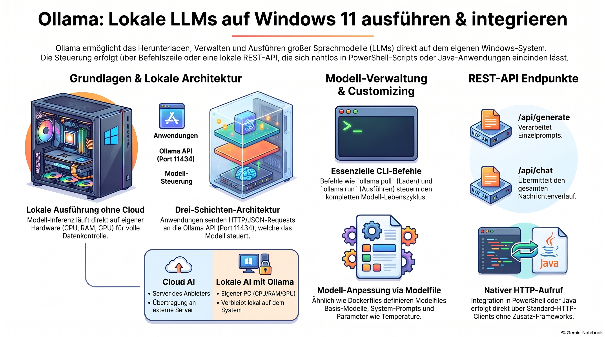

> [!NOTE]
> Diese Anleitung beschreibt ausführlich, wie **Ollama** auf einem Windows 11-System eingerichtet und zur Ausführung lokaler **großer Sprachmodelle** genutzt wird. Nutzer lernen grundlegende **Befehlszeilenwerkzeuge** kennen, um KI-Modelle herunterzuladen, zu verwalten und interaktiv zu bedienen. Darüber hinaus wird gezeigt, wie sich die lokale **REST-API** über Skripte in **PowerShell** sowie in Programmiersprachen wie **Java** und **Spring Boot** anbinden lässt. Abschließend behandelt das Tutorial die Erstellung **angepasster Modelle** mithilfe von Konfigurationsdateien sowie die Entwicklung einfacher **KI-Agenten**.

# Ollama – Absolute Beginner Deep Dive Tutorial

**Platform:** Windows 11  
**Shell:** PowerShell  
**Editor:** Visual Studio Code (optional)  
**Level:** Absolute beginner  
**Project:** Run local AI models and call them from PowerShell and Java

> This tutorial uses Ollama's native Windows installation. You do not need Docker, WSL, Python, Node.js, Postman, or Thunder Client.

## Learning goals

By the end, you will be able to:

1. Explain what Ollama and a local large language model (LLM) are.
2. Install Ollama on Windows 11.
3. Download, run, inspect, and remove models.
4. Send prompts to Ollama using PowerShell.
5. Use the chat API and maintain conversation history.
6. Create a customized model using a `Modelfile`.
7. Understand how Java and Spring Boot can call Ollama over HTTP.
8. Identify sensible next steps toward tool calling and AI agents.

---

## 1. What is Ollama?

Ollama is software for downloading, running, and managing language models on your own computer. It provides a command-line interface and a local HTTP API.

A **large language model (LLM)** is a machine-learning model that generates text based on the input it receives. It can explain concepts, summarize text, answer questions, and help draft or review code. It can also produce incorrect or invented information, so verify important answers.

Examples of model families available through Ollama include:

- **Llama** – Meta's family of language models.
- **Gemma** – Google's family of open models.
- **Qwen** – Alibaba's family of language models.

Check the Ollama model library for current model names, sizes, capabilities, and license information:

<https://ollama.com/library>

### 1.1 Cloud AI versus local AI

| Cloud AI | Local AI with Ollama |
|---|---|
| Inference runs on a provider's servers | Inference runs on your computer |
| Usually needs an internet connection | Internet is normally needed to download models; use can then be offline |
| Provider operates the hardware | Your computer supplies CPU, RAM, and possibly GPU |
| Data is sent to the provider | Prompts can remain on your computer when using the local runtime alone |

Local use can improve control over data, but it is not an automatic privacy guarantee. Other applications, extensions, telemetry, or services may still transmit information. Follow your organization's security rules and do not submit confidential work data without authorization.

### 1.2 How the pieces fit together

```text
PowerShell / Java / Spring Boot
              |
              | HTTP + JSON
              v
      Ollama local API
      http://localhost:11434
              |
              v
       Ollama runtime
              |
              v
       Downloaded model
```

Ollama is the runtime and API. The model is the language model that generates the answer.

---

## 2. Check your Windows hardware

Models need memory and computing power. Smaller models are generally easier to run, but actual speed depends on model architecture, quantization, context length, CPU, GPU, and available memory.

Open PowerShell and run these commands.

### 2.1 Processor

```powershell
Get-CimInstance Win32_Processor |
    Select-Object Name, NumberOfCores, NumberOfLogicalProcessors
```

### 2.2 Installed RAM

```powershell
Get-CimInstance Win32_ComputerSystem |
    Select-Object @{
        Name = "RAM_GB"
        Expression = {
            [math]::Round($_.TotalPhysicalMemory / 1GB, 2)
        }
    }
```

### 2.3 Graphics adapters

```powershell
Get-CimInstance Win32_VideoController |
    Select-Object Name, AdapterRAM
```

`AdapterRAM` is not always an accurate representation of usable dedicated GPU memory. Check the GPU vendor's tools or Windows Task Manager for more detail.

### 2.4 Free disk space

```powershell
Get-Volume |
    Select-Object DriveLetter, FileSystemLabel, @{
        Name = "FreeSpaceGB"
        Expression = {
            if ($_.SizeRemaining -ne $null) {
                [math]::Round($_.SizeRemaining / 1GB, 2)
            }
        }
    }
```

**Exercise:** Save the output in a Zettelkasten note. Model downloads can take several gigabytes, so check free disk space first.

---

## 3. Install Ollama on Windows 11

1. Open the official Windows download page: <https://ollama.com/download/windows>.
2. Download `OllamaSetup.exe`.
3. Run the installer and follow its instructions.
4. Open a **new** PowerShell window.

Ollama's Windows documentation: <https://docs.ollama.com/windows>.

### 3.1 Verify the command-line installation

```powershell
ollama --version
```

You should see a version number.

Find the executable:

```powershell
Get-Command ollama
```

If PowerShell says that `ollama` is not recognized:

- Close and reopen PowerShell.
- Check that installation completed.
- Check the PATH environment variable.
- If necessary, sign out and back in or restart Windows.

### 3.2 Check the local server

The Windows application normally starts the Ollama service in the background. Test its default local endpoint:

```powershell
Invoke-RestMethod http://localhost:11434
```

A successful response normally says:

```text
Ollama is running
```

The default local API address is:

```text
http://localhost:11434
```

If the connection fails, make sure the Ollama application is running.

---

## 4. Download your first model

An Ollama installation does not mean that a model is already downloaded. You choose and download a model separately.

### 4.1 Choose a small model first

For a first experiment, use a small model such as:

```text
gemma3:1b
```

This is an example starting point, not a guarantee that it will run well on every computer. Check the model's current page and requirements before downloading.

Model library: <https://ollama.com/library>

### 4.2 Download the model

```powershell
ollama pull gemma3:1b
```

Wait for the download to finish.

### 4.3 List downloaded models

```powershell
ollama list
```

You should see `gemma3:1b` in the list. The exact model ID and size may change as model versions are updated.

### 4.4 Run the model

```powershell
ollama run gemma3:1b
```

At the interactive prompt, try:

```text
Explain what a Java class is to an absolute beginner.
```

Then try:

```text
What is the difference between an interface
and an abstract class in Java?
```

Exit the interactive session with:

```text
/bye
```

**Important:** A model can make mistakes. Compile, run, and test code it generates.

---

## 5. Essential Ollama commands

| Command | Purpose |
|---|---|
| `ollama --version` | Display the installed version |
| `ollama list` | List downloaded models |
| `ollama pull MODEL` | Download a model |
| `ollama run MODEL` | Run a model interactively |
| `ollama show MODEL` | Display model information |
| `ollama ps` | Show models currently loaded |
| `ollama stop MODEL` | Stop a running model |
| `ollama rm MODEL` | Remove a downloaded model |
| `ollama serve` | Start the server manually |

Examples:

```powershell
ollama show gemma3:1b
ollama ps
ollama stop gemma3:1b
```

Use `ollama rm` carefully: it removes the local model.

```powershell
ollama rm gemma3:1b
```

On Windows, the desktop application normally manages the server. You generally do not need to run `ollama serve` manually as well.

CLI documentation: <https://docs.ollama.com/cli>.

---

## 6. Download and compare another model

You can download another model, for example:

```powershell
ollama pull qwen3:4b
```

Check your models:

```powershell
ollama list
```

Run the first model:

```powershell
ollama run gemma3:1b
```

Ask:

```text
Explain the SOLID principles in object-oriented programming.
```

Exit with `/bye`, then run:

```powershell
ollama run qwen3:4b
```

Ask the same question. Compare:

- Accuracy and usefulness.
- Clarity of the explanation.
- Response speed.
- Memory use.
- Whether it follows your instructions.

Do not assume that a larger model is always better for your task. Try models against the same small set of questions.

---

## 7. Where are models stored?

The default Windows model directory is commonly:

```text
%USERPROFILE%\.ollama\models
```

Open it:

```powershell
explorer "$HOME\.ollama\models"
```

Ollama stores manifests and model data in this directory. Do not edit these files manually.

### 7.1 Use another model directory

If you want models on another drive, first close Ollama completely from its system-tray menu. Create a destination:

```powershell
New-Item -ItemType Directory -Force D:\OllamaModels
```

Set the user environment variable:

```powershell
[Environment]::SetEnvironmentVariable(
    "OLLAMA_MODELS",
    "D:\OllamaModels",
    "User"
)
```

Then copy the **contents** of the existing `models` directory to the new location, preserving its directory structure. For example, from a PowerShell session after Ollama has been stopped:

```powershell
robocopy "$HOME\.ollama\models" "D:\OllamaModels" /E
```

Restart Ollama. Check that the models appear:

```powershell
ollama list
```

Keep the original copy until you have verified that Ollama can use the new location. The environment variable must be available to the Ollama process; restart the application after changing it.

---

## 8. Call Ollama using PowerShell and HTTP

This is where Ollama becomes useful in your own software projects.

Ollama provides a local REST API. We can call it with PowerShell's built-in `Invoke-RestMethod`. No Postman or additional HTTP client is required.

API documentation: <https://docs.ollama.com/api>.

### 8.1 First request: `/api/generate`

Make sure the Ollama application is running and `gemma3:1b` is downloaded.

Run:

```powershell
$body = @{
    model  = "gemma3:1b"
    prompt = "Explain Docker in three sentences."
    stream = $false
}

$json = $body | ConvertTo-Json -Depth 5

$response = Invoke-RestMethod `
    -Uri "http://localhost:11434/api/generate" `
    -Method Post `
    -ContentType "application/json" `
    -Body $json

$response.response
```

What happened?

1. A PowerShell hashtable was created.
2. The model name and prompt were added.
3. `ConvertTo-Json` converted the hashtable to JSON.
4. `Invoke-RestMethod` sent an HTTP POST request.
5. Ollama generated a response.
6. PowerShell displayed the response text.

The `stream = $false` setting asks for one complete JSON response rather than a stream of partial JSON objects.

### 8.2 Inspect the complete response

```powershell
$response | Format-List *
```

The response can include the generated text and timing/token statistics. Consult the API documentation for the exact response fields.

### 8.3 Create a reusable PowerShell function

Create a function in your PowerShell session:

```powershell
function Ask-Ollama {
    param(
        [string]$Model = "gemma3:1b",

        [Parameter(Mandatory = $true)]
        [string]$Prompt
    )

    $body = @{
        model  = $Model
        prompt = $Prompt
        stream = $false
    }

    $json = $body | ConvertTo-Json -Depth 5

    $response = Invoke-RestMethod `
        -Uri "http://localhost:11434/api/generate" `
        -Method Post `
        -ContentType "application/json" `
        -Body $json

    return $response.response
}
```

Call it:

```powershell
Ask-Ollama -Prompt "What is dependency injection?"
```

Use another model:

```powershell
Ask-Ollama `
    -Model "qwen3:4b" `
    -Prompt "Explain Java interfaces."
```

---

## 9. Use the chat API

The `/api/generate` endpoint is useful for a single prompt. The `/api/chat` endpoint accepts a sequence of messages.

A chat message has a role and content:

| Role | Meaning |
|---|---|
| `system` | Instructions or context for the assistant |
| `user` | The user's message |
| `assistant` | A previous assistant response |

### 9.1 Send a chat request

```powershell
$body = @{
    model = "gemma3:1b"

    messages = @(
        @{
            role    = "user"
            content = "What is Java?"
        },
        @{
            role    = "assistant"
            content = "Java is a general-purpose programming language."
        },
        @{
            role    = "user"
            content = "What is Spring Boot?"
        }
    )

    stream = $false
}

$json = $body | ConvertTo-Json -Depth 10

$response = Invoke-RestMethod `
    -Uri "http://localhost:11434/api/chat" `
    -Method Post `
    -ContentType "application/json" `
    -Body $json

$response.message.content
```

The application sends the conversation history with each request. Ollama does not automatically remember every earlier API request as a permanent conversation. Your client is responsible for supplying the history it wants the model to use.

### 9.2 A simple reusable chat function

```powershell
function Send-OllamaChat {
    param(
        [string]$Model = "gemma3:1b",

        [Parameter(Mandatory = $true)]
        [string]$Message
    )

    $body = @{
        model = $Model
        messages = @(
            @{
                role    = "user"
                content = $Message
            }
        )
        stream = $false
    }

    $json = $body | ConvertTo-Json -Depth 10

    $response = Invoke-RestMethod `
        -Uri "http://localhost:11434/api/chat" `
        -Method Post `
        -ContentType "application/json" `
        -Body $json

    return $response.message.content
}

Send-OllamaChat -Message "Explain the MVC architecture."
```

This function sends a single user message per call. It does not preserve history between separate calls.

---

## 10. Build a PowerShell conversational assistant

Now create a small project.

```powershell
New-Item -ItemType Directory -Force `
    "$HOME\Coding\OllamaPowerShell"
```

If the VS Code command-line launcher is installed:

```powershell
code "$HOME\Coding\OllamaPowerShell"
```

Create a file named `assistant.ps1`:

```powershell
# Ollama PowerShell AI Assistant

$Model = "gemma3:1b"
$Uri = "http://localhost:11434/api/chat"

$Messages = @(
    @{
        role = "system"
        content = "You are a helpful programming tutor. Explain concepts clearly to beginners."
    }
)

Write-Host ""
Write-Host "=============================="
Write-Host "     Local AI Assistant"
Write-Host "=============================="
Write-Host "Model: $Model"
Write-Host "Type 'exit' to quit."
Write-Host ""

while ($true) {
    $Question = Read-Host "You"

    if ($Question -eq "exit") {
        break
    }

    if ([string]::IsNullOrWhiteSpace($Question)) {
        continue
    }

    # Add the user's message to the conversation.
    $Messages += @{
        role = "user"
        content = $Question
    }

    $Body = @{
        model = $Model
        messages = $Messages
        stream = $false
    }

    $Json = $Body | ConvertTo-Json -Depth 20

    try {
        $Response = Invoke-RestMethod `
            -Uri $Uri `
            -Method Post `
            -ContentType "application/json" `
            -Body $Json

        $Answer = $Response.message.content

        Write-Host ""
        Write-Host "AI:" -ForegroundColor Green
        Write-Host $Answer
        Write-Host ""

        # Save the assistant's response for the next request.
        $Messages += @{
            role = "assistant"
            content = $Answer
        }
    }
    catch {
        Write-Host "Ollama request failed:"
        Write-Host $_.Exception.Message

        # Remove the unanswered user message.
        if ($Messages.Count -gt 1) {
            $Messages = @($Messages | Select-Object -First ($Messages.Count - 1))
        }
    }
}

Write-Host "Goodbye!"
```

Run it from the project directory:

```powershell
.\assistant.ps1
```

If your organization's execution policy blocks scripts, do not bypass organizational policy. Ask your administrator what script-execution method is permitted. For a personal machine, a process-scoped policy can sometimes be used where permitted, but it does not override organization policy.

### 10.1 Test the conversation

Try:

```text
You: What is Java?
AI: ...

You: What is Spring Boot?
AI: ...

You: Why do developers use dependency injection?
AI: ...
```

The `$Messages` array preserves the conversation history in the PowerShell process.

**Limitation:** The history grows with each turn. Eventually, it can exceed the model's context capacity and consume more memory. A more advanced assistant should limit, summarize, or reset old messages.

---

## 11. Understand streaming

So far, our API requests use:

```powershell
stream = $false
```

With streaming enabled:

```powershell
stream = $true
```

Ollama sends chunks as the model generates them instead of waiting for the complete answer. This can make interactive applications feel more responsive.

The client must read and process the streamed response format. It is not identical to the single JSON response used in the earlier examples.

For now, keep streaming disabled. Implementing streaming is a useful follow-up exercise.

Documentation: <https://docs.ollama.com/api>.

---

## 12. Customize a model with a Modelfile

A `Modelfile` defines how to create a customized model from a base model. It is conceptually similar to a Dockerfile, although it serves a different purpose.

| Docker concept | Ollama concept |
|---|---|
| Dockerfile | Modelfile |
| Base image | Base model (`FROM`) |
| Build image | `ollama create` |
| Run container | Run the model with `ollama run` |

### 12.1 Create a project directory

```powershell
New-Item -ItemType Directory -Force `
    "$HOME\Coding\OllamaTutor"

Set-Location "$HOME\Coding\OllamaTutor"
```

Create a file named exactly `Modelfile` (no `.txt` extension):

```dockerfile
FROM gemma3:1b

PARAMETER temperature 0.7

SYSTEM """
You are an experienced Java developer
and a patient programming tutor.

Explain programming concepts to beginners.
Use simple examples.
Explain technical terminology.
Prefer Java and Spring Boot examples.
"""
```

The main instructions are:

- `FROM` selects the base model.
- `PARAMETER` configures generation behavior.
- `SYSTEM` provides the assistant's general instructions.

### 12.2 Create your customized model

First, make sure the base model is downloaded:

```powershell
ollama pull gemma3:1b
```

Then build your customized model:

```powershell
ollama create java-tutor -f .\Modelfile
```

### 12.3 Run it

```powershell
ollama run java-tutor
```

Ask:

```text
Explain the difference between ArrayList and LinkedList.
```

The model should follow the system instructions in your Modelfile, within the limits of the underlying model.

### 12.4 Experiment with temperature

Try changing the parameter:

```dockerfile
PARAMETER temperature 0.1
```

Then rebuild:

```powershell
ollama create java-tutor -f .\Modelfile
```

In general, lower temperature makes generation more predictable, while higher temperature allows more variation. It is not a measure of intelligence or factual accuracy.

Modelfile reference: <https://docs.ollama.com/modelfile>.

---

## 13. Important model parameters

| Parameter | General purpose |
|---|---|
| `temperature` | Controls randomness/variation in generation |
| `top_k` | Limits the number of candidate tokens considered |
| `top_p` | Nucleus-sampling threshold |
| `seed` | Sets a random seed |
| `repeat_penalty` | Adjusts the likelihood of repeated text |
| `num_ctx` | Configures context length for supported models |

Example additions to a Modelfile:

```dockerfile
PARAMETER temperature 0.3
PARAMETER top_p 0.9
PARAMETER top_k 40
PARAMETER repeat_penalty 1.1
```

Experiment with one parameter at a time. The best settings depend on the model and task.

---

## 14. Integrate Ollama with Java

Ollama's HTTP API means a Java application can call it without a special AI library.

The example below uses Java's built-in `HttpClient` (Java 17 or newer). It sends a request and prints the raw JSON response.

Create `OllamaClient.java`:

```java
import java.net.URI;
import java.net.http.HttpClient;
import java.net.http.HttpRequest;
import java.net.http.HttpResponse;
import java.time.Duration;

public class OllamaClient {

    public static void main(String[] args) throws Exception {

        String json = """
            {
                "model": "gemma3:1b",
                "prompt": "Explain Spring Boot in three sentences.",
                "stream": false
            }
            """;

        HttpClient client = HttpClient.newBuilder()
            .connectTimeout(Duration.ofSeconds(10))
            .build();

        HttpRequest request = HttpRequest.newBuilder()
            .uri(URI.create(
                "http://localhost:11434/api/generate"
            ))
            .header("Content-Type", "application/json")
            .POST(HttpRequest.BodyPublishers.ofString(json))
            .build();

        HttpResponse<String> response = client.send(
            request,
            HttpResponse.BodyHandlers.ofString()
        );

        System.out.println("HTTP status: " + response.statusCode());
        System.out.println(response.body());
    }
}
```

Compile and run:

```powershell
javac .\OllamaClient.java
java OllamaClient
```

Make sure Ollama is running and the model is downloaded.

This simple example prints the JSON response rather than extracting the `response` property. In a real application, deserialize the JSON into a DTO or Java record using a JSON library.

### 14.1 How Spring Boot fits in

A Spring Boot application could expose an endpoint such as:

```text
POST /api/assistant
```

A simple architecture:

```text
src/main/java/your/package/
    controller/
        AssistantController.java
    service/
        OllamaService.java
    dto/
        AssistantRequest.java
        AssistantResponse.java
```

The controller receives a user's question. The service calls Ollama over HTTP. The controller returns the answer.

Use configuration for the Ollama base URL and model name rather than scattering hard-coded values throughout the application.

---

## 15. Ollama and AI agents

An ordinary LLM generates text from input. An AI agent is an application that uses an LLM as part of a larger workflow and can invoke tools.

For example, a programming assistant might:

1. Receive a user's question.
2. Decide whether it needs a tool.
3. Ask the application to search for Java files.
4. Receive the tool result.
5. Send relevant information to the model.
6. Return an explanation.

Conceptually:

```text
User
 |
 v
Agent application
 |
 +----> Ollama / language model
 |
 +----> Approved tools
          |
          +---- Filesystem search
          +---- Documentation lookup
          +---- Application APIs
```

Ollama supports tool calling for models that support it. The model can request a tool call, but your application must implement the tool, validate its arguments, execute it, and return the result.

**Security:** Never give a model unrestricted access to PowerShell, files, databases, or production systems. Use narrowly scoped tools, validate all inputs, require approval for consequential actions, and follow your organization's security rules.

Documentation:

- <https://docs.ollama.com/capabilities/tool-calling>
- <https://docs.ollama.com/api/chat>

---

## 16. Troubleshooting

### Problem 1: `ollama` is not recognized

Possible error:

```text
ollama : The term 'ollama' is not recognized
```

Try:

```powershell
Get-Command ollama
```

If it is not found, verify the installation and PATH. Open a new PowerShell window after installation.

### Problem 2: Connection refused

Test the server:

```powershell
Invoke-RestMethod http://localhost:11434
```

If it fails, check that the Ollama Windows application is running.

### Problem 3: Model not found

List downloaded models:

```powershell
ollama list
```

Download the model:

```powershell
ollama pull gemma3:1b
```

Check the model name and tag carefully.

### Problem 4: Not enough memory or very slow responses

Try a smaller model, close memory-intensive applications, check available RAM and GPU memory, and avoid loading multiple large models at once. A model that fits in memory may still run slowly on a CPU.

### Problem 5: Find logs

Open the Ollama application data directory:

```powershell
explorer "$env:LOCALAPPDATA\Ollama"
```

Log filenames and locations can vary by version. Look for application and server logs, and consult the current Windows documentation.

Windows documentation: <https://docs.ollama.com/windows>.

---

## 17. Practical exercises – Ollama Coding Dojo

Complete these in order.

### Exercise 1 – Installation

- [ ] Install Ollama.
- [ ] Run `ollama --version`.
- [ ] Find the executable with `Get-Command ollama`.
- [ ] Test `http://localhost:11434`.
- [ ] Record your hardware specifications.

### Exercise 2 – Model management

- [ ] Download `gemma3:1b`.
- [ ] Run the model.
- [ ] Ask it five questions.
- [ ] Exit with `/bye`.
- [ ] Download another model that suits your hardware.
- [ ] Compare both models using the same prompts.

### Exercise 3 – PowerShell HTTP client

- [ ] Send an HTTP POST request to `/api/generate`.
- [ ] Use `ConvertTo-Json`.
- [ ] Use `Invoke-RestMethod`.
- [ ] Extract the generated response.
- [ ] Create an `Ask-Ollama` function.

### Exercise 4 – Conversational AI

- [ ] Understand `/api/chat`.
- [ ] Create a messages array.
- [ ] Implement a conversation loop.
- [ ] Preserve previous messages.
- [ ] Add error handling.
- [ ] Add a way to reset the conversation.

### Exercise 5 – Customized model

- [ ] Create a Modelfile.
- [ ] Define a system prompt.
- [ ] Configure temperature.
- [ ] Build a model with `ollama create`.
- [ ] Test the customized assistant.

### Exercise 6 – Java integration

- [ ] Create a Java HTTP client.
- [ ] Send a request to Ollama.
- [ ] Receive the JSON response.
- [ ] Deserialize the response into a Java DTO or record.
- [ ] Create an Ollama service in Spring Boot.

---

## 18. Knowledge check

Answer these questions without looking at the earlier chapters:

1. What is the difference between Ollama and an LLM?
2. What is the default local API address?
3. Which command downloads a model?
4. Which command lists downloaded models?
5. What is the difference between `/api/generate` and `/api/chat`?
6. What does `stream = false` do?
7. What is the purpose of a Modelfile?
8. Why does a chat client need to send conversation history?
9. How can a Java application communicate with Ollama?
10. Why should an AI agent's tools be restricted?

### Suggested answers

1. Ollama manages and runs models; the LLM generates the language responses.
2. `http://localhost:11434`.
3. `ollama pull MODEL`.
4. `ollama list`.
5. Generate accepts a prompt; chat accepts a list of role-based messages.
6. It requests a complete response instead of streamed chunks.
7. It defines a base model and customization instructions and parameters.
8. The client supplies the history it wants the model to consider; separate API calls are not automatically a permanent conversation.
9. By sending HTTP requests with JSON using `HttpClient` or another HTTP client.
10. To reduce the risk of unsafe, unintended, or unauthorized actions.

---

## 19. Final project – Local AI Programming Assistant

**Project name:** `LocalAI-ProgrammingAssistant`

### Goal

Build a local programming assistant that runs on Windows and uses Ollama for text generation.

### Suggested technologies

| Technology | Responsibility |
|---|---|
| Windows 11 | Operating system |
| PowerShell | First command-line interface |
| Ollama | Local AI runtime |
| Gemma or Qwen | Language model |
| HTTP | Communication |
| JSON | Request and response format |
| Java | Backend integration |
| Spring Boot | REST application |

### Milestones

1. Install Ollama.
2. Download a small model.
3. Build a PowerShell assistant.
4. Implement conversation history.
5. Create a customized Java tutor with a Modelfile.
6. Build a Java HTTP client.
7. Create a Spring Boot REST API.
8. Add a simple frontend.
9. Experiment with tool calling.
10. Build a basic, permission-controlled AI agent.

---

## 20. Recommended official resources

- Ollama homepage: <https://ollama.com/>
- Windows download: <https://ollama.com/download/windows>
- Windows documentation: <https://docs.ollama.com/windows>
- Quickstart: <https://docs.ollama.com/quickstart>
- Model library: <https://ollama.com/library>
- CLI reference: <https://docs.ollama.com/cli>
- REST API: <https://docs.ollama.com/api>
- Chat API: <https://docs.ollama.com/api/chat>
- Modelfile reference: <https://docs.ollama.com/modelfile>
- Tool calling: <https://docs.ollama.com/capabilities/tool-calling>
- GitHub repository: <https://github.com/ollama/ollama>

---

## 21. Suggested Zettelkasten structure

Rather than keeping every topic in one enormous note, split the tutorial into smaller connected notes:

```text
C:\LifeLongLearning\
    AI\
        Ollama\
            00-Ollama-Overview.md
            01-What-is-Ollama.md
            02-Large-Language-Models.md
            03-Windows-Installation.md
            04-Hardware-Requirements.md
            05-Model-Management.md
            06-Ollama-CLI.md
            07-PowerShell-Integration.md
            08-Ollama-REST-API.md
            09-Chat-API.md
            10-PowerShell-Assistant.md
            11-Modelfile.md
            12-Model-Parameters.md
            13-Java-Integration.md
            14-Spring-Boot-Integration.md
            15-AI-Agents.md
            16-Troubleshooting.md
            17-Practical-Exercises.md
            18-Final-Project.md
```

### Suggested first note title

**Ollama on Windows 11 – Running and Integrating Local Large Language Models**

Start with one small model, verify that it works, and then proceed to the PowerShell API exercises. The most useful next project is a Spring Boot service that calls your local Ollama instance using HTTP and JSON.

Happy learning!
