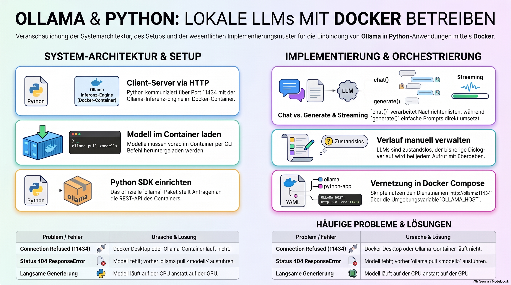

> [!NOTE]
> Dieser Leitfaden erklärt, wie man **Ollama** innerhalb eines **Docker-Containers** ausführt und über ein **Python-Skript** anspricht, um lokale KI-Modelle für Zettelkasten-Notizen zu nutzen. Zunächst werden die **Architektur**, notwendige **Voraussetzungen** sowie die Einrichtung einer virtuellen Python-Umgebung erläutert. Anschließend demonstriert die Anleitung Schritt für Schritt einfache **API-Aufrufe**, **Streaming-Antworten** in Echtzeit sowie interaktive **Chat-Sitzungen**. Darüber hinaus zeigt das Tutorial, wie man rohe Markdown-Notizen mithilfe von Python-Skripten automatisiert in **atomare Zettel** umwandelt. Schließlich werden fortgeschrittene Themen wie die gemeinsame **Docker-Compose-Vernetzung** und typische **Anfängerfehler** bei der Behebung von Verbindungsproblemen behandelt.

# Ollama Beginner Deep Dive with Python and Docker

## 1. Core Concepts (Mental Model)

When your Python code talks to an Ollama server running inside a Docker container, you are working with a **client–server architecture over HTTP**:

* **Ollama Container (`ollama`):** Runs the inference engine and exposes port `11434` (`http://localhost:11434`). Models live inside a persistent Docker volume (`ollama`), not inside Python.
* **Python Client (`ollama` SDK):** A lightweight Python library that sends JSON requests to Ollama's REST API (`http://localhost:11434`) and parses responses—it does **not** run neural network weights inside the Python process itself.
* **`ollama.Client(host=...)`:** Lets you explicitly point Python at a specific host URL (such as `http://localhost:11434` from Windows PowerShell, or `http://ollama:11434` if Python itself runs inside a sibling container on the same Docker network).
* **`chat()` vs. `generate()`:**
  * `chat()` takes a list of role-tagged messages (`system`, `user`, `assistant`)—ideal for multi-turn conversations and structured prompts.
  * `generate()` takes a single prompt string—great for one-shot transformations like summarizing a note.

---

## 2. Prerequisites & Environment Setup

1. **Dockerized Ollama Running:** Ensure your `ollama` container is up on port `11434` (from your Docker setup) and verify it responds:

```powershell
   Invoke-RestMethod -Uri "http://localhost:11434"
```

_(Expected output: `Ollama is running`)_


2. **Pull a Model Inside the Container:** Before calling a model from Python, pull it into the Ollama container (returning `404` in Python usually means the model hasn't been pulled yet):

   PowerShell

   ```
   docker exec -it ollama ollama pull gemma3:4b
   ```

3. **Python 3 + Virtual Environment in PowerShell:** Create an isolated workspace for your Zettelkasten scripts and install the official `ollama` package:

   PowerShell

   ```
   mkdir .\ollama-python-lab
   cd .\ollama-python-lab
   python -m venv .venv
   .\.venv\Scripts\Activate.ps1
   pip install --upgrade pip ollama
   ```

## 3. Step 1: Your First Python Call to Dockerized Ollama

Create `01_hello_ollama.py` in `.\ollama-python-lab`:


Python

```
from ollama import Client

# Connect explicitly to the Dockerized Ollama server exposed on localhost:11434
client = Client(host="http://localhost:11434")

response = client.chat(
    model="gemma3:4b",
    messages=[
        {
            "role": "user",
            "content": "Explain the difference between a fleeting note and a permanent note in two sentences.",
        }
    ],
)

print(response.message.content)
```

Run it from PowerShell:


PowerShell

```
python .\01_hello_ollama.py
```

## 4. Step 2: Streaming Responses (Real-Time Token Output)

By default, `chat()` and `generate()` wait until the full answer is generated before returning. For longer responses, pass `stream=True` and iterate over chunks as they arrive:


Create `02_stream_note.py`:


Python

```
from ollama import Client

client = Client(host="http://localhost:11434")

stream = client.chat(
    model="gemma3:4b",
    messages=[
        {
            "role": "system",
            "content": "You are a concise Zettelkasten assistant. Use clear Markdown.",
        },
        {
            "role": "user",
            "content": "Give me 4 criteria for splitting a long note into atomic notes.",
        },
    ],
    stream=True,
)

for chunk in stream:
    print(chunk.message.content, end="", flush=True)

print()  # Final newline after stream finishes
```

Run it:


PowerShell

```
python .\02_stream_note.py
```

## 5. Step 3: Multi-Turn Conversation & Generation Options

LLMs are stateless between API calls—to keep a conversation going, append each user and assistant turn to the `messages` list. You can also tune inference behavior via `options` (such as `temperature` for creativity/determinism and `num_ctx` for context window size).


Create `03_chat_session.py`:


Python

```
from ollama import Client

client = Client(host="http://localhost:11434")

messages = [
    {
        "role": "system",
        "content": "You help refine Zettelkasten notes. Be direct, accurate, and concise.",
    }
]

print("Chat started. Type 'exit' or 'quit' to stop.\n")

while True:
    user_input = input("You: ").strip()
    if not user_input:
        continue
    if user_input.lower() in {"exit", "quit"}:
        break

    messages.append({"role": "user", "content": user_input})

    reply = client.chat(
        model="gemma3:4b",
        messages=messages,
        options={
            "temperature": 0.3,  # Lower = more focused and repeatable
            "num_ctx": 8192,     # Context window in tokens
        },
    )

    assistant_text = reply.message.content
    print(f"\nAssistant: {assistant_text}\n")

    # Preserve conversation history for subsequent turns
    messages.append({"role": "assistant", "content": assistant_text})
```

Run it:


PowerShell

```
python .\03_chat_session.py
```

## 6. Step 4: Zettelkasten Automation — Turning a Markdown Note into an Atomic Card

Here is a practical script that reads a Markdown file from disk, calls `client.generate()` against the Dockerized Ollama server, and writes a structured Zettelkasten Markdown note with YAML frontmatter.


Create `04_md_to_zettel.py`:


Python

```
import sys
from pathlib import Path
from ollama import Client, ResponseError

client = Client(host="http://localhost:11434")


def main() -> None:
    if len(sys.argv) < 3:
        print("Usage: python 04_md_to_zettel.py <input.md> <output.md>")
        sys.exit(1)

    input_path = Path(sys.argv[1])
    output_path = Path(sys.argv[2])

    source_text = input_path.read_text(encoding="utf-8")

    prompt = f"""Transform the following raw note into a single atomic Zettelkasten note in Markdown.
Include YAML frontmatter with title, tags, and status: draft, followed by a concise explanation in your own words and 2-3 candidate [[WikiLinks]].

RAW NOTE:
{source_text}
"""

    try:
        result = client.generate(
            model="gemma3:4b",
            prompt=prompt,
            options={"temperature": 0.2},
        )
    except ResponseError as exc:
        print(f"Ollama API error ({exc.status_code}): {exc.error}")
        sys.exit(1)

    output_path.write_text(result.response.strip() + "\n", encoding="utf-8")
    print(f"Saved atomic note to: {output_path}")


if __name__ == "__main__":
    main()
```

Test it in PowerShell with a sample note:


PowerShell

```
"# Docker Volumes vs Bind Mounts`nVolumes are managed by Docker under /var/lib/docker/volumes and survive container removal." | Out-File -FilePath ".\raw_docker_note.md" -Encoding utf8
python .\04_md_to_zettel.py .\raw_docker_note.md .\atomic_docker_note.md
Get-Content .\atomic_docker_note.md
```

## 7. Step 5: Running Both Python and Ollama Inside Docker Compose

If you ever containerize your Python script too, place both services on the **same Docker Compose network** and use the service name (`http://ollama:11434`) as the host instead of `localhost` (inside a container, `localhost` refers to that container itself, not another container or the Windows host).


Example `docker-compose.yml` snippet:


```YAML
services:
  ollama:
    image: ollama/ollama:latest
    container_name: ollama
    ports:
      - "11434:11434"
    volumes:
      - ollama:/root/.ollama
    restart: unless-stopped

  python-worker:
    build: .
    container_name: zettel-python-worker
    depends_on:
      - ollama
    environment:
      OLLAMA_HOST: "http://ollama:11434"
    volumes:
      - ./notes:/app/notes

volumes:
  ollama:
    name: ollama
```

In Python, `ollama.Client()` automatically reads `OLLAMA_HOST` from the environment if no `host=` argument is passed—making the same script work seamlessly both on Windows (`OLLAMA_HOST=http://localhost:11434`) and inside Docker (`OLLAMA_HOST=http://ollama:11434`).

## 8. Common Beginner Pitfalls & Fixes

* **`ConnectionError` / refused connection to `localhost:11434`:** Docker Desktop isn't running, or the `ollama` container is stopped (`docker ps` / `docker start ollama`).

* **`ResponseError` with status `404`:** The requested model name isn't downloaded yet in the container—run `docker exec -it ollama ollama pull <model>` and check `docker exec -it ollama ollama list`.

* **Slow responses (CPU fallback):** Check `docker exec -it ollama ollama ps` while a prompt runs to see whether the model is running on `GPU` or `CPU`.

