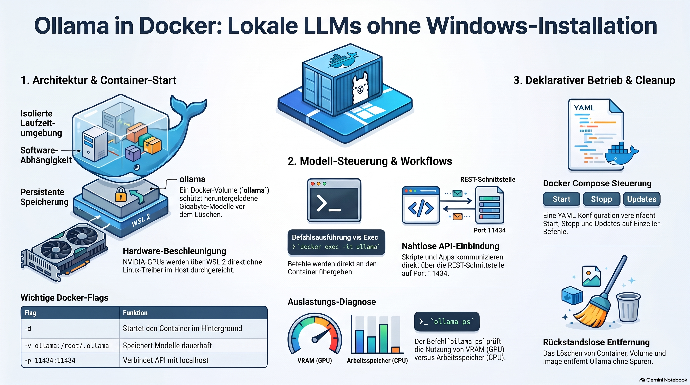

> [!NOTE]
> Diese Anleitung erklärt Schritt für Schritt, wie man **Ollama** mithilfe von **Docker** auf einem **Windows 11**-System ausführt, ohne die Software direkt auf dem Betriebssystem installieren zu müssen. Durch die Nutzung eines **kontainerisierten Servers** bleiben der Host-Computer sauber und alle heruntergeladenen **KI-Modelle** dank permanenter **Datenvolumen** vor Verlust geschützt. Das Dokument zeigt zudem, wie man optional **NVIDIA-Grafikkarten** für die Hardwarebeschleunigung einbindet, Modelle über die Befehlszeile verwaltet und über **PowerShell-Skripte** oder REST-APIs auf den Dienst zugreift. Für eine vereinfachte Handhabung wird schließlich empfohlen, die Einrichtung über eine deklarative **Docker Compose**-Konfiguration zu automatisieren. Bei Bedarf lässt sich die gesamte Umgebung durch das Löschen der Container, Volumes und Images restlos und spurlos entfernen.


# Ollama in Docker with Zero-Install Beginner Deep Dive

## 1. Core Concepts (Mental Model)

Running Ollama inside Docker allows you to run local LLMs without installing Ollama binaries, background services, or drivers directly onto your Windows 11 host OS. Everything stays isolated inside a disposable container.

* **The Container (`ollama`):** An isolated Linux runtime environment packaged with the Ollama server and all its dependencies. When you delete the container, your Windows OS remains completely untouched.
* **The Docker Volume (`ollama`):** Containers are ephemeral—if you destroy a container, files inside it disappear. Mounting a **named volume** (`-v ollama:/root/.ollama`) stores your downloaded multi-gigabyte AI models safely outside the container so they survive updates and restarts.
* **Port Mapping (`11434:11434`):** Connects port `11434` inside the container to `http://localhost:11434` on your Windows host, allowing PowerShell scripts, browsers, or apps (like Obsidian) to talk to the containerized AI.
* **Command Forwarding (`docker exec`):** Since `ollama` is not installed on Windows, you execute commands inside the running container by prefixing them with `docker exec -it ollama`.

---

## 2. Prerequisites on Windows 11

1. **Docker Desktop for Windows:** Installed and running with the **WSL 2 backend** enabled (default in modern Docker Desktop).
2. **Verify Docker in PowerShell:** Open **PowerShell** and confirm the Docker engine is responsive:

```powershell
   docker --version
   docker ps
````

3. _(Optional) NVIDIA GPU Acceleration:_ If you have an NVIDIA GPU, ensure your latest Windows NVIDIA Game Ready or Studio drivers are installed. Docker Desktop on Windows automatically bridges Windows NVIDIA drivers into WSL2 containers without needing a separate Linux driver installation inside Windows. Verify GPU passthrough works with
   ```PowerShell
   docker run --rm --gpus all nvidia/cuda:12.2.0-base-ubuntu22.04 nvidia-smi
   ```

   _(If this prints your GPU table, Docker has full hardware acceleration access.)_

## 3. Step-by-Step: Launching the Ollama Container

Choose **one** of the two commands below based on your hardware. Docker will automatically download the official `ollama/ollama` image (\~1–2 GB) and start the server in the background.

### Option A: With NVIDIA GPU Acceleration (Recommended if you have an NVIDIA GPU)

```PowerShell
docker run -d `
  --gpus=all `
  -v ollama:/root/.ollama `
  -p 11434:11434 `
  --name ollama `
  --restart unless-stopped `
  ollama/ollama
```

_(Note: The backtick `` ` `` is PowerShell's line-continuation character.)_

### Option B: CPU-Only Mode (No dedicated NVIDIA GPU)

```PowerShell
docker run -d `
  -v ollama:/root/.ollama `
  -p 11434:11434 `
  --name ollama `
  --restart unless-stopped `
  ollama/ollama
```

### Anatomy of the Flags

| **Flag**                   | **Purpose**                                                                                   |
| -------------------------- | --------------------------------------------------------------------------------------------- |
| `-d`                       | **Detached mode:** Runs the container in the background so your PowerShell prompt stays free. |
| `--gpus=all`               | Passes your Windows NVIDIA GPU into the container for fast inference.                         |
| `-v ollama:/root/.ollama`  | Creates a persistent Docker volume named `ollama` to keep downloaded models safe.             |
| `-p 11434:11434`           | Exposes Ollama's REST API on `http://localhost:11434`.                                        |
| `--name ollama`            | Assigns a friendly name (`ollama`) instead of a random container ID.                          |
| `--restart unless-stopped` | Automatically restarts Ollama whenever Docker Desktop starts, unless you manually stop it.    |

### Verify the Container is Running

1. **Check container status:**
   ```PowerShell
   docker ps
   ```

2. **Test the HTTP endpoint from PowerShell:**
   ```PowerShell
   Invoke-RestMethod -Uri "http://localhost:11434"
   ```

   _(Expected output: `Ollama is running`)_

## 4. Running & Managing Models Inside the Container

Because Ollama lives inside the container, use `docker exec -it ollama` to interact with it:

* **Download and launch an interactive chat session:**
  ```PowerShell
  docker exec -it ollama ollama run gemma3:4b
  ```

  _(Type `/bye` inside the chat to exit back to PowerShell without stopping the container.)_

* **Download a model without starting a chat:**
  ```PowerShell
  docker exec ollama ollama pull llama3.2
  ```

* **List all models stored in your Docker volume:**
  ```PowerShell
  docker exec ollama ollama list
  ```

* **Verify GPU vs. CPU usage (Crucial Diagnostic):** While a model is loaded or right after running a prompt, run:
  ```PowerShell
  docker exec ollama ollama ps
  ```

  _Look at the `PROCESSOR` column: `100% GPU` confirms full VRAM acceleration; `100% CPU` means it is running on your processor._

* **Delete a model to free up disk space:**
  ```PowerShell
  docker exec ollama ollama rm gemma3:4b
  ```

> **Pro Tip — PowerShell Alias:** Add this function to your PowerShell `$PROFILE` so you can type `ollama list` or `ollama run gemma3:4b` natively as if it were installed:

```PowerShell
function ollama { docker exec -it ollama ollama @args }
```

## 5. Zettelkasten PowerShell Workflows (Host-to-Container)

Even though Ollama is inside Docker, your Windows PowerShell can pipe local Markdown files directly into the container or call its REST API.

### Pipe a Local Markdown File into the Container

Note the `-i` flag (interactive stdin) without `-t` (pseudo-TTY) when piping files in PowerShell:

```PowerShell
Get-Content ".\raw-notes.md" -Raw | docker exec -i ollama ollama run gemma3:4b "Summarize this note into 3 atomic Zettelkasten takeaways in Markdown:"
```

### Query via REST API (No `docker exec` Needed)

Because port `11434` is mapped to Windows, any script or app can send JSON requests directly:

```PowerShell
$Body = @{
    model  = "gemma3:4b"
    prompt = "Explain Zettelkasten atomic notes in two sentences."
    stream = $false
} | ConvertTo-Json

$Response = Invoke-RestMethod -Method Post -Uri "http://localhost:11434/api/generate" -Body Body -ContentType "application/json"
$Response.response
```

### Create a Custom `Modelfile` Inside the Container

1. Write a `Modelfile` on your Windows drive:

```PowerShell
   @"
   FROM gemma3:4b
   PARAMETER temperature 0.2
   SYSTEM """
   You are a Zettelkasten assistant. Output clean Markdown and suggest [[WikiLinks]].
   """
   "@ | Out-File -FilePath ".\Modelfile" -Encoding utf8
```

2. Copy it into the container and build your custom model:

```PowerShell
   docker cp .\Modelfile ollama:/tmp/Modelfile
   docker exec ollama ollama create zettel-assistant -f /tmp/Modelfile
```

## 6. Declarative Setup with `docker-compose.yml` (Recommended)

Instead of memorizing long `docker run` flags, store a `docker-compose.yml` file inside your Zettelkasten or project folder so you can start, stop, or upgrade Ollama with single-word commands.

### Create `docker-compose.yml`

```YAML
services:
  ollama:
    image: ollama/ollama:latest
    container_name: ollama
    ports:
      - "11434:11434"
    volumes:
      - ollama_data:/root/.ollama
    restart: unless-stopped
    # Remove the 'deploy' block below if you do NOT have an NVIDIA GPU
    deploy:
      resources:
        reservations:
          devices:
            - driver: nvidia
              count: all
              capabilities: [gpu]

volumes:
  ollama_data:
    name: ollama
```

_(Setting `name: ollama` ensures Docker Compose reuses the exact same volume created in Section 3 rather than creating a prefixed duplicate.)_

### Docker Compose Lifecycle Commands

Run these from the folder containing `docker-compose.yml`:

* **Start Ollama in the background:** `docker compose up -d`

* **Stop Ollama (models remain safe on disk):** `docker compose down`

* **Update Ollama to the newest release:**

```PowerShell
  docker compose pull
  docker compose up -d
```

## 7. Complete Cleanup (Zero Trace Removal)

Because nothing was installed on Windows, you can completely erase Ollama at any time:

1. **Stop and remove the container:**

```PowerShell
   docker rm -f ollama
```

2. **Delete the downloaded models volume (frees all model storage):**

```PowerShell
   docker volume rm ollama
```

3. **Delete the Docker image:**

```PowerShell
   docker rmi ollama/ollama
```

