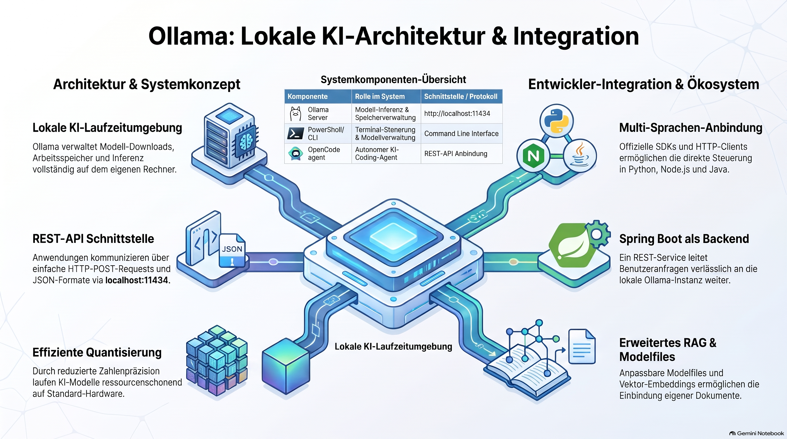

> [!NOTE]
> Diese Dokumentation bietet einen umfassenden Leitfaden für Einsteiger, um **lokale Künstliche Intelligenz** auf **Windows 11** mithilfe von **Ollama** einzurichten und zu nutzen. Der Kurs verbindet die Grundlagen von Sprachmodellen und **REST-Schnittstellen** mit praktischen Programmierübungen in **Python**, **JavaScript** und **Java**. Zudem wird gezeigt, wie Entwickler **Spring Boot** als Backend integrieren und **OpenCode** als lokalen **KI-Coding-Assistenten** einsetzen können. Abschließend vermittelt das Material fortgeschrittene Konzepte wie **Modelfiles**, **Embeddings** und **Retrieval-Augmented Generation (RAG)** für eigene Projekte.


We can go much further than simply installing Ollama and downloading a language model. I suggest turning this into a comprehensive **Ollama Absolute Beginner Deep Dive**, including practical exercises, Python, Node.js, Java, Spring Boot, and OpenCode.

The central idea is to learn how all these components work together.

# **Ollama an Absolute Beginner Deep Dive on Windows**

Windows 11

PowerShell

Local AI

Python · Java · Node.js

[Part 1 - AI Lab - Understanding Ollama — Ian Myles](https://images.openai.com/static-rsc-4/f7XuvMxfvjhLA2lEA0MALf2tEZxQ1l9BK_Ogc4WUR9tqx-CQa9eqcGJvRoVApLusTw5zhgy4aWfkHywX9U24FYiPp1c1CSorNMMV9D4fg3Y1Qu0tbgv78x4jIDKihu6QslxkSKLHoIlSeKGYZGrAq8C7BPnBiafXUkgap292Pvk?purpose=inline)


**Your learning environment**

| Component   | Purpose                               |
| ----------- | ------------------------------------- |
| Windows 11  | Operating system                      |
| PowerShell  | Terminal and automation               |
| Ollama      | Run local language models             |
| OpenCode    | AI coding agent                       |
| Python      | AI experiments and API integration    |
| Node.js     | JavaScript and TypeScript integration |
| Java        | Backend development                   |
| Spring Boot | REST API development                  |

**What we will build**

1. A local AI assistant running entirely on your computer.

2. A Python application communicating with Ollama.

3. A Node.js application communicating with Ollama.

4. A Java application communicating with Ollama.

5. A Spring Boot REST API using Ollama.

6. An AI coding assistant using OpenCode.

7. A small local AI application combining these technologies.

Everything will be explained step by step, assuming absolutely no previous knowledge of Ollama.

## **1. Learning roadmap**

We will use the following structure. You can save each chapter as a separate Zettelkasten note or keep everything in one master note.

## **Ollama learning path**

1. **Foundations**

   What is Ollama? What is an LLM? Models, tokens, quantization, and local inference.

2. **Installation and verification**

   Windows 11, PowerShell, Ollama CLI, server, and model management.

3. **Working with models**

   Download, run, inspect, compare, and remove models.

4. **REST API**

   HTTP, JSON, chat completions, streaming, and conversation history.

5. **Python integration**

   Build your first Python AI assistant.

6. **Node.js integration**

   Build a JavaScript command-line chatbot.

7. **Java integration**

   Communicate with Ollama using Java's HTTP Client.

8. **Spring Boot integration**

   Build a REST service that forwards requests to Ollama.

9. **OpenCode integration**

   Use local LLMs as coding assistants and agents.

10. **Advanced topics**

    Modelfiles, embeddings, RAG, tools, structured output, and security.

11. **Final project**

    Build your own local AI development assistant.

## **2. Important official documentation**

These are the documentation sources we will use throughout the tutorial:

* [Ollama documentation](https://docs.ollama.com/?utm_source=chatgpt.com)

* [Ollama quickstart](https://docs.ollama.com/quickstart?utm_source=chatgpt.com)

* [Ollama REST API](https://docs.ollama.com/api?utm_source=chatgpt.com)

* [Ollama model library](https://ollama.com/library?utm_source=chatgpt.com)

* [OpenCode documentation](https://opencode.ai/docs/?utm_source=chatgpt.com)

* [OpenCode model configuration](https://opencode.ai/docs/models/?utm_source=chatgpt.com)

Ollama supports a local REST API, Python and JavaScript libraries, and integrations with coding agents. OpenCode can discover local Ollama models automatically.


# **3. The complete tutorial**

# Ollama – Absolute Beginner Deep Dive Tutorial

**Version:** November 2026
**Operating system:** Windows 11
**Terminal:** PowerShell
**AI runtime:** Ollama
**Coding agent:** OpenCode
**Programming languages:** Python, JavaScript, Java
**Framework:** Spring Boot
**Learning level:** Absolute beginner to advanced beginner

***

# Chapter 1 – Understanding Ollama

## 1.1 What is Ollama?

Ollama is a software platform that allows you to download and run Large Language Models (LLMs) on your own computer.

Instead of sending every question to an external AI service, you can run a language model locally.

For example, you can download a model, start it, and ask it questions directly from PowerShell.

```
ollama run gemma4:e2b
```

You can then interact with the model:

```
>>> Hello! Who are you?

I am an AI language model...
```

Ollama handles the technical work behind the scenes:

* Downloading models.

* Loading models into memory.

* Running inference.

* Managing model configurations.

* Providing an HTTP API.

* Connecting applications to language models.

## 1.2 What is a Large Language Model?

A Large Language Model is an AI model trained on large amounts of text and other data.

It learns statistical patterns and relationships between tokens.

It can perform tasks such as:

* Answering questions.

* Explaining programming concepts.

* Writing source code.

* Translating languages.

* Summarizing documents.

* Generating structured JSON.

* Helping with debugging.

* Extracting information.

An LLM does not work like a traditional database. It generates responses based on learned patterns and the context supplied to it.

## 1.3 What is a token?

A token is a unit of text processed by a language model.

A token can be:

* A complete word.

* Part of a word.

* A punctuation character.

* A combination of characters.

For example:

```
Ollama is fantastic!
```

The model might process this as several tokens rather than three complete words plus one punctuation character.

Tokens are important because language models have context limits.

## 1.4 What is inference?

Inference is the process of using an already-trained model to generate an answer.

The general process looks like this:

```
User question
      |
      v
Ollama API
      |
      v
Load language model
      |
      v
Process tokens
      |
      v
Generate response
      |
      v
Return answer
```

Training and inference are different activities.

For this tutorial, we concentrate on inference.

## 1.5 What is quantization?

Language models can be very large.

Quantization reduces the numerical precision used to represent model weights.

For example:

* FP16: 16-bit floating-point representation.

* Q8: approximately 8-bit quantization.

* Q4: approximately 4-bit quantization.

Quantization can reduce memory consumption, making models easier to run on ordinary computers.

There can be a quality trade-off, depending on the model and quantization method.

## 1.6 What is the difference between a model and Ollama?

Think about the following analogy:

| Component      | Analogy                 |
| -------------- | ----------------------- |
| Ollama         | Application runtime     |
| Language model | Engine                  |
| Prompt         | Input                   |
| Inference      | Processing              |
| Response       | Output                  |
| REST API       | Communication interface |

Ollama is not itself the language model.

It manages and runs the model.

***

# Chapter 2 – Understanding the Ollama architecture

## 2.1 Architecture

Ollama consists of several important components:

```
+--------------------------------------+
|          Your Windows 11 PC          |
|                                      |
|  +--------------------------------+  |
|  |           PowerShell           |  |
|  +---------------+----------------+  |
|                  |                   |
|                  v                   |
|  +--------------------------------+  |
|  |          Ollama CLI            |  |
|  +---------------+----------------+  |
|                  |                   |
|                  v                   |
|  +--------------------------------+  |
|  |         Ollama Server          |  |
|  |       localhost:11434          |  |
|  +---------------+----------------+  |
|                  |                   |
|                  v                   |
|  +--------------------------------+  |
|  |       Language Model           |  |
|  |                                |  |
|  |          Gemma / Qwen          |  |
|  +--------------------------------+  |
|                                      |
+--------------------------------------+
```

Your applications communicate with the Ollama server through HTTP.

The default local API address is:

```
http://localhost:11434
```

## 2.2 What is a localhost?

`localhost` means your own computer.

The address:

```
http://localhost:11434
```

means:

* HTTP is the communication protocol.

* localhost identifies your computer.

* 11434 is the port used by Ollama.

A port identifies a network service on a computer.

You can think of it as a numbered entrance to an application.

## 2.3 What is a REST API?

REST is an architectural style for communicating between applications over HTTP.

For example:

```
Python application
       |
       | HTTP POST
       v
http://localhost:11434/api/chat
       |
       v
Ollama
       |
       v
Language model
       |
       v
HTTP response
       |
       v
Python application
```

This is particularly interesting because it means you can use almost any programming language to communicate with Ollama.

***

# Chapter 3 – Verify your Windows 11 environment

Open PowerShell.

We first verify that your software is available.

## 3.1 Check Ollama

```
ollama --version
```

Expected result: Ollama displays its installed version.

## 3.2 Check Node.js

```
node --version
```

## 3.3 Check npm

```
npm --version
```

## 3.4 Check Python

```
python --version
```

## 3.5 Check Java

```
java --version
```

## 3.6 Check Maven

```
mvn --version
```

You can also check whether the commands are available through PATH:

```
Get-Command ollama
Get-Command node
Get-Command python
Get-Command java
```

If Maven is not installed globally, you can use the Maven Wrapper included in a Spring Boot project.

## 3.7 Create your learning workspace

Let's create a dedicated directory.

```
New-Item -ItemType Directory -Force -Path C:\AI-Learning
Set-Location C:\AI-Learning
```

Create the project directories:

```
$folders = @(
    "01-Ollama-Basics",
    "02-Python",
    "03-NodeJS",
    "04-Java",
    "05-Spring-Boot",
    "06-OpenCode",
    "07-Advanced",
    "08-Final-Project"
)

foreach ($folder in $folders) {
    New-Item -ItemType Directory -Force -Path $folder
}
```

Your directory structure should look like this:

```
C:\AI-Learning
|
+-- 01-Ollama-Basics
+-- 02-Python
+-- 03-NodeJS
+-- 04-Java
+-- 05-Spring-Boot
+-- 06-OpenCode
+-- 07-Advanced
+-- 08-Final-Project
```

***

# Chapter 4 – Your first Ollama model

## 4.1 What is a model?

A model is the actual AI that generates responses.

Ollama provides a model library:

<https://ollama.com/library>

There are many different model families.

Some examples:

| Model family   | Typical use                   |
| -------------- | ----------------------------- |
| Gemma          | General-purpose AI            |
| Qwen           | General-purpose AI and coding |
| Llama          | General-purpose AI            |
| DeepSeek       | Reasoning and coding          |
| Mistral        | General-purpose AI            |
| EmbeddingGemma | Text embeddings               |

Different models have different memory requirements and capabilities.

## 4.2 Which model should you start with?

For your first exercise, use:

```
ollama pull gemma4:e2b
```

This downloads the model.

The official quickstart currently lists this model as approximately 7.2 GB.

Make sure you have sufficient free disk space.

Important: Model memory requirements depend on the architecture, quantization, context length, and whether the model runs on CPU or GPU.

Do not start with a very large model before checking your available RAM and GPU memory.

## 4.3 List downloaded models

```
ollama list
```

Example:

```
NAME           ID           SIZE
gemma4:e2b     ...          ...
```

## 4.4 Start your first model

```
ollama run gemma4:e2b
```

Now ask:

```
Explain what a REST API is.
```

Try another question:

```
Explain the difference between Java and JavaScript.
```

And another:

```
Write a simple Python program that converts Celsius to Fahrenheit.
```

## 4.5 Leave the chat

Enter:

```
/bye
```

You are now back in PowerShell.

Congratulations!

You have just run your first local language model.

## 4.6 Useful Ollama commands

| Command                 | Description               |
| ----------------------- | ------------------------- |
| `ollama --version`      | Display version           |
| `ollama list`           | List downloaded models    |
| `ollama pull MODEL`     | Download model            |
| `ollama run MODEL`      | Start interactive chat    |
| `ollama show MODEL`     | Display model information |
| `ollama ps`             | Show running models       |
| `ollama stop MODEL`     | Stop a running model      |
| `ollama cp SOURCE DEST` | Copy a model              |
| `ollama rm MODEL`       | Delete a model            |
| `ollama help`           | Display help              |

Try:

```
ollama show gemma4:e2b
```

Then:

```
ollama ps
```

***

# Chapter 5 – Understanding the Ollama server

## 5.1 The Ollama server

Ollama normally runs as a background application on Windows.

It exposes an HTTP API on:

```
http://localhost:11434
```

You usually do not need to start another server manually if the Windows Ollama application is already running.

## 5.2 Test the server

In PowerShell:

```
Invoke-RestMethod http://localhost:11434/api/version
```

You should receive version information.

## 5.3 Check available models through HTTP

```
Invoke-RestMethod http://localhost:11434/api/tags
```

This returns a JSON object containing your installed models.

## 5.4 Check the running models

```
Invoke-RestMethod http://localhost:11434/api/ps
```

This endpoint reports models currently loaded in memory.

## 5.5 Understanding JSON

JSON stands for JavaScript Object Notation.

It is a common data format used by REST APIs.

Example:

```
{
    "name": "Karl",
    "language": "Java",
    "experience": "Beginner with Ollama"
}
```

JSON consists of key-value pairs.

For example:

```
"name": "Karl"
```

Here:

* `name` is the key.

* `Karl` is the value.

You will encounter JSON throughout this tutorial.

***

# Chapter 6 – Your first REST API request

Now things become interesting.

We will communicate with Ollama directly using PowerShell.

## 6.1 Understand the chat endpoint

Ollama provides this endpoint:

```
POST http://localhost:11434/api/chat
```

POST means that we send data to the server.

The request contains:

* Model name.

* Conversation messages.

* Optional parameters.

* Streaming configuration.

## 6.2 Create your first request

Run this PowerShell script:

```
$body = @{
    model = "gemma4:e2b"
    messages = @(
        @{
            role = "user"
            content = "Explain what Ollama is in three sentences."
        }
    )
    stream = $false
} | ConvertTo-Json -Depth 10

$response = Invoke-RestMethod `
    -Uri "http://localhost:11434/api/chat" `
    -Method Post `
    -ContentType "application/json" `
    -Body $body

$response.message.content
```

Congratulations!

You have just sent an HTTP request to your local AI model.

## 6.3 Understand the request

Let's examine the important parts.

```
model = "gemma4:e2b"
```

This tells Ollama which model to use.

```
role = "user"
```

This identifies the sender.

Other possible roles include:

* `system`

* `user`

* `assistant`

* `tool`

```
content = "Explain what Ollama is."
```

This is the actual prompt.

```
stream = $false
```

This tells Ollama to return one complete response rather than streaming multiple response fragments.

## 6.4 Try a programming question

Change the prompt:

```
content = "Write a Java Hello World program."
```

Or:

```
content = "Explain dependency injection in Spring Boot."
```

You are now using Ollama as a programming assistant through HTTP.

***

# Chapter 7 – Understanding prompts and conversation history

## 7.1 What is a prompt?

A prompt is the input you provide to a language model.

For example:

```
Explain object-oriented programming.
```

However, a more detailed prompt can produce a more useful answer.

Example:

```
You are a Java programming teacher.

Explain object-oriented programming to an absolute beginner.

Use:
- Simple language
- Java examples
- Step-by-step explanations
- A practical exercise
```

The instructions describing the assistant's behavior are often called a system prompt.

## 7.2 System messages

Example:

```
$body = @{
    model = "gemma4:e2b"
    messages = @(
        @{
            role = "system"
            content = "You are a friendly Java programming teacher."
        },
        @{
            role = "user"
            content = "Explain inheritance."
        }
    )
    stream = $false
} | ConvertTo-Json -Depth 10
```

Send the request as before.

## 7.3 Conversation history

Ollama's chat endpoint accepts a list of messages.

You can therefore send previous messages along with a new question.

Example:

```
$body = @{
    model = "gemma4:e2b"
    messages = @(
        @{
            role = "user"
            content = "What is Java?"
        },
        @{
            role = "assistant"
            content = "Java is a general-purpose programming language."
        },
        @{
            role = "user"
            content = "What is Spring Boot?"
        }
    )
    stream = $false
} | ConvertTo-Json -Depth 10
```

The model receives the previous conversation as context.

Important: Your application is responsible for maintaining and sending conversation history. The basic chat endpoint does not automatically provide persistent conversation storage.

***

# Chapter 8 – Python integration

Now we will create our first real application.

## 8.1 Create a Python project

```
Set-Location C:\AI-Learning\02-Python

New-Item -ItemType Directory -Force ollama-python
Set-Location ollama-python
```

## 8.2 Create a virtual environment

```
python -m venv .venv
```

Activate it:

```
.\.venv\Scripts\Activate.ps1
```

If PowerShell blocks script activation, use this for the current terminal session:

```
Set-ExecutionPolicy -Scope Process -ExecutionPolicy Bypass
```

Then activate again.

## 8.3 Install the Ollama Python library

```
python -m pip install --upgrade pip
python -m pip install ollama
```

The official Python library provides a convenient interface to the Ollama API.

## 8.4 Create your first Python program

Create:

```
hello_ollama.py
```

Source code:

```
import ollama

response = ollama.chat(
    model="gemma4:e2b",
    messages=[
        {
            "role": "user",
            "content": "Explain Python in three sentences."
        }
    ]
)

print(response.message.content)
```

Run:

```
python hello_ollama.py
```

You should receive an answer generated by your local model.

## 8.5 Build an interactive chatbot

Create:

```
chatbot.py
```

Source code:

```
import ollama

MODEL = "gemma4:e2b"

messages = [
    {
        "role": "system",
        "content": "You are a friendly programming teacher."
    }
]

print("Ollama Python Chatbot")
print("Type 'exit' to quit.")
print()

while True:

    question = input("You: ")

    if question.lower() == "exit":
        break

    messages.append({
        "role": "user",
        "content": question
    })

    response = ollama.chat(
        model=MODEL,
        messages=messages
    )

    answer = response.message.content

    print()
    print("AI:", answer)
    print()

    messages.append({
        "role": "assistant",
        "content": answer
    })
```

Run:

```
python chatbot.py
```

You now have a chatbot that remembers the conversation within its running Python process.

When you close the program, its conversation history disappears because we have not implemented persistent storage.

## 8.6 Python exercises

1. Ask Ollama to explain Java.

2. Ask Ollama to generate a Python function.

3. Modify the system prompt.

4. Store the conversation in a text file.

5. Add a command to clear conversation history.

6. Add exception handling if Ollama is unavailable.

***

# Chapter 9 – Node.js integration

Now let's implement the same idea using JavaScript.

## 9.1 Create a Node.js project

```
Set-Location C:\AI-Learning\03-NodeJS

New-Item -ItemType Directory -Force ollama-node
Set-Location ollama-node
```

Initialize the project:

```
npm init -y
```

## 9.2 Install the Ollama JavaScript library

```
npm install ollama
```

## 9.3 Create the application

Create:

```
hello-ollama.js
```

Source code:

```
import ollama from "ollama";

const response = await ollama.chat({

    model: "gemma4:e2b",

    messages: [
        {
            role: "user",
            content: "Explain Node.js in three sentences."
        }
    ]

});

console.log(response.message.content);
```

For this ES module example, add the following property to `package.json`:

```
"type": "module"
```

Run:

```
node hello-ollama.js
```

## 9.4 Build an interactive JavaScript chatbot

Create:

```
chatbot.js
```

Source code:

```
import ollama from "ollama";
import readline from "node:readline/promises";
import { stdin, stdout } from "node:process";

const rl = readline.createInterface({
    input: stdin,
    output: stdout
});

const messages = [
    {
        role: "system",
        content: "You are a friendly programming teacher."
    }
];

console.log("Node.js Ollama Chatbot");
console.log("Type exit to quit.");

try {

    while (true) {

        const question = await rl.question("You: ");

        if (question.toLowerCase() === "exit") {
            break;
        }

        messages.push({
            role: "user",
            content: question
        });

        const response = await ollama.chat({
            model: "gemma4:e2b",
            messages
        });

        const answer = response.message.content;

        console.log("\nAI:", answer, "\n");

        messages.push({
            role: "assistant",
            content: answer
        });
    }

} finally {
    rl.close();
}
```

Run:

```
node chatbot.js
```

## 9.5 Node.js exercises

1. Add a system prompt.

2. Implement a command to clear the conversation.

3. Save the conversation as JSON.

4. Add error handling.

5. Add a model-selection option.

6. Implement streaming output.

***

# Chapter 10 – Java integration

Let's move to Java.

We will use the built-in Java HTTP Client. This is a good exercise because you can understand the underlying HTTP communication without depending on another library.

Requirements: Java 17 or later.

## 10.1 Create the project

```
Set-Location C:\AI-Learning\04-Java

New-Item -ItemType Directory -Force ollama-java
Set-Location ollama-java
```

Create:

```
OllamaChat.java
```

## 10.2 Java source code

```
import java.net.URI;
import java.net.http.HttpClient;
import java.net.http.HttpRequest;
import java.net.http.HttpResponse;

public class OllamaChat {

    public static void main(String[] args) throws Exception {

        String json = """
            {
                "model": "gemma4:e2b",
                "messages": [
                    {
                        "role": "user",
                        "content": "Explain Java in three sentences."
                    }
                ],
                "stream": false
            }
            """;

        HttpClient client = HttpClient.newHttpClient();

        HttpRequest request = HttpRequest.newBuilder()
                .uri(URI.create(
                    "http://localhost:11434/api/chat"
                ))
                .header(
                    "Content-Type",
                    "application/json"
                )
                .POST(
                    HttpRequest.BodyPublishers.ofString(json)
                )
                .build();

        HttpResponse<String> response = client.send(
                request,
                HttpResponse.BodyHandlers.ofString()
        );

        System.out.println(response.body());
    }
}
```

Compile:

```
javac OllamaChat.java
```

Run:

```
java OllamaChat
```

You will receive a JSON response.

For this first exercise, printing the complete JSON response is sufficient.

## 10.3 Understand the Java implementation

| Java component            | Purpose                      |
| ------------------------- | ---------------------------- |
| `HttpClient`              | Sends HTTP requests          |
| `HttpRequest`             | Describes the request        |
| `URI`                     | Identifies the endpoint      |
| `POST`                    | Sends data                   |
| `HttpResponse`            | Contains the server response |
| `BodyHandlers.ofString()` | Reads the response as text   |

One improvement for later: parse the JSON response using Jackson instead of manually extracting text.

## 10.4 Java exercises

1. Change the prompt.

2. Extract the `message.content` field using Jackson.

3. Create a reusable `OllamaClient` class.

4. Move the model name into a configuration file.

5. Add exception handling.

6. Implement a conversation history.

***

# Chapter 11 – Spring Boot integration

Now we combine Ollama with your Spring Boot knowledge.

Our objective is to create a REST API that communicates with Ollama.

## 11.1 Architecture

```
+-------------------------+
|       Client            |
|                         |
| PowerShell / Browser    |
+------------+------------+
             |
             | HTTP POST
             v
+-------------------------+
|      Spring Boot        |
|                         |
|  ChatController         |
|       |                 |
|  ChatService            |
|       |                 |
|  RestClient             |
+------------+------------+
             |
             | HTTP POST
             v
+-------------------------+
|        Ollama           |
|                         |
|   localhost:11434       |
+------------+------------+
             |
             v
+-------------------------+
|     Language Model      |
+-------------------------+
```

Spring Boot acts as an intermediary between the client and Ollama.

## 11.2 Create a Spring Boot project

Open:

<https://start.spring.io/>

Choose:

```
Project: Maven
Language: Java
Spring Boot: Current stable version
Packaging: Jar
Java: 17 or later
```

Add dependency:

```
Spring Web
```

Generate the project.

Extract it into:

```
C:\AI-Learning\05-Spring-Boot\ollama-spring
```

Open the directory in Visual Studio Code.

## 11.3 Configure application.properties

Open:

```
src/main/resources/application.properties
```

Add:

```
spring.application.name=ollama-spring

server.port=8080

ollama.base-url=http://localhost:11434
ollama.model=gemma4:e2b
```

## 11.4 Create a request DTO

Create:

```
ChatRequest.java
```

```
package com.example.ollamaspring;

public record ChatRequest(String message) {
}
```

## 11.5 Create a response DTO

Create:

```
ChatResponse.java
```

```
package com.example.ollamaspring;

public record ChatResponse(String response) {
}
```

## 11.6 Create the Ollama service

Create:

```
ChatService.java
```

```
package com.example.ollamaspring;

import java.util.Map;
import java.util.List;

import org.springframework.beans.factory.annotation.Value;
import org.springframework.stereotype.Service;
import org.springframework.web.client.RestClient;

@Service
public class ChatService {

    private final RestClient restClient;

    @Value("${ollama.model}")
    private String model;

    public ChatService(
            @Value("${ollama.base-url}") String baseUrl) {

        this.restClient = RestClient.builder()
                .baseUrl(baseUrl)
                .build();
    }

    public String chat(String question) {

        Map<String, Object> userMessage = Map.of(
                "role", "user",
                "content", question
        );

        Map<String, Object> requestBody = Map.of(
                "model", model,
                "messages", List.of(userMessage),
                "stream", false
        );

        Map response = restClient.post()
                .uri("/api/chat")
                .body(requestBody)
                .retrieve()
                .body(Map.class);

        Map message = (Map) response.get("message");

        return (String) message.get("content");
    }
}
```

## 11.7 Create the REST controller

Create:

```
ChatController.java
```

```
package com.example.ollamaspring;

import org.springframework.web.bind.annotation.*;

@RestController
@RequestMapping("/api/chat")
public class ChatController {

    private final ChatService chatService;

    public ChatController(ChatService chatService) {
        this.chatService = chatService;
    }

    @PostMapping
    public ChatResponse chat(
            @RequestBody ChatRequest request) {

        String answer = chatService.chat(
                request.message()
        );

        return new ChatResponse(answer);
    }
}
```

## 11.8 Start Spring Boot

Open PowerShell in the project directory.

```
.\mvnw.cmd spring-boot:run
```

Your Spring Boot application should start on:

```
http://localhost:8080
```

Ollama must also be running.

## 11.9 Test the Spring Boot API

In another PowerShell window:

```
$body = @{
    message = "Explain dependency injection in Spring Boot."
} | ConvertTo-Json

$response = Invoke-RestMethod `
    -Uri "http://localhost:8080/api/chat" `
    -Method Post `
    -ContentType "application/json" `
    -Body $body

$response.response
```

Congratulations!

You now have a Spring Boot REST API powered by a locally running language model.

## 11.10 Spring Boot exercises

1. Add a system prompt.

2. Add conversation IDs.

3. Store conversation history.

4. Add validation to ChatRequest.

5. Implement exception handling.

6. Add a model-selection endpoint.

7. Add a health-check endpoint for Ollama.

8. Implement streaming responses.

For a production application, replace the raw `Map` response handling with typed DTOs, add timeouts, and protect the endpoint with authentication and authorization.

***

# Chapter 12 – OpenCode integration

Now let's explore one of the most interesting parts of your environment.

You already have OpenCode installed.

OpenCode is an AI coding agent that can inspect project files, help with development, edit source code, and execute supported development workflows.

Ollama supplies the local language model.

OpenCode provides the coding-agent environment.

## 12.1 Understand the architecture

```
+--------------------------+
|        OpenCode          |
|                          |
|  Coding Agent            |
|  Project Analysis        |
|  File Editing            |
|  Terminal Tools          |
+-------------+------------+
              |
              | HTTP
              v
+--------------------------+
|         Ollama           |
|                          |
|   localhost:11434        |
+-------------+------------+
              |
              v
+--------------------------+
|      Local LLM           |
|                          |
|      Gemma / Qwen        |
+--------------------------+
```

## 12.2 Check your Ollama models

```
ollama list
```

For a coding experiment, you can also download Qwen:

```
ollama pull qwen3:8b
```

This model requires more resources than the smaller introductory model.

Check your available RAM and GPU memory before downloading.

## 12.3 Start OpenCode

First, make sure Ollama is running.

Then create a test project:

```
Set-Location C:\AI-Learning\06-OpenCode

New-Item -ItemType Directory -Force opencode-test

Set-Location opencode-test
```

Start OpenCode:

```
opencode
```

## 12.4 Select the Ollama model

Inside OpenCode, enter:

```
/models
```

OpenCode can automatically discover models exposed by Ollama at its default local endpoint.

Look for a model such as:

```
ollama/gemma4:e2b
```

or:

```
ollama/qwen3:8b
```

Select an available model.

You can also configure a default model in an `opencode.json` file:

```
{
  "$schema": "https://opencode.ai/config.json",
  "model": "ollama/gemma4:e2b"
}
```

Save this file in your project directory.

## 12.5 Your first coding-agent exercise

Ask OpenCode:

```
Explain the structure of this project.

Create a simple Python Hello World application.

Explain every generated file.
```

Then try:

```
Create a simple Java calculator using object-oriented programming.

Include:
- Calculator class
- Main class
- Addition
- Subtraction
- Multiplication
- Division

Explain the implementation.
```

Review all generated code before accepting changes.

## 12.6 Important OpenCode considerations

A coding agent is more than a chatbot.

Depending on its configuration and available tools, it can:

* Read files.

* Search project directories.

* Modify source code.

* Run terminal commands.

* Execute tests.

* Help debug problems.

Use a dedicated test project initially.

Never give an AI coding agent unrestricted access to important files or credentials. Review commands and changes, especially before executing destructive operations.

***

# Chapter 13 – Modelfiles

One of Ollama's interesting features is the Modelfile.

A Modelfile allows you to define a customized model configuration based on an existing model.

You can configure:

* Base model.

* System prompt.

* Model parameters.

* Template.

* Other supported model settings.

## 13.1 Create a Modelfile

Create a directory:

```
Set-Location C:\AI-Learning\07-Advanced

New-Item -ItemType Directory -Force modelfile
Set-Location modelfile
```

Create a file named:

```
Modelfile
```

Content:

```
FROM gemma4:e2b

SYSTEM """
You are a friendly Java and Spring Boot programming teacher.

Always explain technical concepts step by step.

Use simple examples.

Assume the user is an absolute beginner.
"""

PARAMETER temperature 0.7
```

## 13.2 Create your custom model

```
ollama create java-teacher -f Modelfile
```

## 13.3 Run your custom model

```
ollama run java-teacher
```

Ask:

```
Explain what a Java interface is.
```

You have now created your own customized model configuration.

Important: This does not train a completely new foundation model. It creates a customized model from an existing one.

***

# Chapter 14 – Model parameters

Model parameters influence how a language model generates responses.

Two interesting examples are temperature and context length.

## 14.1 Temperature

Temperature influences the randomness of generated output.

Generally:

* Lower temperature: more predictable output.

* Higher temperature: more variation.

For example:

```
PARAMETER temperature 0.2
```

This can be useful for structured programming explanations.

For creative writing:

```
PARAMETER temperature 0.9
```

The exact effect depends on the model.

## 14.2 Context length

Context length determines how much input and conversation context a model can process.

For example:

```
A short conversation:
Question + answer

A longer conversation:
Question 1
Answer 1
Question 2
Answer 2
...
```

Longer context requirements can increase memory consumption.

Do not assume that a large context setting automatically improves every response.

***

# Chapter 15 – Embeddings

Now we move into an important AI concept.

Embeddings are numerical representations of information.

They allow applications to compare semantic similarity between texts.

For example:

```
Text A:
How do I create a Java REST API?

Text B:
How can I build a REST service using Spring Boot?
```

Although the wording differs, the meanings are similar.

An embedding model converts text into vectors of numbers.

Conceptually:

```
Text
 |
 v
Embedding model
 |
 v
Vector
 |
 v
[0.12, 0.84, -0.31, ...]
```

## 15.1 Download an embedding model

For this exercise:

```
ollama pull embeddinggemma
```

## 15.2 Generate embeddings using PowerShell

```
$body = @{
    model = "embeddinggemma"
    input = @(
        "Java is a programming language."
        "Spring Boot is a Java framework."
        "The weather is sunny today."
    )
} | ConvertTo-Json -Depth 10

$result = Invoke-RestMethod `
    -Uri "http://localhost:11434/api/embed" `
    -Method Post `
    -ContentType "application/json" `
    -Body $body

$result.embeddings
```

You should receive vectors of numerical values.

## 15.3 Why are embeddings important?

Embeddings are commonly used for:

* Semantic search.

* Document retrieval.

* Similarity comparisons.

* Recommendation systems.

* Retrieval-Augmented Generation.

***

# Chapter 16 – Retrieval-Augmented Generation (RAG)

RAG is one of the most useful AI application architectures.

RAG stands for Retrieval-Augmented Generation.

Imagine you have 500 technical documents.

You want to ask:

```
How did I configure Apache Camel in my previous project?
```

A normal LLM might not know anything about your personal project documentation.

RAG solves this problem by retrieving relevant information from your own documents.

## 16.1 RAG architecture

```
             Documents
                 |
                 v
          Document Loader
                 |
                 v
          Text Processing
                 |
                 v
          Chunking
                 |
                 v
          Embedding Model
                 |
                 v
           Vector Database
                 |
                 |
User Question  |
      |        |
      v        |
Embedding Model
      |
      v
Similarity Search
      |
      v
Relevant Documents
      |
      v
     Ollama
      |
      v
Generated Answer
```

## 16.2 Important RAG concepts

| Concept           | Description                   |
| ----------------- | ----------------------------- |
| Document          | Source information            |
| Chunk             | Smaller document section      |
| Embedding         | Numerical text representation |
| Vector database   | Stores embeddings             |
| Similarity search | Finds related information     |
| Retrieval         | Collects relevant documents   |
| Generation        | Produces the final answer     |

## 16.3 Suggested practical project

Build:

**My Local Zettelkasten AI Assistant**

The application should:

1. Read Markdown notes.

2. Split documents into chunks.

3. Generate embeddings using Ollama.

4. Store vectors in a vector database.

5. Accept natural-language questions.

6. Retrieve relevant notes.

7. Send the notes and question to an LLM.

8. Generate an answer based on the retrieved content.

This would be an excellent project for your Zettelkasten.

***

# Chapter 17 – Tool calling and AI agents

A normal chatbot generates text.

An AI agent can interact with tools to perform tasks.

For example:

```
User:
Calculate 125 * 25.

AI:
I should use a calculator tool.

Tool:
125 * 25 = 3125

AI:
The result is 3125.
```

The model does not necessarily perform the calculation itself. It can request that your application execute a tool.

## 17.1 What is tool calling?

Tool calling allows a model to request an application-defined function.

Examples:

* Calculator.

* File search.

* Database lookup.

* Weather service.

* HTTP request.

* Business logic.

Ollama supports tool definitions through its chat API for compatible models.

## 17.2 Understand the architecture

```
User
 |
 v
AI application
 |
 v
Ollama
 |
 v
Model requests a tool
 |
 v
Application executes tool
 |
 v
Tool result returned to Ollama
 |
 v
Model generates final answer
```

Important distinction:

The model proposes the tool call. Your application executes it.

Never execute arbitrary model-generated commands without validation and authorization.

## 17.3 Practical agent project

Create a Python assistant with three tools:

1. Calculator.

2. Current-time lookup.

3. Search through local Markdown files.

Let the model decide when to request a tool.

Your application should validate the requested tool and its arguments before executing it.

***

# Chapter 18 – Streaming responses

So far, we have used:

```
"stream": false
```

This means Ollama returns the complete response.

With streaming enabled, Ollama returns response fragments as they are generated.

This is how many interactive AI applications display text progressively.

## 18.1 Streaming architecture

```
User question
     |
     v
Ollama
     |
     +----> Fragment 1
     |
     +----> Fragment 2
     |
     +----> Fragment 3
     |
     +----> Fragment 4
     |
     v
Complete response
```

## 18.2 Test streaming with Python

```
import ollama

stream = ollama.chat(
    model="gemma4:e2b",
    messages=[
        {
            "role": "user",
            "content": "Explain Spring Boot."
        }
    ],
    stream=True
)

for chunk in stream:
    print(chunk.message.content, end="", flush=True)

print()
```

Run:

```
python streaming.py
```

You should see the answer appearing progressively.

***

# Chapter 19 – Security and privacy

Running an LLM locally provides more control over your data.

However, local execution does not automatically make an entire application secure.

Consider the following:

1. Do not expose Ollama's port to untrusted networks.

2. Do not put passwords or API keys in prompts.

3. Protect your local project files.

4. Review AI-generated code.

5. Validate all user input.

6. Restrict agent access to files and terminal commands.

7. Never trust model-generated SQL or shell commands without review.

8. Keep your software and models updated.

By default, Ollama's local API does not require authentication.

Treat its API endpoint as a trusted local service, not as an internet-facing service.

Also remember that using a local model is different from using an Ollama cloud model. Cloud models involve remote processing.

***

# Chapter 20 – Troubleshooting

## Problem 1: Ollama command not found

Error:

```
ollama : The term 'ollama' is not recognized
```

Check:

```
Get-Command ollama
```

Check whether Ollama is installed and whether its installation directory is included in PATH.

Restart PowerShell after installation or PATH changes.

## Problem 2: Connection refused

Error:

```
Unable to connect to localhost:11434
```

Check:

```
Invoke-RestMethod http://localhost:11434/api/version
```

If necessary, open the Ollama application from Windows.

You can also inspect the port:

```
Test-NetConnection localhost -Port 11434
```

## Problem 3: Model not found

Error:

```
model not found
```

Check:

```
ollama list
```

Download the required model:

```
ollama pull gemma4:e2b
```

## Problem 4: Not enough memory

Symptoms:

* Very slow responses.

* Model loading failures.

* High memory usage.

* GPU memory exhaustion.

Solutions:

* Try a smaller model.

* Close unnecessary applications.

* Use a smaller context length.

* Check GPU and RAM availability.

## Problem 5: OpenCode cannot find Ollama

Check:

```
Invoke-RestMethod http://localhost:11434/api/tags
```

Then open OpenCode:

```
opencode
```

Inside OpenCode:

```
/models
```

Confirm that the local Ollama model appears.

***

# Chapter 21 – Final project: My Local AI Development Assistant

Now combine everything you have learned.

## 21.1 Project objective

Build your own local AI development assistant.

The application should have:

* Spring Boot backend.

* Ollama integration.

* Python document-processing module.

* Optional Node.js frontend.

* OpenCode development assistance.

* Local language model.

* Conversation history.

* RAG functionality.

## 21.2 Proposed architecture

```
+---------------------------------------+
|             User Interface            |
|                                       |
|          Node.js / React              |
+-------------------+-------------------+
                    |
                    v
+---------------------------------------+
|              Spring Boot              |
|                                       |
|  ChatController                       |
|  ChatService                          |
|  DocumentService                      |
|  ConversationService                  |
+-------------------+-------------------+
                    |
          +---------+---------+
          |                   |
          v                   v
+------------------+  +------------------+
|      Ollama      |  |  Vector Database |
|                  |  |                  |
|  Chat Model      |  |   Embeddings     |
|  Embedding Model |  |   Documents      |
+------------------+  +------------------+
          ^
          |
          |
+------------------+
| Python Processing|
|                  |
| Markdown Loader  |
| Document Chunker |
+------------------+
```

## 21.3 Suggested project structure

```
local-ai-assistant/
|
+-- backend/
|   |
|   +-- Spring Boot application
|
+-- frontend/
|   |
|   +-- Node.js application
|
+-- document-processor/
|   |
|   +-- Python application
|
+-- documents/
|   |
|   +-- Markdown files
|
+-- opencode/
    |
    +-- Agent configuration
```

## 21.4 Development milestones

| Milestone | Result                      |
| --------- | --------------------------- |
| 1         | Ollama running locally      |
| 2         | First chat request          |
| 3         | Python integration          |
| 4         | Java integration            |
| 5         | Spring Boot REST API        |
| 6         | Node.js frontend            |
| 7         | Conversation history        |
| 8         | Embeddings                  |
| 9         | RAG                         |
| 10        | Complete local AI assistant |

***

# Chapter 22 – Glossary

| Term           | Meaning                                 |
| -------------- | --------------------------------------- |
| AI             | Artificial Intelligence                 |
| LLM            | Large Language Model                    |
| Ollama         | Local model runtime                     |
| Model          | Trained AI system                       |
| Inference      | Generating model output                 |
| Token          | Unit of model input/output              |
| Prompt         | Input instructions                      |
| Context        | Information available to a model        |
| Quantization   | Reduced numerical precision             |
| REST           | HTTP-based application interface        |
| API            | Application Programming Interface       |
| JSON           | JavaScript Object Notation              |
| Embedding      | Numerical representation of information |
| Vector         | Numerical array                         |
| RAG            | Retrieval-Augmented Generation          |
| Agent          | AI system that can use tools            |
| Tool calling   | Model requests application functions    |
| Streaming      | Progressive response delivery           |
| Modelfile      | Ollama model configuration              |
| Temperature    | Generation randomness control           |
| Context length | Maximum context capacity                |

***

# Chapter 23 – Final knowledge checklist

Use this checklist to measure your progress.

## Foundations

* I understand what Ollama is.

* I understand what an LLM is.

* I understand inference.

* I understand tokens.

* I understand quantization.

* I understand localhost and ports.

## Ollama

* I can use the Ollama CLI.

* I can download models.

* I can run models.

* I can inspect models.

* I can manage running models.

* I understand the Ollama server.

## REST API

* I can send HTTP requests.

* I understand JSON.

* I can use the chat endpoint.

* I understand system prompts.

* I understand conversation history.

* I understand streaming.

## Programming

* I can use Ollama from Python.

* I can use Ollama from Node.js.

* I can use Ollama from Java.

* I can integrate Ollama with Spring Boot.

## Advanced AI

* I understand Modelfiles.

* I understand embeddings.

* I understand RAG.

* I understand tool calling.

* I understand AI agents.

* I understand the security implications.

## Final project

* I have built a local chatbot.

* I have built a Spring Boot integration.

* I have connected OpenCode.

* I have implemented document retrieval.

* I have built my local AI assistant.

***

# Conclusion

You have now covered the foundations of a local AI development environment.

The most important architectural concept is this:

**Ollama is the model runtime. Your programming languages are the clients. Spring Boot can be your backend. OpenCode can be your coding agent.**

Once you understand this separation, you can build much more sophisticated applications without having to depend on a hosted AI service.

Happy learning and happy coding!

## **4. My recommended next step: a 30-day Ollama coding dojo**

The tutorial gives you the foundation. I would recommend continuing with a practical 30-day bootcamp, where every day has a lesson, a coding exercise, and a small test.

## **30-Day Ollama Coding Dojo**

**Your progress**

Beginner → Intermediate

0 / 30 lessons completed

**0**__%__

**Week 1 – Ollama foundations**

Days 1–7

CLI and model management

Understanding LLMs and tokens

REST API fundamentals

PowerShell automation

Prompts and conversation history

Streaming responses

Weekly practical test

**Week 2 – Python and Node.js**

Days 8–14

Python Ollama client

Python chatbot

Python conversation storage

JavaScript Ollama client

Node.js chatbot

Streaming with Node.js

Build a command-line assistant

**Week 3 – Java and Spring Boot**

Days 15–21

Java HTTP Client

JSON processing with Jackson

Spring Boot integration

REST controller and service

Conversation management

Exception handling and testing

Build a Spring Boot AI API

**Week 4 – Advanced AI**

Days 22–30

OpenCode integration

Modelfiles

Embeddings

Vector databases

RAG fundamentals

Tool calling and agents

Final project and review

Reset progress

## **5. A small recommendation before choosing bigger models**

I deliberately haven't recommended a large coding model yet. Your available hardware determines which models are practical.

Could you tell me:

**How much RAM does your Windows 11 computer have, and which graphics card (GPU) do you use?**

You can retrieve the information with PowerShell:

```
Get-CimInstance Win32_ComputerSystem |
    Select-Object @{Name="RAM_GB";Expression={
        [math]::Round($_.TotalPhysicalMemory / 1GB, 2)
    }}

Get-CimInstance Win32_VideoController |
    Select-Object Name
```

With that information, we can select suitable models for Java, Spring Boot, Python and OpenCode rather than wasting disk space downloading models that are too large.

**One final thought:** Your Zettelkasten could eventually become the knowledge base of your own local AI assistant. That would be a wonderful long-term project!

Happy coding! 😊
