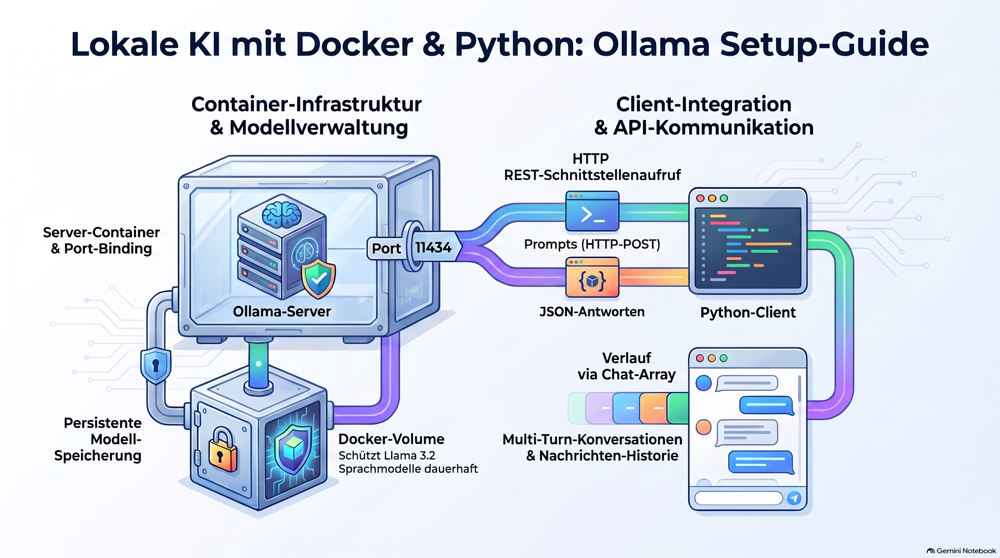
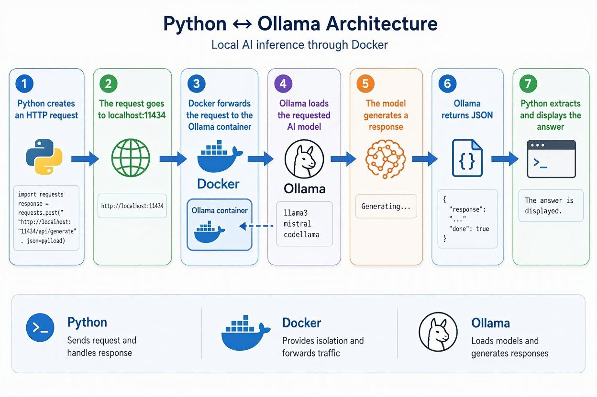

> [!NOTE]
> Diese Anleitung beschreibt, wie man eine **lokale Entwicklungsumgebung für Künstliche Intelligenz** auf einem **Windows-11-Computer** einrichtet, ohne die Ollama-Anwendung direkt zu installieren. Stattdessen wird der offizielle **Ollama-Server** in einem **Docker-Container** ausgeführt, wobei persistente Volumes verwendet werden, um heruntergeladene **AI-Modelle** dauerhaft zu speichern. Über **PowerShell-Befehle** und eine **REST-API** können Entwickler direkt mit dem Server kommunizieren. Anschließend zeigt das Tutorial, wie man mit **Python** und der **Requests-Bibliothek** eigene Skripte, interaktive **Chatbots** mit **System-Prompts**, **Streaming-Antworten** sowie grundlegende **RAG-Anwendungen** (Retrieval-Augmented Generation) baut. Abschließend werden Themen wie **Docker Compose**, **GPU-Beschleunigung** über NVIDIA, **Sicherheitsaspekte** in Unternehmen und **Fehlerbehebung** behandelt, um eine vollständig containerisierte Lernumgebung zu schaffen.


We can build a complete Ollama 🦙 learning environment without installing Ollama 🦙 directly on your Windows 11 machine.

In fact, **Docker, Python and PowerShell is an excellent combination for learning Ollama 🦙.**

There is one important distinction:

* We will NOT install the Ollama 🦙 Windows application.

* We will run the official Ollama 🦙 server inside a Docker container.

* We will download and manage AI models through that container.

* We will communicate with Ollama 🦙 using Python.

* We will use PowerShell for all commands and Visual Studio Code for development.

This gives us a practical introduction to local Large Language Models (LLMs), REST APIs, Python integration, Docker volumes, and eventually Retrieval-Augmented Generation (RAG).

# **Ollama 🦙 with Docker 🐳 and Python 🐍.**

## **Absolute Beginner – Step-by-Step Deep Dive Tutorial**

Windows 🪟

Docker 🐳.

Python 🐍

Our learning environment: Windows host, Docker container, Ollama server, AI models and Python client.

**Learning objectives**

By the end of this tutorial, you will know how to 👉:

1. Understand Ollama 🦙 and Large Language Models 🎪.

2. Run Ollama 🦙 inside Docker.🐳

3. Download 💾 and manage AI models 🎪.

4. Communicate with Ollama 🦙 through its REST API 🖥️.

5. Build a Python AI client 🐍.

6. Create your own command-line AI chatbot 💬.

7. Understand streaming responses.

8. Configure Docker Compose 🐳.

9. Persist AI models between container restarts.

10. Build a small RAG application.

## **1. Understanding Ollama** ⛰️

### **1.1 What is Ollama? 🦙**

Ollama is a tool that makes it relatively easy to run Large Language Models on your own computer or server.

Examples of models you can run through Ollama include:

* Llama

* Gemma

* Qwen

* DeepSeek

* Mistral

* Code-oriented models

A Large Language Model (LLM) is an AI model trained on large amounts of text and other data to understand and generate human language.

Ollama provides the runtime that loads models and makes them accessible through an API.

### **1.2 Our architecture** 📜

We will build the following architecture:



The communication works like this:

1. Python creates an HTTP request.

2. The request goes to `localhost:11434`.

3. Docker forwards the request to the Ollama container.

4. Ollama loads the requested AI model.

5. The model generates a response.

6. Ollama returns JSON.

7. Python extracts and displays the answer.

### **1.3 Important terminology**

| Term        | Explanation                                  |
| ----------- | -------------------------------------------- |
| LLM         | Large Language Model                         |
| Model       | The trained AI                               |
| Runtime     | Software that executes the model             |
| Inference   | Generating an answer using a model           |
| Token       | A unit of text processed by an LLM           |
| Prompt      | Instructions or input sent to the model      |
| Context     | Information available to the model           |
| Temperature | Controls response randomness                 |
| REST API    | HTTP interface for communicating with Ollama |
| Embedding   | Numerical representation of text             |
| RAG         | Retrieval-Augmented Generation               |

# **2. Prepare our Windows environment** 🌍

We will use:

* 🪟 Windows

* 🗔 PowerShell

* 🐳 Docker Desktop

* 🐍 Python

* 📝 Visual Studio Code

⚠️ No direct Ollama Windows installation!

### **2.1 Check Docker**

Open PowerShell.

```powershell
docker --version
```

Expected output (version may differ):

```powershell
Docker version ...
```

Check whether Docker is running:

```
docker info
```

If Docker is working, you should see information about the Docker Engine.

Check the available containers:

```
docker ps
```

### **2.2 Check Python**

```
python --version
```

Expected:

```
Python 3.x.x
```

Check pip:

```
python -m pip --version
```

### **2.3 Check Visual Studio Code**

```
code --version
```

If the command is unavailable, you can still open Visual Studio Code through the Windows Start menu.

### **Exercise 1**

Run all four commands and verify that your environment is ready.

# **3. Run Ollama inside Docker**

This is the most important section of our tutorial.

We will use the official Docker image:

[library](https://images.openai.com/static-rsc-4/iC1pWAxAtGlF4Ppu29pYJyVUYAbL82h0-gEOW2HQi0zMl9OmzSvHrPi1eTJDH-AVbmsne3GGNBazLlCcbxkWQRLQOFsa4cFgyFS1jyYu5fe69eCBdVZE0k1UFHCLXSwVpZTS1U9emNxTbqerTeI9EEnS2WHR7fvgsEfo6fwCP3o?purpose=inline)

**Ollama Docker image**

Docker Hub: ollama/ollama

[Official Docker image](https://hub.docker.com/r/ollama/ollama?utm_source=chatgpt.com)

### **3.1 Download the Docker image**

Execute:

```
docker pull ollama/ollama
```

Docker downloads the Ollama image.

You can inspect the downloaded image:

```
docker images
```

You should find:

```
ollama/ollama
```

### **3.2 Create a persistent Docker volume**

Why do we need a Docker volume?

AI models can be several gigabytes in size.

We don't want to download them every time we restart our container.

Create a volume:

```
docker volume create ollama
```

Inspect it:

```
docker volume inspect ollama
```

The volume stores Ollama's model data independently of the container.

### **3.3 Start the Ollama container**

Execute:

```
docker run -d `
    --name ollama `
    -p 127.0.0.1:11434:11434 `
    -v ollama:/root/.ollama `
    ollama/ollama
```

Let's understand every parameter.

| Parameter               | Meaning                        |
| ----------------------- | ------------------------------ |
| `docker run`            | Create and start a container   |
| `-d`                    | Run in background              |
| `--name ollama`         | Name the container             |
| `-p`                    | Publish a port                 |
| `127.0.0.1:11434:11434` | Bind API to localhost only     |
| `-v`                    | Mount a volume                 |
| `ollama`                | Docker volume name             |
| `/root/.ollama`         | Model storage inside container |
| `ollama/ollama`         | Docker image                   |

**Important:** We deliberately bind the API to `127.0.0.1`, rather than all network interfaces. Ollama's standard local API does not provide authentication by default, so we should not unnecessarily expose it to your network.

### **3.4 Verify the container**

```
docker ps
```

You should see something similar to:

```
CONTAINER ID   IMAGE           STATUS
xxxxxxxx       ollama/ollama   Up ...
```

### **3.5 Inspect the logs**

```
docker logs ollama
```

Follow the logs:

```
docker logs -f ollama
```

Press `Ctrl+C` to stop following the logs. This does not stop the container.

### **3.6 Test the Ollama API**

Open PowerShell:

```
Invoke-RestMethod `
    -Uri "http://localhost:11434/api/version" `
    -Method Get
```

If the server responds successfully, congratulations!

Milestone 1 completed

You have successfully started an Ollama server without installing Ollama directly on Windows.

# **4. Understand Docker and Ollama commands**

We need to distinguish between Docker commands and Ollama commands.

| Task              | Command                               |
| ----------------- | ------------------------------------- |
| Start container   | `docker start ollama`                 |
| Stop container    | `docker stop ollama`                  |
| Restart container | `docker restart ollama`               |
| Container status  | `docker ps`                           |
| Container logs    | `docker logs ollama`                  |
| Enter container   | `docker exec -it ollama bash`         |
| List models       | `docker exec ollama ollama list`      |
| Ollama version    | `docker exec ollama ollama --version` |

Notice something important:

We execute Ollama commands _inside_ the container using `docker exec`.

We do not need an Ollama executable on Windows.

# **5. Download your first AI model**

Now comes the interesting part!

An Ollama container is not the same thing as an AI model.

The container provides the runtime. We still need to download a model.

### **5.1 Choose a beginner model**

For our first experiment, let's use:

[Llama AI: Mô Hình Xử Lý Ngôn Ngữ Lớn Phát Triển Bởi Meta AI](https://images.openai.com/static-rsc-4/jPUUOZrcFNazzcfFkUcoP8-2gTezhwq0PXPY3Kn_TQz30X-D3nWL5m3SkSWDXoah5Qd5rjY5hQltEsrJnu4fwifs6RtvjoaNy4nGCvxdK1I6P97bSnt2ujXiM6o09OczFj85Sxzj1agPObxwtWwOSWWLlMAPLISbNd8hvA_Jjss?purpose=inline)

**Llama 3.2 – 3B**

A relatively small language model suitable for experimentation.

[Model information](https://ollama.com/library/llama3.2?utm_source=chatgpt.com)

The 3B indicates approximately three billion parameters.

It is a reasonable starting point, but performance depends on your available RAM, CPU, and GPU.

### **5.2 Download the model**

Execute:

```
docker exec ollama ollama pull llama3.2:3b
```

This can take some time.

The model is downloaded into the persistent Docker volume.

### **5.3 List installed models**

```
docker exec ollama ollama list
```

Expected output will resemble:

```
NAME           ID       SIZE
llama3.2:3b    ...      ...
```

### **5.4 Start an interactive chat**

```
docker exec -it ollama ollama run llama3.2:3b
```

Try asking:

```
Hello! Who are you?
```

Then:

```
Explain Docker to an absolute beginner.
```

You are now communicating with an AI model running inside Docker!

To leave the interactive session, use:

```
/bye
```

### **Exercise 2**

Ask your model:

1. What is a Large Language Model?

2. Explain the difference between Docker and Ollama.

3. Explain what a token is.

4. Write a small Python program that converts Celsius to Fahrenheit.

# **6. Understand the Ollama REST API**

Now we will leave the interactive terminal behind.

We want to build our own applications.

Ollama provides an HTTP REST API.

The standard local API address is:

```
http://localhost:11434
```

Some important endpoints:

| HTTP method | Endpoint        | Purpose               |
| ----------- | --------------- | --------------------- |
| GET         | `/api/version`  | Get Ollama version    |
| GET         | `/api/tags`     | List installed models |
| GET         | `/api/ps`       | List running models   |
| POST        | `/api/pull`     | Download a model      |
| POST        | `/api/generate` | Generate text         |
| POST        | `/api/chat`     | Chat with a model     |
| POST        | `/api/embed`    | Generate embeddings   |

Official API documentation:

[Ollama REST API documentation](https://docs.ollama.com/api?utm_source=chatgpt.com)

### **6.1 List available local models**

PowerShell:

```
Invoke-RestMethod `
    -Uri "http://localhost:11434/api/tags" `
    -Method Get
```

You should receive JSON describing your installed models.

### **6.2 Generate your first response**

We will use the `/api/generate` endpoint.

```
$body = @{
    model = "llama3.2:3b"
    prompt = "Explain what Python is."
    stream = $false
} | ConvertTo-Json

$response = Invoke-RestMethod `
    -Uri "http://localhost:11434/api/generate" `
    -Method Post `
    -ContentType "application/json" `
    -Body $body

$response.response
```

Congratulations!

You have now communicated with an LLM using PowerShell and HTTP.

### **6.3 Understand the request**

Our JSON request contains:

```
{
    "model": "llama3.2:3b",
    "prompt": "Explain what Python is.",
    "stream": false
}
```

Explanation:

* `model`: Which AI model should be used?

* `prompt`: What should the model do?

* `stream`: Should the answer arrive as one complete response?

When `stream` is `false`, the API returns a single JSON response instead of multiple streaming JSON objects.

### **6.4 Experiment with prompts**

Try:

```
$body = @{
    model = "llama3.2:3b"
    prompt = "Explain Java Spring Boot using five simple bullet points."
    stream = $false
} | ConvertTo-Json

$response = Invoke-RestMethod `
    -Uri "http://localhost:11434/api/generate" `
    -Method Post `
    -ContentType "application/json" `
    -Body $body

$response.response
```

Milestone 2 completed

You now understand the basic communication between PowerShell and Ollama.

# **7. Create our first Python project**

Now we will build a proper Python application.

Our project:

`ollama-python-beginner`

### **7.1 Create the project directory**

Open PowerShell:

```
mkdir C:\Learning\Ollama
cd C:\Learning\Ollama

mkdir ollama-python-beginner
cd ollama-python-beginner
```

Open Visual Studio Code:

```
code .
```

### **7.2 Create a Python virtual environment**

A virtual environment isolates Python dependencies belonging to a project.

Execute:

```
python -m venv .venv
```

Activate it:

```
.\.venv\Scripts\Activate.ps1
```

If PowerShell blocks the activation script, you can use this alternative without changing execution policy:

```
.\.venv\Scripts\python.exe -m pip --version
```

You can also install packages using the full path to the virtual environment's Python executable.

### **7.3 Install the Python HTTP library**

We will use `requests`.

```
python -m pip install requests
```

Why `requests`?

Because we want to understand the REST API itself instead of hiding all communication behind a specialized Ollama library.

### **7.4 Create the project structure**

```
ollama-python-beginner/
│
├── .venv/
│
├── main.py
│
└── requirements.txt
```

Create `requirements.txt`:

```
requests
```

### **7.5 Write your first Python client**

Create `main.py`.

```

import requests

OLLAMA_URL = "http://localhost:11434"

MODEL = "llama3.2:3b"


def ask_ollama(prompt):

    url = f"{OLLAMA_URL}/api/generate"

    data = {
        "model": MODEL,
        "prompt": prompt,
        "stream": False
    }

    response = requests.post(
        url,
        json=data,
        timeout=300
    )

    response.raise_for_status()

    result = response.json()

    return result["response"]


def main():

    question = "Explain Python in simple words."

    print("Question:")
    print(question)

    print("\nOllama is thinking...\n")

    answer = ask_ollama(question)

    print("AI Answer:")
    print(answer)


if __name__ == "__main__":
    main()
```

### **7.6 Execute the program**

```
python main.py
```

Expected result:

```
Question:
Explain Python in simple words.

Ollama is thinking...

AI Answer:
Python is a programming language...
```

The actual answer will be generated by your local model.

### **7.7 Understand the Python code**

Let's examine the most important statements.

**HTTP request:**

```
response = requests.post(
    url,
    json=data,
    timeout=300
)
```

This sends an HTTP POST request to Ollama.

**Error handling:**

```
response.raise_for_status()
```

This raises an exception if the HTTP response indicates an error.

**Convert JSON into Python data:**

```
result = response.json()
```

**Extract the generated text:**

```
return result["response"]
```

That's the complete communication cycle!

# **8. Build an interactive Python chatbot**

Our previous program asked only one question.

Let's improve it.

We want a chatbot that accepts multiple questions.

Create a new file:

`chatbot.py`

```

import requests

OLLAMA_URL = "http://localhost:11434/api/chat"

MODEL = "llama3.2:3b"

messages = []


def chat(prompt):

    messages.append({
        "role": "user",
        "content": prompt
    })

    data = {
        "model": MODEL,
        "messages": messages,
        "stream": False
    }

    response = requests.post(
        OLLAMA_URL,
        json=data,
        timeout=300
    )

    response.raise_for_status()

    result = response.json()

    answer = result["message"]["content"]

    messages.append({
        "role": "assistant",
        "content": answer
    })

    return answer


def main():

    print("Ollama Python Chatbot")
    print("---------------------")
    print("Type 'exit' to quit.\n")

    while True:

        question = input("You: ")

        if question.lower() == "exit":
            break

        try:
            answer = chat(question)

            print("\nAI:", answer, "\n")

        except requests.RequestException as error:
            print("Connection error:", error)


if __name__ == "__main__":
    main()
```

Run:

```
python chatbot.py
```

Try this conversation:

```
You: My name is Karl.

AI: Hello Karl!

You: What is my name?

AI: Your name is Karl.
```

Why does this work?

Because we maintain a conversation history in the `messages` list.

The API receives both previous questions and previous answers.

The important roles are:

| Role        | Meaning                                  |
| ----------- | ---------------------------------------- |
| `system`    | Instructions defining assistant behavior |
| `user`      | User's message                           |
| `assistant` | Model's previous answer                  |

**Important:** Conversation history is maintained by our Python program, not automatically stored as permanent chatbot memory by Ollama.

Milestone 3 completed

# **9. Understand system prompts and temperature**

Now we are entering an important area of LLM development.

### **9.1 What is a system prompt?**

A system prompt defines how an AI assistant should behave.

For example:

```
messages = [
    {
        "role": "system",
        "content": (
            "You are an experienced Java developer. "
            "Explain programming concepts to beginners. "
            "Always provide practical examples."
        )
    }
]
```

Now every subsequent user question will be interpreted using these instructions.

### **9.2 Add system instructions to our chatbot**

Modify the beginning of `chatbot.py`:

```
messages = [
    {
        "role": "system",
        "content": "You are a friendly Python programming tutor. "
                   "Explain everything step by step."
    }
]
```

Try:

```
Explain Python functions.
```

Compare the answer with and without the system prompt.

### **9.3 Understand temperature**

Temperature influences how predictable or varied generated answers are.

For example:

```
data = {
    "model": MODEL,
    "messages": messages,
    "stream": False,
    "options": {
        "temperature": 0.2
    }
}
```

Typical experimentation:

| Temperature | Typical behavior           |
| ----------- | -------------------------- |
| 0.0         | More deterministic         |
| 0.2         | Relatively predictable     |
| 0.7         | More varied                |
| 1.0         | More creative and variable |

These are illustrative settings, not guarantees. The model and task also influence the results.

### **Exercise 3**

Experiment with:

1. Temperature 0.0

2. Temperature 0.2

3. Temperature 0.7

4. Temperature 1.0

Ask the same question each time.

Record your observations in your Zettelkasten.

# **10. Streaming responses**

Until now, we have used:

```
"stream": False
```

This means that we wait until Ollama has generated the complete answer.

But there is another possibility.

**Streaming!**

Instead of waiting for the entire answer, we receive smaller pieces while the model is generating.

### **10.1 Create streaming.py**

```
import requests
import json

URL = "http://localhost:11434/api/generate"

data = {
    "model": "llama3.2:3b",
    "prompt": "Explain Docker containers.",
    "stream": True
}

response = requests.post(
    URL,
    json=data,
    stream=True,
    timeout=300
)

response.raise_for_status()

for line in response.iter_lines():

    if line:

        result = json.loads(line)

        print(
            result["response"],
            end="",
            flush=True
        )

print()
```

Execute:

```
python streaming.py
```

Notice how the answer appears progressively.

### **10.2 Why is streaming useful?**

Streaming is especially useful for:

* Interactive chat applications.

* Web applications.

* AI assistants.

* Long generated responses.

* Applications where users should see immediate feedback.

The Ollama API supports streaming by default for generation endpoints; setting `stream` to `false` disables it.

GitHub+1

# **11. Docker Compose – A better way to manage Ollama**

So far, we have used `docker run`.

For larger projects, Docker Compose is more convenient.

We can describe our complete environment in a YAML file.

### **11.1 Create docker-compose.yml**

Our project structure:

```
Ollama/
│
├── docker-compose.yml
│
└── ollama-python-beginner/
    ├── main.py
    ├── chatbot.py
    └── requirements.txt
```

Create `docker-compose.yml`:

```
services:

  ollama:

    image: ollama/ollama

    container_name: ollama

    ports:
      - "127.0.0.1:11434:11434"

    volumes:
      - ollama_data:/root/.ollama

    restart: unless-stopped


volumes:

  ollama_data:
```

### **11.2 Start the environment**

If you already have a container named `ollama` from section 3, stop and remove that container first:

```
docker stop ollama
docker rm ollama
```

The named volume will remain intact.

Navigate to the directory containing `docker-compose.yml`:

```
cd C:\Learning\Ollama
```

Start:

```
docker compose up -d
```

### **11.3 Check the environment**

```
docker compose ps
```

View logs:

```
docker compose logs -f
```

Stop:

```
docker compose down
```

Start again:

```
docker compose up -d
```

Your downloaded models remain in the Docker volume.

### **11.4 Why use Docker Compose?**

| Docker run                 | Docker Compose                |
| -------------------------- | ----------------------------- |
| Command-line configuration | YAML configuration            |
| Good for quick experiments | Good for projects             |
| Long commands              | Reusable configuration        |
| Manual management          | Easier environment management |

# **12. Understand GPU acceleration**

A very interesting topic!

Can Ollama use your graphics card?

Yes, depending on your hardware, Docker configuration, drivers and supported backend.

For NVIDIA GPUs, Docker Desktop on Windows can support GPU access through its WSL2 backend.

First check whether your GPU is available:

```
nvidia-smi
```

If this command works, you have an NVIDIA driver that exposes the GPU management interface.

However, this alone does not guarantee that Docker can access the GPU.

Test Docker GPU access:

```
docker run --rm --gpus all `
    nvidia/cuda:12.6.0-base-ubuntu24.04 `
    nvidia-smi
```

This example requires the corresponding image to be available and compatible with your driver.

For an NVIDIA-enabled Ollama container, the Docker run command can include:

```
docker run -d `
    --name ollama-gpu `
    --gpus=all `
    -p 127.0.0.1:11434:11434 `
    -v ollama:/root/.ollama `
    ollama/ollama
```

**Important:** Do not run this second container alongside your existing Ollama container on the same port. Stop and remove the old container first, or use a different port.

If you do not have an NVIDIA GPU, you can still experiment with CPU inference.

Expect slower responses, particularly with larger models.

# **13. Build a simple RAG application**

Now we are moving towards a more advanced application.

RAG stands for Retrieval-Augmented Generation.

Imagine that you have a folder containing:

```
Documents/
│
├── Docker.md
├── Python.md
├── SpringBoot.md
└── Kubernetes.md
```

You want to ask your AI assistant:

```
What is the difference between Docker
and Kubernetes according to my notes?
```

The problem:

Your model does not automatically know the contents of your local Markdown files.

RAG solves this problem.

### **13.1 How does RAG work?**

[Revolutionizing KTP Data Extraction: ID Card OCR with Gemini AI for Indonesia](https://images.openai.com/static-rsc-4/miuHYye0tpfB8WdQiSfAtKd_OqNX62dL3frSEl8gN1t-88kKKn2sVSjnpgfpnZCy8snck1MDJc_P9FkayBCIco148sl8LUVxaYeRVDirEA--mZKT_pPpUM9FVlXo7d2R8-cAPNcsUXLv2yfcxzVl_u2Bm6YnNgrV6mQSmdlm90U?purpose=inline)

[linkedin.com](https://www.linkedin.com/pulse/revolutionizing-ktp-data-extraction-id-card-ocr-gemini-indra-lesmana-3p60c?utm_source=chatgpt.com)

The process:

1. Read your documents.

2. Divide documents into smaller chunks.

3. Generate embeddings for each chunk.

4. Store embeddings in a vector database.

5. Convert the user's question into an embedding.

6. Retrieve the most relevant document chunks.

7. Send those chunks together with the question to Ollama.

8. Generate an answer based on the retrieved information.

### **13.2 Important new concepts**

| Concept           | Explanation                               |
| ----------------- | ----------------------------------------- |
| Embedding         | Numerical representation of text          |
| Chunking          | Dividing documents into smaller pieces    |
| Vector database   | Stores and searches embeddings            |
| Similarity search | Finds semantically similar content        |
| Context window    | Amount of information a model can process |
| RAG               | Combines retrieval with text generation   |

### **13.3 Which Python libraries could we use?**

Some interesting candidates:

* `requests` – communicate with Ollama.

* `chromadb` – vector database.

* `numpy` – numerical calculations.

* `sentence-transformers` – create embeddings.

* `pypdf` – read PDF documents.

Ollama also has a native embedding endpoint:

```
POST /api/embed
```

This allows us to generate embeddings using an Ollama embedding model.

Documentation:

[Ollama embeddings documentation](https://docs.ollama.com/capabilities/embeddings?utm_source=chatgpt.com)

### **13.4 Your first RAG exercise**

Create a folder:

```
rag-project/
│
├── documents/
│   ├── docker.md
│   └── python.md
│
└── main.py
```

Put some text into the Markdown files.

For example, `docker.md`:

```
# Docker

Docker is a containerization platform.

A Docker container packages an application
and its dependencies.

Docker images are used to create containers.
```

Your first assignment:

Write a Python program that:

1. Reads all Markdown files.

2. Combines their contents.

3. Sends the relevant text together with the user's question to Ollama.

4. Displays the answer.

This is a simplified context-based prototype, not yet a full embedding-based RAG system.

Later, we can introduce ChromaDB and semantic search.

# **14. Troubleshooting**

Here are some common problems you might encounter.

### **Problem 1: Connection refused**

Example:

```
ConnectionError:
Failed to establish a new connection
```

Check the container:

```
docker ps
```

If it is stopped:

```
docker start ollama
```

Check the API:

```
Invoke-RestMethod `
    http://localhost:11434/api/version
```

### **Problem 2: Model not found**

Example:

```
model not found
```

List models:

```
docker exec ollama ollama list
```

Download the missing model:

```
docker exec ollama ollama pull llama3.2:3b
```

Check that the model name in Python matches the downloaded model exactly.

### **Problem 3: Container exits immediately**

Inspect logs:

```
docker logs ollama
```

Check Docker Desktop and available system resources.

### **Problem 4: Out of memory**

Symptoms:

* Very slow responses.

* Docker container crashes.

* Model loading fails.

* Windows becomes unresponsive.

Solutions:

1. Use a smaller model.

2. Close unnecessary applications.

3. Reduce model context requirements.

4. Check Docker Desktop memory allocation.

5. Consider GPU acceleration if supported.

### **Problem 5: Python cannot connect**

Check that your Python application uses:

```
OLLAMA_URL = "http://localhost:11434"
```

Do not use the container name `ollama` from a Python application running directly on Windows.

That container name is normally resolvable from other containers on the same Docker network, not automatically from the Windows host.

### **Problem 6: Docker volume confusion**

List volumes:

```
docker volume ls
```

Inspect:

```
docker volume inspect ollama
```

Remember:

```
docker compose down
```

does not normally delete named volumes.

However:

```
docker compose down -v
```

deletes the Compose-managed volumes.

Be careful: deleting the Ollama volume means deleting your downloaded models.

# **15. Security considerations for an organization**

This is particularly important in your working environment.

Ollama's local API is not an authenticated enterprise API by default.

Our configuration:

```
ports:
  - "127.0.0.1:11434:11434"
```

helps restrict access to the local machine.

Nevertheless:

* Do not expose the API publicly.

* Do not send confidential source code or company documents without authorization.

* Check model licenses before using models commercially.

* Check your organization's Docker image approval process.

* Keep Docker images updated according to your organization's security policies.

* Remember that downloading a model also means downloading external data.

* Treat AI-generated code and instructions as untrusted until reviewed.

Running an AI model locally does not automatically make every interaction compliant with company policies.

# **16. Practical exercises and coding dojo**

Now let's turn the tutorial into a practical learning project.

**10-Day Ollama Coding Dojo**

Your learning progress

# **0**__/10__

**Day&#x20;**__01__**:&#x20;**__Docker environment__

Download the Ollama image, create a volume and start the container.

**Day&#x20;**__02__**:&#x20;**__First AI model__

Download Llama 3.2 and experiment with interactive questions.

**Day&#x20;**__03__**:&#x20;**__PowerShell REST API__

List models and generate answers using Invoke-RestMethod.

**Day&#x20;**__04__**:&#x20;**__Python HTTP client__

Create main.py and communicate with Ollama using requests.

**Day&#x20;**__05__**:&#x20;**__Interactive chatbot__

Implement a conversation history and an interactive command loop.

**Day&#x20;**__06__**:&#x20;**__System prompts__

Build a Java and Spring Boot programming tutor.

**Day&#x20;**__07__**:&#x20;**__Streaming__

Display generated responses progressively in the terminal.

**Day&#x20;**__08__**:&#x20;**__Docker Compose__

Replace docker run with a reusable Compose configuration.

**Day&#x20;**__09__**:&#x20;**__Model management__

Experiment with multiple models and compare their responses.

**Day&#x20;**__10__**:&#x20;**__Mini RAG project__

Read Markdown documents and provide their contents as context to Ollama.

Reset progress

# **17. Useful documentation and learning resources**

These are worth bookmarking in your Zettelkasten.

[Ollama Logo PNG Vector (SVG) Free Download](https://images.openai.com/static-rsc-4/WXdYj7PGkwWBYOPg-E2YjEpsuJZoKPkpA9AvUzxi2XMMlo_E1lZA_7h9_tFfdHe9oBQ50jxyl45ChS9eA1kfGhmJdQG3f-a7EQ6azk1ti0PI4XDb9l8A7B4UOrBymOI3SRLzGpwlMUPB4fjTnx7CMLmO9u1RB9uTllhH1dpCkEQ?purpose=inline)

**Ollama documentation**

[Official documentation](https://docs.ollama.com/?utm_source=chatgpt.com)

Installation, models, API and capabilities.

[docker Logo PNG Vector (SVG) Free Download](https://images.openai.com/static-rsc-4/R3tE02yQDDdrIl6Y80p2egXN6vwiSR9hKiNlew9xJDHhHCd8CZixMDiOe_pHIFhQZOscJaB4FYXNP06W9P60nxIT5jsSVnyIMRI3Gj2fry6bJ-Z1UcJzVLjvbHqfUZXJNpiT7V7Yl9VplHUBGs4QsgfSbR35dVUxWHcDx7_FPyg?purpose=inline)

**Docker documentation**

[Docker documentation](https://docs.docker.com/?utm_source=chatgpt.com)

Containers, volumes, images and Compose.

[GitHub - thevkrant/morse_code: Morse code is a method of transmitting text information as a series of on-off tones lights or clicks that can be directly understood by a skilled listener or observer without special equipment. It is named for Samuel F. B. Morse. Every character in the English language is substituted by a series of dots and dashes or something just singular dot or dash. · GitHub](https://images.openai.com/static-rsc-4/urfnHK6zfHhc4B3R1e0oqA7y8Vz4MVLbH4OkbEzp4ebiLf4GTPEzcrMq0g_u9dOKD9WtiCsX1xicbi1zCOCmsU7j0U2CpN8O76md71nd7cu1RcWbDdn6SDRiXMKinT5IfvrkoqB5kmNDq66qlVhyACf4H_8owV3q1znxDE3C7JE?purpose=inline)

**Python documentation**

[Python documentation](https://docs.python.org/3/?utm_source=chatgpt.com)

Python language and standard library.

[File:Ollama-logo.svg - Wikimedia Commons](https://images.openai.com/static-rsc-4/XQ1BJbWqowcFMJt71j4H-FU01267u1uFdfHRoUhz3Lrb4fdH9bSAMu3OiCZKmsRMubi3NN2OzQ9BSqTlCfGBpFw7HdnbGyKJ0lJ3d9nJvM5hFmfUeDkMS3c_WmviF_NFeW133WmPUBDkRJZd9MKvpWQaMRgvoaM3plJ2JYKL18E?purpose=inline)

**Ollama GitHub repository**

[ollama/ollama](https://github.com/ollama/ollama?utm_source=chatgpt.com)

Source code and official Docker information.

[This free AI agent will make you open-source king 👑 - DEV Community](https://images.openai.com/static-rsc-4/rF633r_5J0YhtQnmHT88hc1xO36MAB-xGEG4cJw7j63HGq4BJqGsHGBhYtcRdGtBYjnFw8w0HFRWExOtZS8Oc9nHSOdHpetrBe3_LePXCCP7YOFTeHzCh8oGNOX42WBDXhkLyuXKDWHqDo0SF7KM3ckkFcckQWn9QmKlage1zeA?purpose=inline)

**Ollama Python library**

[ollama-python](https://github.com/ollama/ollama-python?utm_source=chatgpt.com)

Python integration and streaming examples.

# **18. Zettelkasten organization**

I would organize your notes like this:

```
C:\LifeLongLearning
│
└── ArtificialIntelligence
    │
    └── Ollama
        │
        ├── 00_Ollama_Overview.md
        ├── 01_Large_Language_Models.md
        ├── 02_Ollama_Docker_Setup.md
        ├── 03_Docker_Volumes.md
        ├── 04_AI_Model_Management.md
        ├── 05_Ollama_REST_API.md
        ├── 06_Python_Integration.md
        ├── 07_Python_Chatbot.md
        ├── 08_System_Prompts.md
        ├── 09_Streaming_Responses.md
        ├── 10_Docker_Compose.md
        ├── 11_GPU_Acceleration.md
        ├── 12_RAG_Introduction.md
        └── 13_Ollama_Troubleshooting.md
```

Suggested main note title:

**Ollama – Running Local Large Language Models with Docker and Python on Windows 11**

Suggested tags:

```
#ArtificialIntelligence
#Ollama
#LLM
#Docker
#Python
#RESTAPI
#RAG
#MachineLearning
```

# **19. Final knowledge check**

Test yourself before moving on.

**Ollama beginner quiz**

0/5 answered

**1**__.&#x20;__**What is Ollama?**

A programming language

A runtime for running and serving language models

A database

**2**__.&#x20;__**Which port does the local Ollama API use by default?**

8080

3000

11434

**3**__.&#x20;__**Why do we use a Docker volume?**

To preserve downloaded models

To increase CPU speed

To compile Python

**4**__.&#x20;__**Which endpoint generates a chat response?**

/api/version

/api/chat

/api/tags

**5**__.&#x20;__**What does RAG stand for?**

Runtime Application Generator

Retrieval-Augmented Generation

Random AI Generation

Check my answers

## **My recommendation for your next project**

Once you have completed this tutorial, I would suggest a practical follow-up project:

**Local AI Knowledge Assistant – Ollama + Python + Docker + ChromaDB**

[Build a Local Documentation AI Assistant with RAG | 2026](https://images.openai.com/static-rsc-4/1rXIGlz02c9lX2eZ4A93Lsat4yRXEd8jJiv3n9HW3wjoodROQw3JrujXMmuNt2b0evpTuYFRpLUNZPS4w8IAXzoFMQs7Fvjt5lFgutCYWI_qzO_ovqQX8Tp5sXy9ARA2Ht8Ju80WOWjJu3FpTaSlhLYJhCxEhyx-B451u2ZWtWY?purpose=inline)

[infrasity.com](https://www.infrasity.com/blog/local-documentation-ai-assistant-with-RAG?utm_source=chatgpt.com)

Imagine having your own local AI assistant that can:

1. Read your Zettelkasten Markdown files.

2. Index your Java and Spring Boot notes.

3. Search your personal technical knowledge.

4. Answer questions based on your documents.

5. Provide references to the original Markdown files.

6. Run entirely within your Docker-based environment.

That would be a fantastic lifelong-learning project!

And most importantly: **you don't need to install Ollama directly on Windows to achieve it.** Docker and Python are sufficient for the architecture we have designed here, provided your organization's policies permit it.

Happy learning! 😊
