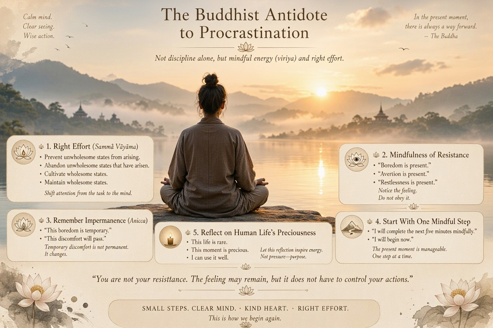
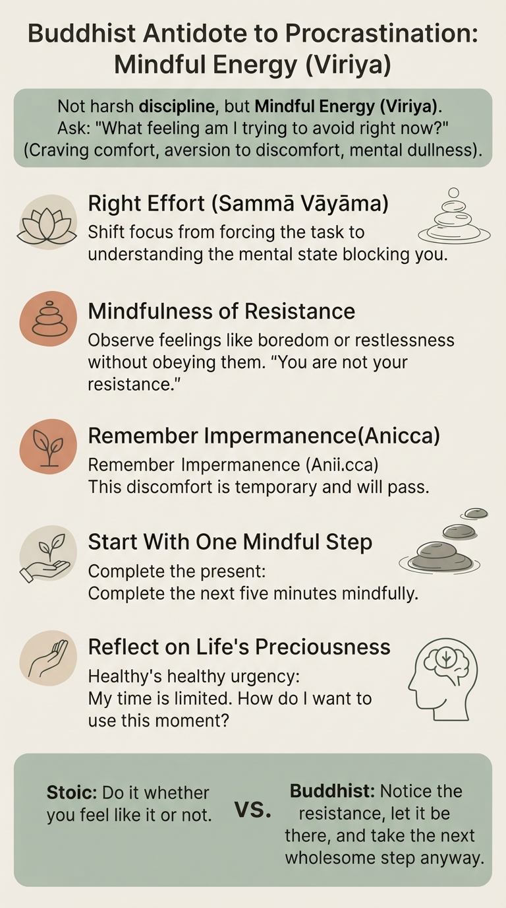

# Buddhist Antidode to Procrastination

In Buddhism, the antidote to procrastination is not primarily **discipline** but **mindful energy** (often called _viriya_ or "right effort").

The Buddha recognized that people often delay things because they are caught between:

* craving comfort,
* aversion to discomfort,
* and mental dullness.

A Buddhist would first investigate:

> "What am I trying to avoid right now?"

Often the answer is not the task itself, but the feelings surrounding it: boredom, uncertainty, fear, frustration, or self-doubt.

### 1. Right Effort (Sammā Vāyāma)

One factor of the Noble Eightfold Path is Right Effort:

* Prevent unwholesome states from arising.
* Abandon unwholesome states that have arisen.
* Cultivate wholesome states.
* Maintain wholesome states.

In practical terms:

Instead of asking:

> "How can I force myself to do this?"

Ask:

> "What mental state is preventing me from beginning?"

This shifts attention from the task to the mind.

### 2. Mindfulness of Resistance

When procrastination appears, a Buddhist practice is to observe it:

* "Boredom is present."
* "Aversion is present."
* "Restlessness is present."

Notice the feeling without immediately obeying it.

The insight is:

> You are not your resistance.

The feeling may remain, but it does not have to control your actions.

### 3. Remember Impermanence

The Buddha repeatedly emphasized impermanence (_anicca_).

When a task feels unpleasant, remind yourself:

> "This boredom is temporary."
>
> "This discomfort will pass."

Many people procrastinate because they unconsciously treat temporary discomfort as permanent.

### 4. Start With One Mindful Step

Buddhism often emphasizes the present moment over grand plans.

Instead of:

* "I must finish this entire training session."

Try:

* "I will complete the next five minutes mindfully."

The present moment is always manageable.

### 5. Reflect on Human Life's Preciousness

Many Buddhist traditions encourage reflecting on the rarity and preciousness of having:

* a human life,
* health,
* opportunities to learn and grow.

This reflection can generate healthy urgency:

> "My time is limited. How do I want to use this moment?"

Not anxiety, but appreciation.

### A Buddhist Summary

A Stoic might say:

> "Do the task whether you feel like it or not."

A Buddhist might say:

> "Notice the feeling that makes you avoid the task, let it be there, and take the next wholesome step anyway."

Both traditions value action despite resistance, but Buddhism pays particularly close attention to understanding the mental states that create procrastination in the first place.

