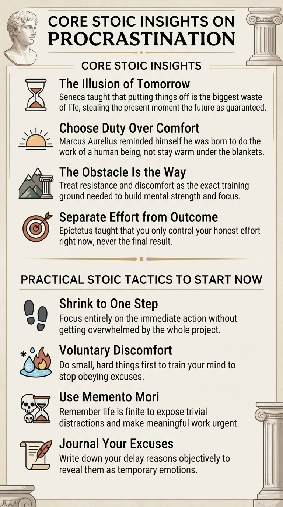

# Core Stoic Insights on Procrastination

Stoic philosophy treats procrastination as _a failure of **self-discipline** and an **illogical fear of discomfort** that steals your only guaranteed possession: the present moment_.

Rather than waiting for motivation, Stoics teach that action comes first and momentum follows.

##  Core Stoic Insights on Procrastination

* **The Illusion of Tomorrow:** Seneca argued that putting things off is the biggest waste of life because it snatches away each day as it comes. We treat future time as guaranteed while throwing away the hours we actually hold.
* **Choose Duty Over Comfort:** Marcus Aurelius famously reminded himself each morning that he was not born to stay warm under the blankets, but to do the work of a human being. Comfort is a natural instinct, not a life purpose.
* **The Obstacle Is the Way:** Procrastination often comes from avoiding hard or unpleasant tasks. Stoics flip this around and treat resistance as the exact training ground needed to build strength and focus.
* **Separate Effort from Outcome:** People often stall because they fear failing or being judged. Epictetus taught that you only control your honest effort right now, never the final result.

## Practical Stoic Tactics to Start Now

* **Shrink the Task to One Step:** Marcus Aurelius advised performing every single action as if it were your last, focusing entirely on the immediate step without getting overwhelmed by the whole project.
* **Practice Voluntary Discomfort:** Intentionally doing small, uncomfortable things—like taking a cold shower or starting your hardest chore first—trains your mind to stop obeying excuses.
* **Use _Memento Mori_:** Reminding yourself that you could leave life right now instantly exposes trivial distractions and makes meaningful work urgent.
* **Journal Your Excuses:** Write down the exact reason you are delaying a task. Looking at your excuse objectively on paper usually reveals it as a temporary emotion rather than a real barrier.

