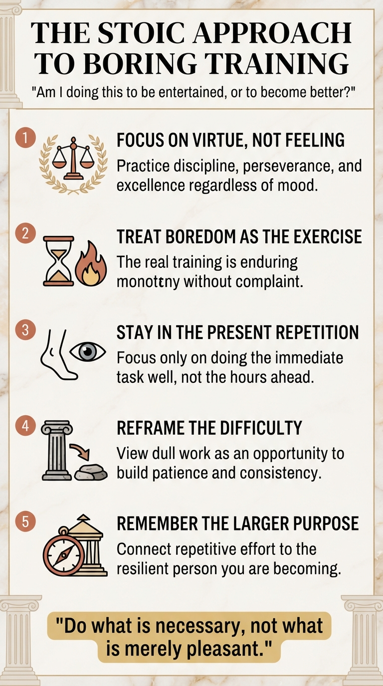

# How do the stoics deal with dull and boring trainings?

The Stoics didn't expect training to be exciting. In fact, they often saw boredom as part of the training.

A Stoic might look at a dull workout, repetitive study session, or tedious practice and ask:

> "Am I doing this to be entertained, or to become better?"

Here are a few Stoic approaches:

**1. Focus on the virtue, not the feeling**

* The goal is not to enjoy every moment.
* The goal is to practice discipline, perseverance, and excellence.
* Whether the training feels interesting or boring is largely outside your control. Showing up is within your control.

As Epictetus would put it, your task is to play your role well, regardless of your mood.

**2. Treat boredom as the actual exercise** Many people think the exercise is lifting weights, studying vocabulary, or practicing scales.

The Stoic twist is:

> The real exercise may be enduring boredom without complaint.

If you can remain calm and committed when the activity stops stimulating you, you're strengthening character.

**3. Stay in the present repetition** Marcus Aurelius often reminded himself to focus on the task immediately in front of him.

Instead of:

* "I have 3 more hours of this."

Think:

* "Do this repetition well."
* "Read this page carefully."
* "Take this step properly."

Boredom often comes from mentally escaping the present.

**4. Reframe the difficulty** A Stoic sees obstacles as opportunities.

So instead of:

> "This training is boring."

Try:

> "This training gives me a chance to practice patience and consistency."

The boredom becomes useful rather than something that blocks progress.

**5. Remember the larger purpose** Stoics connected unpleasant effort to a worthwhile goal.

Ask:

* Why am I doing this?
* What kind of person am I becoming through this?

A clear purpose makes repetitive work easier to bear.

There's a saying often associated with Stoic thinking:

> "Do what is necessary, not what is merely pleasant."

To a Stoic, boring training is not a problem to eliminate. It's often the exact environment in which discipline is forged. The person who can train when motivated is ordinary; the person who can train when bored is becoming resilient.
