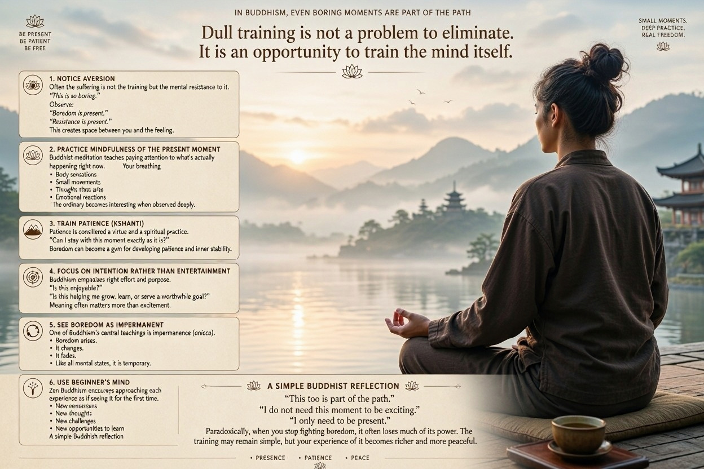

# Dull or boring training in Buddhism

In Buddhism, dull or boring training is not viewed as a problem to eliminate but as an opportunity to train the mind itself.

Here are a few Buddhist approaches:

### 1. Notice aversion

Often the suffering is not the training but the mental resistance to it.

Instead of thinking:

> "This is so boring."

Observe:

> "Boredom is present."
>
> "Resistance is present."

This creates space between you and the feeling.

### 2. Practice mindfulness of the present moment

Buddhist meditation teaches paying attention to what's actually happening right now.

During dull training, become curious about:

* Your breathing
* Body sensations
* Small movements
* Thoughts that arise
* Emotional reactions

The ordinary becomes interesting when observed deeply.

### 3. Train patience (Kshanti)

Patience is considered a virtue and a spiritual practice.

Ask yourself:

> "Can I stay with this moment exactly as it is?"

Boredom can become a gym for developing patience and inner stability.

### 4. Focus on intention rather than entertainment

Buddhism emphasizes right effort and purpose.

Instead of asking:

> "Is this enjoyable?"

Ask:

> "Is this helping me grow, learn, or serve a worthwhile goal?"

Meaning often matters more than excitement.

### 5. See boredom as impermanent

One of Buddhism's central teachings is impermanence (anicca).

Notice:

* Boredom arises.
* It changes.
* It fades.

Like all mental states, it is temporary.

### 6. Use beginner's mind

Zen Buddhism encourages approaching each experience as if seeing it for the first time.

Even a repetitive exercise contains:

* New sensations
* New thoughts
* New challenges
* New opportunities to learn

### A simple Buddhist reflection

When dullness appears, try silently repeating:

> "This too is part of the path."
>
> "I do not need this moment to be exciting."
>
> "I only need to be present."

Paradoxically, when you stop fighting boredom, it often loses much of its power. The training may remain simple, but your experience of it becomes richer and more peaceful.

