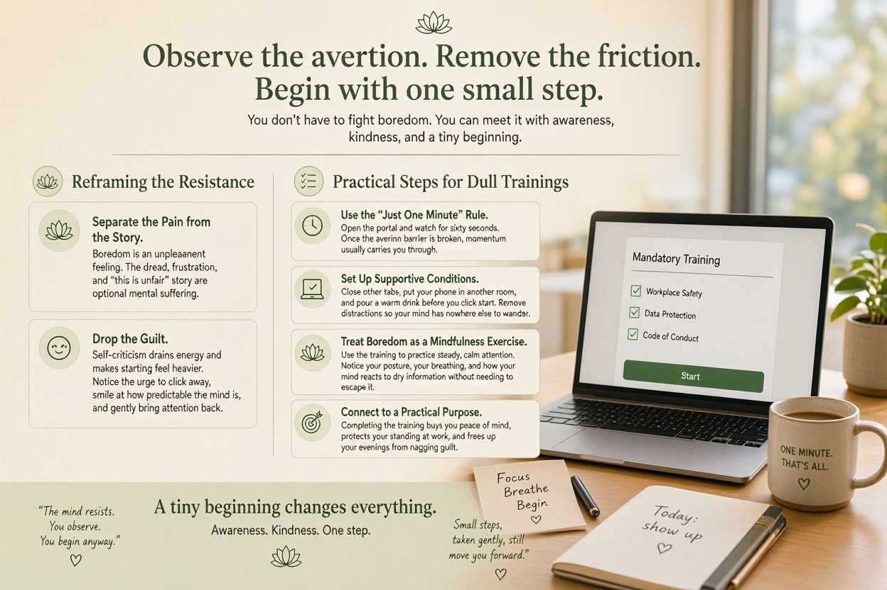
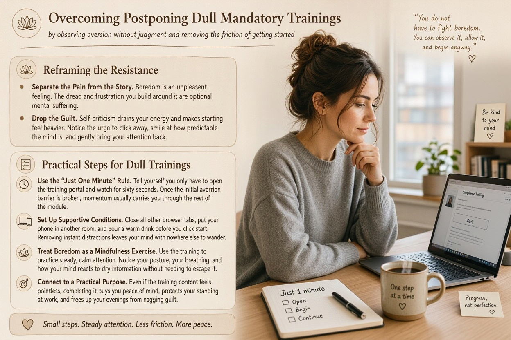

To overcome postponing dull mandatory trainings, Buddhist psychology recommends _**observing your aversion to boredom without judgment and removing the friction of getting started**_. Rather than fighting the boredom with willpower, you treat the resistance itself as a neutral physical sensation and commit to a tiny, effortless first step.

## Reframing the Resistance

* **Separate the Pain from the Story.** In Buddhism, physical or mental boredom is just an unpleasant feeling, while the dread and frustration you build around it is optional mental suffering. Acknowledge that the training is dull without adding the extra weight of complaining about how unfair or boring it is.
* **Drop the Guilt.** Self-criticism drains your mental energy and makes starting feel even heavier. Notice the urge to click away, smile at how predictable the mind is when facing boredom, and gently bring your attention back.

## Practical Steps for Dull Trainings

* **Use the "Just One Minute" Rule.** Tell yourself you only have to open the training portal and watch for sixty seconds. Once the initial aversion barrier is broken, momentum usually carries you through the rest of the module.
* **Set Up Supportive Conditions.** Close all other browser tabs, put your phone in another room, and pour a warm drink before you click start. Removing instant distractions leaves your mind with nowhere else to wander.
* **Treat Boredom as a Mindfulness Exercise.** Use the training to practice steady, calm attention. Notice your posture, your breathing, and how your mind reacts to dry information without needing to escape it.
* **Connect to a Practical Purpose.** Even if the training content feels pointless, completing it buys you peace of mind, protects your standing at work, and frees up your evenings from nagging guilt.

  

