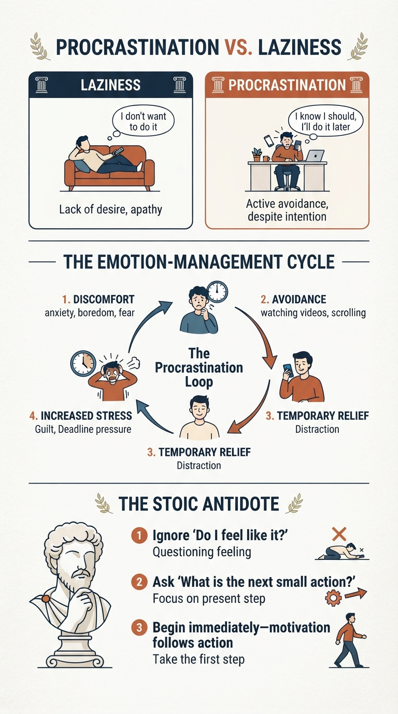

Procrastination is the voluntary delay of something you know you should do, even though you expect the delay to make things worse.:

It's not the same as laziness.

Laziness: "I don't want to do it."
Procrastination: "I want or need to do it, but I'll do it later."

Psychologists often view procrastination as an emotion-management problem, not a time-management problem. You postpone a task because it creates discomfort: boredom, anxiety, uncertainty, fear of failure, perfectionism, or frustration. Delaying the task gives temporary relief, which makes the habit stronger.

For example:

You need to study.
Studying feels boring or difficult.
You watch videos instead.
You feel better for a moment.
The deadline gets closer and stress increases.

From a Stoic perspective, procrastination is often the habit of letting immediate feelings determine your actions instead of reason.

A Stoic might ask:

"Do I act according to what is right and useful, or according to what feels pleasant right now?"

Marcus Aurelius repeatedly reminded himself that we are meant to do the work in front of us rather than wait for the perfect mood.

A useful Stoic response to procrastination is:

Ignore the question "Do I feel like it?"
Ask "What is the next small action?"
Do that action immediately.

The Stoics would say that motivation is unreliable, but discipline is a choice available in the present moment. The cure for procrastination is often not to feel better first, but to begin. Once you start, motivation frequently follows.
