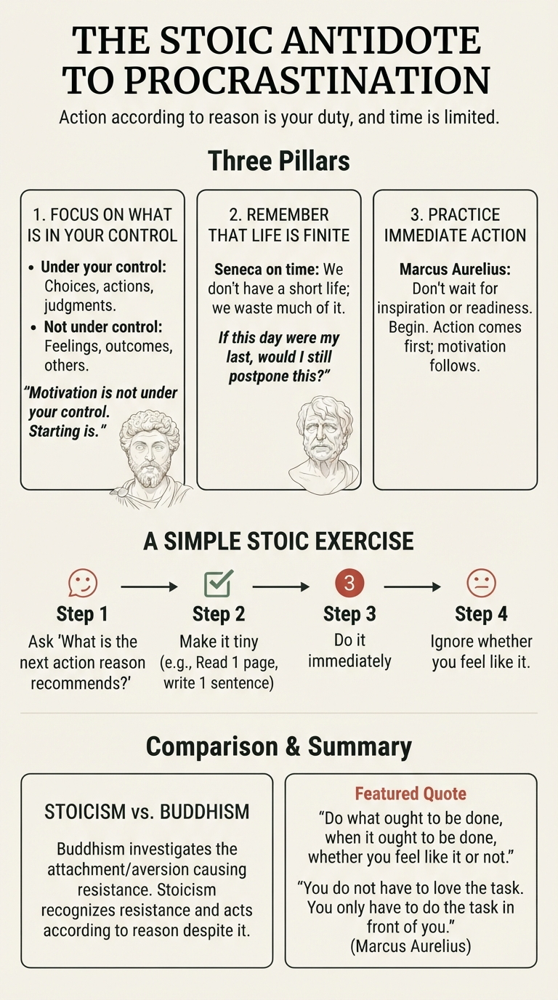

# Stoic Antidote to Procrastination

For the Stoics, the antidote to procrastination is **the recognition that action according to reason is your duty, and that time is limited**.

Three Stoic principles are especially relevant:

### 1. Focus on what is in your control

The Stoics divide reality into:

* What is under your control (your choices, actions, judgments).
* What is not under your control (feelings, outcomes, other people).

Procrastination often sounds like:

> "I'll start when I feel motivated."

A Stoic would respond:

> "Motivation is not under your control. Starting is."

The remedy is to stop negotiating with your feelings and act on what reason says is the right next step.

### 2. Remember that life is finite

Seneca wrote extensively about the shortness of life. His point was not that life is necessarily short, but that we waste much of it.

A Stoic reflection might be:

> "If this day were my last, would I still postpone this?"

This is not meant to create anxiety. It is meant to create clarity.

Every act of procrastination is, in a sense, trading a portion of your life for momentary comfort.

### 3. Practice immediate action

Marcus Aurelius repeatedly reminded himself:

> "At dawn, when you have trouble getting out of bed, tell yourself: I have to go to work as a human being."

The Stoic approach is remarkably simple:

* Don't wait to want to do it.
* Don't wait to feel ready.
* Don't wait for inspiration.
* Begin.

Action comes first; motivation often follows.

### A Simple Stoic Exercise

When you catch yourself procrastinating:

1. Ask: **"What is the next action that reason recommends?"**
2. Make it as small as possible.
3. Do it immediately.
4. Ignore whether you feel like it.

For example:

* Don't "study for three hours."
* Open the book and read one page.
* Don't "write the report."
* Write the first sentence.

### Stoicism vs. Buddhism on Procrastination

* **Buddhism:** Investigate the attachment, aversion, or mental state causing resistance.
* **Stoicism:** Recognize the resistance, but place greater emphasis on acting according to reason despite it.

A Stoic might summarize the antidote in one sentence:

> "Do what ought to be done, when it ought to be done, whether you feel like it or not."

And Marcus Aurelius would add:

> "You do not have to love the task. You only have to do the task that is in front of you."
